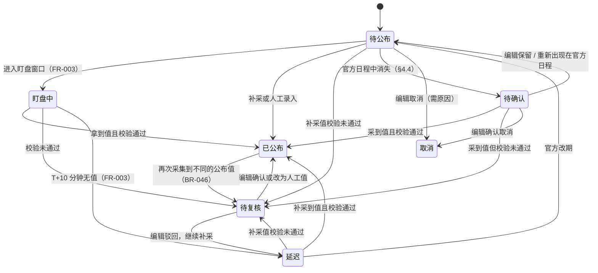

# calendar 模块（财经日历）技术设计

| 项目 | 内容 |
|---|---|
| 版本 | v0.14 |
| 日期 | 2026-10-31 |
| 状态 | 已评审：FR-007、FR-008（2026-10-29，vivo.li：§12 第 1 ~ 9 项均按建议执行）；FR-009 ~ FR-011（2026-10-31，vivo.li：§12 第 10 ~ 23 项均按建议执行） |
| 覆盖 | FR-007 日历排期采集、FR-008 公布值与前值采集、FR-009 日历事件管理、FR-010 预期值人工录入、FR-011 字段锁定与人工优先 |
| 依据 | data-hub PRD v1.0.0.25（DEC-024、FR-007 ~ FR-011、BR-034、BR-036 ~ BR-063、BR-076、BR-079、BR-129、BR-133、BR-134、BR-156、BR-157、§8.1.2、§8.1.3、§8.2、§13.1.2）；后端约定 v1.32（§1.2、§6、§8.2、§10、§11）；前端约定（§3.3、§4.1）；采集设计 v0.11（§5.3 入库接口、§5.5 快照）；基础数据设计 v0.16（§2.1、§3.8 指标与数据源的映射） |

> 本文只写"怎么实现"。需求、业务规则和验收标准以 PRD 为准，这里引用编号，不复述。
> 实现偏离本文时，在同一个 PR 里更新本文。

---

## 1. 范围

**包含**：
- 日历事件及其附属数据：事件表（一次定好 FR-007 ~ FR-011 要用的列）、各数据源的数值、变更历史、锁定冲突、未匹配条目、已忽略的发布。
- 排期入库（FR-007）：日程条目按排期映射匹配指标，新建或更新事件，改期历史，从日程中消失的处理，未匹配条目。排期只来自数据源（DEC-024）。
- 公布值入库（FR-008）：按公布值映射找到指标，写入公布值、前值、前值修正和修正后数值，官方更正进入待复核，刚开始采集时的处理。
- 两种入库服务都实现采集模块的 `ICollectIngestor`（采集设计 §5.3），在 Collector 中被调用；盯盘（FR-003）和重新解析（FR-004）复用同一套入库。
- 事件状态规则（PRD §8.1.3，含 v1.0.0.22 补的三条流转）、字段锁定在自动流程中的处理（BR-062）。
- 后台：待确认事件、未匹配条目。
- 事件管理（FR-009，v0.10）：事件列表和详情，人工修改公布值、前值、前值修正，取消，待复核的处理（§3.7、§9.3）。
- 预期值（FR-010，v0.10）：待录入清单、录入和公布后的更正、公布前 24 小时的提醒（§3.8、§9.4）。
- 字段锁定的人工部分（FR-011，v0.10）：锁定信息的展示、解锁、锁定冲突的处理（§3.9、§9.5）。

**不包含**：
- 排期的人工录入和修改：排期只来自数据源，不做人工新增和批量导入（BR-042 已废弃），事件详情中的排期只读，排期字段不可锁定（DEC-024、BR-039、BR-060）。
- 快讯的处理提示（BR-052）：本文在人工改动已公布的数值后发出消息（§6.3），提示和"关联快讯"由快讯模块（FR-014、FR-016）实现（§12 第 16 项）。
- 告警的聚合、渠道和确认（FR-025）：预期值提醒只调用 `IAlertService`（§3.8）。
- 质量校验规则（FR-026，Ops 模块）：本文只定调用位置和接口（§5.6）。
- 盯盘（FR-003，采集模块）：盯盘拿到的数据交给本文的公布值入库；状态"盯盘中""延迟"由盯盘服务改。
- 快讯（FR-014）、对外视图和前台缓存刷新（FR-023）：消费本文发出的消息（§6.3）。
- 历史回填（FR-012，M3）：`is_backfill`、`value_basis` 两列随回填加。
- 具体数据源的适配器和解析器（ENG-009）：本文只定解析器输出的记录（§4.1、§5.1），以 BLS 为例。

| 需求 | 本文章节 |
|---|---|
| FR-007 日历排期采集（BR-036 ~ BR-041、BR-156） | §2、§3.1 ~ §3.4、§4、§9 |
| FR-008 公布值与前值采集（BR-043 ~ BR-047、BR-157） | §2、§3.5、§5 |
| BR-060 ~ BR-063 字段锁定（自动流程部分） | §3.3 |
| FR-009 日历事件管理（BR-048 ~ BR-052） | §3.7、§6.1、§8、§9.3 |
| FR-010 预期值人工录入（BR-053 ~ BR-059） | §3.8、§9.4 |
| FR-011 字段锁定与人工优先（BR-060 ~ BR-063） | §3.3、§3.9、§9.5 |
| EV-003 ~ EV-006 | §6.3 |

---

## 2. 数据设计

表名前缀 `cal_`（后端约定 §6.2）。实体不写导航属性，不建物理外键，关联列加普通索引。数值列一律 `numeric(18,6)`（硬性规则 7）。

### 2.1 表清单

**`cal_event`（日历事件）** —— 带审计四件套（采集写入时操作人为 `collector`）

| 列 | 类型 | 可空 | 说明 |
|---|---|---|---|
| `id` | `bigint` | 否 | 主键，自增 |
| `indicator_code` | `varchar(32)` | 否 | 指标 |
| `reference_period` | `varchar(16)` | 否 | 参考期，写法见 §3.1；与指标一起唯一（BR-036） |
| `status` | `smallint` | 否 | 待公布 / 盯盘中 / 已公布 / 待复核 / 延迟 / 待确认 / 取消（§3.2） |
| `origin` | `smallint` | 否 | 来源：排期采集 / 补建（ERR-EVT-006 的"补建"标记） |
| `release_batch_id` | `varchar(160)` | 是 | 发布批次（BR-076、BR-156）：`{数据源 id}:{发布标识}:{当地日期}`，同一份报告的事件相同；补建的为空 |
| `schedule_source_id` | `bigint` | 是 | 维护排期的数据源（§4.3）；补建的为空，直到某个数据源的日程接管；编辑"保留"待确认的事件时置空（§4.4） |
| `schedule_release_key` | `varchar(128)` | 是 | 排期来自哪个发布标识，判断"从日程中消失"时用（§4.4） |
| `scheduled_local` | `timestamp` | 是 | 机构当地时间，只用于保留原始值（后端约定 §6.3）；仅日期时时间部分为 00:00；待定且没有日期时为空 |
| `time_zone` | `varchar(64)` | 否 | IANA 时区，写入排期时取指标所属经济体的时区 |
| `scheduled_at` | `timestamptz` | 是 | UTC，用于排序、筛选和盯盘：精确到分钟时为换算结果；仅日期、待定时为当地日期 00:00 换算的结果，只用于排序，不进盯盘（BR-018）；没有日期时为空 |
| `time_precision` | `smallint` | 否 | 精确到分钟 / 仅日期 / 待定（BR-038） |
| `local_time_resolution` | `smallint` | 否 | 换算时当地时刻属于哪种情况：正常 / 不存在已顺延 / 重复取较早（`LocalTimeResolution`，BR-037）；只标记，不影响状态 |
| `actual`、`actual_upper` | `numeric(18,6)` | 是 | 公布值；区间型指标的上限放 `actual_upper`。只有"已公布"（或待复核后经编辑确认）才有值，待复核时候选值在 `cal_event_value` 中（§5.2） |
| `actual_raw` | `varchar(1000)` | 是 | 原始字符串（BR-043）；计算得到的值记参与计算的序列和数值 |
| `actual_source_id` | `bigint` | 是 | 公布值取自哪个数据源；人工录入时为空 |
| `detected_at` | `timestamptz` | 是 | 检测时间（BR-045），入库时延 = 检测时间 − 排期时间（BR-019） |
| `source_snapshot_id` | `bigint` | 是 | 来源快照（BR-045，FR-004 验收第 1 条） |
| `forecast`、`forecast_upper` | `numeric(18,6)` | 是 | 预期值（FR-010） |
| `forecast_type` | `smallint` | 是 | 预期值来源类型（`ForecastType`，BR-053），第一阶段只有"人工录入" = 1，其他类型启用时再加取值 |
| `forecast_note` | `varchar(100)` | 是 | 来源说明，仅内部可见（BR-054） |
| `previous`、`previous_upper` | `numeric(18,6)` | 是 | 前值（BR-044）；区间型指标的上限放 `previous_upper` |
| `previous_revised` | `numeric(18,6)` | 是 | 前值修正：本次发布中上一期的修正值（BR-044） |
| `revised_value` | `numeric(18,6)` | 是 | 本期的修正后数值：以后各次发布对本期的修正（BR-044） |
| `locked_fields` | `jsonb` | 否 | 已锁定的字段，jsonb 数组，每项 `{"Field": 字段, "LockedBy": 登录名, "LockedAt": UTC 时间, "Reason": 原因}`（`EventFieldLock`，§3.3）；新建时为 `[]` |
| `row_version` | `integer` | 否 | 乐观锁（ERR-EVT-009）：每次修改加一，人工保存时带上读取时的值 |

**`cal_event_value`（各数据源的数值）** —— 不带审计四件套（系统写入），每个事件每个数据源一行，只保留最新值

| 列 | 类型 | 可空 | 说明 |
|---|---|---|---|
| `id` | `bigint` | 否 | 主键，自增 |
| `event_id` | `bigint` | 否 | |
| `source_id` | `bigint` | 否 | |
| `value`、`value_upper` | `numeric(18,6)` | 否 / 是 | 按指标小数位四舍五入后的值（§3.5） |
| `raw` | `varchar(1000)` | 否 | 原始字符串 |
| `snapshot_id` | `bigint` | 是 | 来源快照；快照写入前的异常情况下为空 |
| `run_id` | `bigint` | 否 | 产生它的运行记录 |
| `detected_at` | `timestamptz` | 否 | 这个数据源第一次得到当前值的时间；值没变时不更新 |

用途：事件详情中"各数据源的数值"（FR-009）；待复核时的候选值（编辑"确认采集值"时取这里的值，BR-051）；主备不一致的校验（BR-133）。

**`cal_event_change`（变更历史）** —— 只追加，不带审计四件套，永久保留（PRD §8.5）

| 列 | 类型 | 可空 | 说明 |
|---|---|---|---|
| `id` | `bigint` | 否 | 主键，自增 |
| `event_id` | `bigint` | 否 | |
| `kind` | `smallint` | 否 | 改期 / 状态 / 公布值 / 前值 / 前值修正 / 修正后数值 / 预期值 / 锁定 / 解锁；本文的自动流程写前六种 |
| `old_value`、`new_value` | `jsonb` | 是 | 按种类：改期为 `{"at": UTC, "local": 当地时间, "precision": 精度}`，状态为状态值，数值为数值字符串 |
| `actor_kind` | `smallint` | 否 | 采集 / 人工 |
| `source_id` | `bigint` | 是 | 采集时的数据源 |
| `run_id` | `bigint` | 是 | 采集时的运行记录 |
| `changed_by` | `varchar(64)` | 否 | 登录名或程序名 |
| `changed_at` | `timestamptz` | 否 | |
| `reason` | `varchar(500)` | 是 | 人工修改的原因（BR-050）；自动流程写说明，如"从官方日程中消失" |

改期历史（BR-039、FR-007 验收第 3 条）就是 `kind = 改期` 的记录。

**`cal_lock_conflict`（锁定冲突）** —— 不带审计四件套（BR-062）

| 列 | 类型 | 可空 | 说明 |
|---|---|---|---|
| `id` | `bigint` | 否 | 主键，自增 |
| `event_id` | `bigint` | 否 | |
| `field` | `smallint` | 否 | 被锁定的字段（`EventField`，§3.3） |
| `locked_value`、`collected_value` | `jsonb` | 否 | 锁定值和采集值，写法同 `cal_event_change` |
| `source_id` | `bigint` | 否 | |
| `snapshot_id` | `bigint` | 是 | |
| `run_id` | `bigint` | 否 | 最近一次产生冲突的运行记录 |
| `first_detected_at`、`last_detected_at` | `timestamptz` | 否 | |
| `status` | `smallint` | 否 | 待处理 / 已处理 |
| `resolved_by`、`resolved_at`、`resolution` | — | 是 | 编辑的处理（`LockConflictResolution`）：保持锁定 / 解锁并采用采集值（FR-011 实现） |

同一事件同一字段只有一条"待处理"的冲突（条件唯一索引），再次冲突时更新采集值和最近时间；采集值与锁定值相同时不产生冲突。排期不可锁定（DEC-024），冲突只涉及公布值、前值、前值修正和状态。

**`cal_unmatched_entry`（未匹配条目）** —— 不带审计四件套（ERR-EVT-003、BR-156）

| 列 | 类型 | 可空 | 说明 |
|---|---|---|---|
| `id` | `bigint` | 否 | 主键，自增 |
| `source_id` | `bigint` | 否 | |
| `release_key` | `varchar(128)` | 否 | 发布标识，如 BLS 的 `empsit` |
| `release_name` | `varchar(256)` | 否 | 发布名称，如 `Employment Situation`，页面显示用 |
| `reference_period` | `varchar(16)` | 否 | |
| `local_date` | `date` | 是 | |
| `local_time` | `time` | 是 | |
| `time_precision` | `smallint` | 否 | |
| `first_seen_at`、`last_seen_at` | `timestamptz` | 否 | |
| `last_run_id` | `bigint` | 否 | |

只保留未来的条目：每次同步删除这个数据源中日期已过的条目（§4.5）。

**`cal_ignored_release`（已忽略的发布）** —— 带创建两件套（`CreationAuditedEntity`，记录谁、什么时候忽略的）

| 列 | 类型 | 可空 | 说明 |
|---|---|---|---|
| `id` | `bigint` | 否 | 主键，自增 |
| `source_id` | `bigint` | 否 | |
| `release_key` | `varchar(128)` | 否 | 与数据源一起唯一 |
| `release_name` | `varchar(256)` | 否 | |

恢复即删除这一行（操作日志可查）。

**基础数据表的修改**：`ref_indicator_source` 增加"用途"列，唯一键加上用途，排期映射不填优先级（BR-034，基础数据设计 §2.1、§3.8）。

### 2.2 索引

| 表 | 索引 | 用途 |
|---|---|---|
| `cal_event` | `ux_cal_event_indicator_code_reference_period` | 事件唯一键（BR-036），入库时按它 `INSERT ... ON CONFLICT` |
| | `ix_cal_event_scheduled_at` | 按日期范围筛选（BR-048）；盯盘扫描未来 10 分钟的事件（FR-003） |
| | `ix_cal_event_schedule_source_id_schedule_release_key` | 判断从日程中消失（§4.4） |
| | `ix_cal_event_actual_source_id` | 删除数据源前检查引用（后端约定 §6.1：关联列加普通索引） |
| | `ix_cal_event_release_batch_id` | 快讯按发布批次合并（BR-076） |
| | `ix_cal_event_status`（条件：待复核、延迟、待确认） | 待处理清单 |
| `cal_event_value` | `ux_cal_event_value_event_id_source_id` | 每个事件每个数据源一行 |
| | `ix_cal_event_value_source_id` | 删除数据源前检查引用 |
| `cal_event_change` | `ix_cal_event_change_event_id` | 事件详情的变更历史 |
| `cal_lock_conflict` | `ux_cal_lock_conflict_event_id_field`（条件：待处理） | 同一字段只有一条待处理的冲突 |
| | `ix_cal_lock_conflict_status` | 冲突列表 |
| | `ix_cal_lock_conflict_source_id` | 删除数据源前检查引用 |
| `cal_unmatched_entry` | `ux_cal_unmatched_entry_source_id_release_key_reference_period` | 同一条目重复出现时更新 |
| `cal_ignored_release` | `ux_cal_ignored_release_source_id_release_key` | |

### 2.3 数据库授权

与其他模块相同，读写权限来自第一个迁移设置的默认授权（sys 设计 §3.3）。前台不直接读 `cal_` 表，对外视图 `v_pub_calendar` 由 FR-023 定义。

### 2.4 初始化数据

不预置事件：排期只来自采集（DEC-024）。

---

## 3. 领域规则（`Suanpan.Core/Calendar/Rules/`）

### 3.1 参考期（`ReferencePeriodRule`）

参考期按指标的发布频率写成固定格式，按字符串排序即按时间排序：

| 频率 | 写法 | 例 |
|---|---|---|
| 月 | `YYYY-MM` | `2026-09` |
| 季 | `YYYY-Qn` | `2026-Q3` |
| 周 | 周结束日 `YYYY-MM-DD` | `2026-10-24`（初请失业金"截至 10 月 24 日的一周"） |
| 不定期 | 当期日期 `YYYY-MM-DD` | `2026-10-29`（议息会议的决议日） |

- `ReferencePeriodRule.Validate(参考期, 频率)` 校验格式和日期合法；解析器输出的参考期用它校验，不合法的条目按"时间解析失败"处理（ERR-PARSE-005）。
- `Compare(a, b)` 比较同一频率的两个参考期；"数据中最新一期""上一期"都按它判断（§3.5）。
- `Previous(参考期, 频率)` 给出上一期：月为上个月、季为上个季度、周为 7 天前；不定期没有固定间隔，返回空，由调用方取更早的最近一期（新建事件预填前值时用，§4.3）。

### 3.2 事件状态（`CalendarEventStatusRule`）

PRD §8.1.3 的状态机，含 v1.0.0.22 补的自动流转（延迟 → 待公布；待确认 → 待公布、已公布、待复核），以及 v1.0.0.24 补的"待公布 → 待复核"：



- `Scheduled → Review`：普通任务补采到值、校验未通过时进入待复核（FR-026 主流程第 2 步），与 `Scheduled → Released`（补采）对称；评审时确认，PRD v1.0.0.24 补进状态机（§12 第 6 项）。
- 状态只能按上图流转：`CalendarEventStatusRule.CanTransition(旧, 新)` 对应每条边（`NextStatuses(旧)` 列出允许的下一个状态），服务和入库在改状态前检查；人工操作不符合时提示当前状态允许的操作（ERR-EVT-010，FR-009 实现）。
- "已公布""待复核""取消"之外的状态统称"未公布"（`IsUnreleased`），排期入库只处理未公布的事件（§4.3）。

### 3.3 字段锁定（`EventLockRule`）

- 可锁定的字段（BR-060）：公布值（连同上限）、预期值、前值、前值修正、状态。排期时间、时间精度不可锁定，也不能人工修改（DEC-024）。枚举 `EventField`，`locked_fields` 的键用它的名字。
- 加锁（BR-061）：人工保存这些字段时由服务自动加上（FR-009、FR-010）。
- 自动流程遇到锁定字段（BR-062）：不覆盖；采集值与锁定值不同时写入或更新 `cal_lock_conflict`，入库结果计入"因锁定跳过"（`IngestResult.Locked`，采集设计 §5.3）。状态被锁定时，自动流程不改状态，只记 Warning 日志。
- 实现：`EventLockRule.IsLocked / Lock / Unlock` 读写事件的 `LockedFields`（`List<EventFieldLock>`，EF Core 的复杂类型集合映射成 jsonb 数组）；同一字段只有一条锁定信息，再次锁定时换成新的锁定人、时间和原因。

### 3.4 排期的比较（`ScheduleRule`）

一个日程条目落到已有事件上时，按事件状态和锁定决定怎么做（`ScheduleRule.Decide(事件, 新的 UTC 时间, 新的精度)`，返回 `ScheduleDecision(Ignored, Reschedule, NewStatus)`，即下表的一种）：

| 事件状态 | 排期相同 | 排期不同（时间或精度） |
|---|---|---|
| 待公布、盯盘中 | 不变 | 改期（盯盘中的事件只改排期，状态由盯盘服务处理，FR-003） |
| 延迟 | 不变 | 改期并回到"待公布"（PRD §8.1.3 "官方改期"） |
| 待确认 | 回到"待公布" | 改期并回到"待公布" |
| 已公布、待复核、取消 | 不变（不再处理已结束的事件） | 不变 |

- 状态被锁定时只改排期，不改状态（§3.3）。排期本身不可锁定（DEC-024）。
- 排期"相同"指 `scheduled_at` 和 `time_precision` 都相同。
- 改期写 `cal_event_change`（种类"改期"，记旧值和新值），提交后发出 `EventRescheduledEvent`（EV-003，§6.3）。

### 3.5 公布值的取舍（`ReleaseValueRule`）

- **四舍五入**（BR-043）：解析器给出未舍入的值，入库时按指标的小数位四舍五入，`.5` 远离零（`MidpointRounding.AwayFromZero`，不用 .NET 默认的银行家舍入）；比较"值是否相同"一律比较舍入后的值。
- **最新一期**：同一指标的记录中参考期最大的一期（§3.1 `Compare`），其余为"更早各期"。
- **处理计划**：`ReleaseValueRule.Plan(指标的记录, 相关事件, 该指标是否有公布过的事件)` 是纯函数，返回要做的事（§5.2 ~ §5.4 的每个分支），入库服务按计划写库。规则分支全部在 Core 中测试（后端约定 §13）。
- "公布过的事件"指状态为"已公布"或公布值不为空的事件（BR-157）。
- 接口：`Round(值, 小数位)`；`Plan(各期, 参考期 → 事件, 是否有公布过的事件)` 返回 `ReleasePlan`：最新一期、最新一期的处理 `LatestAction`（Supplement 补建、InitialPrevious 刚开始采集、Release 写入公布值、Correction 官方更正、ValueOnly 只记数值）、公布值是否锁定冲突、L 的前值和前值修正 `PreviousValues`（数据中没有上一期或刚开始采集时为空）、更早各期的修正后数值 `Revision` 列表。

### 3.6 枚举（`Suanpan.Core/Calendar/Enums/`）

| 枚举 | 值 | 中文显示名 |
|---|---|---|
| `CalendarEventStatus` | Scheduled=1、Watching=2、Released=3、PendingReview=4、Delayed=5、Unconfirmed=6、Cancelled=7 | 待公布、盯盘中、已公布、待复核、延迟、待确认、取消 |
| `EventOrigin` | Collected=1、Supplemented=2 | 排期采集、补建 |
| `TimePrecision` | Minute=1、DateOnly=2、ToBeDetermined=3 | 精确到分钟、仅日期、待定 |
| `EventField` | Actual=1、Forecast=2、Previous=3、PreviousRevised=4、Status=5 | 公布值、预期值、前值、前值修正、状态 |
| `EventChangeKind` | Rescheduled=1、Status=2、Actual=3、Previous=4、PreviousRevised=5、RevisedValue=6、Forecast=7、Locked=8、Unlocked=9 | 改期、状态、公布值、前值、前值修正、修正后数值、预期值、锁定、解锁 |
| `ChangeActorKind` | Collector=1、User=2 | 采集、人工 |
| `LockConflictStatus` | Pending=1、Resolved=2 | 待处理、已处理 |
| `LockConflictResolution` | KeepLocked=1、AdoptCollected=2 | 保持锁定、解锁并采用采集值 |
| `ForecastType` | Manual=1 | 人工录入 |

中文显示名放 `CalendarDisplayNames`，登记到 Crm 的 `StatusBadges`（状态徽标）。`LocalTimeResolution` 已有（JAN-61）。

### 3.7 人工修改（`EventEditRule`、`EventValueRule`，FR-009）

编辑在后台对事件做的操作，以及每种操作对状态、锁定的影响。状态一律按 §3.2 检查（ERR-EVT-010）；都带读取时的 `row_version`（ERR-EVT-009）。

| 操作 | 允许的状态 | 结果 | 锁定 | 原因 |
|---|---|---|---|---|
| 录入或修改公布值（区间型连同上限） | 待公布、盯盘中、延迟、待确认 → 改为"已公布"；已公布 → 只改值（§12 第 12 项） | 写入公布值；检测时间为保存时间，来源数据源、来源快照、原始字符串为空；变为已公布时发出 `EventReleasedEvent` | 锁定公布值 | 必填（BR-050，ERR-EVT-008） |
| 修改前值（区间型连同上限）、前值修正 | 除"取消"外 | 只改数值（§12 第 11 项） | 锁定该字段 | 必填 |
| 取消 | 待公布、待确认 | 改为"取消"（复用 FR-007.4 的取消） | 不锁定状态（§12 第 10 项） | 必填（BR-049） |
| 待复核：确认采集值 | 待复核 | 选一个数据源，把它在 `cal_event_value` 中的值写入公布值，来源数据源、快照、检测时间、原始字符串取那一行；改为"已公布" | 不锁定（§12 第 13 项） | 选填 |
| 待复核：改为人工值 | 待复核 | 同"录入公布值"，改为"已公布" | 锁定公布值 | 必填 |
| 待复核：驳回 | 待复核，且事件从未公布过（公布值为空，§12 第 14 项） | 改为"延迟"，由补采、盯盘继续取值 | 不锁定 | §12 第 15 项 |
| 解锁 | 任何状态 | 移除该字段的锁定，下一次采集照常更新（BR-063）；该字段待处理的冲突一并关闭（§12 第 22 项） | — | 选填 |

- 排期（时间、精度）只读，不能人工修改（DEC-024）；修正后数值由公布值入库维护，不能人工修改（§12 第 11 项）。取消的事件不能再修改任何字段。
- 公布过的事件（状态为已公布，或官方更正进入待复核、原公布值还在）改了公布值、前值、前值修正后，发出 `EventValueEditedEvent`（§6.3），由快讯模块提示处理相关快讯（BR-052）。
- 变更历史：每个改了的字段一条（种类为该字段，记旧值、新值、原因，操作人为"人工"）；加锁不另记一条"锁定"，锁定人、时间、原因在 `locked_fields` 中；解锁记一条"解锁"（§12 第 20 项）。只提交改了的字段：与读取时的值相同的字段不改、不锁。
- **数值格式**（BR-058，ERR-FC-001，公布值、前值、预期值共用）：`EventValueRule.Validate(值, 上限, 指标)` 检查数值型不填上限、区间型必须填上限且不小于下限、小数位不超过指标的小数位（多出的不四舍五入，直接提示）、绝对值小于 10¹²（`numeric(18,6)`）。单位按指标字典，页面在输入框旁显示单位，不做换算。前值修正只有一个值，区间型指标不能修改前值修正。

### 3.8 预期值（`ForecastRule`，FR-010）

- **待录入清单**（BR-055）：状态为待公布、盯盘中、延迟、待确认，重要性为"高"，预期值为空，排期在"现在"到"现在 + 7 天"之间的事件（按 `scheduled_at`；仅日期的按当地日期 00:00 换算的时间，待定且没有日期的不列出），按排期时间升序。页面可切换为"全部重要性"，供中低重要性的事件选择性录入。
- **公布前录入、修改**：管理员、编辑。"已公布"指状态为已公布、待复核，或公布值不为空（§12 第 18 项）；已公布的事件拒绝保存，提示"事件已公布"（ERR-FC-002）。取消的事件不能录入。
- **公布后更正**（BR-057）：只有管理员，单独的 action 和权限码，原因必填。
- **保存**：写预期值（区间型连同上限）、来源类型"人工录入"、来源说明（选填，≤ 100 字，BR-054）；锁定预期值（BR-061，公布前录入的原因记"录入预期值"，更正记管理员填的原因）；写一条"预期值"变更历史。预期值没有自动来源，锁定只为满足 BR-060、BR-061，不会产生锁定冲突。
- **常用来源**（BR-054）：系统配置 `calendar:forecast_note_options`（逗号分隔，默认空），输入框用 `<datalist>` 提示，也可以自由填写（§12 第 19 项）。
- **提醒**（BR-056）：Job 周期任务 `calendar-forecast-reminder` 每 15 分钟执行：高重要性、未公布、预期值为空、精确到分钟且排期在未来 24 小时内的事件，调用 `IAlertService`（级别"重要"，BR-129），每个事件只提醒一次（Redis 键 `calendar:forecast-reminded:{eventId}`，48 小时过期）；聚合、渠道由 FR-025 实现（§12 第 23 项）。

### 3.9 锁定冲突的处理（FR-011）

| 处理 | 结果 |
|---|---|
| 保持锁定 | 冲突改为"已处理"（处理方式"保持锁定"），字段不变。之后采集到同一个值不再产生冲突，采集值变了才产生新的冲突（§12 第 21 项） |
| 解锁并采用采集值 | 移除锁定，把冲突中的采集值写入字段（公布值连同来源数据源、快照、检测时间），写"解锁"和该字段的变更历史；冲突改为"已处理"（处理方式"解锁并采用采集值"）；改的是已公布事件的公布值、前值时发出 `EventValueEditedEvent` |
| 在事件详情中单独解锁 | 见 §3.7；该字段待处理的冲突改为"已处理"，处理方式新增"已解锁"（`LockConflictResolution.Unlocked = 3`，§12 第 22 项） |

- 状态不会被人工操作锁定（§12 第 10 项），第一阶段的冲突只涉及公布值、前值、前值修正。
- 处理冲突也比对事件的 `row_version`：读取后事件被改过时提示刷新（ERR-EVT-009）。

---

## 4. 排期入库（FR-007）

### 4.1 解析器的输出

排期解析器（目标数据类型"日历排期"）输出 `ScheduleEntryRecord`（`Suanpan.Core/Calendar/Records/`，Collector 的解析器和 Services 的入库服务都引用 Core）：

| 字段 | 说明 |
|---|---|
| `ReleaseKey` | 发布标识，对应排期映射的外部标识（BR-034、BR-156） |
| `ReleaseName` | 发布名称，未匹配条目页面显示用 |
| `ReferencePeriod` | 参考期，按 §3.1 的写法；官方日程不写参考期的数据源由解析器推算（接入时定规则，M3） |
| `LocalDate`、`LocalTime` | 机构当地日期、时间；待定时可以都为空 |
| `Precision` | 时间精度 |
| `ResponseIndex` | 来自第几个响应，对应 `IngestRequest.SnapshotIds` 中的快照（采集设计 §5.3） |

**以 BLS 为例**：BLS 每种发布有单独的日程页（如就业报告 `https://www.bls.gov/schedule/news_release/empsit.htm`），表格列出参考月份、发布日期和时间。适配器按任务参数中的发布标识（`empsit`、`cpi`、`ppi`、`jolts`）逐页请求，解析器把每一行输出为一条记录：`("empsit", "Employment Situation", "2026-10", 2026-11-06, 08:30, 精确到分钟, 0)`。时区不由解析器给出，入库时取指标所属经济体的时区（美国 America/New_York）。

实现（ENG-009.1）：数据源"BLS 发布日程"（官方网页，基础地址 `https://www.bls.gov/schedule/news_release/`，不需要凭据），适配器 `us.blsweb`、解析器 `us.blsweb.schedule`（`Collector/Sources/US/Bls/`）。任务参数 `{"releases": ["empsit", "cpi", "ppi", "jolts"]}`，逐页 GET `{基础地址}{发布标识}.htm`，某一页失败时不再请求后面的页。解析器读表格 `release-list`（列为 Reference Month、Release Date、Release Time）：发布标识取页面文件名，发布名称取标题（"Schedule of Releases for the …"），日期认 `Nov. 06, 2026`、`May 07, 2027`、`Sept. 08, 2027` 这类写法，没有发布时间的行为"仅日期"；写法不认识的字段为空，由入库计为失败。没有这个表格时解析失败（页面改版），内容是 Access Denied 拦截页时快照无效。

### 4.2 匹配

`CalendarScheduleIngestor`（`Services/Calendar/Schedules/`，`TargetType = 日历排期`）：

1. 读出这个数据源"排期"用途的映射：发布标识 → 指标（一个标识可以对应多个指标）；只取启用的指标。读出这个数据源已忽略的发布标识。
2. 逐条处理记录：
   - 参考期或日期时间不合法（§3.1）：计为失败，记 Warning 日志（ERR-PARSE-005），继续下一条。
   - **只处理未来的条目**：精确到分钟的按换算后的 UTC 时间判断，仅日期、待定的按机构当地的日期判断（当天算未来）；过去的计为跳过。已经过去的排期不再补建或修改，避免把早已公布的事件建成"待公布"。
   - 没有映射：标识已忽略的计为跳过；否则写入未匹配条目（§4.5），计为跳过。
   - 有映射：对每个指标调用 `ScheduleApplier`（§4.3）。
3. 处理"从日程中消失"（§4.4），清理未匹配条目（§4.5）。
4. 整个入库在一个事务中完成（§6.1），返回新增、更新、跳过、失败、因锁定跳过的条数。

**实现**（FR-007.3，`Services/Calendar/Schedules/`）：
- 日期时间的校验、换算和"是否未来"放在 Core：`ScheduleRule.ValidateEntry`（精确到分钟要有日期和时间，仅日期要有日期）、`ScheduleRule.Resolve`（返回 `ResolvedSchedule(当地时间, UTC, 换算情况)`）、`ScheduleRule.IsFuture`；当地日期用 `LocalTimeRule.LocalDate`。
- 时区：匹配到指标时取指标所属经济体的时区；未匹配的条目取数据源所属经济体的时区，数据源没有经济体时按 `Etc/UTC`。
- "有映射"指这个发布标识有排期映射，指标已停用的也算：这类条目不建事件，也不进未匹配条目。参考期按每个指标的频率校验；未匹配条目只要求有参考期。记录类型不是 `ScheduleEntryRecord` 时计为失败（解析器与目标数据类型不符）。
- 入库结束时清空 DbContext 的跟踪：执行器在同一个 DbContext 中继续改运行记录，入库失败回滚后不能留下改动。

### 4.3 写入（`ScheduleApplier`）

排期入库和未匹配条目的重新匹配共用 `ScheduleApplier.ApplyAsync(ScheduleTarget)`（指标、参考期、换算好的排期、精度、数据源、发布标识、发布批次、运行记录）：

1. 用 `LocalTimeRule.ToUtc` 把当地时间换算成 UTC（时区取指标所属经济体），记下换算情况（`local_time_resolution`）。不存在、重复的当地时刻只标记、记 Warning 日志，不改状态，不需要人工复核（BR-037）。
2. 按 `(indicator_code, reference_period)` 找事件，行锁读取（§6.1）：
   - **没有事件**：新建，状态"待公布"，来源和发布批次按调用方；前值取该指标上一期已公布事件的公布值（BR-044，§5.3）。计为新增。
   - **有事件**：
     - 事件的排期由别的数据源维护（`schedule_source_id` 不为空且不是本数据源）：不处理，计为跳过，记 Information 日志。同一指标同一参考期只由一个数据源维护排期，避免两个日程来回改。
     - 事件的 `schedule_source_id` 为空（补建的，或编辑"保留"过的）：由本数据源接管，写入 `schedule_source_id`、`schedule_release_key`、发布批次，然后按下一条处理。
     - 按 `ScheduleRule.Decide`（§3.4）：不变计为跳过；改期、回到待公布计为更新。
3. 改了的事件 `row_version` 加一，写变更历史；提交后发出消息（§6.3）。

实现：先 `SELECT id ... FOR UPDATE` 锁住这个"指标 + 参考期"的事件再读；发布标识或发布批次变了也算接管（改期后发布批次中的日期跟着变）。变更历史的写法集中在 `Services/Calendar/Events/EventChanges`，原因写"官方改期""重新出现在官方日程""从官方日程中消失"。新建的事件预填前值：按 `ReferencePeriodRule.Previous` 找上一期，有公布值才填。

### 4.4 从日程中消失（BR-040）

一次排期入库结束前，对本次出现过的每个发布标识：本数据源维护的（`schedule_source_id` = 本数据源、`schedule_release_key` = 该标识）、状态为"待公布"、排期在未来的事件，如果不在本次的条目中，改为"待确认"，写变更历史（原因"从官方日程中消失"），计为更新。

- 只检查本次出现过的发布标识：某个发布页没有取到（请求失败时整次运行失败，不会入库）或解析出 0 条时，不会把它的事件都标成待确认。
- 状态被锁定的事件不改。
- 实现：候选事件按 `id` 顺序 `SELECT ... FOR UPDATE`；"在条目中"按条目里出现过的"指标 + 参考期"判断，参考期写法不对而入库失败的条目也算出现过，不会被误标成待确认。
- 编辑"保留"待确认的事件时，事件与数据源脱钩（`schedule_source_id`、`schedule_release_key` 置空），以后不再被这个数据源判为消失；它重新出现在日程中时由数据源接管（§4.3）。编辑"取消"后事件不再参与自动处理。
- 实现（FR-007.4）：保留、取消都先比对读取时的 `row_version`，再靠并发令牌兜底，不同时拒绝（ERR-EVT-009）；变更历史记为人工，保留的原因写"编辑保留，与数据源脱钩"，取消的原因为编辑填写的原因。保留只针对待确认的事件；取消按 `CalendarEventStatusRule` 判断（ERR-EVT-010），FR-009 的事件管理直接复用。

### 4.5 未匹配条目（ERR-EVT-003、BR-156）

- 没有映射、也没有被忽略的条目写入 `cal_unmatched_entry`：按 `(数据源, 发布标识, 参考期)` 新增或更新日期时间和最近出现时间。
- 每次排期入库结束前清理本数据源的未匹配条目：删除日期已过的，以及发布标识现在已有映射的（下一次同步时这些条目已经建成事件）。
- **忽略**：按"数据源 + 发布标识"写入 `cal_ignored_release`，同时删除这个标识的未匹配条目；以后同一标识的条目不再写入。**恢复**：删除忽略记录，下一次同步时重新出现。
- **重新匹配**：编辑新增指标和映射后，不必等下一次同步，可以对已保存的未匹配条目立即重新匹配：按当前映射逐条调用 `ScheduleApplier`（来源"排期采集"，数据源为条目的数据源），匹配上的条目删除。
- 重新匹配的实现（FR-007.4）：处理全部数据源的条目，在一个事务中完成，改期消息在提交后发出；与排期入库相同，每个指标按自己的时区换算、已经过去的不建事件、参考期不符合频率的记 Warning 日志跳过，发布批次的写法共用 `ScheduleTarget.BatchId`。发布标识已有映射的条目都删除（映射的指标都停用的也删，与入库的清理一致），返回值只数匹配上启用指标的条目。变更历史的来源仍是"采集"，记录人为操作的编辑。忽略时发布名称取最近出现的条目；已忽略的再次忽略视为成功。

### 4.6 同步频率（BR-041）

由采集任务的 cron 配置，不在代码中写死。BLS 的日程页列出全年的排期，"未来 90 天"和"全量"是同一份数据，所以配一个每天执行的任务即可（如 `0 0 * * *`，每天 UTC 00:00，周一这一次就是全量同步）；以后有日程只给近期数据的数据源，再为它配周一的全量任务。

---

## 5. 公布值入库（FR-008）

### 5.1 解析器的输出

公布值解析器（目标数据类型"公布值"）输出 `ReleaseValueRecord`（`Suanpan.Core/Calendar/Records/`）：

| 字段 | 说明 |
|---|---|
| `ExternalId` | 外部标识，对应公布值映射（BR-034） |
| `ReferencePeriod` | 参考期，按 §3.1 的写法 |
| `Value`、`ValueUpper` | 未舍入的值；区间型指标给出上限 |
| `Unit` | 这个值的单位（`IndicatorUnit`）；与指标的单位不同时该条入库失败（ERR-PARSE-006） |
| `Raw` | 原始字符串：官方直接给出的数值原样记录；计算得到的记参与计算的序列和数值（BR-043） |
| `ResponseIndex` | 来自第几个响应 |

解析器每次输出数据中能取到的各期（不只最新一期），入库服务据此判断最新一期和修正（§5.2、§5.3）。

**以 BLS 为例**：API 返回的是水平值，计算方式写在外部标识中，格式 `{序列 ID}` 或 `{序列 ID}:{计算方式}`：不带计算方式为直接取值（如失业率 `LNS14000000`）；`chg` 为较上期变动（非农 `CES0000000001:chg`，本期就业人数 − 上期）；`pct` 为较上期变动率（CPI 月率 `CUSR0000SA0:pct`）；`pct12` 为较 12 期前的变动率（CPI 年率 `CUUR0000SA0:pct12`）。任务参数列出要请求的外部标识，解析器按计算方式算出每一期的值（BR-043）。

实现（ENG-009.1）：数据源"BLS API"（官方 API，基础地址 `https://api.bls.gov/publicAPI/v2/`，凭据为 API Key），适配器 `us.blsapi`、解析器 `us.blsapi.release`。

- 任务参数 `{"series": [外部标识, …]}`，与公布值映射的外部标识一致。适配器去掉计算方式、去重后每 50 个序列 POST 一次 `{基础地址}timeseries/data/`，请求体 `{"seriesid": [...], "registrationkey": Key}`；不指定年份，API 返回最近 3 年（够算 12 期前的变动率）。Key 只在请求体中，快照的请求标识为 `POST /publicAPI/v2/timeseries/data/ series=…`。
- 解析器只取月度数据（M01 ~ M12，不取年均值 M13）。值为 "-" 的月份（如 2025 年 10 月停摆）没有值，依赖它的变动、变动率也不输出（如 2025 年 11 月的 CPI 月率）。
- 单位：变动率为百分比；取值和变动的单位按 BLS 序列编号判断：CES 数据类型 01 为千人，LNS14 / LNU04 为百分比，JOLTS 的 JOL 为千个、比率为百分比，CU、WP 为指数。没有登记单位的序列（如平均时薪的美元值）和响应中没有数据的序列记为缺失项，运行部分成功。
- 原始字符串记参与计算的序列和数值，如 `CES0000000001 2026-09=159044 2026-08=159015`。API 没有处理请求（`status` 不是 `REQUEST_SUCCEEDED`，如 Key 无效、超过每日限额）时快照无效，提示信息写进原因。

首批 9 个指标的映射（排期映射在"BLS 发布日程"，公布值映射在"BLS API"，优先级 1）：

| 指标 | 排期的发布标识 | 公布值的外部标识 |
|---|---|---|
| US.NFP | `empsit` | `CES0000000001:chg` |
| US.UNEMP | `empsit` | `LNS14000000` |
| US.AHE.MOM | `empsit` | `CES0500000003:pct` |
| US.CPI.MOM | `cpi` | `CUSR0000SA0:pct` |
| US.CPI.YOY | `cpi` | `CUUR0000SA0:pct12` |
| US.CORECPI.MOM | `cpi` | `CUSR0000SA0L1E:pct` |
| US.CORECPI.YOY | `cpi` | `CUUR0000SA0L1E:pct12` |
| US.PPI.MOM | `ppi` | `WPSFD4:pct` |
| US.JOLTS | `jolts` | `JTS000000000000000JOL` |

月率、年率按季调（CUSR、WPSFD4）和非季调（CUUR）序列分别取，与 BLS 新闻稿的口径一致。

### 5.2 按指标处理

`CalendarReleaseIngestor`（`Services/Calendar/Releases/`，`TargetType = 公布值`）：

1. 读出这个数据源"公布值"用途的映射：外部标识 → 指标、优先级。没有映射的外部标识计为跳过，记 Warning 日志（任务参数与映射不一致）；停用的指标计为跳过。
2. 按指标分组，逐条校验：参考期写法（ERR-PARSE-005）、单位（ERR-PARSE-006）、区间型指标必须有上限；不通过的计为失败。值按指标小数位四舍五入（§3.5）。
3. 读出该指标数据中各期对应的事件，以及最新一期之后的下一个事件（行锁，§6.1），用 `ReleaseValueRule.Plan` 得到处理计划，按下面的规则写库。

**最新一期 L**：

| 情况 | 处理 |
|---|---|
| L 没有事件，该指标有公布过的事件 | 补建（BR-157，ERR-EVT-006）：来源"补建"，排期时间 = 检测时间，精度"精确到分钟"，然后按"未公布"处理；告警（级别"重要"）。计为新增 |
| L 没有事件，该指标还没有公布过的事件 | 刚开始采集（BR-157）：不补建、不告警；L 的值填为下一个事件的前值（§5.4）。计为跳过 |
| 事件"取消" | 只写 `cal_event_value`，不改状态，记 Warning 日志 |
| 事件的公布值被锁定 | 只写 `cal_event_value`；值与锁定值不同时写锁定冲突（BR-062），计为因锁定跳过 |
| 事件未公布（待公布、盯盘中、延迟、待确认） | 写 `cal_event_value`，质量校验（§5.6）：通过则写入公布值、原始字符串、来源数据源、检测时间、来源快照，状态改为"已公布"（BR-045），发出 `EventReleasedEvent`；不通过则状态改为"待复核"，公布值不写入事件（候选值在 `cal_event_value`），发出 `EventHeldForReviewEvent` 并告警（ERR-EVT-002） |
| 事件"已公布"，值相同 | 只更新 `cal_event_value`，计为跳过 |
| 事件"已公布"，值不同 | L 仍是数据中最新的一期，属于官方更正（BR-046）：状态改为"待复核"，原公布值不变，新值写 `cal_event_value`，发出 `EventHeldForReviewEvent` 并告警（ERR-EVT-007）。备源的值与主源不同时同样进入待复核（BR-133 一致性） |
| 事件"待复核" | 只更新 `cal_event_value` |

告警级别：高重要性事件进入待复核为"紧急"，其他为"重要"（BR-129）；FR-025 实现告警规则后以其配置为准。

**更早各期**：见 §5.3。

实现说明（FR-008.1）：

- 行锁一条 SQL 取齐：数据中各期的事件，加上 L 之后参考期最小的未公布（待公布、盯盘中、延迟、待确认）事件，按 `id` 排序 `FOR UPDATE`。
- 补建先插入事件（状态"待公布"，时区取指标所属经济体，`scheduled_local` 由检测时间按 `LocalTimeRule.ToLocal` 换算，没有排期数据源和发布批次），再按"未公布"处理。
- `cal_event_value` 每个事件每个数据源一行，值变了才更新，检测时间为第一次得到当前值的时间；原始字符串超过 1000 字截断。
- 来源快照取记录的 `ResponseIndex` 对应的快照 id；写入引用快照的事件或数值时，在同一事务中把快照标记为被引用（`ISnapshotService.MarkReferencedAsync`）。
- 进入待复核的原因（含错误码）写进状态变更历史的原因和 `EventHeldForReviewEvent.Reason`。
- 计数：L 按上表；更早各期更新了修正后数值的计为更新，其余计为跳过；不是 `ReleaseValueRecord` 的记录计为失败并记 Error 日志（解析器与目标数据类型不符）。

### 5.3 前值与修正（BR-044、BR-046）

设 P 为数据中 L 的上一期（数据里排在 L 前面的那一期，不按日历推算，周度、不定期的指标也适用）：

- **L 的前值**：P 有公布过的事件时，前值 = 该事件的公布值；P 没有事件或没有公布值时，前值 = 数据中 P 的值（首期前值），前值修正留空。
- **L 的前值修正**：P 的事件有公布值，且数据中 P 的值与它不同时，前值修正 = 数据中 P 的值；相同时为空。只在 L 是数据中最新一期时设置，所以只记录"本次发布对上一期的修正"。
- **修正后数值**：对 L 之外的每一期 O，如果 O 的事件有公布值，且数据中 O 的值与"修正后数值（为空时取公布值）"不同，更新 O 的修正后数值（修正后数值不可锁定，BR-060）。这一条覆盖 P 和更早各期（BR-044 的"更早各期只更新修正后数值"）。
- 数据中已经有比 O 更新的一期，所以 O 的变化都按修正处理，不进待复核（BR-046 只针对最新一期）。
- **下一期的前值**：L 变为"已公布"时，把公布值填为下一个未公布事件的前值。新建事件时也按同样的规则预填前值（§4.3），这样前台在公布前就能显示前值。
- 前值、前值修正被锁定时不覆盖，值不同时写锁定冲突。
- 每次改动写变更历史（种类"前值""前值修正""修正后数值"）。同样的数据重复入库时没有任何改动（幂等）。

### 5.4 刚开始采集（BR-157）

刚接入的指标，日程只建了未来的事件，数据中的最新一期（如 2026 年 9 月）早已公布、在日历中没有事件。这时不补建，只把 L 的值填为下一个事件（如 2026 年 10 月）的前值，前台在 10 月公布前就能显示前值；10 月公布时按 §5.3 的首期规则处理。

### 5.5 主备数据源（BR-047）

- 公布值的优先级：人工录入（锁定）> 主源 > 备源。人工录入的公布值都是锁定的，§5.2 的"公布值被锁定"已覆盖。
- 事件未公布时，先到的数据源（主源或备源）通过校验就写入：公布时刻先拿到值比等主源更重要。之后其他数据源的值写入 `cal_event_value`；与公布值不同时进入待复核（BR-133 一致性，§5.2 表中"已公布，值不同"）。
- 第一阶段每个指标只有 BLS 一个数据源，主备切换由盯盘（FR-003）和 M3 接入备源时细化。

### 5.6 质量校验（FR-026）

- 接口 `IReleaseValidator`（`Services/Calendar/Releases/`）：`ValidateAsync(ReleaseCandidate, ct)` 返回是否通过和命中的规则。`ReleaseCandidate` 包括指标、事件、候选值、数据源及其优先级、其他数据源的值。
- 实现由 FR-026（JAN-40，Ops 模块）提供：格式、合理范围、标准差、主备一致性，并记录每次校验（BR-136）。FR-026 完成前注册一个全部通过的实现 `PassThroughReleaseValidator`，FR-026 用 `Replace` 换掉。
- 已公布值再次采集到不同数值（BR-133 的"变更"）由入库服务直接判断（§5.2），不经过校验接口。

### 5.7 与盯盘、重新解析的关系

- 盯盘（FR-003）用同一个公布值解析器和入库服务，运行记录的触发方式为"盯盘"。盯盘把事件改为"盯盘中""延迟"，拿到值后的"已公布""待复核"由本服务改。
- 重新解析（FR-004）同样调用入库服务，规则相同：锁定字段不覆盖（BR-023），旧快照中"最新一期"的值与已公布值不同时也会进入待复核，由编辑判断。

---

## 6. 事务、并发与消息

### 6.1 事务与并发

- 一次入库（一条运行记录的一次请求）在一个事务中完成（`InTransactionAsync`）：要改的事件按 `id` 排序后 `SELECT ... FOR UPDATE`，避免与另一个入库（如盯盘和普通补采同时拿到值）或人工保存交错。新建事件直接插入，由唯一索引兜底：同一指标同一参考期的并发新建只可能来自排期入库（未来的参考期）和补建（已经公布的参考期），两者不会撞上；万一撞上，这次入库失败回滚，运行记录记为失败，下一次同步再建。（v0.5 实施时改：原定 `INSERT ... ON CONFLICT DO NOTHING` 后再读。）
- 每次修改事件都把 `row_version` 加一：编辑正在修改的事件被采集改动后，编辑保存时提示刷新后重试（ERR-EVT-009）。
- 入库失败时整个事务回滚，运行记录记为失败（采集设计 §4.3 第 6 步）；同样的数据重新入库结果不变（幂等），运行记录可以安全地重新执行。
- 人工操作（§3.7 ~ §3.9，v0.10）同样在一个事务中：`SELECT ... FOR UPDATE` 锁住事件，比对读取时的 `row_version`，不同时拒绝（ERR-EVT-009、ERR-FC-003）；修改后 `row_version` 加一，写变更历史，提交后再发消息。与入库互斥，不会出现入库覆盖了人工刚保存的值。

### 6.2 告警

需要通知人的情况调用 `IAlertService`（后端约定 §11），在事务提交后调用，失败只记日志、不影响入库：

| 情况 | 错误码 | 级别 |
|---|---|---|
| 补建事件 | ERR-EVT-006 | 重要 |
| 进入待复核（校验未通过、官方更正） | ERR-EVT-002、ERR-EVT-007 | 高重要性为紧急，其他为重要（BR-129） |

### 6.3 消息

在事务提交后发布；发布失败只记 Warning 日志，不回滚（不做 Outbox，后端约定 §8.2）。消息契约放 `Suanpan.Shared/Messages/Calendar/`。

| 消息 | 系统事件 | 发送时机 | 接收方 | 字段 |
|---|---|---|---|---|
| `EventRescheduledEvent` | EV-003 | 官方改期 | Job（预告快讯 FR-015，M3）；Portal（缓存刷新，FR-023 接入后） | `EventId`、`IndicatorCode`、`ReferencePeriod`、`OldScheduledAt`、`NewScheduledAt`、`NewPrecision` |
| `EventReleasedEvent` | EV-004 | 事件变为"已公布" | Job（快讯 FR-014） | `EventId`、`IndicatorCode`、`ReferencePeriod`、`ReleaseBatchId`、`DetectedAt` |
| `EventHeldForReviewEvent` | EV-005 | 事件进入"待复核" | Job（告警以外的后续处理，FR-025） | `EventId`、`IndicatorCode`、`Reason`（命中的规则或"官方更正"） |

- 公布值不放进消息：接收方按 `EventId` 读库，拿到的总是最新值。
- `EventRescheduledEvent` 是新增的消息，已登记到后端约定 §8.2 的消息清单（v1.33）；接收方在 FR-015、FR-023 实现，之前发出的消息没有队列接收会被丢弃，不影响本模块。
- `EventReleasedEvent` 发布失败时快讯不会生成。快讯模块（FR-014）实现时补一个兜底：定期找"已公布但没有快讯"的事件。
- 前台缓存刷新的 `PublicDataChangedEvent` 由 FR-023 定义，届时在本文的改期、公布、修正处接入。

人工操作（v0.10）：

| 消息 | 系统事件 | 发送时机 | 接收方 | 字段 |
|---|---|---|---|---|
| `EventReleasedEvent` | EV-004 | 人工录入公布值、待复核确认后事件变为"已公布"（与入库相同） | Job（快讯 FR-014；已有快讯时按 BR-079 不再生成） | 同上 |
| `EventValueEditedEvent` | —（BR-052） | 人工改了"已公布"事件的公布值、前值、前值修正，或解锁并采用采集值 | Job（快讯 FR-016：提示处理相关快讯） | `EventId`、`Fields`（改了的字段）、`ChangedBy` |

- 预期值已录入（EV-006）的消费方是前台发布：由 FR-023 的 `PublicDataChangedEvent` 一并覆盖，本文不单独发消息。
- `EventValueEditedEvent` 是新增的消息，已登记到后端约定 §8.2（v1.37）；FR-016 实现前没有接收方（§12 第 16 项）。

---

## 7. 与其他模块的关系

| 模块 | 关系 |
|---|---|
| 基础数据（Reference） | 事件引用指标，有事件的指标不能删除（BR-153，指标删除时检查 `cal_event`）；时区取指标所属经济体；排期、公布值的匹配用指标与数据源的映射（用途分排期、公布值，BR-034）；指标的小数位、单位、值类型、重要性用于入库和告警 |
| 采集（Collect） | 两个入库服务实现 `ICollectIngestor`，由 Collector 调用；`IngestRequest` 带快照 id，事件和各数据源数值记下来源快照，并把快照标记为"被入库数据引用"（BR-022，采集设计 §5.5）；删除数据源前检查日历表（`cal_event` 的排期和公布值来源、`cal_event_value`、`cal_lock_conflict`、`cal_unmatched_entry`、`cal_ignored_release`）的引用 |
| 运维（Ops） | 质量校验的实现（FR-026，§5.6）；告警（FR-025）；锁定冲突、待复核的数量进看板（FR-027） |
| 快讯（Flash） | 消费 `EventReleasedEvent` 生成快讯；按发布批次合并（BR-076） |
| 前台发布（Publish） | 对外视图 `v_pub_calendar` 读事件表（FR-023） |

---

## 8. 代码结构与服务接口

### 8.1 目录

```
Suanpan.Core/Calendar/
├─ Entities/      CalendarEvent、EventFieldLock、CalendarEventValue、CalendarEventChange、LockConflict、UnmatchedEntry、IgnoredRelease
├─ Enums/         CalendarEventStatus、EventOrigin、TimePrecision、EventField、EventChangeKind、ChangeActorKind、LockConflictStatus、
│                 LockConflictResolution、ForecastType、LocalTimeResolution（已有）
├─ Records/       ScheduleEntryRecord、ReleaseValueRecord（解析器的输出，§4.1、§5.1）
└─ Rules/         LocalTimeRule（已有）、ReferencePeriodRule、CalendarEventStatusRule、EventLockRule、ScheduleRule（含 ScheduleDecision）、
                  CalendarDisplayNames、ReleaseValueRule（含 ReleasePlan）、EventEditRule、EventValueRule、ForecastRule（v0.10）；入库的错误码只出现在日志、告警和待复核原因中，
                  不建 CalendarErrorCodes，后台页面需要时再加

Suanpan.Shared/Messages/Calendar/   EventRescheduledEvent、EventReleasedEvent、EventHeldForReviewEvent

Suanpan.Data/
├─ SuanpanDbContext.Calendar.cs
└─ Configurations/Calendar/         六张表的实体配置

Suanpan.Services/Calendar/
├─ Schedules/     CalendarScheduleIngestor、ScheduleApplier、Models/（ScheduleTarget、ScheduleIndicator、ScheduleApplyResult）
├─ Releases/      CalendarReleaseIngestor、IReleaseValidator（含 ReleaseCandidate、ReleaseValidation、PassThroughReleaseValidator）
├─ Events/        EventChanges（变更历史的写法，FR-007.3）；ICalendarEventService、CalendarEventService（待确认事件的保留、取消；
│                 FR-009 的查询、详情、人工修改、待复核、解锁）、Models/
├─ Forecasts/     IForecastService、ForecastService、CalendarConfigKeys（FR-010）、Models/（ForecastQuery、ForecastInput）
├─ Jobs/          ForecastReminderJob（FR-010 的提醒，后端约定 §8.3：任务类放在 Services/{模块}/Jobs/）
├─ Conflicts/     ILockConflictService、LockConflictService（FR-011）、Models/
└─ Unmatched/     IUnmatchedEntryService、UnmatchedEntryService、Models/（UnmatchedEntryQuery、UnmatchedReleaseGroup 等）

Suanpan.Crm/
├─ Areas/Calendar/    Controllers/（Event、Review、Forecast、Conflict、Unconfirmed、Unmatched）、Views/（Unconfirmed：Index、Cancel、_Schedule；
│                     Unmatched：Index、Ignored、_Tabs、_SourceFilter；Event：Index、Detail、Edit、Cancel；Review：Index、Reject；
│                     Forecast：Index、_Row、Correct；Shared/_EventSchedule 为排期的显示，事件和待确认事件共用，
│                     Shared/_EventSummary 为表单页上方的事件信息，Shared/_ForecastInputs、_ForecastNoteOptions 为预期值的输入框，
│                     清单和事件详情共用）
└─ Models/Calendar/   预期值的 ViewModel 放在 Forecasts/ 子文件夹
```

### 8.2 主要接口

写操作都返回 `ManageResult`，错误属于某个输入项时带字段名（后端约定 §7）。

| 接口 | 方法 | 说明 |
|---|---|---|
| `ICalendarEventService` | `QueryUnconfirmedAsync(query)`、`GetUnconfirmedAsync(id)`、`KeepAsync(id, rowVersion)`、`CancelAsync(id, reason, rowVersion)` | 待确认事件的保留（与数据源脱钩，§4.4）、取消（原因必填）；列表可按指标编码筛选，`GetUnconfirmedAsync` 给取消页显示事件 |
| `IUnmatchedEntryService` | `QueryAsync(query)`、`QueryIgnoredAsync(query)`、`IgnoreAsync(sourceId, releaseKey)`、`RestoreAsync(id)`、`RematchAsync()` | §4.5；`QueryAsync` 按发布分组分页，最近要发布的组在前；`RematchAsync` 返回匹配上启用指标的条数 |
| `IReleaseValidator` | `ValidateAsync(candidate)` | §5.6 |
| `ICalendarEventService`（v0.10 扩充） | `QueryAsync(EventQuery)`、`GetDetailAsync(id)`（FR-009.1）、`EditValuesAsync(id, EventValuesInput, reason, rowVersion)`、`UnlockAsync(id, field, rowVersion)`、`QueryReviewAsync(page, pageSize)`、`ConfirmReviewAsync(id, sourceId, rowVersion)`、`RejectReviewAsync(id, reason, rowVersion)` | §3.7；`EventQuery` 为 BR-048 的筛选，分页；`GetDetailAsync` 带各数据源数值、变更历史、锁定信息、锁定冲突 |
| `IForecastService` | `QueryPendingAsync(ForecastQuery)`、`GetRowAsync(id)`、`GetNoteOptionsAsync()`、`SaveAsync(id, ForecastInput, rowVersion)`、`CorrectAsync(id, ForecastInput, reason, rowVersion)` | §3.8；`CorrectAsync` 只给管理员的 action 调用；`GetRowAsync` 给 HTMX 保存后返回的那一行（v0.14） |
| `ILockConflictService` | `QueryAsync(query)`、`KeepAsync(id, rowVersion)`、`AdoptAsync(id, rowVersion)` | §3.9；`rowVersion` 为事件的 |

两个入库服务在 `AddSuanpanServices` 中注册为 `ICollectIngestor`，Collector 按目标数据类型取用（采集设计 §5.3）。

### 8.3 消息

见 §6.3。

---

## 9. 后台页面（Area：Calendar）

栏目"财经日历"已在栏目清单中（sys 设计 §6.2，图标 `calendar-event`，排序 10）。所有写操作都标 `[OpLog("财经日历", "...")]`；页面用整页刷新，不用 HTMX。时间按操作者时区显示（`<utc-time>`），当地时间旁注明时区。

### 9.1 页面

| 页面 | 路由 | 权限码 | 说明 |
|---|---|---|---|
| 待确认事件 | `/Calendar/Unconfirmed` | `calendar:unconfirmed:index` | 列：指标（编码、简称）、参考期、原排期、维护排期的数据源、变为待确认的时间；按排期时间排序 |
| 保留 / 取消 | POST | `calendar:unconfirmed:keep` / `cancel` | 二次确认；取消必须填原因（ERR-EVT-008）；带 `row_version`，被他人改过时提示刷新（ERR-EVT-009） |
| 未匹配条目 | `/Calendar/Unmatched` | `calendar:unmatched:index` | 筛选：数据源；按发布标识分组显示：数据源、发布名称和标识、各期的参考期和当地日期时间（注明数据源所属经济体的时区）、最近出现时间。每组有"新增映射"链接（跳到指标数据源的新增页，预填数据源、用途"排期"、外部标识）和"忽略此发布"；页面顶部有"重新匹配"。`?view=ignored` 显示已忽略的发布和"恢复" |
| 忽略 / 恢复 / 重新匹配 | POST | `calendar:unmatched:ignore` / `restore` / `rematch` | 忽略和恢复二次确认；重新匹配后提示匹配上的条数 |

菜单排序：日历事件 10、待复核 12、预期值录入 14、待确认事件 20、未匹配条目 30、锁定冲突 40（v0.10 调整）。

实现说明（FR-007.4）：

- 菜单图标：待确认事件 `calendar-question`，未匹配条目 `link-off`。待确认事件列表可按指标编码筛选；原排期按操作者时区显示，下面注明当地时间和时区，仅日期、待定的只显示当地日期和精度。
- 取消要填原因，做成单独的表单页 `/Calendar/Unconfirmed/Cancel/{id}`（同一个权限码），提交前在 `<form>` 上二次确认（前端约定 §5.3）；原因由操作日志过滤器按属性名记入原因列。事件已不是待确认时回到列表并提示。
- 已忽略的发布与未匹配条目用页签切换（`?view=ignored`），保留数据源筛选。
- "新增映射"链接按 `reference:indicator_source:create` 显示：映射由管理员和采集工程师维护（基础数据设计 §6.1），编辑看不到这个链接，需要采集工程师新增映射后再由编辑重新匹配。

### 9.2 权限码与预置角色

按 PRD §13.1.2 和 FR-007 的权限行（处理未匹配条目和待确认事件：管理员、编辑），补充到 `PresetRoleGrants`：

| 角色 | 通配规则 |
|---|---|
| 采集工程师 `engineer` | `calendar:*:index`、`calendar:*:detail` |
| 编辑 `editor` | `calendar:*:index`、`calendar:*:detail`、`calendar:unconfirmed:*`、`calendar:unmatched:*`；v0.10 加 `calendar:event:*`、`calendar:review:*`、`calendar:conflict:*`、`calendar:forecast:save` |
| 只读 `viewer` | `calendar:*:index`、`calendar:*:detail` |

编辑的规则按功能逐个列出，不用 `calendar:*:*`：预期值的"公布后修改"（`calendar:forecast:correct`）只给管理员（PRD §13.1.2），不能被通配自动授予编辑。采集工程师、只读能看锁定冲突，但不能解锁或处理冲突（FR-011 异常流程，ERR-AUTH-002）：没有 `calendar:event:unlock`、`calendar:conflict:keep`、`calendar:conflict:adopt`。

### 9.3 事件管理（FR-009）

| 页面 | 路由 | 权限码 | 说明 |
|---|---|---|---|
| 日历事件 | `/Calendar/Event` | `calendar:event:index` | 筛选（BR-048）：日期范围（默认本周，按操作者时区周一 00:00 至下周一 00:00，§12 第 17 项）、经济体、重要性、状态、缺少预期值；列：时间（操作者时区）、经济体、指标（简称、编码）、参考期、重要性、状态、公布值 / 预期值 / 前值（按指标小数位和单位显示，锁定的带锁图标）；按排期时间升序，每页 50 条 |
| 事件详情 | `/Calendar/Event/Detail/{id}` | `calendar:event:detail` | 排期（只读：操作者时区的时间、当地时间和时区、精度、维护排期的数据源、发布批次、来源"补建"）；数值（公布值、预期值、前值、前值修正、修正后数值，各带来源数据源、检测时间、来源快照，有 `collect:snapshot:detail` 时链接到快照；锁定的显示锁定人、时间、原因，旁边是"解锁"）；各数据源的数值；锁定冲突；变更历史（含改期，时间倒序）；按状态和权限显示操作。"关联快讯"由 FR-014 加入 |
| 修改数值 | `/Calendar/Event/Edit/{id}` | `calendar:event:edit` | 公布值、前值、前值修正（区间型指标显示上限）和原因（必填），隐藏的 `row_version`；单独的表单页，提交前二次确认（前端约定 §5.3）；只保存改了的字段 |
| 取消 | `/Calendar/Event/Cancel/{id}` | `calendar:event:cancel` | 与待确认事件的取消页相同（复用视图），待公布的事件也能取消 |
| 解锁 | POST | `calendar:event:unlock` | 事件详情中每个锁定字段旁；二次确认 |
| 待复核 | `/Calendar/Review` | `calendar:review:index` | 待复核的事件：指标、参考期、排期、进入待复核的原因（最近一条状态变更的原因）、原公布值（官方更正时）、各数据源的候选值；操作：确认采集值（选数据源）、改为人工值（打开修改数值页）、驳回（只对从未公布过的事件显示） |
| 确认采集值 / 驳回 | POST | `calendar:review:confirm` / `reject` | 二次确认；驳回的原因见 §12 第 15 项 |

- 列表的性能（FR-009 验收第 1 条）：经济体、重要性先在指标表中查出指标编码，再按 `indicator_code IN (...)` 和 `scheduled_at` 范围查事件（`ix_cal_event_scheduled_at`）；实施时在本地生成 10 万条事件，用 `EXPLAIN ANALYZE` 验证 1 秒内返回。
- 事件详情是 FR-007 验收第 3 条（改期历史）和 FR-008 验收第 3 条（来源快照和检测时间）的落点，FR-009.1 完成后这两个父工单才能验收。

实现说明（FR-009.1）：

- `QueryAsync` 返回 `EventRow`（事件，加上显示数值用的指标简称、经济体、重要性、值类型、单位、小数位）；经济体、重要性的条件加在指标表上再与事件连接，按 `scheduled_at`、`id` 升序。
- `GetDetailAsync` 返回 `EventDetail`：事件、指标、各数据源的数值（按数据源）、锁定冲突（待处理在前，同状态按最近检测时间倒序）、变更历史（时间倒序），以及其中出现的数据源 id → 名称（已删除的数据源显示"#id（已删除）"）。
- 列表：起止都没填时为操作者时区的本周（`EventFilter.DefaultToWeekOf`），"本周"按钮清空筛选；数值按指标小数位四舍五入（远离零），百分比带 %、指数不带单位、其他带中文单位名（`EventValueFormat`），锁定的值旁带锁图标；菜单图标 `calendar-event`。
- 详情：变更历史中改期的旧值、新值显示操作者时区的时间和当地时间，状态显示中文名，数值按指标小数位；公布值的原始字符串和变更原因转义输出；来源快照、运行记录分别按 `collect:snapshot:detail`、`collect:run:detail` 显示链接。
- 性能：在本地库的事务中给 50 个指标生成 10 万条事件（2018 ~ 2031 年），本周加经济体、重要性、状态、缺少预期值的查询和计数各约 5 毫秒，一整年不加条件取最后一页约 15 毫秒，都走 `ix_cal_event_scheduled_at`，不需要新增索引（FR-009 验收第 1 条）。

实现说明（FR-009.2）：

- 修改数值（`EditValuesAsync`，`EventValuesInput`）：为空的字段不改，与当前值相同的不改不锁；待复核的事件填了公布值即为"改为人工值"，与原公布值相同也写入并锁定（保留原值）。录入公布值后事件改为已公布的，与入库相同把公布值填为下一个未公布事件的前值（下一期的前值被锁定时不改），变更原因写"按 {参考期} 的公布值填入"；人工录入的公布值来源数据源、来源快照、原始字符串为空，检测时间为保存时间。
- 确认采集值（`ConfirmReviewAsync`）同样填下一期的前值；状态变更的原因写"编辑确认采集值"。
- 并发：与待确认事件的保留、取消相同，读取时比对 `row_version`，保存时靠并发令牌（`row_version` 是 IsConcurrencyToken）兜底，与入库的行锁互斥；`locked_fields` 修改后赋一个新的列表，jsonb 列的改动才会被检测到。
- 解锁（`UnlockAsync`）在本单实现，连同 `LockConflictResolution.Unlocked = 3`（原拆给 FR-011.1）；解锁的变更历史旧值记字段名（`EventChanges.Field`）。
- 页面：修改数值、取消、驳回都是单独的表单页，原因在 `<form>` 上二次确认（前端约定 §5.3），表单上方共用 `Shared/_EventSummary`；修改数值页的输入框按指标小数位设 `step`，区间型显示上限、没有前值修正，旁边显示单位。待复核页每个事件一张卡片：原因、原公布值（官方更正时）、各数据源的候选值和"采用"按钮；官方更正的事件按钮为"采用新值""保留原值"，不显示"驳回"。菜单图标 `alert-triangle`。
- 事件详情：按状态和权限显示"修改数值"（待复核时为"改为人工值"）、"去待复核处理"、"取消事件"；锁定信息旁有"解锁"。

### 9.4 预期值录入（FR-010）

| 页面 | 路由 | 权限码 | 说明 |
|---|---|---|---|
| 预期值录入 | `/Calendar/Forecast` | `calendar:forecast:index` | 待录入清单（§3.8），可切换"全部重要性"；每行：指标、参考期、排期（操作者时区）、前值、预期值输入（区间型两个框，旁边显示单位）、来源说明、保存。行内提交只刷新当前行，保存成功的行显示"已录入"并聚焦下一行的输入框（HTMX，前端约定 §4.1 已登记，BR-059）；没有保存权限时只读 |
| 保存预期值 | POST | `calendar:forecast:save` | 公布前（§3.8）；格式不对时在这一行提示（ERR-FC-001），被他人改过时提示刷新（ERR-FC-003）。事件详情中也有同样的表单，供列表以外的事件录入 |
| 更正预期值 | `/Calendar/Forecast/Correct/{id}` | `calendar:forecast:correct` | 公布后，只有管理员；从事件详情进入，原因必填 |

实现说明（FR-010.1）：

- 清单（`QueryPendingAsync`）：状态为待公布、盯盘中、延迟、待确认，公布值和预期值都为空，`scheduled_at` 在 [现在, 现在 + 7 天) 之间（`ForecastRule.PendingDays`），默认只取高重要性的指标，按 `scheduled_at`、`id` 升序，每页 50 条。排期已过的延迟事件不在清单中，仍可在事件详情中录入。
- 保存（`SaveAsync`）：来源说明去掉首尾空白，空的存为空，超过 100 字时提示在 `Note`；已公布的拒绝（"事件已公布"，ERR-FC-002），取消的也拒绝；格式按 `EventValueRule`，错误提示在 `Forecast`（ERR-FC-001）；数值型指标忽略提交的上限；预期值和来源说明都没变时直接返回成功，不写历史、不改 `row_version`。只改来源说明时不写变更历史（历史只记预期值）。保存时写来源类型"人工录入"，锁定预期值（原因"录入预期值"），`row_version` 加一；比对、并发处理与 §9.3 相同（ERR-FC-003）。
- 更正（`CorrectAsync`）：原因必填、不超过 500 字（与修改数值相同）；取消的事件不能更正；没有改动时提示"没有修改预期值"；原因写进变更历史和锁定信息。不发 `EventValueEditedEvent`（§6.3：预期值的变化由 FR-023 的发布消息覆盖）。
- 常用来源（`GetNoteOptionsAsync`）：系统配置按英文逗号和中文逗号拆分，去掉空项和重复项（运营人员在配置页面里常写中文逗号）。
- 清单页：页签切换"高重要性""全部重要性"（`?all=true`）；每行一个 `<form hx-post>`，只刷新这一行（`hx-target="closest tr"`、`hx-swap="outerHTML"`），HTMX 请求返回 `Forecast/_Row`，整页提交（事件详情中的表单）回到事件详情。保存成功的行显示"已录入"和值；出错的行保留填写的值（不按小数位取整）和提交时的 `row_version`（被他人改过时要刷新页面才能再保存），输入框标红，错误显示在行内。定位用 `data-focus`："next" 聚焦后面第一行的输入框，"self" 聚焦本行的（site.js，前端约定 §4.2）。输入框按指标小数位设 `step`、必填，浏览器即时提示格式不对；来源说明 `maxlength=100`，用 `<datalist>` 提示常用来源。没有保存权限时清单只读（显示"未录入"）。菜单图标 `target-arrow`。
- 事件详情：公布前（`ForecastRule.CanEnter`）在"数值"下方显示"录入预期值"表单（`calendar:forecast:save`），预填当前值；公布后（未取消）在标题区显示"更正预期值"（`calendar:forecast:correct`）。更正页与修改数值页相同：单独的表单页，`<form>` 上二次确认，原因由操作日志过滤器记入原因列。
- 提醒（`ForecastReminderJob`，Job 的 `calendar-forecast-reminder`，cron `*/15 * * * *`）：按 §3.8 的条件，`scheduled_at` 在 (现在, 现在 + 24 小时]；分布式锁 `calendar:forecast-reminder`；先 `SET NX` Redis 键 `calendar:forecast-reminded:{eventId}`（48 小时过期）再告警，告警对象"预期值录入"；告警发送失败时删掉这个键，下一次再提醒。

### 9.5 锁定冲突（FR-011）

| 页面 | 路由 | 权限码 | 说明 |
|---|---|---|---|
| 锁定冲突 | `/Calendar/Conflict` | `calendar:conflict:index` | 待处理 / 已处理两个页签；列：指标、参考期、字段、锁定值（锁定人、时间、原因）、采集值（数据源、来源快照、最近检测时间）、首次检测时间；已处理的显示处理人、时间、处理方式 |
| 保持锁定 / 解锁并采用 | POST | `calendar:conflict:keep` / `adopt` | 二次确认（§3.9） |

---

## 10. 错误码

| 错误码 | 场景 | 实现 |
|---|---|---|
| ERR-EVT-002 | 校验未通过 | 进入待复核并告警（§5.2、§5.6） |
| ERR-EVT-003 | 日程条目匹配不到指标 | 写入未匹配条目（§4.5） |
| ERR-EVT-006 | 公布值找不到事件 | 该指标有公布过的事件时补建并告警；刚开始采集时不补建（§5.2、§5.4） |
| ERR-EVT-007 | 已公布的值再次采集到不同数值 | 进入待复核并告警（§5.2） |
| ERR-EVT-008 | 取消事件、修改受锁定保护的字段时没有填原因 | 表单在原因字段提示（v0.10 加上修改数值） |
| ERR-EVT-009 | 并发编辑 | 按 `row_version` 拒绝保存，提示刷新后重试 |
| ERR-EVT-010 | 非法状态流转 | `CalendarEventStatusRule` 拒绝，提示当前状态允许的操作 |
| ERR-PARSE-005 | 参考期、日期时间无法识别 | 该条计为失败并记日志，其余照常入库；运行记为部分成功 |
| ERR-PARSE-006 | 单位与指标字典不一致 | 该条计为失败，不入库 |

| ERR-FC-001 | 预期值格式不符 | `EventValueRule` 拒绝，在这一行提示（v0.10） |
| ERR-FC-002 | 事件已公布后编辑修改预期值 | 拒绝，提示"事件已公布"；管理员走更正（v0.10） |
| ERR-FC-003 | 预期值被他人修改过 | 按 `row_version` 拒绝，提示刷新（v0.10） |
| ERR-AUTH-002 | 采集工程师、只读解锁 | 权限码校验拒绝（v0.10） |

ERR-EVT-001（延迟）由盯盘（FR-003）实现。

---

## 11. 配置

同步频率由采集任务的 cron 决定（§4.6）。v0.10 新增：

| 配置 | 位置 | 默认值 | 说明 |
|---|---|---|---|
| `calendar:forecast_note_options` | 系统配置 | 空 | 预期值来源说明的常用选项，逗号分隔（BR-054，§12 第 19 项） |

---

## 12. 评审结论

PRD 中的业务规则已在 v1.0.0.22 ~ v1.0.0.24 由 vivo.li 确认（BR-034、BR-037、BR-039、BR-043 ~ BR-046、BR-060、BR-129、BR-156、BR-157、§8.1.3、DEC-024）。以下是本文在实现层面的取舍，2026-10-29 vivo.li 确认，均按建议执行：

| # | 问题 | 结论 | 所在章节 |
|---|---|---|---|
| 1 | 两个数据源的日程都有同一个事件时听谁的 | 事件的排期由第一个维护它的数据源负责（`schedule_source_id`），其他数据源的条目不改它；补建的事件可以被数据源接管 | §4.3 |
| 2 | 编辑"保留"待确认的事件后，下一次同步又会把它标成待确认 | 保留时事件与数据源脱钩，不再参与该数据源的消失判断；它重新出现时由数据源接管 | §4.4 |
| 3 | 日程中过去的条目怎么处理 | 只处理未来的条目，过去的不建事件、不改排期 | §4.2 |
| 4 | 参考期的写法 | 月 `YYYY-MM`、季 `YYYY-Qn`、周为周结束日、不定期为当期日期 | §3.1 |
| 5 | 待复核时公布值存在哪里 | 不写入事件的公布值，候选值在各数据源数值表中；编辑确认时再写入（FR-009） | §5.2 |
| 6 | 普通补采拿到的值校验未通过，状态怎么走 | 补一条"待公布 → 待复核"（与"待公布 → 已公布"对称），已补进 PRD §8.1.3（v1.0.0.24） | §3.2 |
| 7 | 补建、非高重要性事件进入待复核的告警级别 | "重要"，已补进 PRD BR-129（v1.0.0.24）；FR-025 的告警规则上线后以其配置为准 | §6.2 |
| 8 | 新增消息 `EventRescheduledEvent`（EV-003） | 从 M2 起发出，接收方在 FR-015、FR-023 实现 | §6.3 |
| 9 | BLS 公布值的外部标识写法 | `{序列 ID}` 或 `{序列 ID}:{计算方式}`，计算方式 `chg`、`pct`、`pct12` | §5.1 |

**v0.10 补充的 FR-009 ~ FR-011**：2026-10-31 vivo.li 确认，均按建议执行。第 10、11、14、15、16 项涉及 PRD 没写明的业务规则，已补进 PRD v1.0.0.25（BR-050、BR-051、BR-052、BR-061、FR-009 异常流程和验收第 4 条）：

| # | 问题 | 结论 | 所在章节 |
|---|---|---|---|
| 10 | 哪些人工操作锁定"状态"（BR-060 列了状态） | 都不锁：保留、驳回之后要靠自动流程继续走；取消、已公布之后自动流程本来就不改。状态仍是可锁定字段，自动流程已按锁定处理（§3.3），以后有需要时再加人工锁定状态的操作 | §3.7 |
| 11 | 人工能修改哪些数值 | 公布值（含上限）、前值（含上限）、前值修正；修正后数值由入库维护，不能人工改；区间型指标没有前值修正 | §3.7 |
| 12 | 哪些状态能录入公布值 | 待公布、盯盘中、延迟、待确认（改为已公布）、已公布（只改值）；待复核走"改为人工值"；取消的不能改 | §3.7 |
| 13 | 待复核"确认采集值"是否锁定公布值 | 不锁：这是采用采集值，不是人工修改（BR-050）；有多个数据源的候选值时由编辑选一个 | §3.7 |
| 14 | 官方更正（已公布后进入待复核）怎么"驳回" | 状态机只有"待复核 → 延迟"，对已经公布过的事件不合适。这类事件的选项为"采用新值"（确认采集值）和"保留原值"（改为人工值，预填原公布值，锁定后同一采集值只记锁定冲突、不再进待复核）；"驳回"只对从未公布过的事件显示 | §3.7、§9.3 |
| 15 | 驳回是否要填原因 | 必填，写进状态变更历史，便于追查为什么继续补采 | §3.7 |
| 16 | BR-052 提示处理相关快讯 | 快讯（FR-014、FR-016）还没有。FR-009 在人工改动已公布的数值后发出 `EventValueEditedEvent`，快讯模块接收后提示；FR-009 验收第 4 条随 FR-016 一起验收 | §3.7、§6.3 |
| 17 | 列表默认"本周"的起止 | 按操作者时区，周一 00:00 至下周一 00:00 | §9.3 |
| 18 | 预期值"公布后"怎么判断（BR-057） | 状态为已公布、待复核，或公布值不为空；取消的事件不能录入 | §3.8 |
| 19 | 常用来源的下拉选项（BR-054） | PRD 没有清单：做成系统配置 `calendar:forecast_note_options`，默认空；输入框用 datalist，也可自由填写 | §3.8、§11 |
| 20 | 加锁要不要单独记一条"锁定"历史 | 不单独记：值的变更历史里有原因，锁定人和时间在 `locked_fields`；解锁单独记一条"解锁" | §3.7 |
| 21 | 保持锁定后，下一次采集到同一个值又产生冲突 | 记住已处理冲突的采集值，相同的不再产生冲突，采集值变了才产生新的；需要改公布值入库的冲突写法（FR-008 的代码） | §3.9 |
| 22 | 单独解锁时，该字段待处理的冲突怎么办 | 一并改为"已处理"，处理方式新增"已解锁"（`LockConflictResolution.Unlocked = 3`） | §3.9 |
| 23 | 预期值提醒怎么实现（BR-056） | Job 每 15 分钟检查，每个事件只提醒一次（Redis 键 48 小时），级别"重要"；聚合、渠道等 FR-025 | §3.8 |

---

## 13. 测试要点

| 验收标准 / 规则 | 测试方式 |
|---|---|
| FR-007 #1 重复采集同一排期不产生重复事件 | 集成测试：同一批条目入库两次，事件数不变，第二次全部计为跳过 |
| FR-007 #2 夏令时切换周的换算 | `LocalTimeRule` 单元测试（已有，JAN-61）；集成测试：3 月切换周的条目入库后 `scheduled_at` 正确 |
| FR-007 #3 改期后排期更新并有历史 | 单元测试 `ScheduleRule` 各分支；集成测试：改期后有"改期"变更历史、发出 `EventRescheduledEvent` |
| BR-040 从日程中消失 | 集成测试：只检查本次出现过的发布标识；保留后不再被标成待确认；重新出现后回到待公布 |
| BR-156 未匹配与忽略 | 集成测试：未匹配条目写入、忽略后不再写入、恢复后重新出现；新增映射后重新匹配建成事件、条目被删除 |
| §3.2 状态流转 | 单元测试 `CalendarEventStatusRule` 每条边，含 v1.0.0.22、v1.0.0.24 补的几条 |
| §3.4 延迟、待确认的自动流转 | 单元测试 `ScheduleRule`；集成测试：延迟的事件改期后回到待公布 |
| §4.3 多个数据源维护同一事件 | 集成测试：另一个数据源的条目不改事件；补建的事件被数据源接管 |
| FR-008 #1 公布值和前值修正同时入库 | 单元测试 `ReleaseValueRule.Plan`：首期前值、前值修正、更早各期的修正后数值；集成测试：一次入库后本期已公布、上一期的修正后数值已更新 |
| FR-008 #2 已公布的不同数值进待复核 | 单元测试：仍是最新一期 → 待复核；已有更新一期 → 修正；集成测试：发出 `EventHeldForReviewEvent`、告警被调用 |
| FR-008 #3 公布值有来源快照和检测时间 | 集成测试：入库后 `source_snapshot_id` 为对应响应的快照，快照被标记为被引用 |
| BR-043 四舍五入 | 单元测试：`.5` 远离零（正负数），按指标小数位 |
| BR-157 刚开始采集 | 单元测试：没有公布过的事件时不补建、下一期前值被填；有公布过的事件时补建；集成测试：补建时告警被调用 |
| ERR-PARSE-005、ERR-PARSE-006 | 集成测试：单位不符、参考期不合法的条目计为失败，其余照常入库 |
| 锁定（BR-062） | 集成测试：公布值、前值被锁定时不覆盖，值不同时有冲突记录、计入"因锁定跳过" |
| 并发（ERR-EVT-009） | 集成测试：采集改过事件后，带旧 `row_version` 的取消被拒绝 |
| 权限码 | `AreaCatalogTests` 登记本模块的权限码；`PresetRoleGrantsTests` 加入日历模块的预置授权 |
| FR-009 #1 组合筛选、10 万条 1 秒内（v0.10） | 集成测试：各筛选条件组合、默认本周按操作者时区；性能在本地生成 10 万条数据用 `EXPLAIN ANALYZE` 验证，不进 CI |
| FR-009 #2 修改后自动锁定，详情显示锁定人和时间 | 单元测试 `EventEditRule` 每种操作的状态、锁定、原因；集成测试：改公布值后已公布、锁定信息和变更历史正确、发出 `EventReleasedEvent`；管道测试：详情显示锁定人和时间 |
| FR-009 #3 并发编辑不静默覆盖 | 集成测试：带旧 `row_version` 的修改被拒绝，事件不变 |
| FR-009 #4 修改已被快讯引用的数值后提示 | 集成测试：改已公布事件的数值后发出 `EventValueEditedEvent`；提示本身随 FR-016 测试 |
| BR-051 待复核的三种处理 | 集成测试：确认采集值取所选数据源的值和快照、不锁定；改为人工值锁定；驳回改为延迟；官方更正的事件不能驳回 |
| BR-058、ERR-FC-001 格式 | 单元测试 `EventValueRule`：数值型带上限、区间型缺上限或上限小于下限、小数位超出 |
| FR-010 #1 待录入清单 | 集成测试：只列未来 7 天、高重要性、未录入、未公布的事件；录入后不再出现 |
| FR-010 #2 保存后停留并定位下一条 | 管道测试：HTMX 保存返回这一行的片段，下一行的输入框带 `autofocus` |
| FR-010 #4 公布后编辑不能改、管理员要原因 | 集成测试：已公布时 `SaveAsync` 拒绝；`CorrectAsync` 没有原因时拒绝；管道测试：编辑没有 `calendar:forecast:correct` |
| FR-010 #5 公布前 24 小时提醒 | 集成测试：符合条件的事件告警一次，再执行不重复 |
| FR-011 #1 锁定字段不被采集和重新解析修改 | 已有入库测试（§13 锁定一行）；重新解析走同一入库服务 |
| FR-011 #2 冲突列表看到两个值 | 集成测试：冲突查询带锁定值和采集值；保持锁定后同一采集值不再产生冲突 |
| FR-011 #3 解锁后下一次采集更新 | 集成测试：解锁后再次入库，字段被更新、待处理冲突已关闭；解锁并采用直接写入采集值 |

入库服务的集成测试在 `Suanpan.Services.Tests/Calendar/`，连数据库、在事务中执行（后端约定 §13.4）；告警、消息用测试替身记录调用。BLS 解析器的快照测试在 `Suanpan.Collector.Tests/Sources/US/Bls/`（ENG-009）。

---

## 14. 实施拆分

评审通过，拆成以下子任务，一个子任务对应一个 PR（快照两项见采集设计 §13）：

| 子任务 | 工单 | 父工单 | 内容 | 依赖 |
|---|---|---|---|---|
| FR-007.1 指标映射增加用途 | JAN-87 | JAN-21 | `ref_indicator_source` 增加用途列、唯一键调整、排期映射不填优先级；映射的服务和页面；迁移（基础数据设计 §2.1、§3.8）；停用 7 个非官方指标的数据迁移（Q-004，首批指标清单 §2 第 9 项） | — |
| FR-007.2 日历：领域模型与数据 | JAN-88 | JAN-21 | 实体、枚举及中文显示名、记录类型；`ReferencePeriodRule`、`CalendarEventStatusRule`、`EventLockRule`、`ScheduleRule` 及单元测试；六张表的实体配置和迁移；消息契约；删除指标、数据源时检查日历表的引用 | — |
| FR-007.3 排期入库 | JAN-89 | JAN-21 | `ScheduleApplier`、`CalendarScheduleIngestor`（匹配、写入、消失、未匹配条目、告警、消息）；集成测试 | FR-007.1、FR-007.2、FR-004.1 |
| FR-007.4 排期的后台页面 | JAN-91 | JAN-21 | 待确认事件、未匹配条目；预置角色规则；集成测试、管道测试 | FR-007.3 |
| FR-008.1 公布值入库 | JAN-92 | JAN-22 | `ReleaseValueRule` 及单元测试；`CalendarReleaseIngestor`、`IReleaseValidator`；集成测试 | FR-007.3 |
| ENG-009.1 BLS 适配器与解析器 | JAN-93 | JAN-14 | 官网日程（`us.blsweb`）和 API（`us.blsapi`）两个适配器、排期和公布值两个解析器、解析器目录登记；基于真实快照的测试；本地跑通一次真实采集 | FR-008.1 |

v0.10 补充的 FR-009 ~ FR-011 评审通过，拆成以下子任务：

| 子任务 | 工单 | 父工单 | 内容 | 依赖 |
|---|---|---|---|---|
| FR-009.1 事件列表与详情 | JAN-94 | JAN-23 | `ICalendarEventService` 的查询和详情；事件列表、详情页面；菜单调整；10 万条的性能验证；集成测试、管道测试。完成后验收 FR-007、FR-008 父工单 | — |
| FR-009.2 人工修改与待复核 | JAN-95 | JAN-23 | `EventEditRule`、`EventValueRule` 及单元测试；修改数值、取消、解锁；待复核页面和三种处理；`EventValueEditedEvent`；预置角色规则；集成测试、管道测试 | FR-009.1 |
| FR-010.1 预期值录入 | JAN-96 | JAN-24 | `ForecastRule`；`IForecastService`；清单（HTMX 行内）、保存、管理员更正；系统配置；提醒任务；集成测试、管道测试 | FR-009.2（共用 `EventValueRule`） |
| FR-011.1 锁定冲突 | JAN-97 | JAN-25 | `ILockConflictService`；冲突页面、保持锁定、解锁并采用；入库不再重复产生已处理的冲突；集成测试、管道测试（`LockConflictResolution.Unlocked` 已随 FR-009.2 实现） | FR-009.2 |

FR-010.1 与 FR-011.1 可以并行。

FR-007.4 与 FR-008.1 可以并行。ENG-009.1 的前置条件已满足：BLS 的 API Key（D-001）填在后台"BLS API"数据源的凭据中，User-Agent 的联系邮箱为部署配置（采集设计 §11 第 7 项）。

---

## 变更记录

| 版本 | 日期 | 修改人 | 内容 |
|---|---|---|---|
| v0.1 | 2026-10-28 | vivo.li / Claude | 初稿：FR-007、FR-008 的表结构、规则、排期和公布值的入库、后台页面和权限；同步 PRD v1.0.0.22 确认的规则；列出 11 个待评审问题 |
| v0.2 | 2026-10-29 | vivo.li / Claude | 同步 PRD v1.0.0.23（DEC-024：排期只来自数据源）：去掉人工新增和批量导入（原 §4.6、两个页面、`CsvReader`、ERR-EVT-005）；排期不可锁定，去掉排期锁定冲突（ERR-EVT-004）；`EventOrigin` 只剩排期采集、补建，`EventField` 去掉排期时间、时间精度；§12 删去原第 8、10 项；FR-007.1 加入停用 7 个非官方指标 |
| v0.3 | 2026-10-29 | vivo.li / Claude | 评审通过：§12 改为评审结论（9 项均按建议执行），第 6、7 项同步 PRD v1.0.0.24（状态机补"待公布 → 待复核"、BR-129 告警级别）；§14 回填 Linear 工单号（JAN-87 ~ JAN-89、JAN-91 ~ JAN-93） |
| v0.4 | 2026-10-29 | vivo.li / Claude | FR-007.2（JAN-88）实施：§2.1 `locked_fields` 改为 jsonb 数组（`EventFieldLock`），`forecast_type`、`resolution` 的枚举；§2.2 增加 `ix_cal_event_actual_source_id`、`ix_cal_lock_conflict_source_id`（删除数据源前检查）；§3.2 ~ §3.4 规则的接口；§3.6 枚举增加 `LockConflictResolution`、`ForecastType`；§6.3 消息已登记到后端约定；§7 删除数据源时也检查锁定冲突；§8.1 目录按实现调整；日历事件的状态登记到 Crm 的 `StatusBadges` |
| v0.5 | 2026-10-29 | vivo.li / Claude | FR-007.3（JAN-89）实施：§3.1 `ReferencePeriodRule.Previous`；§4.2 ~ §4.4 实现说明（`ScheduleRule.ValidateEntry / Resolve / IsFuture`、时区的取法、指标停用的映射、行锁、`EventChanges`、前值预填、消失判断按条目中出现过的指标和参考期）；§6.1 新建事件改为直接插入、由唯一索引兜底；§8.1 目录 |
| v0.6 | 2026-10-29 | vivo.li / Claude | FR-008.1（JAN-92）实施：§3.5 `ReleaseValueRule` 的接口；§5.2 实现说明（行锁范围、补建的写法、各数据源数值的更新、来源快照、计数）；§8.1 不建 `CalendarErrorCodes`，`Releases/` 不分 Models |
| v0.7 | 2026-10-29 | vivo.li / Claude | FR-007.4（JAN-91）实施：§4.4、§4.5 保留、取消、重新匹配的实现说明；§8.1 目录；§8.2 增加 `GetUnconfirmedAsync`、列表筛选；§9.1 实现说明（取消用表单页、已忽略用页签、"新增映射"链接的权限） |
| v0.8 | 2026-10-29 | vivo.li / Claude | §14 ENG-009.1 的前置条件：User-Agent 的联系邮箱已提供，API Key 填在后台 BLS 数据源的凭据中；变更记录按版本排序 |
| v0.9 | 2026-10-29 | vivo.li / Claude | ENG-009.1（JAN-93）实施：BLS 拆成"BLS 发布日程"（官网）和"BLS API"两个数据源，各一个适配器（`us.blsweb`、`us.blsapi`），解析器标识改为 `us.blsweb.schedule`、`us.blsapi.release`；§4.1、§5.1 补充请求方式、任务参数、日期写法、缺值月份、单位的判断和首批 9 个指标的映射；§14 前置条件已满足 |
| v0.10 | 2026-10-31 | vivo.li / Claude | 补充 FR-009 ~ FR-011 的人工部分：§1 范围；新增 §3.7 人工修改、§3.8 预期值、§3.9 锁定冲突的处理；§6.1 人工操作的事务；§6.3 新增 `EventValueEditedEvent`；§8 目录和接口；新增 §9.3 ~ §9.5 页面，§9.1 菜单排序，§9.2 预置角色；§10 错误码；§11 配置；§12 第 10 ~ 23 项待评审；§13 测试要点；§14 拟拆分的子任务 |
| v0.11 | 2026-10-31 | vivo.li / Claude | 评审通过：§12 第 10 ~ 23 项均按建议执行，改为评审结论，第 10、11、14、15、16 项已补进 PRD v1.0.0.25；§14 回填 Linear 工单号（JAN-94 ~ JAN-97） |
| v0.12 | 2026-10-31 | vivo.li / Claude | FR-009.1（JAN-94）实施：§8.1 目录（`Shared/_EventSchedule`）；§8.2 查询和详情已实现；§9.3 实现说明（`EventRow`、`EventDetail`、默认本周、数值格式、性能验证结果） |
| v0.13 | 2026-10-31 | vivo.li / Claude | FR-009.2（JAN-95）实施：§6.3 `EventValueEditedEvent` 已登记；§8.2 `QueryReviewAsync` 的参数；§9.3 实现说明（修改数值的取舍、人工录入和确认采集值都填下一期的前值、并发、解锁和 `LockConflictResolution.Unlocked` 在本单实现、页面） |
| v0.14 | 2026-10-31 | vivo.li / Claude | FR-010.1（JAN-96）实施：§3.8 提醒任务放在 `Services/Calendar/Jobs/`（后端约定 §8.3）；§8.1 目录；§8.2 `IForecastService` 增加 `GetRowAsync`、`GetNoteOptionsAsync`；§9.4 实现说明（清单范围、保存和更正的取舍、常用来源、HTMX 行内保存和定位下一条、事件详情中的表单、提醒的去重）；变更记录按版本排序 |
