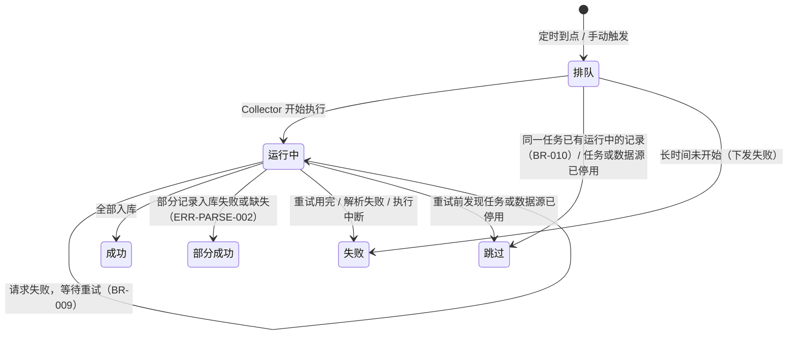
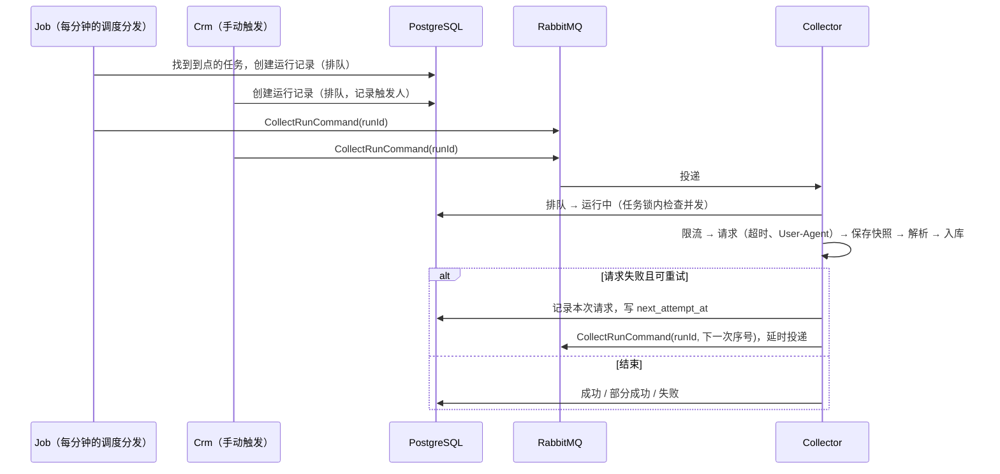
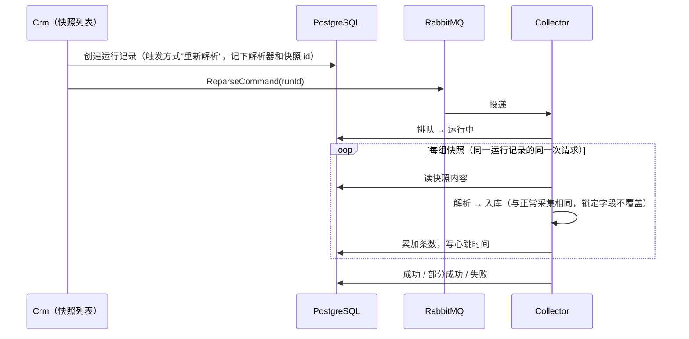

# collect 模块（数据采集）技术设计

| 项目 | 内容 |
|---|---|
| 版本 | v0.12 |
| 日期 | 2026-10-29 |
| 状态 | FR-001、FR-002 部分已评审（2026-10-23，vivo.li；§11 第 7 项的联系邮箱待提供）；v0.11 新增的快照与重新解析（FR-004）已评审（2026-10-29，vivo.li：§11 第 14 ~ 20 项均按建议执行） |
| 覆盖 | FR-001 数据源管理、FR-002 采集任务配置与调度、FR-004 原始快照与重新解析；盯盘（FR-003）只定接入位置 |
| 依据 | data-hub PRD v1.0.0.22（FR-001、FR-002、FR-004、BR-001 ~ BR-012、BR-020 ~ BR-025、DEC-023、§8.1.2、§10.8、§13.1.2、DEC-012、DEC-016、DEC-017、DEC-020）；后端约定 v1.27（§1.2、§7、§8、§9、§12）；前端约定 v1.9；数据库变更约定；sys 设计（§6 权限、§7 操作日志）；基础数据设计（§2.1 指标与数据源的映射） |

> 本文只写"怎么实现"。需求、业务规则和验收标准以 PRD 为准，这里引用编号，不复述。
> 实现偏离本文时，在同一个 PR 里更新本文。

---

## 1. 范围

**包含**：
- 数据源：登记、合规校验、凭据加密、连通性测试、启停、删除。
- 采集任务：配置（数据源、解析器、目标数据类型、cron、参数）、启停、删除、手动触发。
- 调度与下发：Job 按 cron 到点创建运行记录，经 RabbitMQ 下发给 Collector（DEC-020）。
- 执行框架：Collector 接收指令后执行，包括并发控制、频率限制、超时、重试、User-Agent，以及适配器、解析器、入库三段的接口。
- 运行记录：生成、查询、保留 90 天。
- 快照与重新解析（FR-004）：响应先存快照再解析，按内容哈希去重，后台查看和下载，按任务重新解析，保留 180 天（§5.5、§5.6）。

**不包含**：
- 具体数据源的适配器和解析器：ENG-009（M2 先接 BLS）。M1 只交付框架，用测试中的假适配器验证（§11 第 6 项）。
- 各目标数据类型的入库：日历排期、公布值由日历模块（FR-007、FR-008，[日历设计](calendar.md)）实现，央行利率、参考汇率由市场数据模块实现，新闻由新闻模块实现。本文只定入库接口。
- 盯盘（FR-003，M2）：盯盘是 Collector 中的常驻服务，复用本文的执行框架和频率限制，运行记录的触发方式记为"盯盘"。
- 数据源的"异常"状态和告警（FR-025，M2）：本文只发出运行失败的日志，告警规则由 FR-025 实现。
- 新闻源专有的字段（BR-099：源类别、语言、是否免审）：随新闻模块（M5）加列。
- 指标与数据源的映射（JAN-79）：表结构已在基础数据设计 §2.1 定好，数据源表建好后由 JAN-79 实现。

| 需求 | 本文章节 |
|---|---|
| FR-001 数据源管理（BR-001 ~ BR-006） | §2.1、§3.1、§5.1、§8 |
| FR-002 采集任务配置与调度（BR-007 ~ BR-012） | §2.1、§3.2 ~ §3.4、§4、§5、§8 |
| FR-004 原始快照与重新解析（BR-020 ~ BR-025） | §2.1、§4.3、§4.6、§5.5、§5.6、§8 |

---

## 2. 数据设计

表名前缀 `col_`（后端约定 §6.2）。实体不写导航属性，不建物理外键，关联列加普通索引。

### 2.1 表清单

**`col_source`（数据源）** —— 带审计四件套

| 列 | 类型 | 可空 | 说明 |
|---|---|---|---|
| `id` | `bigint` | 否 | 主键，自增 |
| `name` | `varchar(64)` | 否 | 唯一 |
| `agency` | `varchar(128)` | 否 | 所属机构，如"美国劳工统计局" |
| `economy_code` | `char(2)` | 是 | 所属经济体，可不填（如跨经济体的数据门户） |
| `type` | `smallint` | 否 | 官方 API / 官方网页 / RSS/Atom / 文件下载（BR-001） |
| `base_url` | `varchar(512)` | 否 | http 或 https 地址；连通性测试请求这个地址 |
| `rate_limit` | `integer` | 否 | 请求频率上限，正整数（BR-003） |
| `rate_limit_unit` | `smallint` | 否 | 次/秒、次/分 |
| `timeout_seconds` | `smallint` | 否 | 单次请求超时，默认 30（PRD FR-002 异常流程"请求失败"），1 ~ 120 |
| `credential_required` | `boolean` | 否 | 是否需要凭据（§11 第 1 项） |
| `credential` | `text` | 是 | 凭据密文（`ISecretProtector`，`enc:` 开头，BR-004） |
| `compliance_class` | `smallint` | 否 | 政府公开数据 / 机构许可 / 待确认（BR-002） |
| `terms_url` | `varchar(512)` | 否 | 条款链接 |
| `robots_result` | `smallint` | 否 | 允许 / 不涉及（API）/ 不允许（BR-002） |
| `remark` | `varchar(500)` | 是 | 备注 |
| `is_enabled` | `boolean` | 否 | 新建时为否（FR-001 验收第 1 条）；"异常"状态另由 FR-025 加列（§11 第 2 项） |

**`col_task`（采集任务）** —— 带审计四件套

| 列 | 类型 | 可空 | 说明 |
|---|---|---|---|
| `id` | `bigint` | 否 | 主键，自增 |
| `name` | `varchar(64)` | 否 | 唯一，如"BLS 发布日程" |
| `source_id` | `bigint` | 否 | 数据源 |
| `parser_key` | `varchar(64)` | 否 | 解析器标识，取自解析器目录（§5.2，BR-012） |
| `target_type` | `smallint` | 否 | 目标数据类型（BR-007），由解析器决定，保存时从目录带出，不让人选 |
| `cron` | `varchar(64)` | 是 | 5 段 cron，按 UTC 解释（后端约定 §8.3）；为空表示只能手动触发（§11 第 3 项） |
| `params` | `jsonb` | 是 | 解析器参数（如 BLS 的序列 ID 列表），必须是 JSON 对象；具体字段由解析器校验 |
| `is_enabled` | `boolean` | 否 | 新建时为否 |
| `last_dispatched_at` | `timestamptz` | 是 | 调度分发的记账字段（§4.2）：上一次检查到点的时间。修改 cron 或启用任务时重置为当前时间 |
| `remark` | `varchar(500)` | 是 | |

**`col_run`（运行记录）** —— 不带审计四件套（系统写入，只追加和更新状态），保留 90 天（BR-011）

| 列 | 类型 | 可空 | 说明 |
|---|---|---|---|
| `id` | `bigint` | 否 | 主键，自增 |
| `task_id` | `bigint` | 否 | |
| `source_id` | `bigint` | 否 | 冗余，用于按数据源筛选（FR-002 验收第 5 条） |
| `trigger` | `smallint` | 否 | 定时 / 盯盘 / 手动 / 重新解析（PRD §8.1.2） |
| `scheduled_for` | `timestamptz` | 是 | 定时触发对应的 cron 时间点；其他触发方式为空 |
| `triggered_by` | `varchar(64)` | 是 | 手动触发的操作人登录名（FR-002 主流程第 5 步） |
| `status` | `smallint` | 否 | 排队 / 运行中 / 成功 / 部分成功 / 失败 / 跳过（§3.3） |
| `queued_at` | `timestamptz` | 否 | 创建时间 |
| `started_at`、`ended_at` | `timestamptz` | 是 | |
| `attempt_count` | `smallint` | 否 | 已发起的请求次数（含重试） |
| `next_attempt_at` | `timestamptz` | 是 | 等待重试时的下一次时间 |
| `attempts` | `jsonb` | 否 | 每次请求的记录：序号、开始时间、耗时、HTTP 状态码、错误、因频率上限等待的毫秒数（FR-002 验收第 3 条）；键名与 `CollectAttempt` 的属性名相同。新建时由程序写入 `[]`，数据库不设默认值 |
| `inserted_count`、`updated_count`、`skipped_count` | `integer` | 否 | 入库结果，新建时为 0 |
| `error_code` | `varchar(32)` | 是 | 失败或跳过的错误码（§9） |
| `error_message` | `varchar(2000)` | 是 | 面向工程师的原因 |
| `trace_id` | `varchar(64)` | 是 | 贯穿下发、执行、入库的日志追踪（NFR-050） |
| `locked_count` | `integer` | 否 | 因字段锁定没有更新的条数（BR-062、FR-004 主流程第 4 步），新建时为 0；v0.11 加列 |
| `parse_output` | `jsonb` | 是 | 解析器输出的记录（JSON 数组，最多 1000 条，超出时只存前 1000 条并标明），快照详情中"当时的解析结果"用（FR-004 主流程第 2 步）；v0.11 加列 |
| `reparse` | `jsonb` | 是 | 重新解析的参数：`{"parserKey": 解析器, "snapshotIds": [快照 id]}`（§5.6）；其他触发方式为空；v0.11 加列 |
| `heartbeat_at` | `timestamptz` | 是 | 重新解析处理中定期写入，执行中断的回收据此判断（§5.6）；v0.11 加列 |

**`col_snapshot`（快照）** —— 不带审计四件套（系统写入），保留 180 天，被入库数据引用的保留 1 年（BR-022，§4.6）；v0.11 新增

| 列 | 类型 | 可空 | 说明 |
|---|---|---|---|
| `id` | `bigint` | 否 | 主键，自增 |
| `run_id` | `bigint` | 否 | 产生它的运行记录（运行记录保留 90 天，过期后这里的值不再能关联到记录） |
| `attempt` | `smallint` | 否 | 运行记录的第几次请求 |
| `seq` | `smallint` | 否 | 这次请求的第几个响应，从 0 开始，与 `FetchResult.Responses` 的顺序相同 |
| `source_id`、`task_id` | `bigint` | 否 | 冗余，运行记录删除后仍能按数据源、任务筛选 |
| `url` | `varchar(2048)` | 否 | 请求地址，不含查询串（BR-020；有的数据源把凭据放在查询串里，与错误信息的处理相同） |
| `request_key` | `varchar(512)` | 否 | 请求标识，判断"未变化"用（BR-021 的"同一 URL"）：默认等于 `url`；同一地址按查询串或请求体区分不同请求时（如 BLS API 按序列），由适配器给出不含凭据的标识（§5.5） |
| `fetched_at` | `timestamptz` | 否 | 收到响应的时间 |
| `http_status` | `smallint` | 否 | |
| `content_type` | `varchar(128)` | 是 | |
| `content_hash` | `char(64)` | 否 | 原始内容的 SHA-256，十六进制小写；对应 `col_snapshot_content`（BR-020 的"存储位置"，DEC-023） |
| `size` | `integer` | 否 | 原始内容的字节数 |
| `unchanged` | `boolean` | 否 | 与同一数据源、同一请求标识的上一个快照内容相同（BR-021 的"未变化"） |
| `is_valid` | `boolean` | 否 | 内容为空或被判定为拦截页时为否（ERR-PARSE-003） |
| `invalid_reason` | `varchar(500)` | 是 | |
| `referenced` | `boolean` | 否 | 被入库数据引用（BR-022）：入库服务写入引用这个快照的数据时置为是，不再改回 |

**`col_snapshot_content`（快照内容）** —— 按内容去重，同样的内容只存一份（BR-021、FR-004 验收第 2 条）；v0.11 新增

| 列 | 类型 | 可空 | 说明 |
|---|---|---|---|
| `content_hash` | `char(64)` | 否 | 主键 |
| `body` | `bytea` | 否 | gzip 压缩后的原始内容；列的存储方式设为 `EXTERNAL`，不让 PostgreSQL 再压缩一次 |
| `created_at` | `timestamptz` | 否 | |

### 2.2 索引

| 表 | 索引 | 用途 |
|---|---|---|
| `col_source` | `ux_col_source_name` | 名称唯一 |
| | `ix_col_source_economy_code` | 删除经济体前检查引用（BR-028，基础数据设计 §3.5） |
| `col_task` | `ux_col_task_name` | 名称唯一 |
| | `ix_col_task_source_id` | 删除数据源前检查引用；数据源停用时找到它的任务 |
| `col_run` | `ux_col_run_task_id_scheduled_for`（条件：`scheduled_for IS NOT NULL`） | 同一任务同一 cron 时间点只创建一次运行，调度分发重复执行时不会重复下发 |
| | `ix_col_run_task_id_queued_at` | 按任务查看运行记录；删除任务前检查 |
| | `ix_col_run_source_id_queued_at` | 按数据源筛选 |
| | `ix_col_run_queued_at` | 按时间筛选；清理过期记录 |
| | `ix_col_run_status`（条件：状态为排队或运行中） | 找排队、运行中的记录：并发检查、超时回收 |
| `col_snapshot` | `ix_col_snapshot_run_id` | 运行详情列出关联快照 |
| | `ix_col_snapshot_source_id_request_key_id` | 找同一数据源、同一请求标识的上一个快照，判断"未变化" |
| | `ix_col_snapshot_task_id_fetched_at` | 按任务、时间筛选；重新解析选择快照 |
| | `ix_col_snapshot_source_id_fetched_at` | 按数据源、时间筛选 |
| | `ix_col_snapshot_fetched_at` | 清理过期快照 |
| | `ix_col_snapshot_content_hash` | 清理不再被引用的内容 |

### 2.3 数据库授权

与其他模块相同，读写权限来自第一个迁移设置的默认授权（sys 设计 §3.3）。前台账号对 `col_` 表没有权限。

### 2.4 初始化数据

不预置数据源和任务（§11 第 8 项）：PRD §10.8 的首批数据源要逐个确认合规信息（D-008）、申请 API Key（D-001），由采集工程师接入适配器时在后台录入。

---

## 3. 领域规则（`Suanpan.Core/Collect/Rules/`）

### 3.1 数据源（`DataSourceRule`）

- **保存**：名称、所属机构、基础地址、条款链接必填；基础地址和条款链接必须是 http 或 https 的绝对地址；频率上限为正整数；超时 1 ~ 120 秒；需要凭据时凭据不能为空（新建时必须填写，修改时留空表示不变，ERR-SRC-004）。
- **启用**：合规类别为"待确认"或 robots.txt 为"不允许"时拒绝（BR-002，ERR-SRC-001）。已启用的数据源把合规类别改为"待确认"、robots.txt 改为"不允许"时，同样拒绝保存，提示先停用（否则会绕过启用时的检查）。
- **凭据**（BR-004）：保存前用 `ISecretProtector` 加密；页面只显示"已设置"或"未设置"，不显示任何字符；修改时输入框为空表示保留原值，要更换就输入完整的新值；"清除凭据"单独一个勾选项。凭据只在 Collector 发请求时解密，不写日志。表单字段名包含 `Credential`，操作日志自动脱敏（sys 设计 §7.1）。
- **删除**：被任务引用的不能删除，提示中列出任务名（BR-006，ERR-SRC-003）；以后加入的引用方（新闻）同样检查。`DataSourceService.DeleteAsync` 查 `col_task`（FR-002.1 实现）和指标映射 `ref_indicator_source`（JAN-79 实现），提示由 `Services/Common/References/ReferenceUsage` 拼写。
- **实现**：`DataSourceRule.Validate(DataSource)` 校验保存，`DataSourceRule.ValidateCanEnable(DataSource)` 校验启用，都返回第一条错误 `FieldError(Field, Message)`。凭据按保存后的值判断：服务先把"留空不改""清除"处理成最终的密文再校验。超时的默认值和范围是 `DataSourceRule` 的常量。
- **数据源引用经济体**：经济体被数据源引用时也不能删除，`EconomyService.DeleteAsync` 在 FR-001.2（JAN-81）中补充这项检查。

### 3.2 采集任务（`CollectTaskRule`）

- 名称必填且唯一；解析器必须在解析器目录中（§5.2）；所选数据源必须存在。参数为空或是 JSON 对象。
- **cron**（BR-008，ERR-COL-001）：只接受 5 段标准写法（分 时 日 月 周），所以最小间隔天然是 1 分钟；带秒的 6 段写法、无法解析的写法都拒绝。表单上同时显示"按操作者时区的下 3 次执行时间"，方便核对 UTC 换算。cron 的解析和计算放在 Services（`CronSchedule`，基于 Cronos 库）：Core 不引用第三方包。
- **启用**：所属数据源必须是启用状态（PRD FR-002 前置条件）。数据源停用后，它下面的任务不用逐个停用：调度分发和执行时都检查数据源状态（§4.2、§4.3）。
- **删除**：有运行记录的任务不能删除，只能停用；没有运行记录的可以删除（BR-154）。
- **实现**：`CollectTaskRule.Validate(CollectTask, 按标识查解析器)` 校验名称必填、解析器在目录中、目标数据类型与解析器一致、参数为空或 JSON 对象，返回第一条错误 `FieldError`；名称唯一、数据源存在和启用要查库，在服务中校验（FR-002.2）。`CronSchedule`（`Suanpan.Services/Collect/Tasks/`）：`Validate(cron)` 返回提示或 null；`LatestOccurrence(cron, 起点, 终点)` 取起点（不含）到终点（含）之间最后一个时间点，供调度分发（§4.2）；`NextOccurrences(cron, 起点, 个数)` 供表单预览。时间都是 UTC。

### 3.3 运行记录的状态（`CollectRunStatusRule`）



- 状态只能按上图流转，用条件更新（`ExecuteUpdateAsync` + `Where(status = 旧状态)`）防止并发改写（后端约定 §6.4）。
- "跳过"和"失败"都写 `error_code`、`error_message`。
- **实现**：`CollectRunStatusRule.CanTransition(旧状态, 新状态)` 对应上图的每条边；`IsFinished(状态)` 判断成功、部分成功、失败、跳过四个结束状态。

### 3.4 重试（`RetryPolicy`，BR-009）

- 可重试的失败：超时、网络错误、HTTP 5xx、429。HTTP 4xx（429 除外）不重试：多半是地址、参数或凭据错误，重试也不会成功。解析失败不重试（同样的内容再解析结果相同），快照保留供 FR-004 重新解析。
- 最多重试 3 次，间隔取系统配置 `collect:retry_delay_seconds`，默认 `30,120,300`（30 秒、2 分钟、5 分钟）。
- 429 和 403 在盯盘中另有"间隔加倍退避"（ERR-COL-005），由 FR-003 实现。
- **实现**：`RetryPolicy.ParseDelays(配置值)` 解析间隔，间隔的个数就是最多重试的次数，空值表示不重试，格式不对返回 null（调用方改用默认值 `RetryPolicy.DefaultDelaySeconds`）；`IsRetryable(HTTP 状态码)`，超时和网络错误传 null；`DelayAfter(第几次请求, 间隔)` 返回下一次请求前的等待时间，次数用完返回 null。

---

## 4. 调度与执行

### 4.1 总体流程



### 4.2 调度分发（Job）

- 用**一个**每分钟执行的周期任务 `collect-dispatch` 统一分发（§11 第 10 项），不为每个采集任务注册 Hangfire 周期任务：
  1. 取启用的、有 cron 的、所属数据源也启用的任务。
  2. 对每个任务，用 `CronSchedule` 算出 `(last_dispatched_at, now]` 之间最后一个时间点；没有就跳过。
  3. 有到点的时间点时，创建一条运行记录（触发方式"定时"，`scheduled_for` 为该时间点），更新 `last_dispatched_at = now`，提交后发布 `CollectRunCommand`。
  4. Job 停机期间错过的时间点只补最近一次，不逐个补发，避免恢复时一下子涌出大量请求。
- 修改 cron、启用任务时把 `last_dispatched_at` 设为当前时间：新规则从下一个时间点开始生效（FR-002 验收第 1 条），不会因为旧的记账时间补发一次。
- 任务模板按后端约定 §8.3：`[AutomaticRetry(Attempts = 0)]` + 分布式锁防止多实例同时分发；`ux_col_run_task_id_scheduled_for` 兜底，重复执行也不会产生两条记录。
- **下发失败的兜底**：不做 Outbox（后端约定 §8.2），提交后发布消息失败时，运行记录停在"排队"。同一个周期任务顺带检查：排队超过 2 分钟的记录重新发布一次；超过 10 分钟仍未开始的记为失败（下发失败），由 FR-025 告警。
- **实现**（`Services/Collect/Jobs/CollectDispatchJob`）：
  - 分布式锁 `collect:dispatch`（5 分钟过期），拿不到锁时本轮跳过。一个任务出错（如 cron 被改坏）只记 Error 日志，不影响其他任务。
  - 到点时调用 `ICollectRunService.EnqueueAsync`（触发方式"定时"）：定时的运行记录用 `INSERT ... ON CONFLICT DO NOTHING` 写入（后端约定 §6.4），时间点已经有记录时不再下发。下发后才把 `last_dispatched_at` 记为本轮开始的时间，中途退出时下一轮算出同一个时间点，由唯一索引去重。记账用 `ExecuteUpdateAsync`，不改任务的审计字段。
  - `last_dispatched_at` 为空（不经后台启用的任务）时只记账、不补发。
  - 重新发布按整分钟划分窗口：第 n 分钟的这一轮只处理在 [n-3, n-2) 分钟内排队的记录，每分钟一轮时每条记录正好重新发布一次；Job 停机错过的那一轮不再补发，10 分钟后记为失败。
  - 记为失败用条件更新（状态仍为排队），写 `ended_at`、错误码 ERR-COL-008（`CollectErrorCodes.DispatchFailed`）和原因，并记 Error 日志。

### 4.3 执行（Collector）

Collector 的消息处理器 `CollectRunCommandHandler`（`Suanpan.Collector/Handlers/`）按以下步骤执行：

1. **幂等与状态**：读运行记录。第一次请求时状态必须是"排队"；重试时状态必须是"运行中"，且 `attempt_count` 与消息中的序号对应。不符合的消息直接确认丢弃（重复投递）。
2. **并发控制**（BR-010，ERR-COL-004）：在分布式锁 `collect:task:{taskId}` 内，检查同一任务是否有其他"运行中"的记录（包括等待重试的）；有则本条记为"跳过"，否则改为"运行中"。锁只保护"检查 + 改状态"这一小段，不在整个执行期间持有，所以等待重试时不占锁，状态"运行中"本身就挡住了后来者。
3. **前置检查**：数据源必须是启用状态；任务也必须启用，手动触发的除外（§4.4）。不满足时记为"跳过"（数据源或任务已停用）。每次重试前重新检查，满足"停用后 1 分钟内不再发起新请求"（FR-001 验收第 4 条）。
4. **请求**：
   - 频率限制（BR-003，ERR-COL-003）：每次请求前向 `IRateLimiter` 申请配额，键为 `collect:source:{sourceId}`，窗口为 1 秒或 1 分钟，按数据源的单位换算。拿不到配额就等到下一个窗口再申请，等待的时长记进本次请求的记录，运行记录页面显示"已延后 N 秒"。所有任务和盯盘共用这一个键，合计不超过上限。
   - 发请求：用适配器（§5.1）。HttpClient 由 Infrastructure 统一配置 User-Agent（BR-005），超时取数据源的 `timeout_seconds`。
   - 保存快照（FR-004，§5.5）：每个响应（包括非 2xx 的）都先保存为快照，再判断成败、交给解析器（硬性规则 14）。快照写入失败时本次运行记为"失败"并告警（ERR-COL-007），不解析、不重试。
5. **解析**：调用解析器（纯函数，§5.2），解析器输出的记录存入 `parse_output`。解析失败记为"失败"（ERR-PARSE-001），不入库；内容为空或被判定为拦截页时，这次请求的快照标记为无效，记为"失败"（ERR-PARSE-003）。
6. **入库**：按目标数据类型交给对应模块的入库服务（§5.3），带上这次请求的快照 id，得到新增、更新、跳过、因锁定跳过的条数；部分记录入库失败或缺失时记为"部分成功"。
7. **结束**：写结束时间、条数和状态。失败时记 Error 日志；告警由 FR-025 按 BR-129 的规则处理（"任务连续 3 次失败"等），运行失败事件 EV-002 的消息契约随 FR-025 定义。
8. **重试**：请求失败且可重试（§3.4）时，把本次请求写进 `attempts`、写 `next_attempt_at`，然后延时发布 `CollectRunCommand(runId, 下一次序号)`（`IEventBus` 的延时投递），本次处理结束。重试用完仍失败则记为"失败"（ERR-COL-002）。

**执行中断的回收**：进程崩溃或重试消息丢失时，运行记录会停在"运行中"。Collector 启动时和之后每 5 分钟检查一次，下面两种"运行中"的记录记为"失败"（执行中断，ERR-COL-009）：
- 等待重试，但 `next_attempt_at` 已过去 5 分钟以上（重试消息丢失）；
- 不在等待重试，最近一次请求开始已超过"数据源超时 + 5 分钟"（执行到一半进程退出）。
- 重新解析（§5.6）：心跳时间（没有时取开始时间）超过 5 分钟没有更新。

盯盘服务重启后的恢复（ERR-COL-006）由 FR-003 处理。

**实现**（`Suanpan.Collector/Execution/CollectExecutor`、`StaleRunRecovery`）：
- 一条 `CollectRunCommand` 对应一次请求（含适配器的多页请求）。第 n 次的指令要求运行记录"运行中"且已请求 n-1 次（第 1 次要求"排队"），否则是重复投递，直接忽略。
- 前置检查放在认领之前：停用而跳过时没有发请求，请求次数不变。因停用跳过、缺少解析器 / 适配器 / 入库服务的实现而失败，没有对应的错误码，只写原因。
- 认领时请求次数加一，并写入这次请求的记录（开始时间），结束时再补全耗时、状态码、错误和延后时长；执行中断的回收以最近一条请求记录的开始时间判断（`CollectRunStatusRule.IsInterrupted`）。第 1 次请求的认领在任务锁内进行（锁 30 秒过期，最多等 10 秒，拿不到时抛出异常，由消息框架稍后重试）。
- 改运行记录一律在行锁内进行（`SELECT ... FOR UPDATE` 后检查状态和请求次数再保存），与重复投递的指令、执行中断的回收互斥；回收用条件更新（状态仍为运行中、请求次数没变）。
- 并发检查（BR-010）不计触发方式为"重新解析"的运行记录：重新解析不发请求，与同一任务的采集互不阻塞（§5.6）。
- 任一响应不是 2xx 即算请求失败，错误信息中的地址只保留路径（有的数据源把凭据放在查询串里）。重试间隔取系统配置，格式不对时按默认值并记警告日志；重试指令发布失败时记录停在"运行中"，由回收记为失败。
- 频率限制拿不到配额时，等到下一个固定窗口开始再申请，同一次执行中等待的时长累加到请求记录的 `DeferredMs`。
- RabbitMQ 接收端按到达顺序逐条处理消息（每个程序一个通道，`ConsumerDispatchConcurrency` 为默认的 1），所以一个 Collector 实例同一时刻只执行一条运行记录，频率限制的等待也会让后面的消息排队。任务多起来后再调大并发或增加实例。

### 4.4 手动触发（Crm）

- 运行记录页和任务列表上的"立即执行"：创建运行记录（触发方式"手动"，`triggered_by` 为当前登录名），然后发布 `CollectRunCommand`。页面跳到该运行记录的详情页，状态从"排队"变为"运行中"（FR-002 验收第 2 条：10 秒内，取决于 Collector 接收消息的速度）；详情在排队、运行中时每 2 秒局部刷新，结束后停止（前端约定 §4.1 登记的"手动触发采集"）。运行记录提交后发布失败时不报错，页面提示"稍后由调度自动重新下发"（§4.2 的兜底）。
- 停用的任务也允许手动触发，方便工程师在启用前试跑；所属数据源必须启用（BR-155）。
- 编辑只能触发目标数据类型为"日历排期""公布值"的任务（PRD §13.1.2），实现见 §8.2。

### 4.5 运行记录的清理

Job 每天执行一次 `collect-run-cleanup`：删除 `queued_at` 早于保留天数的记录，保留天数取系统配置 `collect:run_retention_days`（默认 90，BR-011），分批删除，每批 5000 条。快照另有保留规则（BR-022，§4.6），清理运行记录不影响快照。执行时间为每天 UTC 20:00（北京时间 04:00）；分布式锁 `collect:run-cleanup`；保留天数不是正整数时按默认值清理并记警告日志（`Services/Collect/Jobs/CollectRunCleanupJob`）。

### 4.6 快照的清理

Job 每天执行一次 `collect-snapshot-cleanup`（UTC 20:30，分布式锁 `collect:snapshot-cleanup`，`Services/Collect/Jobs/CollectSnapshotCleanupJob`），分批删除，每批 5000 条：

1. 删除 `fetched_at` 早于保留天数、且没有被入库数据引用的快照；保留天数取系统配置 `collect:snapshot_retention_days`（默认 180，BR-022），不是正整数时按默认值并记警告日志。
2. 被引用的快照保留 1 年（BR-022 的"≥ 1 年"）：删除 `fetched_at` 早于 365 天和保留天数中较长者的快照。被删除快照的数据仍在，追溯时显示"快照已过保留期"。
3. 删除不再被任何快照引用的内容（`col_snapshot_content`）。

---

## 5. 采集框架（Collector）

### 5.1 适配器（`Suanpan.Collector/Sources/{经济体}/{机构}/`）

- 一个数据源一个适配器（后端约定 §9），负责"怎么请求"：拼地址、放凭据、分页。接口：

  ```csharp
  public interface ICollectAdapter
  {
      string Key { get; }                       // 与解析器标识的前缀一致，如 "us.bls"
      Task<FetchResult> FetchAsync(FetchContext context, CancellationToken ct);
  }
  ```

  `FetchContext` 带数据源配置（`Source`）、解密后的凭据（`Credential`）、任务参数（`Parameters`），请求一律通过它的 `SendAsync` / `GetAsync` 发出：每次请求前申请频率配额，超时取数据源的 `timeout_seconds`（超时抛出 `FetchTimeoutException`），User-Agent 由采集用的 HttpClient 设置。`FetchResult` 是一个或多个响应（`FetchedResponse`：地址、状态码、内容类型、原始内容，`Text()` 按字符集解码），供解析和以后的快照使用。
- 适配器只发请求、不解析、不写库。频率限制、超时、User-Agent、重试由框架统一处理，适配器不重复实现。

### 5.2 解析器与解析器目录

- 解析器是纯函数（硬性规则 14）：输入响应内容和任务参数，输出标准化记录，不访问数据库和网络，配基于真实快照的测试（ENG-009）。接口 `IParser`（`Key`、`Parse(FetchResult, 参数)`）返回 `ParseResult(记录, 缺失项)`，缺失项不为空时运行记为部分成功（ERR-PARSE-002）；内容不符合预期时抛出 `ParseException`（ERR-PARSE-001）。适配器和解析器在 `AddSuanpanCollectors` 中注册。
- **解析器目录** `ParserCatalog`（`Suanpan.Core/Collect/Parsers/`）：列出全部解析器的标识、中文名、所属适配器、目标数据类型（`ParserDescriptor`；所属适配器取标识去掉最后一段，如 `us.bls`）。Crm 用它填下拉框、校验任务配置；Collector 按标识找到实现。Services 经 `IParserCatalog`（`Services/Collect/Tasks/`，默认实现就是 `ParserCatalog`）使用目录，测试中换成假的解析器。Crm 不引用 Collector（后端约定 §2），所以目录放在两边都能引用的 Core 中。`Suanpan.Core.Tests` 检查标识的写法和不重复，`Suanpan.Collector.Tests` 检查目录与实现一一对应。
- 解析器标识的写法：`{经济体}.{机构}.{内容}`，全部小写，如 `us.bls.schedule`、`us.bls.release`。
- M1 目录为空（真实解析器从 ENG-009 开始加入），后台的任务页面在目录为空时提示"还没有可用的解析器"。

### 5.3 入库接口

- 每种目标数据类型一个入库服务，由负责该数据的模块在 `Suanpan.Services/{模块}/` 中实现，Collector 按目标数据类型调用：

  | 目标数据类型（BR-007） | 实现模块 | 里程碑 |
  |---|---|---|
  | 日历排期 | Calendar（FR-007） | M2 |
  | 公布值 | Calendar（FR-008） | M2 |
  | 历史数据 | Calendar（FR-012） | M3 |
  | 央行利率 | Market（FR-018） | M3 |
  | 参考汇率 | Market（FR-022） | M3 |
  | 新闻 | News（FR-019） | M5 |

- 入库服务负责校验（FR-026）、字段锁定（FR-011）和幂等（重复入库同一批记录结果不变），返回新增、更新、跳过条数。记录的类型随各模块的设计定义。
- 接口 `ICollectIngestor`（`Suanpan.Services/Collect/Ingest/`）：`TargetType`、`IngestAsync(IngestRequest)`，返回 `IngestResult(新增, 更新, 跳过, 失败, 因锁定跳过)`，失败条数大于 0 时运行记为部分成功。M1 还没有入库服务，执行到这一步时记为失败（"没有……的入库服务"）。
- `IngestRequest` 带 `SnapshotIds`：与解析器输入的响应一一对应（第 i 个响应的快照 id）。记录来自哪个响应由各模块的记录类型约定（如日历的记录带 `ResponseIndex`），入库服务据此记下来源快照（BR-045、FR-004 验收第 1 条），并调用 `ISnapshotService.MarkReferencedAsync` 把被引用的快照标记出来（BR-022）。
- "因锁定跳过"（v0.11 新增）：自动流程遇到人工锁定的字段没有更新的条数（BR-062），运行记录的 `locked_count` 显示，重新解析的结果中单独列出（FR-004 主流程第 4 步、验收第 3 条）。

### 5.4 HTTP 客户端

- `Suanpan.Infrastructure/Http/` 注册采集用的命名 HttpClient（`AddSuanpanCollectHttp`，客户端名 `CollectHttp.ClientName`）：User-Agent 取配置 `Collect:UserAgent`（如 `SuanpanForexBot/1.0 (+mailto:联系邮箱)`，§11 第 7 项；邮箱确定之前用占位值 `SuanpanForexBot/1.0`，写在 Collector 的 `appsettings.json`），自动解压；跳转由 `SameHostRedirectHandler` 处理，只跟随同一主机内的跳转（最多 5 次），跳到别的域名时把跳转响应原样返回。依赖 `Microsoft.Extensions.Http`（PRD §13.2.4）。
- 超时不在 HttpClient 上设固定值，每次请求按数据源的 `timeout_seconds` 用 `CancellationTokenSource` 控制。
- Crm 的连通性测试（§8.1）复用同一个客户端，超时固定 10 秒（PRD FR-001 异常流程），同样经过频率限制。

### 5.5 快照（FR-004）

**保存**（`ISnapshotService.SaveAsync`，`Services/Collect/Snapshots/`）：执行器拿到适配器的响应后、判断成败和解析之前调用（§4.3 第 4 步），一次请求的全部响应在一个事务中写入：

1. 对每个响应算原始内容的 SHA-256；内容表中没有这个哈希时，gzip 压缩后写入（`INSERT ... ON CONFLICT DO NOTHING`，并发写入同样的内容不会出错）。
2. 查同一数据源、同一请求标识的上一个快照，哈希相同时 `unchanged` 为是（BR-021）。内容没有重复存储，快照记录照常写一条，运行详情和快照列表能看到"未变化"。
3. 写快照记录，返回快照 id（顺序与响应相同），交给入库服务。

- **请求标识**：`FetchedResponse` 增加可选的 `RequestKey`。默认取地址去掉查询串；同一地址按查询串或请求体区分不同请求的数据源（如 BLS API 用 POST 按序列取数），由适配器给出不含凭据的标识，如 `POST /publicAPI/v2/timeseries/data series=CES0000000001,LNS14000000`。凭据只能出现在请求中，不能出现在请求标识里。
- **盯盘**（FR-003）只保存内容有变化的快照（BR-016）：`SaveAsync` 的 `skipUnchanged` 为是时，未变化的响应不写快照记录、返回空，盯盘也不解析它（BR-015）。
- **无效快照**（ERR-PARSE-003）：2xx 但内容为空的，执行器直接标记为无效；解析器发现内容是拦截页（如"Access Denied"页面）时抛出 `InvalidSnapshotException`（`ParseException` 的子类，带原因），执行器把这次请求的快照标记为无效。无效快照不参与重新解析。
- **存储**：快照记录在 `col_snapshot`，内容在 `col_snapshot_content`（DEC-023）。内容的读写经 `ISnapshotContentStore`（`PutAsync`、`GetAsync`、`DeleteOrphansAsync`），PostgreSQL 的实现是 `PostgresSnapshotContentStore`；以后量大时换成对象存储，只换这个实现，快照记录仍在数据库中。压缩和解压用 .NET 自带的 `GZipStream`，不引入第三方包。
- **查看**（BR-025）：后台只以纯文本显示（`<pre>` 内转义输出，硬性规则 10），不渲染 HTML、不执行脚本（FR-004 验收第 4 条）。文本类型（`text/*`、JSON、XML、CSV，或声明了字符集的）按字符集解码，显示前 1 MB，超出时注明并提供下载；其他类型只显示类型和大小，提供下载。下载一律用 `application/octet-stream` + `Content-Disposition: attachment` + `X-Content-Type-Options: nosniff`，浏览器不会打开或执行内容。
- **当时的解析结果**（FR-004 主流程第 2 步）：快照详情与内容并排显示所属运行记录的状态、错误、条数和 `parse_output`；运行记录过了 90 天的保留期后只显示"运行记录已清理"。
- **保留**：见 §4.6。

### 5.6 重新解析（FR-004）



- **发起**（Crm）：在快照列表中按任务筛选后（重新解析按任务进行，运行记录属于这个任务），勾选快照或选"全部筛选结果"，选择解析器：默认是任务的解析器，可改选同一适配器下的其他解析器（解析器随发版更新，只有当前部署的版本，BR-012、PRD FR-004 主流程第 3 步）。选中超过 5000 个时拒绝，提示分批（BR-024，ERR-PARSE-004）。提交后创建运行记录（`reparse` 列记下解析器和快照 id），发布 `ReparseCommand`，页面跳到运行详情，排队、运行中时自动刷新（前端约定 §4.1 登记的长任务）。
- **执行**（Collector，`ReparseCommandHandler` → `ReparseExecutor`，`Suanpan.Collector/Execution/`）：
  1. 认领：在行锁内把运行记录从"排队"改为"运行中"，不是"排队"的是重复投递，直接忽略。不参与同一任务的并发检查（§4.3）。
  2. 选中的快照按"运行记录 + 第几次请求"分组，组内按 `seq` 排序，还原成解析器的输入（`FetchResult`）；一组一组地读内容、解析、入库，不一次读入全部内容。
  3. 无效的快照跳过并计数（ERR-PARSE-003）；某一组解析失败时记下快照 id，继续下一组。入库走与正常采集相同的入库服务（BR-023），锁定字段不覆盖，计入"因锁定跳过"。
  4. 每处理完一组累加条数；距上次写心跳超过 30 秒时更新 `heartbeat_at`。
  5. 结束：全部成功为"成功"；有无效快照或解析失败的组为"部分成功"，错误信息列出前 10 个快照 id；全部失败为"失败"。结果显示新增、更新、因锁定跳过、失败的条数（FR-004 主流程第 4 步）。
- **执行中断**：重新解析没有请求超时，回收（§4.3）对它改用心跳判断：运行中且 `heartbeat_at`（没有时取开始时间）超过 5 分钟没有更新的，记为失败（ERR-COL-009）。重新解析可以再次发起，入库是幂等的。
- 解析器不能依赖查询串：快照只存去掉查询串的地址，重新解析时还原的地址没有查询串。

---

## 6. 与其他模块的关系

| 模块 | 关系 |
|---|---|
| 基础数据（Reference） | 数据源可选所属经济体；指标与数据源的映射（`ref_indicator_source`）引用数据源（JAN-79），删除数据源时要检查这一引用 |
| 日历、市场数据、新闻 | 实现各自目标数据类型的入库服务（§5.3），入库时记下来源快照并标记为被引用（§5.5）；盯盘（FR-003）按日历事件发起"公布值"类采集；日历的设计见 [calendar.md](calendar.md) |
| 运维（Ops） | 运行失败、数据源异常的告警和看板（FR-025、FR-027）读取运行记录；数据源的"异常"状态由 FR-025 判定 |
| 系统（Sys） | 凭据加密用 `ISecretProtector`；系统配置用 `IConfigService`；操作日志自动记录写操作 |

---

## 7. 代码结构与服务接口

### 7.1 目录

```
Suanpan.Core/Collect/
├─ Entities/      DataSource、CollectTask、CollectRun、Snapshot、SnapshotContent
├─ Enums/         DataSourceType、RateLimitUnit、ComplianceClass、RobotsResult、CollectTargetType、CollectRunTrigger、CollectRunStatus
├─ Parsers/       ParserCatalog、ParserDescriptor
└─ Rules/         DataSourceRule、CollectTaskRule、CollectRunStatusRule、RetryPolicy、CollectDisplayNames（枚举的中文显示名）、CollectErrorCodes

Suanpan.Shared/Messages/Collect/   CollectRunCommand、ReparseCommand

Suanpan.Data/Configurations/Collect/   五张表的实体配置

Suanpan.Infrastructure/Http/           采集用的命名 HttpClient

Suanpan.Services/Collect/
├─ Sources/       IDataSourceService、DataSourceService、Models/
├─ Tasks/         ICollectTaskService、CollectTaskService、CronSchedule、IParserCatalog、Models/
├─ Runs/          ICollectRunService、CollectRunService、CollectConfigKeys（§10 的系统配置）、Models/
├─ Snapshots/     ISnapshotService、SnapshotService、ISnapshotContentStore、PostgresSnapshotContentStore、Models/
├─ Jobs/          CollectDispatchJob、CollectRunCleanupJob、CollectSnapshotCleanupJob
└─ Ingest/        ICollectIngestor（§5.3 的入库接口，各模块实现）

Suanpan.Job/
└─ Registry/       RecurringJobRegistry：注册 collect-dispatch、collect-run-cleanup、collect-snapshot-cleanup

Suanpan.Collector/
├─ Execution/     CollectExecutor（§4.3 的步骤）、ReparseExecutor（§5.6）、ICollectAdapter、FetchContext、FetchResult、IParser、
│                 InvalidSnapshotException、StaleRunRecovery、CollectorServiceCollectionExtensions（AddSuanpanCollectors）
├─ Handlers/      CollectRunCommandHandler、ReparseCommandHandler
└─ Sources/       各数据源的适配器和解析器（ENG-009 起）

Suanpan.Crm/
├─ Areas/Collect/     Controllers/（Source、Task、Run、Snapshot）、Views/（Shared/_TriggerButton 为"立即执行"按钮，任务列表和运行详情共用）
└─ Models/Collect/
```

### 7.2 主要接口

写操作都返回 `ManageResult`，错误属于某个输入项时带字段名（后端约定 §7）。

| 接口 | 方法 | 说明 |
|---|---|---|
| `IDataSourceService` | `GetListAsync`、`GetAsync(id)`、`GetOptionsAsync`、`CreateAsync`、`UpdateAsync(id, input)`、`SetEnabledAsync`、`DeleteAsync`、`TestAsync(id)` | 数据源不多，列表不分页；`TestAsync` 返回状态码、耗时、前 500 个字符的响应片段 |
| `ICollectTaskService` | `QueryAsync`、`GetAsync(id)`、`GetAllAsync`、`CreateAsync`、`UpdateAsync(id, input)`、`SetEnabledAsync`、`DeleteAsync`、`PreviewSchedule(cron)` | 列表带最近一次运行的状态和下次执行时间；`GetAllAsync` 供运行记录的筛选下拉框；`PreviewSchedule` 返回下 3 次执行时间（UTC，页面用 `<utc-time>` 按操作者时区显示） |
| `ISnapshotService` | `SaveAsync(运行记录, 第几次请求, FetchResult, skipUnchanged)`、`MarkInvalidAsync(ids, 原因)`、`MarkReferencedAsync(ids)`、`QueryAsync(SnapshotQuery)`、`GetAsync(id)`、`GetContentAsync(id)`、`ReparseAsync(taskId, parserKey, 快照选择, triggeredBy)` | §5.5、§5.6；`ReparseAsync` 校验数量上限、创建运行记录并发布 `ReparseCommand`；`SnapshotQuery` 按数据源、任务、时间、运行状态、是否有效筛选，分页 |
| `ICollectRunService` | `QueryAsync(CollectRunQuery)`、`GetAsync(id)`、`EnqueueAsync(taskId, trigger, scheduledFor, triggeredBy)`、`TriggerAsync(taskId, triggeredBy, anyTargetType)` | `EnqueueAsync` 创建运行记录并发布消息，Job 和 Crm 共用，返回 `EnqueueResult`（运行记录 id；`Published` 为 false 表示已创建但发布失败）；`TriggerAsync` 是后台的"立即执行"，`anyTargetType` 为 false 时只能触发日历排期、公布值类任务（§8.2）；`TryPublishAsync(runId)` 发布第 1 次请求的指令，调度分发重新下发时也用；`CollectRunQuery` 按任务、数据源、状态、触发方式、时间筛选，分页 |

### 7.3 消息

| 消息 | 类型 | 发送方 | 接收方 | 字段 |
|---|---|---|---|---|
| `CollectRunCommand` | 指令 | Job、Crm、Collector（重试） | Collector | `RunId`、`Attempt`（第几次请求，从 1 开始） |
| `ReparseCommand` | 指令 | Crm | Collector | `RunId`（解析器和快照 id 记在运行记录的 `reparse` 列，不放进消息） |

后端约定 §8.2 的消息清单中原有 `CollectTaskDueCommand`（Job → Collector）和 `CollectTriggerCommand`（Crm → Collector）两个指令。运行记录改为由发送方先创建，两个指令的内容就一样了，所以合并为 `CollectRunCommand`，已同步后端约定 §8.2（§11 第 11 项）。

---

## 8. 后台页面（Area：Collect）

栏目"数据采集"已在栏目清单中（sys 设计 §6.2，图标 `cloud-download`，排序 30）。所有写操作都标 `[OpLog("数据采集", "...")]`；运行记录列表用整页刷新，不用 HTMX；只有运行详情在排队、运行中时用 HTMX 自动刷新（§4.4）。

### 8.1 页面

| 页面 | 路由 | 权限码 | 说明 |
|---|---|---|---|
| 数据源 | `/Collect/Source` | `collect:source:index` | 列：名称、机构、经济体、类型、频率上限、合规类别、robots.txt、凭据、状态、任务数（链接到按数据源筛选的任务列表） |
| 数据源详情 | `/Collect/Source/Detail/{id}` | `collect:source:detail` | 只读；凭据只显示"已设置 / 未设置" |
| 新增 / 编辑数据源 | `/Collect/Source/Create`、`/Edit/{id}` | `collect:source:create` / `edit` | 字段分组：基本信息、访问方式（类型、基础地址、频率上限、超时、凭据）、合规信息。启用不在表单中，在列表上单独操作 |
| 连通性测试 | POST | `collect:source:test` | 在详情页执行，停用的数据源也可以测试（启用前先测，PRD FR-001 主流程第 2 步），robots.txt 为"不允许"的不发请求；结果经 TempData 带回详情页（状态码、耗时、响应片段按纯文本显示）；失败时写 `TempData["Error"]`，操作日志记为失败；失败不影响保存（ERR-SRC-002） |
| 启用 / 停用、删除数据源 | POST | `collect:source:set_status` / `delete` | 二次确认；启用时校验 BR-002；停用时提示"它下面的任务将停止执行" |
| 采集任务 | `/Collect/Task` | `collect:task:index` | 筛选：数据源、目标数据类型、状态；列：名称、数据源、解析器、目标数据类型、cron（UTC）、下次执行时间（操作者时区；任务或数据源停用时为空）、最近一次运行的状态和时间、启用状态。有运行记录的任务删除按钮置灰。解析器目录为空时不显示新增按钮，给出提示 |
| 新增 / 编辑任务 | `/Collect/Task/Create`、`/Edit/{id}` | `collect:task:create` / `edit` | 解析器下拉框按适配器分组，选项文字带目标数据类型（不用脚本）；cron 输入框下显示下 3 次执行时间：按表单中的 cron 在服务端计算，打开编辑页、提交后回到表单时显示，输入时不实时更新 |
| 启用 / 停用、删除任务 | POST | `collect:task:set_status` / `delete` | 二次确认 |
| 立即执行 | POST | `collect:task:trigger` / `trigger_any` | 见 §8.2 |
| 运行记录 | `/Collect/Run` | `collect:run:index` | 筛选：任务、数据源、状态、触发方式、时间范围（FR-002 验收第 5 条）；列：触发时间（与筛选的时间一致，即 `queued_at`）、任务、触发方式（手动的带触发人）、状态、耗时、新增 / 更新 / 跳过、请求次数 |
| 运行详情 | `/Collect/Run/Detail/{id}` | `collect:run:detail` | 每次请求的时间、耗时、状态码、错误、延后时长；错误信息按纯文本显示（硬性规则 10）；排队、运行中时每 2 秒自动刷新（§4.4）；列出关联快照（有快照查看权限时链接到快照详情）；重新解析的运行显示解析器、快照数和因锁定跳过的条数 |
| 快照 | `/Collect/Snapshot` | `collect:snapshot:index` | 筛选：数据源、任务、时间范围、运行状态、是否有效（FR-004 主流程第 1 步）；列：请求时间、数据源、任务、地址、状态码、大小、未变化、有效、运行记录。选定任务后显示勾选框和"重新解析" |
| 快照详情 | `/Collect/Snapshot/Detail/{id}` | `collect:snapshot:detail` | 左侧为内容（纯文本，§5.5），右侧为当时的解析结果；显示是否被引用 |
| 下载快照 | `/Collect/Snapshot/Download/{id}` | `collect:snapshot:download` | 原始内容，按附件下载（§5.5） |
| 重新解析 | POST | `collect:snapshot:reparse` | 选择解析器，二次确认（提示快照数）；成功后跳到运行详情（§5.6） |

菜单排序：数据源 10、采集任务 20、运行记录 30、快照 40。

### 8.2 编辑的手动触发

PRD §13.1.2 规定编辑只能手动触发"排期采集、公布值补采"类任务，即目标数据类型为"日历排期""公布值"的任务。权限码由 action 自动生成，不能手工加权限点（硬性规则 9），所以用两个 action（§11 第 5 项）：

| action | 权限码 | 能触发的任务 |
|---|---|---|
| `Trigger` | `collect:task:trigger` | 目标数据类型为"日历排期""公布值"的任务；其他类型由服务拒绝 |
| `TriggerAny` | `collect:task:trigger_any` | 全部任务 |

页面上只显示一个"立即执行"按钮：有 `trigger_any` 时提交到 `TriggerAny`，否则对允许的任务提交到 `Trigger`，其他任务不显示按钮。

### 8.3 权限码与预置角色

按 PRD §13.1.2，补充到 `PresetRoleGrants`。快照（FR-004）编辑和只读都不能看，所以编辑和只读的规则按页面逐个列出，不用 `collect:*:index` 这种通配，以免 M2 加入快照页面后被自动授权：

| 角色 | 通配规则 |
|---|---|
| 采集工程师 `engineer` | `collect:*:*` |
| 编辑 `editor` | `collect:source:index`、`collect:source:detail`、`collect:task:index`、`collect:task:trigger`、`collect:run:index`、`collect:run:detail` |
| 只读 `viewer` | `collect:source:index`、`collect:source:detail`、`collect:task:index`、`collect:run:index`、`collect:run:detail` |

---

## 9. 错误码

| 错误码 | 场景 | 实现 |
|---|---|---|
| ERR-SRC-001 | 合规未确认时启用 | `DataSourceRule` 拒绝，提示"请先完成合规确认" |
| ERR-SRC-002 | 连通性测试失败 | 页面显示状态码和错误，不阻止保存 |
| ERR-SRC-003 | 删除被引用的数据源 | 拒绝，提示中列出任务名（由 `Services/Common/References/ReferenceUsage` 拼写，与基础数据的删除提示相同） |
| ERR-SRC-004 | 需要凭据但未填写 | 表单在凭据字段提示 |
| ERR-COL-001 | cron 非法 | 表单在 cron 字段提示 |
| ERR-COL-002 | 请求失败 | 按 §3.4 重试；用完记为失败，每次请求的原因见运行详情 |
| ERR-COL-003 | 超过频率上限 | 等到下一个窗口，运行详情显示延后时长 |
| ERR-COL-004 | 同一任务并发 | 本条记为跳过 |
| ERR-COL-005 | 被限流（429、403） | 定时和手动的采集：429 按可重试处理，403 不重试（多为凭据或权限问题，运行详情显示状态码）；盯盘的间隔加倍退避由 FR-003 实现 |
| ERR-COL-006 | 盯盘中服务重启 | FR-003 |
| ERR-COL-007 | 快照写入失败 | 本次运行记为失败并告警（重要），不解析、不重试（§4.3） |
| ERR-PARSE-001 | 解析失败 | 记为失败，不重试，不入库 |
| ERR-PARSE-002 | 部分指标缺失 | 记为部分成功 |
| ERR-PARSE-003 | 快照无效（内容为空或为拦截页） | 正常采集时快照标记为无效、记为失败；重新解析时跳过并在结果中列出（§5.5、§5.6） |
| ERR-PARSE-004 | 重新解析选中超过 5000 个快照 | 拒绝，提示分批（§5.6） |

另外两种只在本模块出现的情况，错误码由本文新增，已补进 PRD FR-002 的异常流程：

| 错误码 | 场景 | 实现 |
|---|---|---|
| ERR-COL-008 | 运行记录长时间排队，下发失败 | 排队超过 10 分钟仍未开始记为失败（§4.2） |
| ERR-COL-009 | 执行中断（进程崩溃） | 回收时记为失败（§4.3） |

---

## 10. 配置

| 配置 | 位置 | 默认值 | 说明 |
|---|---|---|---|
| `collect:retry_delay_seconds` | 系统配置 | `30,120,300` | 重试间隔，逗号分隔，个数即最多重试次数（BR-009） |
| `collect:run_retention_days` | 系统配置 | `90` | 运行记录保留天数（BR-011） |
| `collect:snapshot_retention_days` | 系统配置 | `180` | 快照保留天数（BR-022）；被引用的快照保留 365 天和它之中较长者（§4.6）；v0.11 新增 |

系统配置项登记在 `CollectConfigKeys.Definitions`，由 `ConfigDefinitions.All` 汇总，系统配置页面的"数据采集"分组中可以修改（后端约定 §7）。
| `Collect:UserAgent` | appsettings | `SuanpanForexBot/1.0`（占位值，联系邮箱确定后改为 `SuanpanForexBot/1.0 (+mailto:邮箱)`） | 采集请求的 User-Agent（BR-005），不涉密，写在 Collector 的 `appsettings.json`；请求头只能用 ASCII 字符 |

---

## 11. 评审结论

2026-10-23 vivo.li 确认，均按初稿的建议执行；第 7 项的联系邮箱待提供：

| # | 问题 | 结论 | 落实 |
|---|---|---|---|
| 1 | 凭据什么时候必填（ERR-SRC-004 "类型要求凭据"）：同是"官方 API"，BLS、BEA 要 Key，Census、Eurostat 不要 | 数据源上加"需要凭据"开关，打开时必填 | §2.1、§3.1；PRD FR-001 页面元素、§8.1.2 |
| 2 | 数据源状态"停用 / 启用 / 异常"怎么存 | 分开存：`is_enabled` + FR-025 加的健康状态列；"异常"不改变启用状态，恢复后自动消失 | §2.1；PRD §8.1.2 |
| 3 | PRD 说"支持周期调度和一次性执行"，一次性执行怎么做 | 用"立即执行"；cron 为空的任务只能手动触发；不做"指定时间执行一次" | §2.1；PRD FR-002 需求描述 |
| 4 | 采集任务能否删除 | 有运行记录的只能停用，没有的可以删除 | §3.2；PRD 新增 BR-154 |
| 5 | 编辑只能触发部分任务，怎么实现 | 两个 action：`Trigger`（限日历排期、公布值）和 `TriggerAny`（全部） | §8.2 |
| 6 | M1 没有真实解析器，怎么验证调度、重试、并发 | 集成测试中注册假适配器和假解析器，对接进程内的假 HTTP 服务；真实的端到端在 M2 接入 BLS 时验证 | §12 |
| 7 | User-Agent 中的联系邮箱 | 待 vivo.li 提供项目公共邮箱；FR-002.4 先用不带邮箱的占位值 | §10 `Collect:UserAgent`；真正采集前（M2 接入 BLS）补上 |
| 8 | 首批数据源要不要预置 | 不预置，由工程师接入适配器时录入 | §2.4 |
| 9 | 重试间隔按全局还是按任务配置 | 全局（系统配置 `collect:retry_delay_seconds`） | §3.4、§10 |
| 10 | 调度方式 | 一个每分钟执行的分发任务，按 cron 算到点 | §4.2 |
| 11 | 两个下发指令合并为 `CollectRunCommand` | 合并 | §7.3；后端约定 §8.2 |
| 12 | 新增依赖 Cronos（MIT） | 在 Services 中直接引用 | 已登记到 PRD §13.2.4（v1.0.0.19），使用 0.13.0；Hangfire.Core 不依赖这个包 |
| 13 | 停用的任务能否手动触发 | 可以，方便启用前试跑；数据源必须启用 | §4.3、§4.4；PRD 新增 BR-155 |

另外，本文新增的错误码 ERR-COL-008（下发失败）、ERR-COL-009（执行中断）补进 PRD FR-002 的异常流程；数据源的"请求超时"补进 FR-001 的页面元素。

**v0.11 新增的快照与重新解析**：2026-10-29 vivo.li 确认，均按建议执行（业务规则已在 PRD v1.0.0.22 确认：快照内容存 PostgreSQL（DEC-023）、重新解析用当前部署的解析器）：

| # | 问题 | 结论 | 所在章节 |
|---|---|---|---|
| 14 | 内容去重的范围 | 按内容哈希全局去重：不同数据源、不同地址的相同内容也只存一份；"未变化"仍按同一数据源、同一请求标识判断 | §2.1、§5.5 |
| 15 | 同一地址的不同请求（如 BLS API 用 POST 按序列取数）怎么判断"同一 URL" | 适配器给出不含凭据的请求标识，默认取地址去掉查询串 | §5.5 |
| 16 | 非 2xx 的响应要不要存快照 | 存，排查被拦截、限流时能看到当时的响应 | §4.3 |
| 17 | "当时的解析结果"存在哪里 | 存运行记录的 `parse_output`（最多 1000 条），运行记录过了 90 天后不再显示 | §2.1、§5.5 |
| 18 | 重新解析的范围和并发 | 按任务进行；选中的快照按原来的请求分组解析；不参与同一任务的并发检查 | §5.6 |
| 19 | 重新解析中途进程退出怎么发现 | 每 30 秒写心跳，5 分钟没有心跳记为执行中断 | §5.6 |
| 20 | "被入库数据引用的快照保留 ≥ 1 年"怎么实现 | 入库服务写入引用快照的数据时把快照标记为被引用（不再改回），被引用的保留 365 天和保留天数中较长者 | §4.6 |

---

## 12. 测试要点

| 验收标准 / 规则 | 测试方式 |
|---|---|
| FR-001 #1 新建默认停用；合规未确认不能启用 | 单元测试 `DataSourceRule`；集成测试：新建后为停用，"待确认"启用失败 |
| FR-001 #2 凭据只显示掩码，库中为密文 | 集成测试：保存后库中的值以 `enc:` 开头、能解密回原值；修改时留空不改变凭据 |
| FR-001 #3 被引用不能删除并提示任务 | 集成测试：有任务时删除失败，提示中有任务名 |
| FR-001 #4 停用后 1 分钟内不再请求 | 单元测试分发规则（停用的数据源不分发）；Collector 集成测试：重试前数据源被停用，本条记为跳过且没有新请求 |
| FR-001 #5 操作日志可查、凭据脱敏 | Crm 管道测试：保存数据源后，操作日志的请求参数中凭据为 `***` |
| FR-002 #1 修改 cron 后按新规则执行 | 单元测试 `CronSchedule` 的到点计算；集成测试：修改 cron 后 `last_dispatched_at` 被重置，下一次分发按新规则 |
| 调度分发 | 集成测试：错过的时间点只补最近一次；记账时间丢失后重跑不重复创建、不重复下发；停用的任务、停用数据源下的任务、没有 cron 的任务不分发；排队满 2 分钟的重新发布、超过 10 分钟的记为失败 |
| BR-011 运行记录保留 90 天 | 集成测试：按配置的保留天数分批删除 |
| FR-002 #2 手动触发后很快出现"运行中" | Collector 集成测试：发布指令后运行记录从排队变为运行中（不按秒数断言，按状态） |
| FR-002 #3 最多重试 3 次，每次可见 | 单元测试 `RetryPolicy`；Collector 集成测试：假 HTTP 服务一直返回 500，运行记录有 4 次请求、状态为失败 |
| FR-002 #4 同一任务不并发 | Collector 集成测试：同一任务两条排队记录同时处理，一条运行、一条跳过 |
| FR-002 #5 运行记录按任务、数据源、状态、时间筛选 | 集成测试：查询条件组合 |
| FR-002 主流程第 5 步、BR-155 手动触发 | 集成测试：停用的任务能立即执行，运行记录为排队、记录触发人并发布指令；数据源停用时拒绝；编辑不能触发其他类型；发布失败时记录停在排队。Crm 管道测试：立即执行以登录名为触发人、跳到运行详情、记入操作日志；运行详情的 HTMX 区块结束后不再刷新 |
| BR-154 有运行记录的任务不能删除 | 集成测试 |
| BR-003 频率上限 | 单元测试窗口换算；Collector 集成测试：上限 1 次/秒时连续两次请求，第二次记录了延后 |
| BR-008 cron 最小 1 分钟 | 单元测试：6 段写法、非法写法被拒绝 |
| 消息幂等 | Collector 集成测试：同一条指令投递两次，只执行一次 |
| 解析器目录与实现一致 | `Suanpan.Collector.Tests` 检查目录中的每个标识都有实现，反之亦然 |
| 权限码 | `AreaCatalogTests` 登记本模块的权限码；`PresetRoleGrantsTests` 加入采集模块的预置授权 |
| FR-004 #1 入库数值能追溯到快照 | Collector 集成测试：假入库服务收到的 `SnapshotIds` 与快照记录一致；日历的入库测试见日历设计 §13 |
| FR-004 #2 未变化的重复请求不产生新内容 | 集成测试 `SnapshotService`：同一内容保存两次，内容表一行、快照记录两条、第二条为未变化；`skipUnchanged` 时不写记录 |
| FR-004 #3 重新解析不覆盖锁定字段 | Collector 集成测试：假入库服务返回因锁定跳过的条数，运行记录的 `locked_count` 正确 |
| FR-004 #4 快照查看页不执行脚本 | Crm 管道测试：内容含 `<script>` 的快照，详情页输出为转义文本；下载的响应头为附件和 `nosniff` |
| ERR-COL-007 快照写入失败 | Collector 集成测试：快照服务抛出异常时运行记为失败、告警被调用、没有解析 |
| ERR-PARSE-003 无效快照 | Collector 集成测试：空内容、解析器抛出 `InvalidSnapshotException` 时快照标记为无效、运行记为失败；重新解析时跳过并计数 |
| ERR-PARSE-004、BR-024 重新解析的上限 | 集成测试：选中 5001 个快照时拒绝 |
| 重新解析 | Collector 集成测试：多响应的请求按组还原后解析；同一任务正在运行时重新解析照常执行；心跳超过 5 分钟被回收 |
| BR-022 快照保留 | 集成测试：未被引用的过期快照被删、被引用的保留到 365 天、没有快照引用的内容被删 |

Collector 的集成测试需要 PostgreSQL、Valkey、RabbitMQ 三个容器（标 `Category=Integration`）和一个进程内的假 HTTP 服务，测试中不用 `Task.Delay` 等待（后端约定 §13.4）：重试间隔在测试中配置为 0 秒，状态变化用轮询数据库并设上限的方式等待。

实现（`Suanpan.Collector.Tests`）：`CollectorFixture` 启动三个容器、按生产方式建库并执行迁移，用 WebApplicationFactory 在内存中启动 Collector；采集用 HttpClient 的最底层处理器换成 `StubHttp`（按随机主机名设置应答、记录请求），另注册测试用的适配器、解析器和入库服务。Collector 在后台自己提交事务，测试不能用回滚隔离，改为每个测试用自己的数据源、任务和主机名。"同一条指令投递两次只执行一次"的测试依赖接收端按顺序处理消息（§4.3 实现），以排在后面的另一条运行结束为准。

---

## 13. 实施拆分

评审通过后按 FR 拆成 6 个子任务，一个子任务对应一个 PR：

| 子任务 | 工单 | 内容 | 依赖 |
|---|---|---|---|
| FR-001.1 数据源：领域模型与数据 | JAN-80 | 实体、枚举及中文显示名、`DataSourceRule` 及单元测试；实体配置；迁移（`col_source`） | — |
| FR-001.2 数据源：服务与后台页面 | JAN-81 | `IDataSourceService`（含凭据加密、连通性测试、引用检查）；Infrastructure 的采集 HttpClient；数据源页面；预置角色规则；集成测试、管道测试 | FR-001.1 |
| FR-002.1 采集任务与运行记录：领域模型与数据 | JAN-82 | 实体、枚举、`CollectTaskRule`、`CollectRunStatusRule`、`RetryPolicy`、解析器目录；`CronSchedule`（引入 Cronos）；迁移（`col_task`、`col_run`） | FR-001.1 |
| FR-002.2 采集任务：服务与后台页面 | JAN-83 | `ICollectTaskService`、`ICollectRunService`；任务、运行记录页面；手动触发；集成测试 | FR-002.1、FR-001.2 |
| FR-002.3 调度分发与清理 | JAN-84 | Job 的 `collect-dispatch`、`collect-run-cleanup`；下发失败的兜底；消息契约 | FR-002.2 |
| FR-002.4 Collector 执行框架 | JAN-85 | 消息处理器、并发控制、频率限制、超时、重试、执行中断回收、适配器 / 解析器 / 入库接口；Collector 的集成测试 | FR-002.3 |

JAN-79（指标与数据源的映射）在 FR-001.2（JAN-81）完成后可以开始。FR-002.4 开始前需要提供 User-Agent 的联系邮箱（§11 第 7 项）。

v0.11 的快照与重新解析评审通过，拆成两个子任务（父工单 JAN-18）：

| 子任务 | 工单 | 内容 | 依赖 |
|---|---|---|---|
| FR-004.1 快照：数据与保存 | JAN-86 | 实体、实体配置、迁移（`col_snapshot`、`col_snapshot_content`、`col_run` 加列）；`ISnapshotService` 的保存和标记、`PostgresSnapshotContentStore`；执行器先存快照、无效快照、`parse_output`；`IngestRequest.SnapshotIds`、`IngestResult.Locked`；`collect-snapshot-cleanup`；集成测试 | — |
| FR-004.2 快照页面与重新解析 | JAN-90 | 快照列表、详情、下载；`ReparseCommand`、`ReparseExecutor`、心跳回收；运行详情显示快照；集成测试、管道测试 | FR-004.1 |

FR-004.1 是日历排期入库（日历设计 §14 的 FR-007.3，JAN-89）的前置任务；FR-004.2 可以与日历的子任务并行。

---

## 变更记录

| 版本 | 日期 | 修改人 | 内容 |
|---|---|---|---|
| v0.1 | 2026-10-23 | vivo.li / Claude | 初稿：FR-001、FR-002 的表结构、规则、调度与执行流程、采集框架、页面和权限；列出 13 个待评审问题 |
| v0.2 | 2026-10-23 | vivo.li / Claude | 评审：§11 改为评审结论（13 项均按建议执行，第 7 项的联系邮箱待提供）；同步 PRD v1.0.0.17（FR-001、FR-002、BR-154、BR-155、§8.1.2）和后端约定 v1.25（§8.2 消息清单） |
| v0.3 | 2026-10-23 | vivo.li / Claude | 评审通过；§13 回填 Linear 工单号（JAN-80 ~ JAN-85） |
| v0.4 | 2026-10-23 | vivo.li / Claude | FR-001.1 实施：§2.2 增加 `ix_col_source_economy_code`（经济体被数据源引用时不能删除）；§3.1 补充规则的接口 |
| v0.5 | 2026-10-23 | vivo.li / Claude | FR-001.2 实施：§5.4 HttpClient 的注册和跳转处理、User-Agent 的默认值；§7.2 数据源服务的方法名；§8.1 连通性测试的结果展示。数据源被采集任务引用时不能删除的检查随 FR-002.1（JAN-82）建表后实现 |
| v0.6 | 2026-10-23 | vivo.li / Claude | FR-002.1 实施：§2.1 `attempts` 的键名，`attempts` 和计数列的初值由程序写入；§3.1 数据源删除时检查采集任务；§3.2 ~ §3.4 补充规则和 `CronSchedule` 的接口；§5.2 解析器描述和目录的测试；§9 `ReferenceUsage` 移到 `Services/Common/References/`，各模块共用；§11 第 12 项 Cronos 已登记（PRD v1.0.0.19） |
| v0.7 | 2026-10-26 | vivo.li / Claude | FR-002.2 实施：§4.4 运行详情自动刷新、发布失败的提示；§5.2 Services 经 `IParserCatalog` 使用解析器目录；§7.1、§7.2 任务和运行记录服务的方法（`PreviewSchedule` 不带时区，新增 `GetAllAsync`、`TriggerAsync`、`EnqueueResult`）；§8 各页面的列和交互按实现补充（运行记录列表的时间列为触发时间；cron 预览在服务端计算，输入时不实时更新）；§12 补充手动触发和删除的测试 |
| v0.8 | 2026-10-27 | vivo.li / Claude | FR-002.3 实施：§4.2 调度分发的实现（锁、`ON CONFLICT` 写入、记账时机、重新发布的整分钟窗口、记为失败）；§4.5 清理的执行时间和锁；§7.1 Job 的任务注册表、`CollectConfigKeys`、`CollectErrorCodes`；§7.2 `TryPublishAsync`；§10 配置项的登记位置；§12 补充分发和清理的测试 |
| v0.9 | 2026-10-27 | vivo.li / Claude | JAN-79 实施：§3.1 数据源删除时也检查指标映射；解析器下拉框 `ParserSelectOptions` 与指标映射的表单共用 |
| v0.10 | 2026-10-27 | vivo.li / Claude | FR-002.4 实施：§4.3 执行和回收的实现（认领、行锁、请求记录先写开始时间、按顺序处理消息）；§5.1 ~ §5.3 适配器、解析器、入库的接口；§5.4、§10、§11 第 7 项 User-Agent 先用占位值；§7.1 目录；§12 Collector 测试的实现 |
| v0.11 | 2026-10-28 | vivo.li / Claude | 补充快照与重新解析（FR-004）：§2.1 新增 `col_snapshot`、`col_snapshot_content`，`col_run` 加 `locked_count`、`parse_output`、`reparse`、`heartbeat_at`；§4.3 先存快照再解析、无效快照、重新解析不参与并发检查；新增 §4.6 快照的清理、§5.5 快照、§5.6 重新解析；§5.3 `IngestRequest` 带快照 id、`IngestResult` 增加因锁定跳过；§7 ~ §10 目录、接口、消息、页面、错误码、配置；§11 第 14 ~ 20 项待评审；§12、§13 测试和拆分。同步 PRD v1.0.0.22（BR-020 ~ BR-025、DEC-023） |
| v0.12 | 2026-10-29 | vivo.li / Claude | 评审通过：§11 第 14 ~ 20 项均按建议执行；§13 回填快照两个子任务的工单号（JAN-86、JAN-90） |
