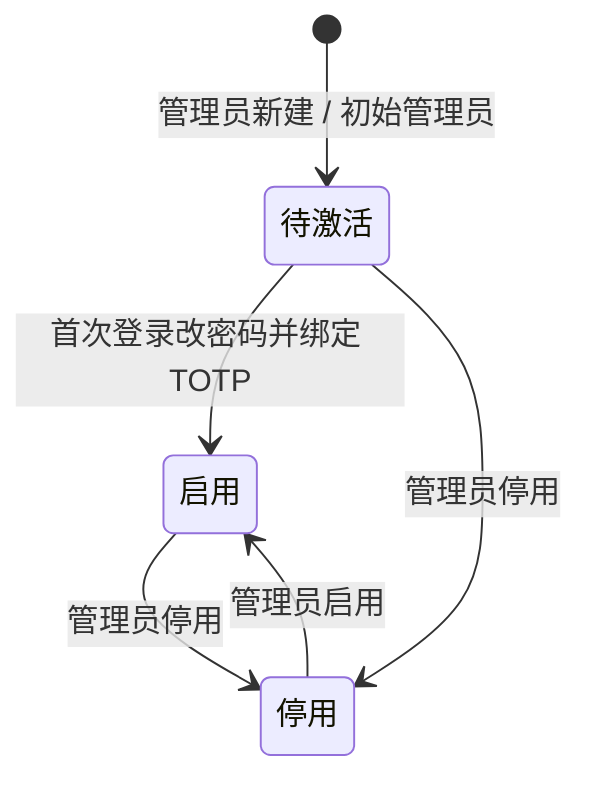
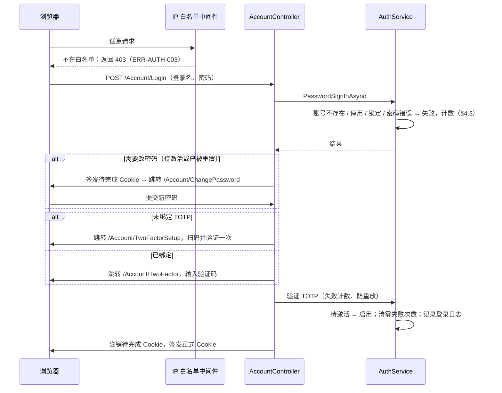

# sys 模块（系统管理）技术设计

| 项目 | 内容 |
|---|---|
| 版本 | v0.21（草稿） |
| 日期 | 2026-10-23 |
| 状态 | 待评审 |
| 覆盖 | FR-028、FR-029；ENG-002、ENG-003（系统表部分）、ENG-004、ENG-005 |
| 依据 | data-hub PRD v1.0.0.3；后端约定 v1.1；前端约定 v1.1 |
| 代码来源 | VVPay 系统模块（ENG-002 迁移），差异见 §2 |

> 本文只写"怎么实现"。需求、业务规则和验收标准以 PRD 为准，这里引用编号，不复述。
> 实现偏离本文时，在同一个 PR 里更新本文。

---

## 1. 范围

**包含**：后台账号、角色、权限点与菜单、登录（密码 + TOTP + 失败锁定 + 首次激活）、会话与安全戳、后台访问 IP 白名单、操作日志、登录日志、系统配置、Hangfire 面板入口，以及 Crm 程序的整体框架（布局、菜单、公共部件）。

**不包含**：
- 部门、数据权限（PRD §10.10 明确不需要）。
- 商户、代理等其他用户体系（本项目只有后台一个登录端）。
- 告警的发送渠道（属于 Ops 模块，FR-025）。本模块只调用告警接口。

| 需求 / 任务 | 本文章节 |
|---|---|
| FR-028 账号与权限（BR-139 ~ BR-145、BR-152） | §4、§5、§6、§9 |
| FR-029 操作日志（BR-146 ~ BR-151） | §7 |
| ENG-002 迁移 VVPay 通用模块 | §2、§8 |
| ENG-003 系统表迁移与数据库账号 | §3 |
| ENG-004 Crm 框架 | §9.3 |
| ENG-005 补齐 VVPay 缺的能力 | §2 中标 ENG-005 的条目 |

---

## 2. 与 VVPay 的差异（迁移清单）

迁移时逐条对照，标"去掉"的不迁移，标"改为"的迁移后修改。ENG-002.7 已全仓核对：标"去掉"的条目在代码、配置和迁移中均无残留，也没有支付、商户、代理相关代码和 VVPay 命名。

| 项目 | VVPay 现状 | 本项目 | 依据 | 任务 |
|---|---|---|---|---|
| 数据库与表结构 | MySQL，手写 SQL | PostgreSQL，EF Core Migrations 生成 | DEC-009、DEC-015 | ENG-003 |
| 多端字段 `client` | 权限点、日志表都有 `client`（admin / merchant / agent） | 去掉，只有后台一个端 | — | ENG-002 |
| 部门、数据权限 | `sys_dept`、`sys_role.data_scope` | 去掉 | PRD §10.10 | ENG-002 |
| 手机号 | `sys_user.phone` | 去掉，只存姓名和邮箱 | NFR-061 | ENG-002 |
| 二次验证 | 可选，未绑定也能登录 | **强制**，未绑定不能进入任何功能页 | FR-028 验收标准 1 | ENG-005 |
| 账号激活 | 管理员建号即可用 | 新账号为"待激活"，首次登录必须改密码并绑定 TOTP | FR-028 主流程 | ENG-005 |
| 密码规则 | ≥ 8 位 | ≥ 8 位，同时含英文字母和数字 | BR-140 | ENG-005 |
| 密码错误锁定 | 没有（只有 TOTP 步限流） | 连续 5 次失败锁定 15 分钟，TOTP 失败也计数；管理员可手动解锁 | BR-140 | ENG-005 |
| 会话时长 | 8 小时滑动续期 | 空闲 30 分钟超时 | BR-142 | ENG-002 |
| 初始管理员 | 种子数据硬编码默认密码 | 账号和初始密码来自环境变量 | NFR-033 | ENG-002 |
| 按钮显隐 | 不按权限隐藏 | `asp-permission` 标签助手按权限隐藏 | BR-152 | ENG-005 |
| 操作日志写入失败 | 只记 Warning | 记 Error 并触发告警 | BR-151 | ENG-005 |
| 操作日志表权限 | 可改可删 | 应用账号只能 INSERT 和 SELECT | BR-148 | ENG-003 |
| 操作日志字段 | 无角色、无原因 | 增加 `roles`、`reason` | BR-147 | ENG-002 |
| 时间 | `DateTime.Now` 与数据库时间混用 | 全部 UTC | 后端约定 §10 | ENG-002 |
| IP 白名单 | 用于代付接口 | 改为限制后台访问 | BR-141 | ENG-005 |
| 栏目清单 | 订单、商户、通道等 6 个 | 9 个模块，见 §6.2 | 后端约定 §1.1 | ENG-004 |
| 系统模块名 | Area 和命名空间为 `System` | 改为 `Sys`，显示名仍为"系统管理"；URL `/Sys/...`，权限码前缀 `sys:` | 后端约定 §1.1 | ENG-002、ENG-004 |

---

## 3. 数据设计

所有表由 EF Core Migrations 创建，编写和上线规则见数据库变更约定（`docs/conventions/database.md`）。列名 snake_case，时间列为 `timestamptz`（UTC），不建物理外键，关联列加索引。带"审计四件套"的表含 `created_by`、`created_at`、`updated_by`、`updated_at`，由拦截器填充。主键、索引的名字由 `SuanpanDbContext` 统一生成（`pk_`、`ux_`、`ix_`，见后端约定 §6.2）。

### 3.1 表清单

**`sys_user`（后台账号）** —— 带审计四件套

| 列 | 类型 | 约束 | 说明 |
|---|---|---|---|
| `id` | bigint | PK，自增 | |
| `username` | varchar(64) | 唯一，非空 | 登录名，创建后不可修改 |
| `password_hash` | varchar(256) | 非空 | 自描述格式 `pbkdf2$迭代次数$盐$哈希` |
| `real_name` | varchar(64) | 非空 | 姓名 |
| `email` | varchar(128) | 可空 | |
| `status` | smallint | 非空 | 1 待激活、2 启用、3 停用（§4.1） |
| `must_change_password` | boolean | 非空 | 首次登录或管理员重置密码后为 true |
| `totp_secret` | varchar(256) | 可空 | AES 加密后的密钥（`enc:` 前缀）；空表示尚未绑定 |
| `security_stamp` | varchar(64) | 非空 | 安全戳（§5.3） |
| `login_fail_count` | integer | 非空，默认 0 | 连续失败次数（密码和 TOTP 共用） |
| `locked_until` | timestamptz | 可空 | 锁定截止时间；为空或早于当前时间表示未锁定 |
| `last_login_at` | timestamptz | 可空 | |
| `last_login_ip` | varchar(64) | 可空 | |

**`sys_role`（角色）** —— 带审计四件套

| 列 | 类型 | 约束 | 说明 |
|---|---|---|---|
| `id` | bigint | PK | |
| `role_code` | varchar(64) | 唯一 | 如 `super_admin`、`engineer` |
| `role_name` | varchar(64) | 非空 | |
| `is_builtin` | boolean | 非空 | 内置角色不可修改、删除和授权 |
| `is_enabled` | boolean | 非空 | |
| `remark` | varchar(256) | 可空 | |

**`sys_user_role`（账号与角色，多对多）**：`user_id`、`role_id` 联合主键，另有 `created_by`、`created_at`；`role_id` 单独建索引。

**`sys_permission`（权限点，同时也是菜单）** —— 带审计四件套

| 列 | 类型 | 约束 | 说明 |
|---|---|---|---|
| `id` | bigint | PK | 重建时保留已有 id，角色授权按 id 关联 |
| `parent_id` | bigint | 非空，0 表示根 | 树形结构 |
| `perm_type` | smallint | 非空 | 1 目录（Area）、2 菜单（Controller）、3 按钮（Action） |
| `perm_code` | varchar(128) | 唯一 | `{area}:{controller}:{action}`，由代码自动生成（§4.3） |
| `perm_name` | varchar(64) | 非空 | 显示名 |
| `menu_url` | varchar(256) | 可空 | 菜单的路由，如 `/Calendar/Event` |
| `icon` | varchar(64) | 可空 | Tabler Icons 名称 |
| `sort` | integer | 非空 | |
| `is_enabled` | boolean | 非空 | 代码中已不存在的权限点在重建时被停用，不删除 |

**`sys_role_permission`（角色与权限点）**：`role_id`、`perm_id` 联合主键；`perm_id` 单独建索引。

**`sys_config`（系统配置）** —— 带审计四件套

| 列 | 类型 | 约束 | 说明 |
|---|---|---|---|
| `id` | integer | PK | |
| `config_key` | varchar(128) | 唯一 | 格式 `模块:键名`，如 `security:login_max_failures` |
| `config_value` | text | 非空 | |
| `value_type` | smallint | 非空 | 1 字符串、2 整数、3 小数、4 布尔、5 JSON；保存时按类型校验 |
| `config_group` | varchar(64) | 非空 | 页面分组展示用 |
| `description` | varchar(256) | 可空 | |

**`sys_ip_whitelist`（后台访问 IP 白名单）** —— 带审计四件套

| 列 | 类型 | 约束 | 说明 |
|---|---|---|---|
| `id` | bigint | PK | |
| `ip_value` | varchar(64) | 唯一 | 单个 IP 或 CIDR 网段（IPv4、IPv6） |
| `remark` | varchar(128) | 可空 | 如"办公室网络" |
| `is_enabled` | boolean | 非空 | |

**`sys_op_log`（操作日志，只追加）** —— 不带审计四件套

| 列 | 类型 | 说明 |
|---|---|---|
| `id` | bigint，PK，自增 | |
| `user_id` | bigint | |
| `username` | varchar(64) | |
| `roles` | varchar(256) | 操作当时的角色编码，逗号分隔；没有角色时为空串 |
| `module` | varchar(64) | `[OpLog]` 的模块名 |
| `action` | varchar(64) | `[OpLog]` 的动作名 |
| `perm_code` | varchar(128)，可空 | 自动采集 |
| `http_method` | varchar(8) | |
| `request_url` | varchar(256) | |
| `request_params` | text，可空 | 序列化后的请求参数，已脱敏（§7.1） |
| `reason` | varchar(512)，可空 | 请求参数中名为 `reason` 的字段（如有） |
| `is_success` | boolean | |
| `error_msg` | varchar(512)，可空 | |
| `duration_ms` | integer | |
| `ip` | varchar(64)，可空 | |
| `user_agent` | varchar(256)，可空 | |
| `trace_id` | varchar(64)，可空 | |
| `created_at` | timestamptz | |
| `prev_hash` | varchar(64)，可空 | 哈希链（NFR-041，P1）。第一阶段先建列，暂不填写 |

**`sys_login_log`（登录日志，只追加）** —— 不带审计四件套

| 列 | 类型 | 说明 |
|---|---|---|
| `id` | bigint，PK，自增 | |
| `username` | varchar(64) | 输入的登录名（账号不存在时也记录） |
| `user_id` | bigint，可空 | |
| `stage` | smallint | 1 密码、2 TOTP、3 激活、4 退出、5 跳过 TOTP（开发环境，§5.1） |
| `is_success` | boolean | |
| `fail_reason` | varchar(128)，可空 | 内部记录的真实原因（页面上统一提示，见 §5.1） |
| `ip` | varchar(64)，可空 | |
| `user_agent` | varchar(256)，可空 | |
| `created_at` | timestamptz | |

两张日志表中，未注明"可空"的列都不可空。

### 3.2 索引

| 表 | 索引 | 用途 |
|---|---|---|
| `sys_op_log` | `(created_at)`、`(user_id, created_at)`、`(module, action, created_at)` | 按时间、操作人、模块检索（BR-150） |
| `sys_login_log` | `(created_at)`、`(username, created_at)` | |
| `sys_permission` | `(parent_id)` | 树形查询 |

### 3.3 数据库授权

写在迁移里（`migrationBuilder.Sql`），对应后端约定 §6.7 和数据库变更约定 §2.3：

- `sys_` 表的读写权限来自第一个迁移中设置的默认授权，不需要逐表授权。
- 创建 `sys_op_log`、`sys_login_log` 的迁移中，撤销 `suanpan_app` 对这两张表的 `UPDATE`、`DELETE` 权限，只保留 `INSERT`、`SELECT`（BR-148）。默认授权本来就不含 `TRUNCATE`，应用账号也不能清空这两张表。
- `suanpan_portal` 对所有 `sys_` 表无任何权限。

### 3.4 初始化数据

| 数据 | 方式 | 说明 |
|---|---|---|
| 4 个预置角色 | 迁移中的种子数据 | `super_admin`（管理员，内置）、`engineer`（采集工程师）、`editor`（编辑）、`viewer`（只读）。id 为 1 ~ 4，`created_by` 为 `migration`；`sys_role` 的自增从 100 开始，1 ~ 99 留给预置角色。编码常量见 `Suanpan.Core/Sys/Constants/RoleCodes` |
| 初始管理员 | 程序启动时的种子服务 | 仅当 `sys_user` 为空时执行；登录名和初始密码读环境变量 `SUANPAN__Seed__AdminUsername`、`SUANPAN__Seed__AdminPassword`，未设置则跳过并记录 Error 日志；账号状态为"待激活"，绑定 `super_admin`。由 Crm 启动时的 `AdminSeedHostedService` 调用 `AdminSeeder`，失败只记 Error 日志，不阻止启动 |
| 权限点 | 不做种子 | 部署后在后台执行"从代码重建"生成（§6.3） |
| 系统配置默认值 | 不做种子 | 代码中有默认值，表里有值时才覆盖（§10.2） |

---

## 4. 领域规则（`Suanpan.Core/Sys/Rules/`）

### 4.1 账号状态



- **锁定**不是单独的状态，而是叠加在"启用"上的时间条件：`locked_until` 晚于当前时间即为锁定。账号列表中显示为"锁定（剩余 N 分钟）"。
- 停用、启用、重置密码、重置 TOTP 都会刷新安全戳，让该账号已登录的会话立即失效（§5.3）。
- 不能停用自己；不能停用最后一个未停用的管理员，也不能去掉他的管理员角色（BR-144，ERR-AUTH-004）。"未停用"包括待激活：初始管理员在激活前也受保护。规则在 `Suanpan.Core/Sys/Rules/UserStatusRule`。
- 后台只能把账号停用，或把停用的账号恢复为启用；不能手工设为待激活，待激活的账号只能由本人首次登录完成激活。
- 账号没有删除功能（BR-143）。

### 4.2 密码规则

- 长度 ≥ 8 位，同时包含英文字母和数字（BR-140）；新密码不能与旧密码相同。
- 哈希：PBKDF2-SHA256，10 万次迭代，16 字节盐，32 字节哈希，比较时用固定时间比较（沿用 VVPay）。

### 4.3 失败计数与锁定

- 密码错误、登录过程中的 TOTP 错误和重放都使 `login_fail_count` 加 1。已登录后重新绑定 TOTP 时输错不计；Redis 不可用导致无法校验时不计。
- 加 1 后达到上限（默认 5 次，配置 `security:login_max_failures`）时，同时写入 `locked_until = 当前时间 + 锁定时长`（默认 15 分钟，配置 `security:login_lock_minutes`）。
- 锁定期间，密码正确也拒绝登录，提示"账号已锁定，请 N 分钟后再试"（剩余时间向上取整），不再计数。导致锁定的那次失败也直接给出这个提示。
- 登录成功时，失败次数清零。
- 锁定记入登录日志（BR-140）：导致锁定的那次失败，失败原因写为"<原因>，账号已锁定"（如"密码错误，账号已锁定"）；锁定期间的登录尝试写为"已锁定"。锁定由登录尝试自动触发，没有操作人，不写操作日志。
- 管理员手动解锁：失败次数清零，`locked_until` 置空，并记录操作日志（`IUserManageService.UnlockAsync`；账号列表中只在锁定时显示解锁按钮）。
- 锁定期满后，第一次登录失败从 1 重新计数。
- 规则在 `Suanpan.Core/Sys/Rules/LockoutRule`。写库用比较并交换：读出当前计数和锁定时间，按规则算出新值，`UPDATE ... WHERE id = @id AND login_fail_count = @旧值 AND locked_until 与旧值相同`，没有写入（被并发的失败抢先）就重读再算。同一账号的并发失败不会丢计数，规则也只写在一处。

### 4.4 权限码生成

`{area}:{controller}:{action}`，三段都转成 snake_case，如 `CalendarController.Forecast` 生成 `calendar:calendar:forecast`，`OpLogController.Export` 生成 `sys:op_log:export`。规则写在 `Suanpan.Shared/Auth/PermCodeHelper`，Convention 和重建服务共用同一份规则，保证两边生成的码一致。

### 4.5 预置角色的默认授权

- 管理员（`super_admin`）是内置角色，授权判断时直接放行，不需要逐项授权。
- 其余 3 个预置角色的默认权限由代码中的"预置授权表"定义：每个角色对应一组权限码通配规则，如 `calendar:*:index`、`calendar:forecast:*`。
- 各模块的设计文档在"权限码与预置角色"一节给出本模块的规则；本模块只提供应用机制。
- 后台"角色管理"提供"恢复默认授权"操作：按预置授权表重新授权该角色，覆盖当前授权，需要二次确认。
- 本模块自身的权限码只授给管理员（§9.1）。

---

## 5. 认证

### 5.1 登录流程



- **失败提示统一**：账号不存在、密码错误统一提示"用户名或密码错误"；已锁定提示剩余时间；已停用提示"账号已停用"。真实原因记入登录日志（ERR-AUTH-001、ERR-AUTH-005）。
- **每一步都记录登录日志**，包括成功和失败（§7.2）。
- 改密码和绑定 TOTP 这两步都在"待完成 Cookie"下进行，这个 Cookie 不带任何业务权限。
- **不能跳步**：下一步由 `SignInStepRule`（Core）按账号当前状态判断：必须改密码 → 改密码；未绑定 TOTP → 绑定；否则输入验证码。每个页面打开时都重新判断，不在这一步就跳到应进行的步骤。
- **只通过了密码的人**（待完成 Cookie）只能在"必须改密码"时改密码、只能在"尚未绑定"时绑定 TOTP，不能主动改密码，也不能改绑 TOTP，否则拿到密码就能绕过二次验证。这个限制在 `AuthService` 中判断。
- 已完成登录（正式 Cookie）的人可以主动改密码（须输入当前密码）、重新绑定 TOTP。完成后刷新安全戳并用新安全戳重签当前 Cookie：本会话不受影响，其他设备上的会话失效。
- 待激活账号绑定 TOTP 成功后变为"启用"，并让它的权限快照失效（待激活时是空快照）。
- 登录过程中的页面底部可以"放弃登录"（POST 退出）；`returnUrl` 在各步骤之间传递，只接受本站地址。
- **开发环境跳过验证码**（本地开发用，2026-10-23 vivo.li 确认）：Development 环境并且配置 `Auth:SkipTotpInDevelopment` 为 `true` 时，下一步是"输入验证码"的账号（已绑定 TOTP、不需要改密码）输完密码直接完成登录。
  - 改密码、绑定 TOTP 照常进行：新账号要靠绑定 TOTP 激活。
  - 照常记录最后登录时间、失败次数清零；登录日志的步骤记为"跳过 TOTP"（`stage` = 5）。
  - 开关由 Crm 的 `TotpSkipSwitch` 判断。其他环境即使配置了也不生效，启动时记一条警告；开关打开时启动也记一条警告。部署环境仍按 BR-140 强制二次验证。

### 5.2 Cookie

| Cookie | 用途 | 有效期 | 说明 |
|---|---|---|---|
| `suanpan.crm.auth` | 正式登录 | 空闲 30 分钟（滑动） | HttpOnly、Secure、SameSite=Lax（BR-142） |
| `suanpan.crm.pending` | 密码已通过、尚未完成改密或 TOTP | 10 分钟（不滑动） | 只能访问改密码、绑定 TOTP、TOTP 验证三个页面 |

正式 Cookie 中的 Claims：用户 id、登录名、`suanpan:real_name`、`suanpan:security_stamp`。角色和权限不放进 Claims，每次从权限快照读取（§6.1），这样调整权限后不需要重新登录。

- 默认 scheme 为正式登录：待完成 Cookie 访问业务页面时被当作未登录，跳转登录页。改密码、绑定 TOTP、TOTP 验证三个 action 显式指定接受待完成 Cookie。
- 两个 Cookie 都逐请求比对安全戳（§5.3）。
- Development 环境的 Cookie 跟随请求（`SameAsRequest`），本地用 http 也能登录；其他环境一律 Secure。
- 未登录跳转 `/Account/Login`，无权限跳转 `/Account/AccessDenied`。HTMX 请求不跟随跳转：未登录返回 401，并在 `HX-Redirect` 头中给出登录页地址，由 htmx 整页跳转；无权限返回 403，由 site.js 统一提示（ERR-AUTH-002）。

### 5.3 安全戳

沿用 VVPay：

- 登录时把 `security_stamp` 的副本写入 Claims；Cookie 中间件在 `OnValidatePrincipal` 中逐请求比对，不一致或账号已停用即注销。
- 比对结果缓存 60 秒；走服务修改的场景会主动让缓存失效，所以是即时生效的。
- **刷新安全戳的操作**：修改密码、管理员重置密码、停用账号、绑定或重置 TOTP。
- 用户自己修改密码或绑定 TOTP 后，用新的安全戳重签当前 Cookie，本会话不受影响，其他设备上的会话失效。

### 5.4 TOTP

沿用 VVPay 的实现：

- RFC 6238：HMAC-SHA1，30 秒一个时间步，6 位验证码，允许前后各 1 个时间步的误差。
- 密钥为 20 字节，Base32 编码；保存前用 AES-256-GCM 加密（`ISecretProtector`），加密密钥来自环境变量 `SUANPAN__Security__EncryptionKey`，格式为 32 字节随机数的 Base64。解密时不是 `enc:` 开头的值直接报错，不按明文兼容。
- `TotpService` 通过注入的 `TimeProvider` 取时间，用 RFC 6238 附录 B 的测试向量验证。
- 绑定时，待绑定的密钥加密后放在页面隐藏域里，验证通过才保存。
- **防重放**：Redis 键 `suanpan:totp:used:{userId}:{时间步}` 用 SETNX 写入（保留 3 分钟），同一个时间步的验证码只能用一次（`TotpReplayGuard`）。
- **Redis 不可用时拒绝验证**（fail-closed）：无法确认验证码是否用过，提示"暂时无法校验验证码，请稍后重试"，记 Error 日志和登录日志。Redis 故障期间无法登录后台。与限流器相反，限流器在 Redis 异常时放行。
- **限流**：TOTP 失败计入 §4.3 的统一失败次数，不再单独设 Redis 计数（与 VVPay 不同）。
- **救援**：管理员在账号编辑页执行"重置二次验证"，清空密钥并刷新安全戳；该账号下次登录时必须重新绑定。

### 5.5 后台访问 IP 白名单（BR-141）

- 在 Crm 的请求管道中，位于 `UseForwardedHeaders` 和异常处理之后、路由和认证之前，拦截所有请求（包括登录页和静态资源）。放在异常处理之后，读配置或白名单出错时也能显示错误页。
- 判断数据来自 `sys_ip_whitelist` 中启用的条目，30 秒内存缓存；后台增删改后本实例立即生效。
- 条目只接受单个 IP 或 CIDR 网段：IPv4 必须是完整的四段写法；CIDR 网段地址的主机位必须为 0（`203.0.113.10/24` 会被拒绝，避免误以为只放行了单个 IP）。不支持 VVPay 的起止段写法。
- **总开关**：配置 `security:admin_ip_whitelist_enabled`，默认关闭（访问方式是 IP 白名单还是 VPN 还没定，见 PRD Q-003）。
- **应急放行**：环境变量 `SUANPAN__Security__BootstrapAllowedIps`（逗号分隔，单个 IP 或 CIDR，格式同白名单条目）中的地址总是放行，防止把所有人都挡在外面。格式错误时 Crm 启动即报错。
- 客户端 IP 取自 ForwardedHeaders 处理后的地址。只采信可信代理传来的 `X-Forwarded-For`：可信代理由配置 `ForwardedHeaders:TrustedProxies`（逗号分隔的 IP 或 CIDR）指定，未配置时只信任本机回环地址。部署时必须按实际的反向代理填写，否则所有请求都会显示为代理的 IP；也不能填得过宽，否则客户端可以伪造 `X-Forwarded-For` 绕过白名单。
- 被拒绝时返回一个只写"禁止访问"的 403 页面，并记 Warning 日志（IP、路径）。

---

## 6. 授权与菜单

### 6.1 权限判断

沿用 VVPay 的"动态 Policy 三件套"：

| 组件 | 位置 | 作用 |
|---|---|---|
| `HasPermissionAttribute`、`PermissionRequirement`、`PermissionPolicyProvider` | `Suanpan.Shared/Auth/` | `perm:` 前缀的 Policy 按需生成，不必逐个注册 |
| `PermissionAuthorizationHandler` | `Suanpan.Services/Sys/Rbac/` | 取当前用户的权限快照：管理员直接放行，其他人检查权限码 |
| `PermissionService` | `Suanpan.Services/Sys/Rbac/` | 生成权限快照：账号启用 → 角色（启用的）→ 权限码集合；已停用的账号返回空快照 |

### 6.2 自动绑定权限与栏目清单

- `AutoPermissionConvention`（`Suanpan.Crm/Auth/`）给每个 Area 内的 action 自动加上权限要求；忘了标特性的 action 会返回 403，不会裸奔。
- Controller 必须标 `[Area("模块名")]` 和 `[PermMenu("菜单名", Icon = "...", Sort = n)]`；特殊 action 按需标 `[PermName("中文名")]`。
- 多个 action 共用一个权限码，或需要特殊权限码时，显式标 `[HasPermission("...")]`。
- 根目录的 `AccountController`、`HomeController` 只要求登录，不进入权限体系：授权的兜底策略（FallbackPolicy）要求登录，所以没有标授权特性的页面也不会被匿名访问；登录页、错误页等需要匿名访问的 action 显式标 `[AllowAnonymous]`。静态资源（`MapStaticAssets`）允许匿名。
- `AutoPermissionConvention` 把权限码写进端点元数据的 `[HasPermission]`；Controller 或 action 已显式标 `[HasPermission]` 时不再自动添加。权限树重建和操作日志读的都是这一份。
- 栏目（Area）清单在 `Suanpan.Crm/Auth/AreaCatalog` 中集中维护：

| Area | 栏目名 | 图标 | 排序 |
|---|---|---|---|
| Calendar | 财经日历 | `calendar-event` | 10 |
| Flash | 快讯 | `bolt` | 20 |
| Collect | 数据采集 | `cloud-download` | 30 |
| Reference | 基础数据 | `database` | 40 |
| Market | 市场数据 | `chart-line` | 50 |
| News | 新闻 | `news` | 60 |
| Publish | 前台发布 | `world-upload` | 70 |
| Ops | 运维 | `activity` | 80 |
| Sys | 系统管理 | `settings` | 90 |

### 6.3 权限树重建

沿用 VVPay，"系统管理 → 权限点 → 从代码重建"：

- Area 生成目录，Controller 生成菜单（权限码取 Index 的码，菜单路由自动为 `/{Area}/{Controller}`），其余 action 生成按钮。
- **代码是唯一的事实来源**：名称、层级、路由、图标、排序以代码为准覆盖，代码中存在的权限码一律启用；代码中已不存在的权限码停用，不删除；已存在的行保留 id，所以角色授权不会丢。
- 权限点页面上改的图标、排序、启停只是临时的，到下次重建时恢复为代码中的设置。重建结果列出新增、更新、停用的数量，以及停用的和重新启用的权限码，便于核对。
- 重建完成后，菜单缓存和全部权限快照立即失效。
- 在页面上手工新增的权限点，会在下次重建时被停用，因此不提供手工新增入口。

### 6.4 菜单

- 侧边栏 = 当前用户有权限的"目录 + 菜单"树：管理员看到全部；其他人只看到有权限的菜单，目录在其下至少有一个可见菜单时才显示。
- 布局通过注入 `IMenuService` 渲染，当前路径按前缀高亮。

### 6.5 缓存与失效

单实例 Crm 使用本机内存缓存（第一阶段只部署一个 Crm 实例）。

| 缓存 | 键 | 有效期 | 主动失效时机 |
|---|---|---|---|
| 权限快照 | `perms:{版本号}:{userId}`（全部失效时版本号加 1，旧条目到期淘汰） | 5 分钟 | 账号的角色变更、停用（按账号）；角色授权变更、角色启停（找出持有该角色的所有账号逐个失效）；权限树重建（全部） |
| 菜单源数据 | `menusrc` | 5 分钟 | 权限点修改、重建 |
| 安全戳 | `stamp:{userId}` | 60 秒 | 见 §5.3 |
| 系统配置 | `config:{key}` | 60 秒 | 配置保存 |
| IP 白名单 | `ipwhitelist` | 30 秒 | 白名单增删改 |

Crm 将来部署多个实例时，以上缓存需要改为分布式失效（如 Redis 发布订阅），接口不变。

### 6.6 按权限隐藏按钮（BR-152）

标签助手 `asp-permission`（`Suanpan.Crm/TagHelpers/PermissionTagHelper`）：当前用户的权限快照中没有指定权限码时，不输出该元素；管理员总是输出；未登录时不输出。写法：`<a asp-permission="sys:user:edit" ...>`。这只影响显示，后端校验照常进行。

- 判断由按请求注册的 `CurrentPermissions`（`Suanpan.Crm/Auth/`）完成，一次请求只取一次权限快照。
- 标签助手在同一元素的其他标签助手之后执行，可以直接写在 `<confirm-form>`、`<form>` 上：`<confirm-form>` 会重新生成标签，先执行的话隐藏会被覆盖。
- 一个元素要看多个权限码时（如"更多"下拉菜单，里面有一项能用就显示），视图里 `@inject CurrentPermissions` 后用 `HasAsync` 判断。
- 表单页的"保存"按钮不用标：打开表单页和提交用的是同一个权限码。
- 系统管理栏目的列表页按钮全部按权限隐藏。视图里写的权限码由 `AreaCatalogTests.PermCodesUsedInViewsExist` 检查，必须是代码生成的权限码：写错时按钮对所有非管理员隐藏，管理员却照常看得到，不容易发现。

---

## 7. 操作日志与登录日志

### 7.1 操作日志（FR-029）

由全局过滤器 `OpLogActionFilter`（`Suanpan.Services/Sys/Logging/`）写入，只处理标了 `[OpLog("模块","动作")]` 的 action：

1. 执行前采集请求参数，经 `SensitiveDataMasker` 脱敏后序列化。
2. 执行 action，计时。
3. 判断结果：未处理的异常、`TempData["Error"]`、ModelState 校验失败都算失败。
4. 从 `[HasPermission]` 元数据中取权限码，从当前用户的权限快照中取角色编码，从参数中取 `reason` 字段。
5. 写入 `sys_op_log`。

**脱敏**：参数名包含以下任一词（不区分大小写）的字段，值替换为 `***`：`password`、`pwd`、`secret`、`token`、`totp`、`apikey`、`api_key`、`privatekey`、`private_key`、`credential`、`encryptionkey`。不要加入单独的 `key`、`code`，否则会误伤 `config_key`、`perm_code` 这类正常字段（VVPay 的经验）。因此绑定二次验证时提交的 6 位验证码会以明文记录：它是一次性的，30 秒后失效且有防重放，不算凭据（FR-029 验收时确认）；TOTP 密钥本身照常脱敏。

**写入方式**：操作日志和登录日志都用一条参数化的 `INSERT` 直接写入，不经过 EF 的变更跟踪。业务操作失败时上下文里可能留有未保存的改动，若用 `SaveChanges` 写日志，这些改动会随日志一起保存。超长字段截断到列的长度上限。

**写入失败**（BR-151）：不影响业务请求的结果；记录 Error 级日志，并发出"重要"级别、对象为"操作日志"的告警。

- 告警接口 `IAlertService`（`Suanpan.Services/Common/Alerts/`）对应告警事件 EV-015：级别、对象、内容；级别枚举 `AlertLevel`（`Suanpan.Core/Ops/Enums/`：紧急、重要、一般，BR-129）。
- 渠道、接收人、30 分钟聚合等由 Ops 模块（FR-025，M2）的实现负责。M1 阶段注册的是只写 Error 日志的 `LoggingAlertService`（`TryAddSingleton`）；Ops 模块在它之前注册自己的实现即可替换。
- 告警本身失败（如渠道不可用）同样只记 Error 日志，不影响已经完成的业务请求。
- 业务执行完后，写日志时取权限快照、写入、告警都不随客户端断开而取消，避免因断开产生误报。

**哪些 action 要标 `[OpLog]`**：所有写操作（新增、修改、删除、状态变更、授权、重置、解锁、重建、导出、手动触发）。查询类 action 不标。登录、输入验证码、退出不标，它们写登录日志；改密码、绑定 TOTP 是账号变更，另标 `[OpLog]`。

### 7.2 登录日志

由 `AuthService` 在登录过程的每一步写入，成功和失败都记：密码步、TOTP 步、激活（登录过程中的强制改密码、绑定 TOTP，包括首次登录和被重置之后）、退出。`fail_reason` 记真实原因："账号不存在""账号已停用""已锁定""密码错误""TOTP 错误""TOTP 重放""防重放检查失败（Redis 不可用）"；导致锁定的那次失败记为"密码错误，账号已锁定"这样的形式。已登录后主动改密码、重新绑定 TOTP 不是登录过程，只记操作日志。

### 7.3 查询与导出

- 操作日志页：按操作人、模块、动作、结果、时间范围筛选，按时间倒序分页。
- 登录日志页：按登录名、结果、时间范围筛选。
- 时间范围在页面上按操作者时区选起止日期（含两端），换算为 UTC 区间查询，开始含、结束不含（`Suanpan.Crm/Mvc/DateRangeFilter`）。不设默认范围。
- 模块、动作用下拉框，选项取自代码中标了 `[OpLog]` 的 action（日志里的模块和动作就是这些名字）。动作的查询参数名用 `ActionName`：路由值 `action` 优先于查询参数，同名会绑定成当前 action 名。
- 导出 CSV（UTF-8 带 BOM）：按当前筛选条件导出，单次最多 10 万行，按时间倒序；时间按操作者时区显示，表头写明时区；导出动作本身标 `[OpLog]`（BR-150）。导出按钮用 `formaction` 提交同一个筛选表单；边查边写入响应流，不在内存中攒整个文件。符合条件的超过 10 万行时，页面提示缩小时间范围后分批导出。
- 以 `=`、`+`、`-`、`@` 开头的单元格前加单引号，防止导出内容在 Excel 中被当作公式执行（CSV 注入）。
- 两个日志都没有修改、删除入口；保留期限见 BR-149，第一阶段不做清理任务。

---

## 8. 代码结构与服务接口

### 8.1 目录

```
Suanpan.Core/Sys/
├─ Entities/      SysUser、SysRole、SysUserRole、SysPermission、SysRolePermission、
│                 SysConfig、SysIpWhitelist、SysOpLog、SysLoginLog
├─ Enums/         UserStatus、PermType、ConfigValueType、LoginStage、SignInStep
├─ Constants/     RoleCodes
└─ Rules/         PasswordPolicy、LockoutRule、UserStatusRule、PermCodePattern、ConfigValueRule、SignInStepRule

Suanpan.Shared/Auth/      AuthSchemes、SuanpanClaimTypes、ICurrentUser、HttpContextCurrentUser、
                          HasPermission 三件套、PermMenu / PermName 特性、PermCodeHelper
Suanpan.Shared/Mvc/       OpLogAttribute、ManageResult
Suanpan.Shared/Paging/    PagedResult

Suanpan.Data/
├─ SuanpanDbContext.Sys.cs
└─ Configurations/Sys/

Suanpan.Services/Sys/
├─ Auth/          AuthService、TotpReplayGuard、SecurityStampValidator、AdminSeeder、AdminSeedHostedService、Models/
├─ Rbac/          PermissionService、PermissionAuthorizationHandler、PermissionRebuildService、
│  │              PresetRoleGrantService、PresetRoleGrants、MenuService
│  └─ Manage/     UserManageService、RoleManageService、PermissionManageService
├─ Logging/       OpLogActionFilter、SensitiveDataMasker、OpLogService、LoginLogService、LogExport
├─ Configs/       ConfigService、SysConfigKeys
└─ Security/      Pbkdf2PasswordHasher、TotpService、AesSecretProtector、IpWhitelistService、
                  IpWhitelistMatcher、QrCodeHelper

Suanpan.Crm/
├─ Auth/          AutoPermissionConvention、AreaCatalog、CurrentPermissions、IpWhitelistMiddleware、CrmAuthServiceCollectionExtensions
│                 （Cookie、授权、可信代理）、CrmCookieEvents、IpListConfig、CurrentUserAuditActorProvider
├─ Mvc/           HtmxRequestExtensions（Request.IsHtmx()）、IOperatorTimeZone、ChineseValidationMessages、
│                 DateRangeFilter（日期筛选换算为 UTC 区间）、CsvDownload（CSV 下载的响应头）
├─ Filters/       DevelopmentOnlyAttribute
├─ Controllers/   AccountController、HomeController、DevComponentsController（开发环境示例页）
├─ Areas/Sys/     Controllers/（User、Role、Permission、Config、IpWhitelist、OpLog、LoginLog、Job）、Views/；页面见 §9.1
├─ Models/        Sys/（各页面的 ViewModel）、Shared/（EmptyStateModel）、Dev/
└─ TagHelpers/    见 §9.3
```

### 8.2 主要接口

```csharp
// Services/Sys/Auth
public interface IAuthService
{
    Task<LoginResult> PasswordSignInAsync(string username, string password, ClientInfo client, CancellationToken ct);
    Task<LoginResult> VerifyTotpAsync(long userId, string code, ClientInfo client, CancellationToken ct);
    Task<ManageResult> ChangePasswordAsync(long userId, string? oldPassword, string newPassword, CancellationToken ct);
    Task<TotpSetupInfo> BeginTotpSetupAsync(long userId, CancellationToken ct);
    Task<LoginResult> ConfirmTotpSetupAsync(long userId, string protectedSecret, string code, ClientInfo client, CancellationToken ct);
}

public enum LoginStep { Succeeded, RequiresPasswordChange, RequiresTotpSetup, RequiresTotp, Failed, Locked, Disabled }
public sealed record LoginResult(LoginStep Step, long? UserId, string? Message, DateTime? LockedUntilUtc);
public sealed record ClientInfo(string? Ip, string? UserAgent);

// Services/Sys/Rbac
public interface IPermissionService
{
    Task<PermissionSnapshot> GetSnapshotAsync(long userId, CancellationToken ct);
    void Invalidate(long userId);
    Task InvalidateRoleHoldersAsync(long roleId, CancellationToken ct);  // 持有该角色的全部账号
    void InvalidateAll();
}
public sealed record PermissionSnapshot(bool IsSuperAdmin, IReadOnlyList<string> RoleCodes, IReadOnlySet<string> Codes);

// Services/Sys/Rbac/Manage

public interface IUserManageService
{
    Task<PagedResult<UserRow>> QueryAsync(UserQuery query, CancellationToken ct);
    Task<UserDetail?> GetAsync(long userId, CancellationToken ct);
    Task<ManageResult> CreateAsync(UserCreateInput input, CancellationToken ct);       // 状态为待激活
    Task<ManageResult> UpdateAsync(UserUpdateInput input, CancellationToken ct);       // 姓名、邮箱、角色
    Task<ManageResult> SetStatusAsync(long userId, UserStatus status, CancellationToken ct);
    Task<ManageResult> ResetPasswordAsync(long userId, string newPassword, CancellationToken ct);
    Task<ManageResult> ResetTotpAsync(long userId, CancellationToken ct);
    Task<ManageResult> UnlockAsync(long userId, CancellationToken ct);                 // 失败次数清零、解除锁定
}

public interface IPresetRoleGrantService
{
    Task<ManageResult> ApplyDefaultsAsync(string roleCode, CancellationToken ct);
}

// Services/Sys/Configs
public interface IConfigService
{
    Task<int> GetIntAsync(string key, int defaultValue, CancellationToken ct = default);
    Task<decimal> GetDecimalAsync(string key, decimal defaultValue, CancellationToken ct = default);
    Task<bool> GetBoolAsync(string key, bool defaultValue, CancellationToken ct = default);
    Task<string?> GetStringAsync(string key, string? defaultValue, CancellationToken ct = default);
    Task<IReadOnlyList<ConfigRow>> GetListAsync(CancellationToken ct);         // 代码中定义的配置项合并库中的值
    Task<ManageResult> SaveAsync(string key, string value, CancellationToken ct); // 按类型校验，库里没有就新建
    Task<ManageResult> ResetAsync(string key, CancellationToken ct);              // 恢复默认值：删除库中的值
}
```

其余服务（角色管理、权限点管理、菜单、日志查询、IP 白名单、TOTP、加密）的接口与 VVPay 一致，迁移时按 §2 调整。

---

## 9. 后台页面

### 9.1 系统管理栏目（Area：Sys）

所有写操作和导出都标 `[OpLog("系统管理", "...")]`，POST 都带防伪校验；`Suanpan.Crm.Tests` 的 `AreaCatalogTests` 检查 Area 内所有 POST 和 `Export` 开头的 action。本模块不使用 HTMX。

| 页面 | 路由 | 权限码 | 说明 |
|---|---|---|---|
| 账号列表 | `/Sys/User` | `sys:user:index` | 显示状态、角色、是否锁定、最后登录时间 |
| 新建账号 | `/Sys/User/Create` | `sys:user:create` | 填写登录名、姓名、邮箱、角色、初始密码；状态为待激活 |
| 编辑账号 | `/Sys/User/Edit/{id}` | `sys:user:edit` | 姓名、邮箱、角色；登录名不可改 |
| 启用 / 停用 | POST | `sys:user:set_status` | 二次确认；不能停用自己和最后一个管理员 |
| 重置密码 | `/Sys/User/ResetPassword/{id}` | `sys:user:reset_password` | 管理员输入临时密码（符合密码规则），线下告知本人；设为待改密码状态，刷新安全戳 |
| 重置二次验证 | POST | `sys:user:reset_totp` | 二次确认 |
| 解锁 | POST | `sys:user:unlock` | 只在锁定时显示 |
| 角色列表 | `/Sys/Role` | `sys:role:index` | 内置角色只读 |
| 新建 / 编辑 / 删除角色 | `/Sys/Role/...` | `sys:role:create` / `edit` / `delete` | 删除前须解除所有账号绑定 |
| 角色授权 | `/Sys/Role/Assign/{id}` | `sys:role:assign` | 复选框权限树（勾选父节点全选子节点，勾选子节点自动选中祖先） |
| 恢复默认授权 | POST | `sys:role:apply_defaults` | 只对 3 个预置角色可用；二次确认 |
| 权限点 | `/Sys/Permission` | `sys:permission:index` | 树形表格 |
| 修改权限点 | `/Sys/Permission/Edit/{id}` | `sys:permission:edit` | 只允许改图标、排序、启停；是临时修改，下次重建时恢复为代码中的设置（§6.3） |
| 从代码重建 | POST | `sys:permission:rebuild` | 二次确认；完成后显示新增、更新、停用的数量 |
| 系统配置 | `/Sys/Config` | `sys:config:index` | 按分组展示代码中定义的全部配置项，标出哪些在用默认值；库中有、代码中已不再使用的配置项也列出，可以删除 |
| 修改配置 | `/Sys/Config/Edit?key=...` | `sys:config:edit` | 按类型校验，输入控件随类型变化（是 / 否用下拉框，JSON 用多行文本）；库里没有的配置项第一次保存时新建，所以按键而不是按 id 编辑。保存后 Crm 立即生效，其他程序在本机缓存过期后生效（§6.5，不超过 60 秒） |
| 恢复默认值 | POST | `sys:config:reset` | 删除库中的值；二次确认。对代码中已不再使用的配置项即删除 |
| IP 白名单 | `/Sys/IpWhitelist` | `sys:ip_whitelist:index` | 显示总开关是否开启和当前访问者的 IP，便于判断改动会不会把自己挡在外面 |
| 新增 / 编辑 / 删除白名单 | `/Sys/IpWhitelist/...` | `sys:ip_whitelist:create` / `edit` / `delete` | 删除需二次确认 |
| 操作日志 | `/Sys/OpLog` | `sys:op_log:index` | §7.3；每行可展开详情：请求地址、权限码、当时的角色、请求参数、原因、失败原因、User-Agent、TraceId |
| 导出操作日志 | `/Sys/OpLog/Export?...` | `sys:op_log:export` | 按当前筛选条件导出；导出动作本身记操作日志 |
| 登录日志 | `/Sys/LoginLog` | `sys:login_log:index` | §7.3 |
| 导出登录日志 | `/Sys/LoginLog/Export?...` | `sys:login_log:export` | 同上 |
| 任务面板 | `/Sys/Job` → `/Sys/hangfire` | `sys:job:index` | Hangfire 自带面板，挂为端点并要求此权限码（未登录跳转登录页，无权限跳转无权限页），面板自带的授权过滤器清空。权限点由 `Sys/Job/Index`（菜单"任务面板"，跳转到面板）生成，因为权限树只从 Controller 生成 |

**权限码与预置角色**：以上权限码只默认授予管理员（内置，直接放行）；`engineer`、`editor`、`viewer` 默认没有 系统管理栏目的任何权限（PRD §13.1.2）。

### 9.2 根目录页面（只要求登录，或允许匿名）

| 页面 | 路由 | 访问条件 |
|---|---|---|
| 登录 | `/Account/Login` | 匿名 |
| 修改密码（激活或被重置后强制进入） | `/Account/ChangePassword` | 待完成 Cookie（只在必须改密码时）或正式 Cookie（须输入当前密码） |
| 绑定二次验证 | `/Account/TwoFactorSetup` | 待完成 Cookie（只在尚未绑定时）或正式 Cookie（重新绑定） |
| 输入验证码 | `/Account/TwoFactor` | 待完成 Cookie |
| 退出 | POST `/Account/Logout` | 正式 Cookie 或待完成 Cookie（放弃登录） |
| 无权限 | `/Account/AccessDenied` | 正式 Cookie |
| 首页 | `/` | 正式 Cookie |
| 错误页 | `/Home/Error` | 匿名；非开发环境的异常处理使用，用不读业务数据的 `_LayoutAccount` |

### 9.3 Crm 框架（ENG-004）

本模块负责 Crm 的公共框架，其他模块在此基础上开发：

| 部件 | 位置 | 说明 |
|---|---|---|
| 布局 | `Views/Shared/_Layout.cshtml` | Tabler 垂直导航；统一加载 Tabler、jQuery、HTMX、site.js（前端约定 §3.1）；`<body>` 上设置携带防伪令牌的 `hx-headers`；菜单按当前路径高亮（路径等于菜单地址，或以"菜单地址/"开头） |
| 消息提示 | 布局内 | 显示 `TempData["Message"]`、`TempData["Error"]`；HTMX 出错时由 site.js 在同一位置提示 |
| 二次确认 | 布局内的公共弹窗 + site.js | `<confirm-form>` 提交前弹出；带 `data-confirm` 的 HTMX 元素通过 `htmx:confirm` 事件同样弹出 |
| 校验提示 | `Suanpan.Crm/Mvc/ChineseValidationMessages` | 常用校验特性和模型绑定错误的中文默认提示（前端约定 §5.2） |
| 表单校验 | `Views/Shared/_ValidationScriptsPartial.cshtml` | 先加载 jquery-validation，再加载 unobtrusive；表单页通过 `@section Scripts` 引用 |
| 公共部件 | `Views/Shared/`、`TagHelpers/` | `_Pager`、`_EmptyState`、`<status-badge>`、`<confirm-form>`、`asp-permission`（ENG-005.3）、`<utc-time>`（前端约定 §6） |
| 示例页 | `/Dev/Components`（`DevComponentsController`） | 只在 Development 环境可用（其他环境 404），允许匿名访问；展示全部公共部件和一个带校验的表单，也是部件用法的参考 |
| HTMX 辅助 | `Suanpan.Crm/Mvc/` | `Request.IsHtmx()` 扩展方法；site.js 中统一处理 `htmx:responseError`，并在 `htmx.onLoad` 中重新解析表单校验 |
| 操作者时区 | `IOperatorTimeZone`（`Suanpan.Crm/Mvc/`） | `<utc-time>` 和导出都通过它取时区；第一阶段固定为 Asia/Shanghai，按账号设置时区作为后续扩展 |

---

## 10. 配置项

### 10.1 环境变量（基础设施和密钥）

| 键 | 说明 |
|---|---|
| `SUANPAN__ConnectionStrings__Main` | 应用账号的连接串 |
| `SUANPAN__Redis__Configuration` | Redis 连接串 |
| `SUANPAN__RabbitMq__Uri` | RabbitMQ 连接串 |
| `SUANPAN__Security__EncryptionKey` | AES 加密密钥（TOTP 密钥、数据源凭据共用） |
| `SUANPAN__Security__BootstrapAllowedIps` | 应急放行 IP，逗号分隔（§5.5） |
| `SUANPAN__ForwardedHeaders__TrustedProxies` | 可信的反向代理，逗号分隔的 IP 或 CIDR；为空时只信任本机（§5.5） |
| `SUANPAN__Seed__AdminUsername`、`SUANPAN__Seed__AdminPassword` | 初始管理员（§3.4） |
| `SUANPAN__Auth__IdleTimeoutMinutes` | 会话空闲超时，默认 30 |

### 10.2 `sys_config`（业务开关，可在后台修改）

| 键 | 类型 | 默认值 | 说明 |
|---|---|---|---|
| `security:login_max_failures` | 整数 | 5 | 连续失败多少次锁定 |
| `security:login_lock_minutes` | 整数 | 15 | 锁定时长 |
| `security:admin_ip_whitelist_enabled` | 布尔 | false | 后台 IP 白名单总开关 |

配置键和默认值用常量类 `SysConfigKeys` 集中定义（如 `LoginMaxFailures`、`LoginMaxFailuresDefault`），读取时把默认值传给 `IConfigService`（后端约定 §7）。每个配置项同时登记到 `SysConfigKeys.Definitions`（类型、默认值、分组、说明），系统配置页面据此显示和校验。库里没有的配置项在页面上第一次保存时新建。

---

## 11. 错误码

| 错误码 | 场景 | 处理 |
|---|---|---|
| ERR-AUTH-001 | 密码错误、账号不存在、已锁定 | 统一提示"用户名或密码错误"；已锁定时提示剩余时间；记登录日志 |
| ERR-AUTH-002 | 无权限 | 页面请求跳转无权限页；HTMX 请求返回 403 片段 |
| ERR-AUTH-003 | IP 不在白名单 | 返回 403 页面，不暴露原因细节 |
| ERR-AUTH-004 | 停用最后一个管理员、停用自己 | `ManageResult` 返回错误，显示在页面上 |
| ERR-AUTH-005 | TOTP 错误或重放 | 提示"验证码错误"，计入失败次数（ENG-005.2）；Redis 不可用时提示"暂时无法校验验证码，请稍后重试" |
| ERR-AUD-001 | 操作日志写入失败 | 业务不受影响；Error 日志 + 告警 |

---

## 12. 测试要点

| 验收标准 | 测试方式 |
|---|---|
| FR-028 #1 未绑定 TOTP 无法进入功能页 | Crm 管道测试：待完成 Cookie 访问任意 Area 页面被重定向 |
| FR-028 #2 非白名单 IP 被拒 | Crm 管道测试：开关打开时，非白名单 IP 访问返回 403；应急 IP 放行；不可信来源伪造 `X-Forwarded-For` 无效 |
| FR-028 #3 后端拒绝越权 | Crm 管道测试 `BackendAuthorizationTests`：能打开列表页的账号直接 POST 没有授权的写操作、请求导出，在进入 action 之前被拒绝且不留操作日志；Area 内所有 action 都要求权限码、没有允许匿名访问的 |
| FR-028 #4 连续 5 次锁定 15 分钟，管理员解锁 | 单元测试 `LockoutRule`（第 4、5、6 次的状态，期满后重新计数）；集成测试：锁定期间密码正确也拒绝，解锁后可登录 |
| FR-028 #5 不能停用最后一个管理员 | 单元测试 `UserStatusRule`；集成测试 `UserManageServiceTests.Disable_RejectsLastAdmin`、`Update_CannotRemoveAdminRoleFromLastAdmin` |
| FR-028 #6 新页面默认拒绝 | Crm 管道测试：测试用的 Area Controller，没有对应权限码的账号被拒绝 |
| FR-028 #7 无权限的按钮不显示 | 标签助手单元测试 `PermissionTagHelperTests`：有权限、无权限、管理员三种情况；`AreaCatalogTests.PermCodesUsedInViewsExist` 检查视图里的权限码都存在 |
| FR-029 #1 写操作有日志 | 约定测试 `AreaCatalogTests.WriteAndExportActionsAreProtectedAndOpLogged`：Area 内所有 POST 都标了 `[OpLog]`；单元测试 `OpLogActionFilterTests`：记录的字段；集成测试 `SysSmokeTests`：写操作经过滤器写入 `sys_op_log` 后能查到 |
| FR-029 #2 凭据脱敏 | `SensitiveDataMasker` 单元测试：覆盖每个敏感词，且 `config_key`、`perm_code` 不被误伤 |
| FR-029 #3 日志表不可改删 | 集成测试 `LogTablePermissionTests`：用 `suanpan_app` 账号对两张日志表执行 UPDATE、DELETE、TRUNCATE，预期权限不足（42501） |
| FR-029 #4 导出被记录 | Crm 管道测试 `OpLogControllerTests`：导出返回 CSV、筛选条件绑定正确、写入一条导出的操作日志；`AreaCatalogTests` 检查 Area 内所有 POST 和导出都标了 `[OpLog]` |
| FR-029 #5 日志写入失败不影响业务 | 单元测试 `OpLogActionFilterTests`：模拟 `IOpLogService` 抛异常，action 结果不变，发出"重要"告警；告警本身抛异常也不影响请求 |
| ENG-002 冒烟测试 | 集成测试 `SysSmokeTests`：管理员建号 → 首次登录改密码并绑定 TOTP → 再次登录（密码 + TOTP）→ 权限判断只放行授予的权限码 → 写操作经过滤器写入 `sys_op_log` |
| 其他 | `PasswordPolicy`、`PermCodeHelper`（含 snake_case 转换）、预置授权的通配规则匹配：单元测试 |

---

## 13. 待确认

| # | 问题 | 当前设计 | 说明 |
|---|---|---|---|
| 1 | ~~模块名用 `System` 会与 .NET 的 `System` 命名空间冲突~~ | **已确认（2026-10-17）**：模块的目录名、命名空间、Area 名都用 `Sys`，后台显示名仍为"系统管理"；URL 为 `/Sys/...`，权限码前缀为 `sys:` | 规则已写入后端约定 §1.1 |
| 2 | 管理员角色的实现方式 | 内置 `super_admin`，授权时直接放行，不可修改 | PRD BR-139 说"角色权限可在后台调整"，管理员角色除外 |
| 3 | 新账号如何"激活" | 管理员建号时设置初始密码，线下告知本人；首次登录强制改密码并绑定 TOTP | PRD FR-028 写的是"发送激活方式"，这里理解为线下告知，不做邮件发送 |
| 4 | TOTP 失败是否计入锁定次数 | 计入，与密码错误共用一个计数 | 与 PRD ERR-AUTH-005"计入失败次数"一致；VVPay 是分开计数的 |
| 5 | 会话是否设绝对时长上限 | 只设空闲 30 分钟超时 | 如需"无论是否活跃，最长 12 小时必须重新登录"，再加一条 |
| 6 | IP 白名单还是 VPN（PRD Q-003） | 两者都支持：白名单功能做好，总开关默认关闭 | 确定方案后修改开关默认值 |

---

## 变更记录

| 版本 | 日期 | 修改人 | 内容 |
|---|---|---|---|
| v0.1 | 2026-10-17 | vivo.li / Claude | 初稿；模块名由 System 改为 Sys（文件名同步改为 sys.md） |
| v0.2 | 2026-10-17 | vivo.li / Claude | ENG-002.1 实施：§8.1 补充 `HttpContextCurrentUser`、`PagedResult` 的位置。`ICurrentUser` 只有 `UserId`、`UserName`，未登录时为空，不再回落为 "system"（审计字段的程序名由数据层的 `IAuditActorProvider` 提供） |
| v0.3 | 2026-10-17 | vivo.li / Claude | ENG-002.2 实施：§3.1 写明两张日志表哪些列可空（`roles` 不可空，没有角色时为空串）；§3 补充主键、索引的命名方式 |
| v0.4 | 2026-10-18 | vivo.li / Claude | ENG-003.2 实施：§3.4 写明预置角色的 id、`created_by` 和 `sys_role` 自增起点 |
| v0.5 | 2026-10-18 | vivo.li / Claude | ENG-002.3 实施：§5.4 写明加密密钥格式、解密不兼容明文、TOTP 用 `TimeProvider`；§5.5 写明 IP 白名单条目的格式要求 |
| v0.6 | 2026-10-18 | vivo.li / Claude | ENG-002.4 实施：§4.1 明确"最后一个管理员"按未停用（含待激活）计数，启用只能从停用恢复；§6.5 权限快照的缓存键带版本号；§8.1 Rbac 拆出 Manage 子目录，Core 增加 Constants 和 PermCodePattern；§8.2 补充接口 |
| v0.7 | 2026-10-18 | vivo.li / Claude | ENG-002.5 实施：§7.1 日志用 INSERT 直接写入；§7.3 导出的时区和 CSV 注入防护；§8.2 配置服务接口；§9.1 配置按键编辑、新增"恢复默认值"；§10.2 配置项登记到 `SysConfigKeys.Definitions` |
| v0.8 | 2026-10-18 | vivo.li / Claude | ENG-004.1 实施：§5.2 默认 scheme、开发环境 Cookie、HTMX 的未登录和无权限处理；§5.5 白名单在管道中的位置、可信代理 `ForwardedHeaders:TrustedProxies`；§6.2 兜底策略要求登录、显式 `[HasPermission]` 时不自动生成；§8.1 Crm 目录；§9.1 Hangfire 面板改为端点授权，权限点由 `Sys/Job/Index` 生成；§10.1 新增环境变量；§12 管道测试的方式 |
| v0.9 | 2026-10-18 | vivo.li / Claude | ENG-004.2 实施：§8.1 Crm 目录；§9.3 布局细节、二次确认、中文校验提示、开发环境示例页、操作者时区改为 `IOperatorTimeZone` |
| v0.10 | 2026-10-18 | vivo.li / Claude | ENG-004.3、ENG-005.1 实施：§3.4 初始管理员的启动服务；§5.1 不能跳步、待完成 Cookie 下的限制、主动改密和重新绑定、激活后权限快照失效；§5.4 防重放保留时长、Redis 不可用时拒绝验证；§7.1、§7.2 登录日志与操作日志的分工和失败原因；§8.1 目录；§9.2 各页面的访问条件、错误页；§11 ERR-AUTH-005 |
| v0.11 | 2026-10-18 | vivo.li / Claude | ENG-005.2 实施：§4.3 哪些失败计数、锁定提示、规则所在位置、写库用比较并交换（代替原来的单条 SQL 写法）；§7.2 锁定相关的失败原因 |
| v0.12 | 2026-10-18 | vivo.li / Claude | ENG-004.4 实施：§6.3 写明图标、排序、启停也以代码为准，页面修改到下次重建为止，重建结果列出重新启用的权限码（原文只写了名称、层级、路由，与实现不一致）；§8.1 Areas/Sys 与 Models 目录；§9.1 重置密码改为表单页、修改权限点的说明 |
| v0.13 | 2026-10-18 | vivo.li / Claude | ENG-004.5 实施：§7.3 日期筛选的换算、模块和动作的下拉选项、`ActionName` 参数名、导出用 `formaction` 并边查边写、超过 10 万行时提示；§8.1 Crm 目录；§9.1 写操作和导出由约定测试检查，配置页列出代码中已不用的配置项、其他程序的生效延迟，白名单页显示开关和当前 IP，日志详情，任务面板入口 `/Sys/Job`；§12 FR-029 #4 的测试方式 |
| v0.14 | 2026-10-21 | vivo.li / Claude | 随 data-hub PRD v1.0.0.13（BR-140）：§4.2 和与 VVPay 的差异表，密码最短长度由 12 位改为 8 位 |
| v0.15 | 2026-10-21 | vivo.li / Claude | ENG-005.3 实施：§6.6 写明 `CurrentPermissions`、标签助手的执行顺序、多个权限码时在视图里判断、表单页按钮不用标、视图权限码的检查；§8.1 Crm 目录；§12 FR-028 #7 的测试方式 |
| v0.16 | 2026-10-21 | vivo.li / Claude | ENG-005.4 实施：§3.3 应用账号也不能清空日志表；§7.1 写入失败的告警级别和对象、`IAlertService` 与 `AlertLevel` 的位置、M1 的实现如何替换、告警失败和客户端断开的处理；§12 FR-029 #3、#5 的测试方式 |
| v0.17 | 2026-10-21 | vivo.li / Claude | ENG-002.7 实施：§2 记录全仓核对结果；§12 新增冒烟测试 |
| v0.18 | 2026-10-21 | vivo.li / Claude | FR-028 验收（JAN-42）：§12 第 3 条改为实际的 Crm 管道测试（原写的集成测试不存在），第 5 条补充服务层测试 |
| v0.19 | 2026-10-21 | vivo.li / Claude | 随 data-hub PRD v1.0.0.14（BR-140、BR-146）：§4.3 写明锁定记入登录日志、解锁记入操作日志 |
| v0.20 | 2026-10-21 | vivo.li / Claude | FR-029 验收（JAN-43）：§7.1 写明一次性 TOTP 验证码不算凭据、不脱敏；§12 第 1 条改为实际承担的测试 |
| v0.21 | 2026-10-23 | vivo.li / Claude | §5.1 新增开发环境跳过 TOTP 验证码（`Auth:SkipTotpInDevelopment`）；§3 登录日志的 `stage` 增加 5 跳过 TOTP |
