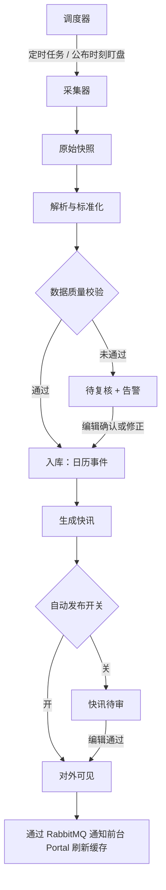
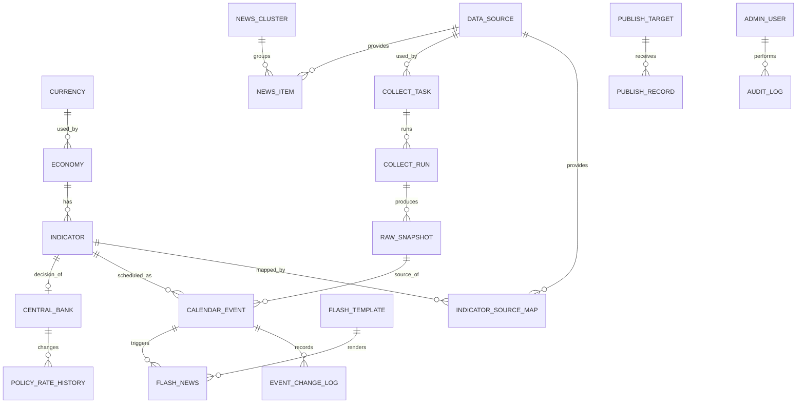
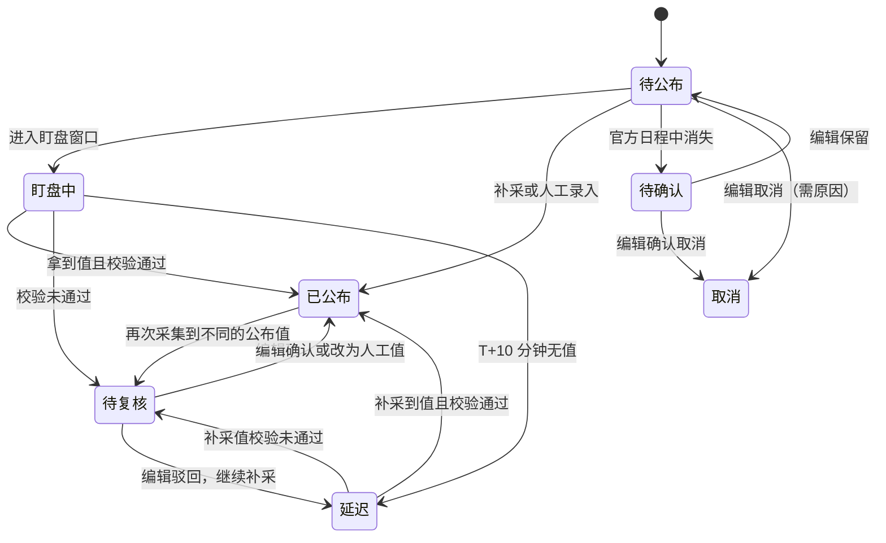
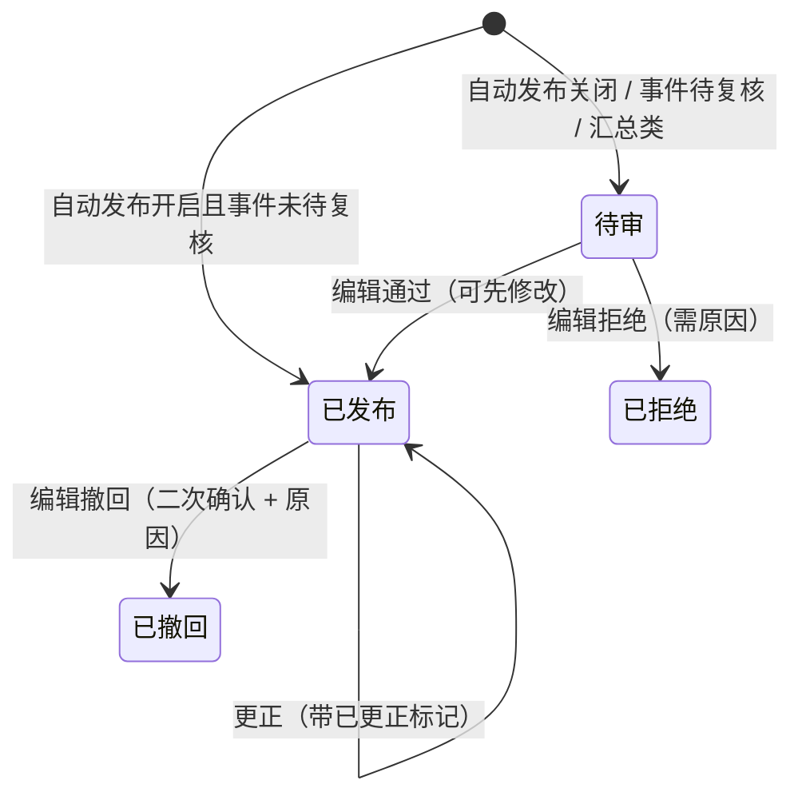
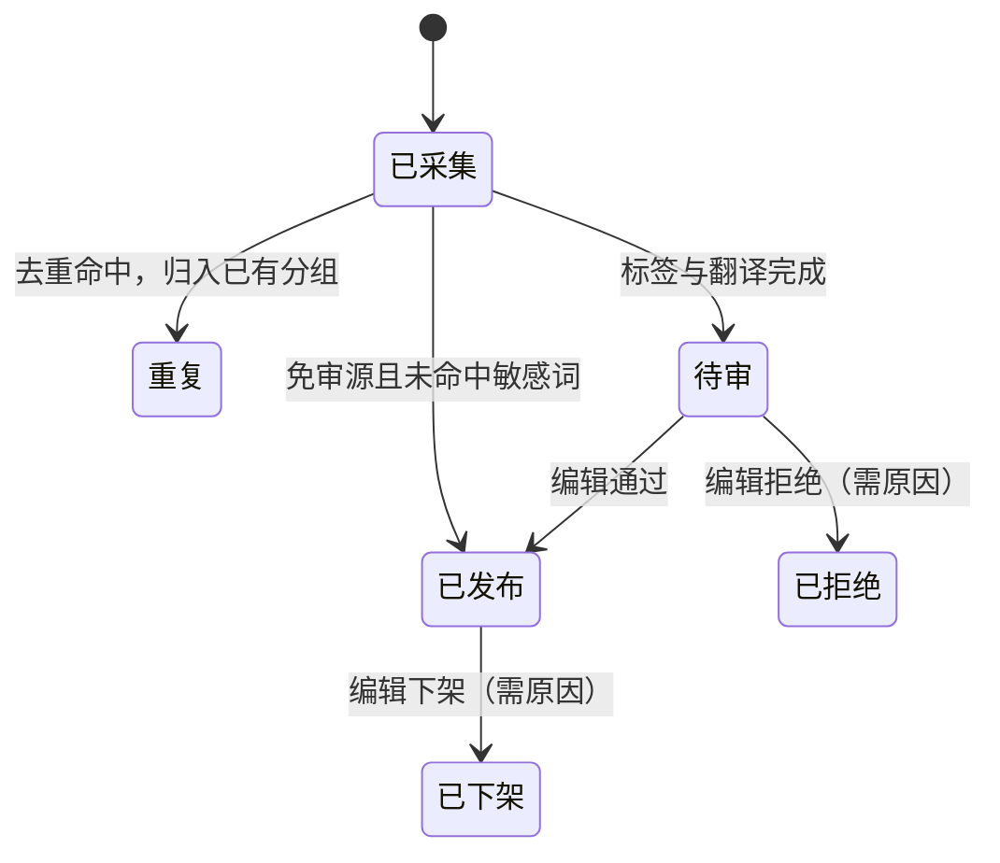

# PRD：suanpan-forex 数据中台（data-hub）—— 采集服务与后台管理

> 所属项目：suanpan-forex（外汇财经工具与资讯站）第一阶段。产品对外名称待定，见 Q-007。
> 本文按 skr-prd Part I（§1–§13）编写，Part II–V 暂不输出；需求追踪、决策日志、假设日志以简版放在 §10 附录。
> 本文件是 PRD 正本。评审确认后同步到 Linear 项目文档，并按 §10.5 拆分工单、回填工单号。

---

## 1. 文档信息

| 项目 | 内容 |
|---|---|
| 文档版本 | v1.0.0.2 |
| 状态 | 草稿 |
| 产品类型 | 金融（财经资讯与工具，不涉及交易与资金） |
| 创建日期 | 2026-10-17 |
| 最后更新 | 2026-10-17 |
| 作者 | vivo.li（Claude 起草） |
| 评审人 | 待定 |
| 项目代号 | suanpan-forex / 模块 data-hub |
| 文档位置 | `docs/product/data-hub/prd.md`（正本）；Linear 项目文档（同步副本，待建） |
| 关联文档 | [web-portal PRD](../web-portal/prd.md) |

---

## 2. 修订记录

| 版本 | 日期 | 修改人 | 变更类型 | 变更摘要 | Diff 摘要 | 影响范围 |
|---|---|---|---|---|---|---|
| v1.0.0.0 | 2026-10-17 | vivo.li / Claude | 创建 | 初始版本 | Added: All | 全文 |
| v1.0.0.1 | 2026-10-17 | vivo.li / Claude | 修订 | 确定技术基础（以 VVPay 为基础，PostgreSQL、EF Core Migrations、保留 RabbitMQ）；审计改为只记录请求参数；项目代号改为 suanpan-forex | Added: NFR-130 ~ NFR-134、DEC-013 ~ DEC-018、RISK-014 ~ RISK-015、D-009、ASS-010、§10.10；Changed: BR-139、BR-140、BR-147、BR-151、NFR-033、NFR-040、DEC-001、DEC-009、Q-001、Q-007、RISK-003、D-002 等，详见 §11 | §1、§3、§4.4、§5.2、§6、§7、§8、§9、§10、§11、§12、§13 |
| v1.0.0.2 | 2026-10-17 | vivo.li / Claude | 修订 | 单体解决方案（Collector、Job、Crm、Portal）；Collector 独立程序；前台直接查询数据库对外视图，FR-023 改为前台数据可见性与缓存刷新；FR-024 总开关改为前台冻结；HTMX 按需引入；后台前端四项优化 | Added: DEC-019 ~ DEC-021、BR-152、NFR-014、RISK-016；Changed: FR-023、FR-024、BR-035 等，详见 §11；Removed: 发布目标 | §3、§4、§5、§6、§7、§8、§9、§10、§11、§12、§13 |

---

## 3. 背景与目标

### 3.1 业务背景

- suanpan-forex 是面向中文用户（以中国大陆为主）和英文用户的外汇财经工具与资讯网站。第一阶段不做会员，前台以静态页面展示财经日历、自动数据快讯、央行利率、新闻和交易工具。
- 前台的动态内容全部依赖数据。项目决定不采购商业数据，而是自建采集服务，从各国统计机构、央行等官方公开渠道采集。首批覆盖美国、欧元区（含德国等成员国数据）、英国、日本、中国 5 个经济体。
- 采集来的数据需要一个后台来管理：配置数据源和采集任务，查看采集结果和数据质量，人工修正数据，每周人工录入预期值，控制快讯和新闻的发布。
- 整个项目采用单体解决方案：采集（Collector）、定时任务（Job）、后台（Crm）、前台（Portal）是同一个解决方案下的四个程序，共享类库，可以分开部署（DEC-019）。前台用只读数据库账号直接查询对外视图（DEC-021）。
- 部署方面，第一阶段整体部署在香港。中期把前台迁回大陆并完成备案，采集端和主数据库继续留在香港，因为境外官方源从大陆访问不稳定；届时在大陆部署数据库只读副本供前台查询。
- 金十数据等竞品的快讯速度以秒计。本模块的核心价值是：在公布时刻尽快拿到官方公布值，并自动生成中英文快讯。

### 3.2 产品目标（SMART）

| 目标编号 | 目标描述 | 衡量指标 | 目标值 | 衡量方式 |
|---|---|---|---|---|
| G-001 | 首批 5 个经济体的高重要性指标全部进入日历 | 指标字典中"高"重要性指标的排期覆盖率 | ≥ 95%（上线后首月） | 运营看板：有排期的高重要性指标数 ÷ 高重要性指标总数 |
| G-002 | 公布值尽快入库 | 官方按时发布的高重要性事件，从排期时间到公布值入库的耗时 | P50 ≤ 15 秒，P95 ≤ 60 秒 | 盯盘时效报表 |
| G-003 | 公布值准确 | 入库公布值与官方原始发布的一致率 | ≥ 99.5%（每月抽检 ≥ 100 条） | 人工抽检记录 |
| G-004 | 采集稳定 | 采集任务日成功率 | ≥ 98% | 采集健康日报 |
| G-005 | 快讯可信 | 自动快讯被人工撤回或修改的比例 | ≤ 2%（按月） | 快讯审计记录 |
| G-006 | 人工成本可控 | 每周录入高重要性事件预期值的人工耗时 | ≤ 60 分钟/周 | 录入记录时间戳 + 编辑自报 |

### 3.3 目标用户

| 用户角色 | 画像描述 | 核心诉求 | 当前痛点 | 使用频率 |
|---|---|---|---|---|
| 编辑（数据运营） | 懂宏观数据的内容运营 | 录入预期值、修正数据、审核快讯和新闻 | 没有工具，只能手工整理 | 高（每日） |
| 采集工程师 | 负责数据源和解析器的开发与运维 | 尽快发现并修复采集故障 | 官方页面改版、限流无法预知 | 中 |
| 管理员 | 项目负责人 | 控制发布、管理账号、紧急关停 | 出错时没有统一开关 | 低 |
| 前台访客（间接） | web-portal 的用户 | 看到及时、准确、双语的数据 | — | 高（不直接使用后台） |

### 3.4 竞品参考

| 竞品 | 相关功能 | 优势 | 劣势 | 差异化策略 |
|---|---|---|---|---|
| Forex Factory | 财经日历（影响等级、公布/预期/前值、指标说明、历史） | 指标说明和历史完整，明确标注"数值高对货币是好是坏" | 只有英文，没有中文快讯 | 借鉴指标字典和影响方向字段；提供中英双语 |
| 金十数据 | 7×24 快讯、数据公布快讯 | 速度快、覆盖广 | 依赖付费数据源和大量人工 | 用模板自动生成中英文快讯，压低人工成本 |
| Trading Economics | 指标历史与图表 | 历史数据完整 | 中文弱，有付费墙 | 用官方 API 回填历史，供前台指标详情页使用 |

---

## 4. 范围定义

### 4.1 包含范围（In Scope）

| 范围编号 | 功能模块 | 功能点描述 | 优先级 | MVP |
|---|---|---|---|---|
| S-01 | 数据源与采集 | 数据源管理、采集任务调度、运行日志、手动触发 | P0 | Yes |
| S-02 | 数据源与采集 | 公布时刻高频盯盘 | P0 | Yes |
| S-03 | 数据源与采集 | 原始快照存储与重新解析 | P0 | Yes |
| S-04 | 基础数据 | 经济体、货币、指标字典 | P0 | Yes |
| S-05 | 财经日历 | 排期采集、公布值与前值采集、事件管理、字段锁定 | P0 | Yes |
| S-06 | 财经日历 | 预期值人工录入 | P0 | Yes |
| S-07 | 快讯 | 中英文模板、数据公布快讯、央行决议快讯、预告快讯、审核与撤回 | P0 | Yes |
| S-08 | 央行利率 | 9 家央行的政策利率表 | P0 | Yes |
| S-09 | 汇率快照 | 每日参考汇率（供前台计算器使用） | P0 | Yes |
| S-10 | 发布 | 前台数据可见性、前台缓存刷新、紧急开关 | P0 | Yes |
| S-11 | 监控 | 采集监控告警、数据质量校验 | P0 | Yes |
| S-12 | 系统 | 后台账号、角色权限、审计日志 | P0 | Yes |
| S-13 | 财经日历 | 指标历史数据回填 | P1 | No |
| S-14 | 快讯 | 定时汇总（早报、下周日历预览） | P1 | No |
| S-15 | 新闻 | 新闻源管理、采集、去重、标签、机器翻译、审核发布 | P1 | No |
| S-16 | 监控 | 运营看板 | P1 | No |

### 4.2 不包含范围（Out of Scope）

| 排除项 | 排除原因 | 预计后续版本 |
|---|---|---|
| 实时报价、行情异动快讯 | 网页采集报价又慢又不稳定，而且大多违反网站条款；报价源单独评估 | v1.1+（确定报价源后） |
| 多空情绪数据 | 没有可用数据源 | 待定 |
| 采集商业网站（Forex Factory、Investing 等） | 条款禁止抓取，且有反爬机制，法律和维护风险都高 | 不做 |
| 自动采集预期值、模型预测预期值 | 已决定人工录入（DEC-002） | v2 视人力情况再评估 |
| 自动采集非政府发布机构的数据（ISM、密歇根大学、S&P Global PMI、ifo、ZEW 等） | 再分发授权不明 | v1.1（法务确认后）；在此之前允许人工录入 |
| 自动采集加拿大、澳大利亚、新西兰、瑞士等经济体 | 首批聚焦 5 个经济体（DEC-004） | v1.1 |
| 前台页面 | 属于 web-portal 模块 | 见 web-portal PRD |
| 会员、前台用户系统 | 第一阶段不做 | 待定 |
| 自动分发到 Telegram、X、公众号 | 不在 MVP 范围 | v1.1 |
| 新闻全文转载 | 版权问题和大陆新闻许可限制 | 不做 |
| AI 生成的解读文章 | 合规与审核成本高 | v2 |

### 4.3 MVP 边界定义

- **Must**：S-01 ~ S-12，构成"采集 → 入库 → 人工录入预期值 → 生成快讯 → 发布到前台"的最小闭环。
- **Should**：S-13 指标历史回填、S-15 新闻。
- **Could**：S-14 定时汇总、S-16 运营看板。
- **Won't**：见 4.2。

### 4.4 假设与前提条件

> 完整的确认状态见 §10.7 假设日志。

- ASS-001：首批官方数据源从香港服务器可以稳定访问。
- ASS-002：需要 API Key 的官方接口（BLS、BEA、FRED、e-Stat 等）可以免费申请。
- ASS-003：至少 1 名编辑每周能投入 ≥ 1 小时录入预期值，并能在重要数据公布时段处理待审内容。
- ASS-004：前台用只读数据库账号直接查询对外视图，只能读到对外可见的数据（DEC-021）。
- ASS-005：后台只对内部人员开放，同时在线 < 20 人。
- ASS-006：官方机构按其公布的排期准时发布，偶发延迟按异常处理。
- ASS-010：VVPay 的通用模块（鉴权、权限、操作日志、系统配置、Redis、RabbitMQ、Hangfire 接入、后台系统管理页面）可以不带支付逻辑地迁移过来。技术基础见 §10.10。

---

## 5. 用户场景与故事

### 5.1 核心使用场景

**场景 1：美国非农公布后自动出快讯**

| 维度 | 描述 |
|---|---|
| 触发条件 | 美国"就业报告"的排期时间到达（如北京时间 20:30） |
| 前置状态 | 事件已在日历中；预期值已录入；对应采集任务已启用 |
| 用户行为 | 不需要人工操作 |
| 系统响应 | 排期前 60 秒开始高频请求官方源 → 识别到新数据 → 解析出非农、失业率、平均时薪等多个指标 → 数据质量校验 → 入库 → 按模板生成中英文快讯并判断利多/利空 → 自动发布 → 通知前台刷新缓存 |
| 预期结果 | 排期后 60 秒内（P95），前台出现公布值和快讯 |
| 异常分支 | ① 官方延迟：排期后 10 分钟仍没有数据 → 事件标为"延迟"并告警；② 解析失败 → 告警，编辑可以手工录入公布值；③ 数值异常 → 事件进入"待复核"，快讯不自动发布 |

**场景 2：每周录入预期值**

| 维度 | 描述 |
|---|---|
| 触发条件 | 每周一，或事件公布前 |
| 前置状态 | 本周排期已采集 |
| 用户行为 | 编辑打开"待录入预期值"清单，逐条填写预期值 |
| 系统响应 | 校验格式 → 保存 → 自动锁定预期值字段 → 前台随之显示预期值 |
| 预期结果 | 本周所有高重要性事件在公布前都有预期值 |
| 异常分支 | 公布前 24 小时仍未录入 → 提醒编辑；公布时仍没有预期值 → 快讯改为"较前值"的表述，不判断利多利空 |

**场景 3：官方页面改版**

| 维度 | 描述 |
|---|---|
| 触发条件 | 某个数据源连续解析失败 |
| 前置状态 | 原始快照已保存 |
| 用户行为 | 工程师收到告警 → 查看失败日志和原始快照 → 修复解析器并发版 → 对失败期间的快照执行"重新解析" |
| 系统响应 | 重新解析的数据走同样的校验和入库流程；人工修正过并已锁定的字段不会被覆盖 |
| 预期结果 | 数据补齐，不需要重新抓取 |
| 异常分支 | 快照本身不完整（如抓到的是拦截页）→ 标记为无效，需要人工补录 |

**场景 4：新闻审核发布（P1）**

| 维度 | 描述 |
|---|---|
| 触发条件 | 新闻源出现新条目 |
| 前置状态 | 新闻源已启用 |
| 用户行为 | 编辑在待审队列里审核：通过、修改译文后通过，或拒绝 |
| 系统响应 | 采集标题、摘要、链接 → 去重 → 打标签 → 机器翻译 → 敏感词检测 → 进入待审队列 |
| 预期结果 | 只有审核通过的新闻会出现在前台 |
| 异常分支 | 命中敏感词 → 强制人工审核，并高亮命中的词；翻译失败 → 只保留原文，中文站不展示 |

### 5.2 用户故事

| 故事ID | 角色 | 动作 | 价值 | 验收标准 | 关联FR |
|---|---|---|---|---|---|
| US-001 | 采集工程师 | 我希望在后台登记和启停数据源 | 不改代码就能调整采集范围 | 1. 能新增、编辑、停用数据源<br>2. 停用后不再产生采集请求 | FR-001 |
| US-002 | 采集工程师 | 我希望配置采集任务的频率，并能随时手动重跑 | 及时补齐数据 | 1. 修改频率后下一周期生效<br>2. 手动触发后 10 秒内开始执行<br>3. 每次运行都有日志 | FR-002 |
| US-003 | 编辑 | 我希望在公布时刻由系统自动盯盘拿到公布值 | 快讯能第一时间发出 | 1. 排期前 60 秒开始盯盘<br>2. 拿到值后自动停止<br>3. P95 ≤ 60 秒 | FR-003 |
| US-004 | 采集工程师 | 我希望解析器修好后能对旧快照重新解析 | 不丢数据 | 1. 能按数据源和时间范围选择快照重跑<br>2. 结果不覆盖已锁定字段 | FR-004 |
| US-005 | 编辑 | 我希望维护经济体、货币和指标字典 | 日历和快讯有统一的中英文名称和规则 | 1. 预置首批经济体和货币<br>2. 每个指标有中英文名、单位、重要性、影响方向 | FR-005, FR-006 |
| US-006 | 编辑 | 我希望日历排期能从官方日程自动更新 | 不用手工维护时间表 | 1. 每日自动同步未来 90 天排期<br>2. 改期有记录 | FR-007 |
| US-007 | 编辑 | 我希望公布值和前值修正自动入库 | 不用手工录入 | 1. 公布值和前值修正一起入库<br>2. 数值能追溯到来源 | FR-008 |
| US-008 | 编辑 | 我希望查看、筛选、修正日历事件，并锁定我改过的字段 | 能纠错，且修正不会被采集覆盖 | 1. 可组合筛选<br>2. 修改后自动锁定<br>3. 采集不覆盖已锁定字段 | FR-009, FR-011 |
| US-009 | 编辑 | 我希望每周集中录入预期值 | 快讯能判断利多利空 | 1. 有待录入清单<br>2. 保存后停留在清单<br>3. 事件公布后不能再改预期值 | FR-010 |
| US-010 | 前台访客（间接） | 我希望看到指标的历史数据 | 判断数据趋势 | 1. 高重要性月度指标有 ≥ 60 期历史<br>2. 标注数值口径 | FR-012 |
| US-011 | 编辑 | 我希望自己维护中英文快讯模板 | 调整措辞不用发版 | 1. 能预览中英文效果<br>2. 未定义的变量无法保存 | FR-013 |
| US-012 | 前台访客（间接） | 我希望数据公布、央行决议后立即看到快讯，重要数据公布前看到预告 | 及时了解市场事件 | 1. 生成后 5 秒内发布<br>2. 利多利空判断正确<br>3. 预告在排期前 30 分钟出现 | FR-014, FR-015 |
| US-013 | 编辑 | 我希望审核、修改或撤回快讯 | 纠正错误 | 1. 撤回后前台不再展示<br>2. 修改后带"已更正"标记 | FR-016 |
| US-014 | 编辑 | 我希望系统定时生成早报和下周日历预览 | 减少重复劳动 | 1. 按时生成并进入待审<br>2. 内容与日历一致 | FR-017 |
| US-015 | 编辑 | 我希望维护央行利率表 | 前台展示准确的政策利率 | 1. 9 家央行都有数据<br>2. 决议后自动更新 | FR-018 |
| US-016 | 编辑 | 我希望采集新闻，并在审核后发布 | 内容合规 | 1. 只存标题、摘要、链接<br>2. 命中敏感词的必须人工审核 | FR-019, FR-020, FR-021 |
| US-017 | 前台访客（间接） | 我希望计算器用的是当天的参考汇率 | 计算结果合理 | 1. 工作日每天更新<br>2. 标注日期和"非实时" | FR-022 |
| US-018 | 管理员 | 我希望数据一变化，前台就尽快显示，且前台只能看到对外数据 | 前台数据及时、安全 | 1. 快讯类变更 5 秒内前台可见<br>2. 前台读不到内部字段 | FR-023 |
| US-019 | 管理员 | 我希望出问题时能一键冻结前台 | 控制错误扩散 | 1. 5 秒内生效<br>2. 采集不受影响 | FR-024 |
| US-020 | 采集工程师 | 我希望采集异常时第一时间收到告警 | 尽快修复 | 1. 紧急告警 1 分钟内送达<br>2. 同一问题不重复轰炸 | FR-025 |
| US-021 | 编辑 | 我希望异常数值不会被自动发出去 | 避免错误快讯 | 1. 异常值进入待复核<br>2. 待复核期间不自动发布快讯 | FR-026 |
| US-022 | 管理员 | 我希望看到采集健康度和数据质量看板 | 掌握系统状况 | 1. 看板展示成功率、时延等核心指标 | FR-027 |
| US-023 | 管理员 | 我希望管理后台账号和角色 | 控制谁能做什么 | 1. 预置四种角色，角色权限可在后台调整<br>2. 后端校验权限<br>3. 连续 5 次密码错误锁定账号 | FR-028 |
| US-024 | 管理员 | 我希望能追溯每一次人工操作 | 出问题时能查清楚 | 1. 每次写操作都有操作日志（含请求参数，凭据脱敏）<br>2. 操作日志不可篡改 | FR-029 |

> INVEST 自检：以上故事都能独立交付、可协商、有明确价值、可估算、可测试。US-005、US-008、US-012、US-016 各覆盖多个 FR，拆工单时按 FR 拆。

### 5.3 主流程图



---

## 6. 功能需求详情

> 说明：
> - FR 写在"契约高度"，只写系统要做到什么，不指定控件和布局。后台界面的细节在原型阶段确定，涉及界面的部分等原型定稿后回填。
> - data-hub 是内部后台，不做用户行为埋点。系统事件见 §8.2，人工操作留痕由 FR-029 审计日志覆盖，各 FR 不再单列埋点。
> - 权限角色有四种：管理员、采集工程师、编辑、只读。完整权限矩阵见 §13.1.2。

### 6.1 功能清单总览

| FR编号 | 功能模块 | 功能点名称 | 优先级 | 故事ID | 生命周期状态 | 关联事件 | 备注 |
|---|---|---|---|---|---|---|---|
| FR-001 | 数据源与采集 | 数据源管理 | P0 | US-001 | Draft | — | |
| FR-002 | 数据源与采集 | 采集任务配置与调度 | P0 | US-002 | Draft | EV-001, EV-002 | |
| FR-003 | 数据源与采集 | 公布时刻高频盯盘 | P0 | US-003 | Draft | EV-004, EV-005 | 由 Collector 程序中的常驻后台服务执行，不走 Hangfire（DEC-017） |
| FR-004 | 数据源与采集 | 原始快照与重新解析 | P0 | US-004 | Draft | EV-001 | |
| FR-005 | 基础数据 | 经济体与货币管理 | P0 | US-005 | Draft | — | |
| FR-006 | 基础数据 | 指标字典管理 | P0 | US-005 | Draft | — | |
| FR-007 | 财经日历 | 日历排期采集 | P0 | US-006 | Draft | EV-003 | |
| FR-008 | 财经日历 | 公布值与前值采集 | P0 | US-007 | Draft | EV-004, EV-005 | |
| FR-009 | 财经日历 | 日历事件管理 | P0 | US-008 | Draft | EV-004 | |
| FR-010 | 财经日历 | 预期值人工录入 | P0 | US-009 | Draft | EV-006 | |
| FR-011 | 财经日历 | 字段锁定与人工优先 | P0 | US-008 | Draft | — | |
| FR-012 | 财经日历 | 指标历史数据回填 | P1 | US-010 | Draft | — | |
| FR-013 | 快讯 | 快讯模板管理 | P0 | US-011 | Draft | — | |
| FR-014 | 快讯 | 数据公布快讯 | P0 | US-012 | Draft | EV-007, EV-008 | |
| FR-015 | 快讯 | 央行决议与预告快讯 | P0 | US-012 | Draft | EV-007, EV-008, EV-016 | |
| FR-016 | 快讯 | 快讯审核、修改与撤回 | P0 | US-013 | Draft | EV-008, EV-009 | |
| FR-017 | 快讯 | 定时汇总 | P1 | US-014 | Draft | EV-007 | |
| FR-018 | 央行利率 | 央行利率表 | P0 | US-015 | Draft | EV-016 | |
| FR-019 | 新闻 | 新闻源与新闻采集 | P1 | US-016 | Draft | EV-010 | |
| FR-020 | 新闻 | 新闻去重、标签与翻译 | P1 | US-016 | Draft | — | |
| FR-021 | 新闻 | 新闻审核与发布 | P1 | US-016 | Draft | EV-011 | |
| FR-022 | 汇率快照 | 每日参考汇率 | P0 | US-017 | Draft | — | 前台计算器依赖此项 |
| FR-023 | 发布 | 数据发布 | P0 | US-018 | Draft | EV-012, EV-013 | |
| FR-024 | 发布 | 发布控制与紧急开关 | P0 | US-019 | Draft | EV-014 | |
| FR-025 | 监控 | 采集监控与告警 | P0 | US-020 | Draft | EV-015 | |
| FR-026 | 监控 | 数据质量校验 | P0 | US-021 | Draft | EV-005 | |
| FR-027 | 监控 | 运营看板 | P1 | US-022 | Draft | — | |
| FR-028 | 系统 | 后台账号与角色权限 | P0 | US-023 | Draft | — | |
| FR-029 | 系统 | 审计日志（操作日志） | P0 | US-024 | Draft | — | 本文中"审计日志"与"操作日志"指同一份记录 |

### 6.2 功能详情

---

#### FR-001：数据源管理

| 项目 | 内容 |
|---|---|
| 所属模块 | 数据源与采集 |
| 优先级 | P0 |
| 关联故事 | US-001 |
| 关联事件 | — |
| 关联状态机 | 数据源状态：停用 / 启用 / 异常（由 FR-025 判定） |
| 权限 | 查看：全部角色；新增、编辑、启停：管理员、采集工程师 |

**需求描述**

在后台登记所有数据源（官方统计机构、央行、新闻 RSS 等），记录访问方式、请求频率上限、凭据和合规信息。采集任务（FR-002）引用数据源；数据源停用后，它下面的所有任务都停止执行。

**业务规则**

| 规则编号 | 规则描述 | 约束类型 | 备注 |
|---|---|---|---|
| BR-001 | 数据源类型限定为：官方 API、官方网页、RSS/Atom、文件下载（如 CSV、XLSX） | 硬约束 | |
| BR-002 | 每个数据源必须填写所属机构、合规类别（政府公开数据 / 机构许可 / 待确认）、条款链接、robots.txt 检查结果。合规类别为"待确认"，或 robots.txt 结果为"不允许"的数据源不能启用 | 硬约束 | 见 §13.2 |
| BR-003 | 每个数据源必须设置请求频率上限（每秒或每分钟最大请求数）。所有任务对同一数据源的请求合计不得超过上限 | 硬约束 | 盯盘同样受限 |
| BR-004 | API Key 等凭据加密存储；界面只显示掩码，修改时需要重新输入完整值 | 硬约束 | |
| BR-005 | 采集请求统一使用可识别的 User-Agent，包含项目名和联系邮箱 | 硬约束 | 采集合规 |
| BR-006 | 被任务引用的数据源不能删除，只能停用 | 硬约束 | |

**前置条件**
- 操作者已登录，且具备对应权限。

**主流程（正向）**

| 步骤 | 用户操作 | 系统响应 | 触发事件 | 说明 |
|---|---|---|---|---|
| 1 | 工程师新建数据源，填写基础信息、合规信息、频率上限、凭据 | 校验必填项和格式，保存为"停用"状态 | — | |
| 2 | 工程师执行"连通性测试" | 按配置发起一次请求，返回状态码、耗时和响应片段 | — | |
| 3 | 工程师启用数据源 | 校验 BR-002，通过后状态改为"启用" | — | |
| 4 | — | 写入审计日志 | — | FR-029 |

**异常流程**

| 异常场景 | 触发条件 | 系统处理 | 用户感知 | 错误码 |
|---|---|---|---|---|
| 合规未确认 | 合规类别为"待确认"或 robots.txt 为"不允许"时启用 | 拒绝启用 | 提示"请先完成合规确认" | ERR-SRC-001 |
| 连通性失败 | 测试请求超时（10 秒）或返回非 2xx | 返回失败详情，不阻止保存 | 显示状态码和错误信息 | ERR-SRC-002 |
| 删除被引用的数据源 | 有任务引用 | 拒绝删除 | 列出引用它的任务 | ERR-SRC-003 |
| 凭据缺失 | 类型要求凭据但未填写 | 拒绝保存 | 字段提示 | ERR-SRC-004 |

**后置条件**
- 数据源可以被采集任务引用。

**页面元素**

| 元素名称 | 类型 | 必填 | 校验规则 | 权限要求 | 说明 |
|---|---|---|---|---|---|
| 名称 | 文本 | 是 | ≤ 64 字符，唯一 | 管理员、工程师 | |
| 所属机构 | 文本 | 是 | ≤ 128 字符 | 同上 | |
| 经济体 | 选择 | 否 | 引用 FR-005 | 同上 | |
| 类型 | 选择 | 是 | BR-001 枚举 | 同上 | |
| 基础地址 | 文本 | 是 | http/https URL | 同上 | |
| 请求频率上限 | 数字 | 是 | 正整数，带单位（次/秒 或 次/分） | 同上 | |
| 凭据 | 密文 | 按类型 | — | 同上 | 掩码显示 |
| 合规类别 | 选择 | 是 | 政府公开数据 / 机构许可 / 待确认 | 同上 | |
| 条款链接 | 文本 | 是 | URL | 同上 | |
| robots.txt 检查结果 | 选择 | 是 | 允许 / 不涉及（API） / 不允许 | 同上 | |
| 备注 | 文本 | 否 | ≤ 500 字符 | 同上 | |

**验收标准**

1. 新建的数据源默认停用；合规类别为"待确认"或 robots.txt 结果为"不允许"时无法启用。
2. 凭据保存后，界面只显示掩码，数据库中为密文。
3. 被任务引用的数据源无法删除，并提示引用它的任务。
4. 数据源停用后 1 分钟内，其下所有任务不再发起新请求。
5. 新增、修改、启停操作都能在操作日志中查到，含请求参数；凭据字段脱敏，不记录明文。

---

#### FR-002：采集任务配置与调度

| 项目 | 内容 |
|---|---|
| 所属模块 | 数据源与采集 |
| 优先级 | P0 |
| 关联故事 | US-002 |
| 关联事件 | EV-001, EV-002 |
| 关联状态机 | 采集运行：排队 → 运行中 → 成功 / 部分成功 / 失败 / 跳过 |
| 权限 | 查看：全部角色；配置任务：管理员、采集工程师；手动触发：管理员、采集工程师，编辑仅可触发"排期采集"和"公布值补采"类任务 |

**需求描述**

采集任务 = 数据源 + 解析器 + 目标数据类型 + 调度规则。支持周期调度（cron 表达式）和一次性执行，每次执行都生成一条运行记录。定时调度由 Job 中的 Hangfire 触发，通过 RabbitMQ 下发给 Collector 执行；后台的手动触发同样下发给 Collector（DEC-020）。

**业务规则**

| 规则编号 | 规则描述 | 约束类型 | 备注 |
|---|---|---|---|
| BR-007 | 任务的目标数据类型：日历排期、公布值、历史数据、央行利率、参考汇率、新闻 | 硬约束 | |
| BR-008 | 周期任务最小间隔 1 分钟；秒级采集需求只通过盯盘（FR-003）实现 | 硬约束 | |
| BR-009 | 失败自动重试最多 3 次，默认间隔 30 秒 / 2 分钟 / 5 分钟（可配置）；重试后仍失败记为失败，并按 FR-025 规则告警 | 软约束 | 参数可配 |
| BR-010 | 同一任务同一时刻只允许一个运行实例；上一次未结束时，本次跳过并记录"跳过" | 硬约束 | |
| BR-011 | 运行记录保留 90 天 | 软约束 | |
| BR-012 | 解析器用代码实现，后台通过"解析器标识"选择；新增解析器需要发版，后台不支持在线编写脚本 | 硬约束 | 出于安全考虑，见 DEC-012 |

**前置条件**
- 引用的数据源已启用（FR-001）。

**主流程（正向）**

| 步骤 | 用户操作 | 系统响应 | 触发事件 | 说明 |
|---|---|---|---|---|
| 1 | 工程师新建任务：选择数据源、解析器、目标数据类型、调度规则、参数 | 校验 cron 是否合法、解析器是否存在 | — | |
| 2 | 工程师启用任务 | 注册调度 | — | |
| 3 | — | 到点执行：请求 → 保存快照（FR-004）→ 解析 → 校验（FR-026）→ 入库 | EV-001 | |
| 4 | 工程师查看运行记录 | 展示开始/结束时间、耗时、状态、新增/更新/跳过条数、错误信息、关联快照 | — | |
| 5 | 工程师或编辑手动触发 | 10 秒内开始执行，记录触发人 | EV-001 | |

**异常流程**

| 异常场景 | 触发条件 | 系统处理 | 用户感知 | 错误码 |
|---|---|---|---|---|
| cron 非法 | 表达式无法解析或间隔 < 1 分钟 | 拒绝保存 | 字段提示 | ERR-COL-001 |
| 请求失败 | 超时（默认 30 秒）或返回非 2xx | 按 BR-009 重试 | 运行记录显示失败原因和每次重试 | ERR-COL-002 |
| 解析失败 | 解析器报错或缺少必需字段 | 不入库，保留快照，记为失败 | 运行记录显示错误 | ERR-PARSE-001 |
| 超过频率上限 | 本次执行会超过数据源频率上限 | 延后执行 | 运行记录显示"已延后" | ERR-COL-003 |
| 并发冲突 | 上一次运行未结束 | 本次跳过 | 运行记录显示"跳过" | ERR-COL-004 |

**后置条件**
- 运行记录已生成；成功时数据已按 FR-026 校验后入库。

**验收标准**

1. 修改调度规则后，下一个周期按新规则执行。
2. 手动触发后 10 秒内，运行记录出现"运行中"。
3. 请求失败时最多重试 3 次，运行记录能看到每次重试的时间和原因。
4. 同一任务不会并发运行。
5. 运行记录可以按任务、数据源、状态、时间筛选。

---

#### FR-003：公布时刻高频盯盘

| 项目 | 内容 |
|---|---|
| 所属模块 | 数据源与采集 |
| 优先级 | P0 |
| 关联故事 | US-003 |
| 关联事件 | EV-004, EV-005 |
| 关联状态机 | 日历事件（§8.1.3） |
| 权限 | 系统自动执行；盯盘参数配置：管理员、采集工程师；查看盯盘状态：全部角色 |

**需求描述**

对重要性为"高"的日历事件（可配置扩展到"中"），在排期时间前后以秒级频率请求官方源。拿到新的公布值后立即停止盯盘，进入入库和快讯流程。

**业务规则**

| 规则编号 | 规则描述 | 约束类型 | 备注 |
|---|---|---|---|
| BR-013 | 盯盘窗口：排期前 60 秒开始，排期后 15 分钟结束（均可按指标配置） | 软约束 | |
| BR-014 | 盯盘请求间隔默认 2 秒、最小 1 秒，且受数据源频率上限（BR-003）约束。同一数据源同一时刻的多个事件（如非农、失业率、平均时薪出自同一份报告）合并成一路请求 | 硬约束 | |
| BR-015 | "拿到新值"的判定：解析结果中出现目标参考期的公布值。只有响应内容变化（哈希不同）时才解析 | 硬约束 | |
| BR-016 | 盯盘期间只保存内容有变化的快照（按哈希去重） | 硬约束 | 控制存储量 |
| BR-017 | 排期后 10 分钟仍未拿到值：事件状态改为"延迟"并告警。窗口结束后转为每 5 分钟一次的普通补采，直到拿到值或人工处理 | 硬约束 | |
| BR-018 | 时间精度为"仅日期"或"待定"的事件不进入盯盘，按普通任务补采 | 硬约束 | |
| BR-019 | 记录"检测时间 − 排期时间"作为入库时延，用于统计 G-002 | 硬约束 | |

**前置条件**
- 事件的指标已映射到可用数据源（FR-006），且数据源已启用。
- 服务器时钟已与 NTP 同步（NFR-113）。

**主流程（正向）**

| 步骤 | 用户操作 | 系统响应 | 触发事件 | 说明 |
|---|---|---|---|---|
| 1 | — | 每分钟扫描未来 10 分钟内需要盯盘的事件，按数据源合并生成盯盘计划 | — | |
| 2 | — | 从 T-60 秒起按间隔请求官方源 → 快照去重 → 内容有变化时解析 | — | |
| 3 | — | 识别到目标参考期的新值 → 质量校验（FR-026）→ 通过则写入公布值，状态改为"已公布" | EV-004 | |
| 4 | — | 触发快讯生成（FR-014），结束该事件的盯盘；同批其他事件继续，直到全部拿到值或窗口结束 | — | |

**异常流程**

| 异常场景 | 触发条件 | 系统处理 | 用户感知 | 错误码 |
|---|---|---|---|---|
| 官方延迟 | T+10 分钟仍无值 | 状态改为"延迟"并告警 | 编辑看到"延迟"标记 | ERR-EVT-001 |
| 被限流 | 返回 429 或 403 | 请求间隔加倍退避，并告警 | 告警消息 | ERR-COL-005 |
| 部分指标缺失 | 同一报告中部分指标解析不到 | 已解析的先入库，缺失的继续盯盘 | — | ERR-PARSE-002 |
| 校验未通过 | 命中 FR-026 规则 | 状态改为"待复核"，快讯不自动发布，并告警 | 编辑在待复核列表处理 | ERR-EVT-002 |
| 服务重启 | 盯盘中进程重启 | 重启后 30 秒内恢复仍在窗口内的盯盘 | — | ERR-COL-006 |

**后置条件**
- 事件为"已公布""待复核"或"延迟"之一。

**验收标准**

1. 高重要性事件在排期前 60 秒（±5 秒）开始发起请求。
2. 同一份官方报告中的多个指标只产生一路请求。
3. 拿到值后，该事件停止盯盘（可通过请求日志验证）。
4. 模拟官方延迟 10 分钟，事件变为"延迟"，并收到告警。
5. 盯盘请求频率不超过数据源上限。
6. 用历史快照做回放测试，系统自身的入库时延 P95 ≤ 60 秒（不含官方自身的延迟）。

---

#### FR-004：原始快照与重新解析

| 项目 | 内容 |
|---|---|
| 所属模块 | 数据源与采集 |
| 优先级 | P0 |
| 关联故事 | US-004 |
| 关联事件 | EV-001 |
| 关联状态机 | 快照：有效 / 无效 |
| 权限 | 查看快照、执行重新解析：管理员、采集工程师 |

**需求描述**

每次采集得到的原始响应（HTML、JSON、XML 或文件）都保存为快照，用于追溯数据来源，以及在解析器修复后重新解析，不需要重新抓取。重新解析由后台发起、Collector 执行。

**业务规则**

| 规则编号 | 规则描述 | 约束类型 | 备注 |
|---|---|---|---|
| BR-020 | 每个快照记录：数据源、任务、请求 URL、请求时间、HTTP 状态、内容哈希、内容大小、存储位置 | 硬约束 | |
| BR-021 | 同一数据源、同一 URL 的内容哈希与上一个快照相同时，不再重复存储内容，只记录"未变化" | 硬约束 | |
| BR-022 | 快照默认保留 180 天（可配置）；被已入库数据引用的快照保留 ≥ 1 年 | 软约束 | |
| BR-023 | 重新解析产出的数据走与正常采集相同的校验和入库流程，遵守字段锁定（FR-011） | 硬约束 | |
| BR-024 | 单次重新解析最多 5000 个快照，超出时需分批 | 软约束 | |
| BR-025 | 后台只以纯文本或源码方式查看快照内容，不渲染外部 HTML | 硬约束 | 防 XSS |

**前置条件**
- 快照存储可用。

**主流程（正向）**

| 步骤 | 用户操作 | 系统响应 | 触发事件 | 说明 |
|---|---|---|---|---|
| 1 | 工程师按数据源、时间范围、运行状态筛选快照 | 返回快照列表 | — | |
| 2 | 工程师查看快照 | 并排展示快照内容和当时的解析结果 | — | |
| 3 | 工程师选中快照（或整个筛选结果），选择解析器版本，执行重新解析 | 生成一条"重新解析"运行记录 | EV-001 | |
| 4 | — | 展示结果：新增、更新、因锁定跳过、失败的条数 | — | |

**异常流程**

| 异常场景 | 触发条件 | 系统处理 | 用户感知 | 错误码 |
|---|---|---|---|---|
| 快照无效 | 内容为拦截页或为空 | 标记为无效并跳过 | 在结果中列出 | ERR-PARSE-003 |
| 超出上限 | 选中 > 5000 个快照 | 拒绝执行 | 提示分批 | ERR-PARSE-004 |
| 存储不可用 | 快照写入失败 | 本次采集记为失败并告警 | 告警消息 | ERR-COL-007 |

**后置条件**
- 任一入库数值都关联到产生它的快照。

**验收标准**

1. 任一入库数值都能追溯到产生它的快照。
2. 内容未变化的重复请求不产生新的快照内容文件。
3. 重新解析不覆盖已锁定字段，结果中显示跳过的数量。
4. 快照查看页不执行快照中的任何脚本。

---

#### FR-005：经济体与货币管理

| 项目 | 内容 |
|---|---|
| 所属模块 | 基础数据 |
| 优先级 | P0 |
| 关联故事 | US-005 |
| 关联事件 | — |
| 关联状态机 | 启用 / 停用 |
| 权限 | 查看：全部角色；编辑：管理员、编辑 |

**需求描述**

维护经济体（国家或地区，如美国、欧元区）和货币的主数据，供指标、日历、快讯、央行利率表引用。

**业务规则**

| 规则编号 | 规则描述 | 约束类型 | 备注 |
|---|---|---|---|
| BR-026 | 经济体编码使用 ISO 3166-1 alpha-2，欧元区使用 `EA`（沿用 Eurostat 惯例）；货币编码使用 ISO 4217 | 硬约束 | |
| BR-027 | 每个经济体必须有中英文名称、关联货币、默认时区（IANA，如 `America/New_York`） | 硬约束 | |
| BR-028 | 被引用的经济体或货币不能删除，只能停用 | 硬约束 | |

预置数据（10 个经济体）：US/USD、EA/EUR、DE/EUR、GB/GBP、JP/JPY、CN/CNY，以及 CH/CHF、CA/CAD、AU/AUD、NZ/NZD（供央行利率表和后续扩展使用）。德国单列为 DE，见 Q-008。

**前置条件**
- 操作者具备编辑权限。

**主流程（正向）**

| 步骤 | 用户操作 | 系统响应 | 触发事件 | 说明 |
|---|---|---|---|---|
| 1 | 编辑新增或修改经济体/货币 | 校验编码唯一、时区合法 | — | |
| 2 | 编辑保存 | 保存并写审计日志 | — | |

**异常流程**

| 异常场景 | 触发条件 | 系统处理 | 用户感知 | 错误码 |
|---|---|---|---|---|
| 编码重复 | 编码已存在 | 拒绝保存 | 字段提示 | ERR-REF-001 |
| 删除被引用的数据 | 有指标或央行引用 | 拒绝删除 | 列出引用方 | ERR-REF-002 |
| 时区非法 | 不在 IANA 时区列表中 | 拒绝保存 | 字段提示 | ERR-REF-003 |

**后置条件**
- 经济体和货币可被指标与央行引用。

**验收标准**

1. 系统初始化后包含上述 10 个经济体及其货币。
2. 编码唯一；时区只能从 IANA 列表中选择。
3. 被引用的经济体和货币不能删除。

---

#### FR-006：指标字典管理

| 项目 | 内容 |
|---|---|
| 所属模块 | 基础数据 |
| 优先级 | P0 |
| 关联故事 | US-005 |
| 关联事件 | — |
| 关联状态机 | 启用 / 停用 |
| 权限 | 查看：全部角色；编辑指标：管理员、编辑；编辑数据源映射：管理员、采集工程师 |

**需求描述**

指标字典是日历、快讯和前台指标详情页的基础。每个指标定义中英文名称、单位、重要性、对货币的影响方向、发布机构、说明文字，以及它在各数据源中的标识映射。首批指标清单见 §10.9。

**业务规则**

| 规则编号 | 规则描述 | 约束类型 | 备注 |
|---|---|---|---|
| BR-029 | 指标编码格式为 `{经济体}.{简称}`，如 `US.NFP`、`US.CPI.YOY`；同一概念的不同口径（环比/同比、初值/终值）作为不同指标 | 硬约束 | |
| BR-030 | 必填字段：编码、经济体、货币、中英文名称、类别、单位、数值类型（数值 / 区间）、小数位、频率、重要性（高/中/低）、影响方向、发布机构、默认发布时间（机构当地时间） | 硬约束 | |
| BR-031 | 影响方向取值：数值越高越利好本币 / 数值越高越利空本币 / 无方向。快讯（FR-014）据此判断利多利空。修改影响方向必须填写理由，并记入审计日志 | 硬约束 | |
| BR-032 | 数值类型为"区间"的指标（如美联储联邦基金利率目标区间）同时存储上下限 | 硬约束 | |
| BR-033 | 中英文说明（定义、计算方式、为什么重要）供前台指标详情页使用；可以为空，为空时前台不展示该区块 | 软约束 | 不得复制其他网站的说明文字，见 §13.2.1 |
| BR-034 | 一个指标可以映射多个数据源（主源 + 备源）。每个映射包含数据源、外部标识（如序列 ID）、解析器标识、优先级；主源失败时使用备源 | 硬约束 | |
| BR-035 | 重要性调整立即影响盯盘范围（FR-003）和预告快讯（FR-015），并通知前台刷新缓存 | 硬约束 | |

**前置条件**
- 所属经济体和货币已存在（FR-005）。

**主流程（正向）**

| 步骤 | 用户操作 | 系统响应 | 触发事件 | 说明 |
|---|---|---|---|---|
| 1 | 编辑新增指标，填写必填字段和中英文说明 | 校验编码唯一和必填项 | — | |
| 2 | 工程师配置数据源映射 | 校验数据源存在且已启用 | — | |
| 3 | 保存 | 保存并写审计日志 | — | |

**异常流程**

| 异常场景 | 触发条件 | 系统处理 | 用户感知 | 错误码 |
|---|---|---|---|---|
| 编码重复 | 编码已存在 | 拒绝保存 | 字段提示 | ERR-IND-001 |
| 修改方向未填理由 | 影响方向变更但理由为空 | 拒绝保存 | 字段提示 | ERR-IND-002 |
| 映射的数据源已停用 | 选中的数据源处于停用状态 | 警告，但不阻止保存 | 警告提示 | ERR-IND-003 |

**后置条件**
- 指标可被日历事件引用。

**页面元素**

指标的字段见 §8.1.2；校验规则见 BR-029 ~ BR-034。

**验收标准**

1. 上线前，§10.9 中的首批高重要性指标全部录入，并经编辑确认影响方向。
2. 修改影响方向必须填写理由，审计日志可查。
3. 一个指标可以配置主备数据源；主源失败时自动改用备源（可通过采集日志验证）。
4. 把指标重要性改为"高"后，下一次盯盘计划包含该指标的事件。

---

#### FR-007：日历排期采集

| 项目 | 内容 |
|---|---|
| 所属模块 | 财经日历 |
| 优先级 | P0 |
| 关联故事 | US-006 |
| 关联事件 | EV-003 |
| 关联状态机 | 日历事件（§8.1.3） |
| 权限 | 系统自动执行；人工新增、批量导入、处理未匹配条目：管理员、编辑 |

**需求描述**

从官方发布日程采集未来的事件，生成或更新日历事件。官方日程的来源包括 BLS、BEA、Eurostat、ONS 的发布日历，国家统计局年度发布日程表，e-Stat 公表予定等。官方没有提供可采集日程的，支持人工新增和批量导入。

**业务规则**

| 规则编号 | 规则描述 | 约束类型 | 备注 |
|---|---|---|---|
| BR-036 | 事件唯一键：指标 + 参考期（如 `US.NFP` + 2026-09）。同一键重复采集时更新，不新增 | 硬约束 | |
| BR-037 | 排期时间按发布机构当地时间解析，转换为 UTC 存储，同时保存原始当地时间和时区；夏令时按 IANA 时区数据库计算 | 硬约束 | |
| BR-038 | 时间精度分三种：精确到分钟 / 仅日期 / 待定 | 硬约束 | |
| BR-039 | 官方改期时更新排期，记录改期历史并触发 EV-003；如果排期字段已被人工锁定，则不覆盖，并产生"排期冲突"告警 | 硬约束 | |
| BR-040 | 从官方日程中消失的事件不自动删除，标记为"待确认"，由编辑确认取消或保留 | 硬约束 | |
| BR-041 | 每天至少同步一次未来 90 天的排期；每周一 00:00 UTC 额外做一次全量同步 | 软约束 | |
| BR-042 | 批量导入使用 CSV 模板（指标编码、参考期、当地日期、当地时间、时间精度）；整批校验通过才导入，错误逐行提示 | 硬约束 | |

**前置条件**
- 日程类采集任务已启用；指标已配置数据源映射。

**主流程（正向）**

| 步骤 | 用户操作 | 系统响应 | 触发事件 | 说明 |
|---|---|---|---|---|
| 1 | — | 定时采集官方日程 | — | |
| 2 | — | 解析出指标、参考期、当地时间 | — | |
| 3 | — | 按外部标识映射匹配指标字典 | — | |
| 4 | — | 新增或更新事件；改期时记录历史 | EV-003 | |
| 5 | 编辑处理"未匹配条目"和"待确认"事件 | 新增指标后重新匹配，或忽略 | — | |

**异常流程**

| 异常场景 | 触发条件 | 系统处理 | 用户感知 | 错误码 |
|---|---|---|---|---|
| 无法匹配指标 | 日程条目在指标字典中找不到映射 | 放入"未匹配条目"列表 | 编辑可新增指标或忽略 | ERR-EVT-003 |
| 时间解析失败 | 日期或时间格式无法识别 | 跳过该条并记录 | 运行记录显示 | ERR-PARSE-005 |
| 锁定冲突 | 官方改期，但排期已被人工锁定 | 不覆盖，产生告警 | 告警消息 + 冲突列表 | ERR-EVT-004 |
| 导入校验失败 | CSV 有任意一行不合法 | 整批不导入 | 逐行列出错误 | ERR-EVT-005 |

**后置条件**
- 未来 90 天的排期已更新。

**验收标准**

1. 重复采集同一排期，不会产生重复事件。
2. 美国夏令时切换周（3 月、11 月）的事件，UTC 时间与官方当地时间换算正确。
3. 官方改期后，事件排期更新，并能在事件详情中看到改期历史。
4. 人工锁定的排期不会被覆盖，并产生冲突告警。
5. CSV 导入有错时整批不导入，并逐行列出错误。

---

#### FR-008：公布值与前值采集

| 项目 | 内容 |
|---|---|
| 所属模块 | 财经日历 |
| 优先级 | P0 |
| 关联故事 | US-007 |
| 关联事件 | EV-004, EV-005 |
| 关联状态机 | 日历事件（§8.1.3） |
| 权限 | 系统自动执行；查看：全部角色 |

**需求描述**

采集事件的公布值，同时采集前值修正（官方在本次发布中对上一期数值的修正）。公布时刻的采集由盯盘（FR-003）完成，其他时间由普通任务（FR-002）补采。

**业务规则**

| 规则编号 | 规则描述 | 约束类型 | 备注 |
|---|---|---|---|
| BR-043 | 公布值、前值、前值修正按指标字典的单位和小数位标准化存储，同时保留原始字符串 | 硬约束 | |
| BR-044 | 前值默认取该指标上一期事件的公布值。若本次发布带有上一期的修正值，则写入本事件的"前值修正"字段，并同步更新上一期事件的"修正后数值" | 硬约束 | |
| BR-045 | 公布值写入后，事件状态改为"已公布"，并记录检测时间和来源快照 | 硬约束 | |
| BR-046 | 已公布事件再次采集到不同的公布值时，不直接覆盖，而是进入"待复核"并告警（官方更正极少，需人工确认） | 硬约束 | |
| BR-047 | 公布值来源优先级：人工录入（已锁定）> 主数据源 > 备数据源 | 硬约束 | |

**前置条件**
- 事件已存在于日历中，或允许按 ERR-EVT-006 补建。

**主流程（正向）**

| 步骤 | 用户操作 | 系统响应 | 触发事件 | 说明 |
|---|---|---|---|---|
| 1 | — | 解析得到参考期和数值 | — | |
| 2 | — | 按指标 + 参考期匹配事件 | — | |
| 3 | — | 质量校验（FR-026） | — | 不通过时触发 EV-005 |
| 4 | — | 写入公布值；更新上一期的修正后数值 | EV-004 | |
| 5 | — | 触发快讯生成（FR-014） | — | |

**异常流程**

| 异常场景 | 触发条件 | 系统处理 | 用户感知 | 错误码 |
|---|---|---|---|---|
| 找不到事件 | 排期缺失 | 自动补建事件（时间 = 检测时间，精度 = 精确到分钟），标记"补建"并告警 | 告警消息 | ERR-EVT-006 |
| 公布值与已公布值不同 | 已公布事件再次采集到不同数值 | 进入待复核并告警 | 待复核列表 | ERR-EVT-007 |
| 单位不符 | 原始数据单位与指标字典不一致（如"千人"与"人"） | 解析失败，不入库 | 运行记录显示 | ERR-PARSE-006 |

**后置条件**
- 事件为"已公布"或"待复核"。

**验收标准**

1. 公布值和前值修正同时入库，上一期事件的修正后数值同步更新。
2. 已公布的事件再次采集到不同数值时不覆盖，而是进入待复核。
3. 每个公布值都能看到来源快照和检测时间。

---

#### FR-009：日历事件管理

| 项目 | 内容 |
|---|---|
| 所属模块 | 财经日历 |
| 优先级 | P0 |
| 关联故事 | US-008 |
| 关联事件 | EV-004 |
| 关联状态机 | 日历事件（§8.1.3） |
| 权限 | 查看：全部角色；修改、变更状态、处理待复核：管理员、编辑 |

**需求描述**

后台以列表方式查看和维护日历事件，支持筛选、人工修正、变更状态，以及查看各数据源的数值和变更历史。

**业务规则**

| 规则编号 | 规则描述 | 约束类型 | 备注 |
|---|---|---|---|
| BR-048 | 列表支持按日期范围、经济体、重要性、状态、是否缺少预期值筛选；默认显示本周，时间按操作者时区显示（默认 Asia/Shanghai） | 硬约束 | |
| BR-049 | 事件状态：待公布、盯盘中、已公布、待复核、延迟、取消、待确认。状态流转见 §8.1.3；改为"取消"必须填写原因 | 硬约束 | |
| BR-050 | 人工修改公布值、前值或排期时，该字段自动锁定（FR-011），并要求填写修改原因 | 硬约束 | |
| BR-051 | "待复核"事件由编辑选择：确认采集值 / 改为人工值 / 驳回（转为"延迟"并继续补采） | 硬约束 | |
| BR-052 | 已发布快讯所依据的数值被人工修改后，系统提示编辑处理相关快讯（修改或撤回，见 FR-016） | 硬约束 | |

**前置条件**
- 操作者具备对应权限。

**主流程（正向）**

| 步骤 | 用户操作 | 系统响应 | 触发事件 | 说明 |
|---|---|---|---|---|
| 1 | 编辑设置筛选条件 | 返回事件列表 | — | |
| 2 | 编辑查看事件详情 | 展示各字段当前值、来源、锁定状态、变更历史、关联快讯 | — | |
| 3 | 编辑修改字段并填写原因 | 校验格式 | — | |
| 4 | 编辑保存 | 保存、锁定字段、写审计日志；数值变化时通知前台刷新缓存（FR-023） | EV-004（人工录入公布值时） | |

**异常流程**

| 异常场景 | 触发条件 | 系统处理 | 用户感知 | 错误码 |
|---|---|---|---|---|
| 未填写原因 | 修改受锁定保护的字段或取消事件时原因为空 | 拒绝保存 | 字段提示 | ERR-EVT-008 |
| 并发编辑 | 事件已被他人修改 | 拒绝保存 | 提示刷新后重试 | ERR-EVT-009 |
| 非法状态流转 | 不符合 §8.1.3 的流转 | 拒绝操作 | 提示当前状态允许的操作 | ERR-EVT-010 |

**后置条件**
- 修改已保存且字段已锁定；相关快讯已提示编辑处理。

**验收标准**

1. 筛选条件可以组合使用，在 10 万条事件的规模下 1 秒内返回结果。
2. 修改字段后自动锁定，详情页显示锁定人和锁定时间。
3. 两人同时编辑同一事件时，后保存的人收到冲突提示，不会静默覆盖。
4. 修改已被快讯引用的数值后，出现处理相关快讯的提示。

---

#### FR-010：预期值人工录入

| 项目 | 内容 |
|---|---|
| 所属模块 | 财经日历 |
| 优先级 | P0 |
| 关联故事 | US-009 |
| 关联事件 | EV-006 |
| 关联状态机 | 日历事件（§8.1.3） |
| 权限 | 录入：管理员、编辑；事件公布后修改：仅管理员 |

**需求描述**

编辑集中录入事件的预期值（市场共识）。预期值带来源类型，前台据此展示"市场预期"，快讯据此判断利多利空。

**业务规则**

| 规则编号 | 规则描述 | 约束类型 | 备注 |
|---|---|---|---|
| BR-053 | 预期值来源类型：人工录入（市场共识）。为后续扩展预留"多源采集""模型预估"两种类型，第一阶段只启用人工录入 | 硬约束 | DEC-002 |
| BR-054 | 来源说明为选填（≤ 100 字符，仅内部可见），提供常用来源下拉选项 | 软约束 | |
| BR-055 | "待录入预期值"清单：未来 7 天内、重要性为"高"、尚未录入预期值的事件；中低重要性事件可选择性录入 | 硬约束 | |
| BR-056 | 公布前 24 小时仍未录入预期值的高重要性事件，通过告警渠道提醒编辑（FR-025） | 硬约束 | |
| BR-057 | 事件公布后不允许新增或修改预期值，防止事后改预期值影响快讯判断；确需更正的，只有管理员可以操作，且必须填写原因 | 硬约束 | |
| BR-058 | 预期值格式与指标字典一致（单位、小数位、数值或区间） | 硬约束 | |
| BR-059 | 在清单中保存后停留在清单，并自动定位到下一条 | 软约束 | 支撑 G-006 |

**前置条件**
- 本周排期已采集（FR-007）。

**主流程（正向）**

| 步骤 | 用户操作 | 系统响应 | 触发事件 | 说明 |
|---|---|---|---|---|
| 1 | 编辑打开"待录入预期值"清单 | 列出符合 BR-055 的事件 | — | |
| 2 | 编辑填写预期值（可附来源说明） | 按指标格式即时校验 | — | |
| 3 | 编辑保存 | 保存、锁定字段、写审计日志，定位到下一条 | EV-006 | |
| 4 | — | 通知前台刷新缓存，前台显示预期值 | — | FR-023 |

**异常流程**

| 异常场景 | 触发条件 | 系统处理 | 用户感知 | 错误码 |
|---|---|---|---|---|
| 格式错误 | 不符合指标格式 | 拒绝保存 | 即时提示 | ERR-FC-001 |
| 事件已公布 | 非管理员在事件公布后修改 | 拒绝保存 | 提示"事件已公布" | ERR-FC-002 |
| 并发编辑 | 他人已录入 | 拒绝保存 | 提示刷新 | ERR-FC-003 |

**后置条件**
- 预期值已保存并锁定。

**页面元素**

| 元素名称 | 类型 | 必填 | 校验规则 | 权限要求 | 说明 |
|---|---|---|---|---|---|
| 事件信息 | 只读 | — | — | — | 指标名、参考期、排期时间（操作者时区）、前值 |
| 预期值 | 数值或区间 | 是 | 按指标的单位和小数位校验 | 管理员、编辑 | |
| 来源说明 | 文本 / 下拉 | 否 | ≤ 100 字符 | 管理员、编辑 | 仅内部可见 |

**验收标准**

1. 清单只列出未来 7 天、高重要性且未录入预期值的事件；录入后从清单中消失。
2. 保存后停留在清单，并定位到下一条。
3. 预期值格式不符时即时提示，无法保存。
4. 事件公布后，编辑无法修改预期值；管理员修改时必须填写原因。
5. 公布前 24 小时仍未录入的高重要性事件会触发提醒。

---

#### FR-011：字段锁定与人工优先

| 项目 | 内容 |
|---|---|
| 所属模块 | 财经日历 |
| 优先级 | P0 |
| 关联故事 | US-008 |
| 关联事件 | — |
| 关联状态机 | 字段：未锁定 / 已锁定 |
| 权限 | 锁定：人工保存时自动加上；解锁：管理员、编辑 |

**需求描述**

人工修改过的字段会被锁定。之后的自动采集和重新解析都不覆盖它，保证人工修正优先。

**业务规则**

| 规则编号 | 规则描述 | 约束类型 | 备注 |
|---|---|---|---|
| BR-060 | 可锁定字段：排期时间、时间精度、公布值、预期值、前值、前值修正、状态 | 硬约束 | 央行利率表同样适用（BR-096） |
| BR-061 | 人工保存时自动加锁，记录锁定人、时间、原因 | 硬约束 | |
| BR-062 | 自动流程遇到锁定字段时不覆盖，记录"因锁定跳过"；采集值与锁定值不同时生成"锁定冲突"记录供编辑查看。排期字段的冲突同时触发告警（BR-039） | 硬约束 | |
| BR-063 | 解锁后，下一次采集按正常优先级更新该字段 | 硬约束 | |

**前置条件**
- 字段曾被人工修改。

**主流程（正向）**

| 步骤 | 用户操作 | 系统响应 | 触发事件 | 说明 |
|---|---|---|---|---|
| 1 | 编辑保存修改 | 字段加锁 | — | |
| 2 | — | 自动采集遇到锁定字段时跳过；值不同则生成冲突记录 | — | |
| 3 | 编辑在冲突列表中对比采集值和锁定值 | 展示两个值及来源 | — | |
| 4 | 编辑选择保持锁定，或解锁并采用采集值 | 更新字段，写审计日志 | — | |

**异常流程**

| 异常场景 | 触发条件 | 系统处理 | 用户感知 | 错误码 |
|---|---|---|---|---|
| 无权限解锁 | 只读或工程师角色尝试解锁 | 拒绝操作 | 提示无权限 | ERR-AUTH-002 |

**后置条件**
- 锁定状态和冲突记录可查。

**验收标准**

1. 锁定字段在后续采集和重新解析中都不会被修改。
2. 采集值与锁定值不同时，冲突列表里能看到两个值。
3. 解锁后，下一次采集会更新该字段。

---

#### FR-012：指标历史数据回填（P1）

| 项目 | 内容 |
|---|---|
| 所属模块 | 财经日历 |
| 优先级 | P1 |
| 关联故事 | US-010 |
| 关联事件 | — |
| 权限 | 执行回填：管理员、采集工程师 |

**需求描述**

通过官方 API（FRED/ALFRED、BLS、Eurostat、ONS、e-Stat、国家统计局数据库等）回填指标的历史数值，供前台指标详情页展示历史表和走势图。

**业务规则**

| 规则编号 | 规则描述 | 约束类型 | 备注 |
|---|---|---|---|
| BR-064 | 默认回填近 5 年，月度指标不少于 60 期，季度指标不少于 20 期 | 软约束 | |
| BR-065 | 回填记录标记为"回填"，并注明数值口径：首次公布值（如 ALFRED 能提供）或最新修订值；前台展示时必须标注口径 | 硬约束 | |
| BR-066 | 回填不触发快讯，也不计入盯盘时效统计 | 硬约束 | |
| BR-067 | 回填数据与已有的同参考期事件冲突时，以已有事件为准，回填值写入"修正后数值" | 硬约束 | |

**主流程**：工程师选择指标和时间范围 → 执行回填任务 → 查看新增、跳过、失败的条数。

**异常流程**：官方 API 失败按 BR-009 重试；某个指标没有可用的历史接口时，在结果中列出，由编辑决定是否人工导入（复用 BR-042 的 CSV 导入）。

**验收标准**

1. §10.9 中的月度高重要性指标都有 ≥ 60 期历史数据。
2. 回填记录在后台和前台都带"回填"标记和口径标记。
3. 回填不产生快讯。

---

#### FR-013：快讯模板管理

| 项目 | 内容 |
|---|---|
| 所属模块 | 快讯 |
| 优先级 | P0 |
| 关联故事 | US-011 |
| 关联事件 | — |
| 关联状态机 | 模板版本：每次保存生成新版本 |
| 权限 | 查看：全部角色；编辑：管理员、编辑 |

**需求描述**

维护各类快讯的中英文模板，模板中用变量引用事件数据。修改模板不需要发版。

**业务规则**

| 规则编号 | 规则描述 | 约束类型 | 备注 |
|---|---|---|---|
| BR-068 | 模板按"快讯类型 × 语言"维护。类型：数据公布、央行决议、预告、早报、下周日历预览。可按指标单独配置模板，指标级模板优先于类型模板 | 硬约束 | |
| BR-069 | 可用变量包括：经济体名、指标名、参考期、公布值、预期值、前值、前值修正、单位、变动（基点或百分点）、利多利空结论、货币、排期时间等。变量清单在技术方案中固定，后台提供变量说明 | 硬约束 | |
| BR-070 | 保存前必须用样例数据预览中英文结果；模板包含未定义的变量时不允许保存 | 硬约束 | |
| BR-071 | 利多利空结论的文案（如"利多美元""利空美元""符合预期""较前值上升"）也作为模板维护 | 硬约束 | |
| BR-072 | 模板修改只影响之后生成的快讯，不改动已发布的快讯 | 硬约束 | |

**前置条件**
- 系统已预置 5 类快讯的默认中英文模板。

**主流程（正向）**

| 步骤 | 用户操作 | 系统响应 | 触发事件 | 说明 |
|---|---|---|---|---|
| 1 | 编辑选择快讯类型和语言 | 展示当前模板和变量说明 | — | |
| 2 | 编辑修改模板，选择样例事件预览 | 渲染中英文预览 | — | |
| 3 | 编辑保存 | 校验变量，生成新版本，写审计日志 | — | |

**异常流程**

| 异常场景 | 触发条件 | 系统处理 | 用户感知 | 错误码 |
|---|---|---|---|---|
| 未定义变量 | 模板引用了不存在的变量 | 拒绝保存 | 高亮错误变量 | ERR-FL-001 |
| 预览失败 | 样例数据缺少必需字段 | 提示更换样例 | 错误提示 | ERR-FL-002 |

**后置条件**
- 新版本模板对之后生成的快讯生效。

**验收标准**

1. 系统预置 5 类快讯的中英文模板。
2. 包含未定义变量的模板无法保存。
3. 修改后新生成的快讯使用新模板，已发布的快讯不变。
4. 可以查看模板的历史版本。

---

#### FR-014：数据公布快讯

| 项目 | 内容 |
|---|---|
| 所属模块 | 快讯 |
| 优先级 | P0 |
| 关联故事 | US-012 |
| 关联事件 | EV-007, EV-008 |
| 关联状态机 | 快讯（§8.1.3） |
| 权限 | 系统自动生成；配置自动发布开关：管理员（见 FR-024） |

**需求描述**

事件公布值入库后，按模板生成中英文快讯，并按规则判断对本币是利多还是利空。

**业务规则**

| 规则编号 | 规则描述 | 约束类型 | 备注 |
|---|---|---|---|
| BR-073 | 生成范围：重要性为"高"和"中"的事件（可配置）；"低"重要性不生成 | 软约束 | |
| BR-074 | 利多利空判断，仅在预期值来源为人工录入（市场共识）时进行：偏差 = 公布值 − 预期值。偏差的绝对值 ≤ 指标的"持平容差"（默认 0）时为"符合预期"；方向为"越高越利好"时，偏差 > 0 为利多本币，偏差 < 0 为利空本币；方向为"越高越利空"时相反；方向为"无方向"时不给结论 | 硬约束 | |
| BR-075 | 没有预期值时，与前值比较（有前值修正时用修正值），结论文案为"较前值上升 / 下降 / 持平"，不出现"利多""利空" | 硬约束 | |
| BR-076 | 同一份官方报告中的多个指标分别生成快讯，这些快讯带同一个"发布批次"标识，供前台合并展示 | 硬约束 | |
| BR-077 | 自动发布开关按快讯类型设置：开启时生成即发布，关闭时进入"待审"。事件处于"待复核"时生成的快讯一律进入待审 | 硬约束 | |
| BR-078 | 从公布值入库到快讯生成 ≤ 2 秒；从生成到前台可见 ≤ 5 秒（P95） | 硬约束 | |
| BR-079 | 同一事件、同一类型只生成一条快讯。公布值之后被人工修改时，不自动生成新快讯，按 BR-052 提示编辑处理 | 硬约束 | |
| BR-080 | 含利多利空结论的快讯带"不构成投资建议"标记，前台据此展示免责声明 | 硬约束 | 见 §13.1.1 |

**前置条件**
- 指标已配置影响方向；对应快讯类型的模板存在。

**主流程（正向）**

| 步骤 | 用户操作 | 系统响应 | 触发事件 | 说明 |
|---|---|---|---|---|
| 1 | — | 收到公布值入库事件 | — | EV-004 |
| 2 | — | 读取指标、预期值、前值，按 BR-074 / BR-075 计算结论 | — | |
| 3 | — | 渲染中英文快讯 | EV-007 | |
| 4 | — | 按 BR-077 直接发布，或进入待审 | EV-008（发布时） | |

**异常流程**

| 异常场景 | 触发条件 | 系统处理 | 用户感知 | 错误码 |
|---|---|---|---|---|
| 模板缺失 | 没有指标级模板也没有类型模板 | 不生成快讯并告警 | 告警消息 | ERR-FL-003 |
| 渲染失败 | 变量取值异常 | 不生成快讯并告警 | 告警消息 | ERR-FL-004 |
| 影响方向未设置 | 指标方向为空 | 按"无方向"处理，并在后台标注 | 后台标注 | ERR-FL-005 |

**后置条件**
- 快讯为"已发布"或"待审"。

**验收标准**

1. 用样例数据验证 BR-074 的各个分支（越高越利好、越高越利空、无方向、持平、无预期值），结论全部正确。
2. 没有预期值时，快讯中不出现"利多""利空"字样。
3. 一份非农报告中的 3 个指标生成 3 条快讯，带同一个批次标识。
4. 自动发布关闭时，快讯进入待审，不出现在前台。
5. 压测 20 个事件同时公布，从生成到发布的 P95 ≤ 5 秒。

---

#### FR-015：央行决议与预告快讯

| 项目 | 内容 |
|---|---|
| 所属模块 | 快讯 |
| 优先级 | P0 |
| 关联故事 | US-012 |
| 关联事件 | EV-007, EV-008, EV-016 |
| 关联状态机 | 快讯（§8.1.3） |
| 权限 | 系统自动生成；配置：管理员 |

**需求描述**

① 央行利率决议公布后，生成决议快讯并更新央行利率表；② 高重要性事件公布前，生成预告快讯。

**业务规则**

| 规则编号 | 规则描述 | 约束类型 | 备注 |
|---|---|---|---|
| BR-081 | 央行决议作为"利率决议"类指标在日历中排期；公布值为决议后的利率（区间型存上下限），变动以基点表示 | 硬约束 | |
| BR-082 | 决议快讯与预期值比较，给出"符合预期 / 高于预期 / 低于预期"，以及"加息 / 降息 / 维持，X 基点"；利多利空按 BR-074 判断（利率类指标方向为"越高越利好"） | 硬约束 | |
| BR-083 | 决议公布值入库后，自动更新央行利率表（FR-018）的当前利率和最近一次变动，并触发 EV-016 | 硬约束 | |
| BR-084 | 预告快讯在高重要性事件排期前 30 分钟生成（可配置），内容含指标名、排期时间、预期值（如有）、前值；时间精度不是"精确到分钟"的事件不生成预告 | 硬约束 | |
| BR-085 | 预告发出后事件改期或取消的，预告快讯自动标记"已改期"或"已取消"，并通知前台刷新缓存 | 硬约束 | |

**前置条件**
- 利率决议事件已排期；预告类型的自动发布开关已配置。

**主流程（正向）**

| 步骤 | 用户操作 | 系统响应 | 触发事件 | 说明 |
|---|---|---|---|---|
| 1 | — | 决议公布值入库后，生成决议快讯 | EV-007 | |
| 2 | — | 更新央行利率表 | EV-016 | |
| 3 | — | 按开关发布或进入待审 | EV-008 | |
| 4 | — | 每分钟扫描未来 30 分钟内的高重要性事件，生成预告快讯 | EV-007 | |

**异常流程**

| 异常场景 | 触发条件 | 系统处理 | 用户感知 | 错误码 |
|---|---|---|---|---|
| 决议值格式不符 | 区间型指标只解析到一个值等 | 事件进入待复核 | 待复核列表 | ERR-EVT-002 |
| 预告时事件状态异常 | 事件已取消或处于待确认 | 不生成预告，记录跳过 | — | ERR-FL-008 |

**后置条件**
- 央行利率表与最新决议一致。

**验收标准**

1. 用"美联储降息 25 基点"（区间型）的样例生成快讯，正确显示新区间和变动。
2. 决议入库后 5 秒内，央行利率表完成更新。
3. 预告在排期前 30 分钟（±1 分钟）生成。
4. 事件改期后，已发布的预告显示"已改期"。

---

#### FR-016：快讯审核、修改与撤回

| 项目 | 内容 |
|---|---|
| 所属模块 | 快讯 |
| 优先级 | P0 |
| 关联故事 | US-013 |
| 关联事件 | EV-008, EV-009 |
| 关联状态机 | 快讯（§8.1.3） |
| 权限 | 管理员、编辑 |

**需求描述**

编辑处理待审快讯，修改或撤回已发布的快讯。

**业务规则**

| 规则编号 | 规则描述 | 约束类型 | 备注 |
|---|---|---|---|
| BR-086 | 待审快讯可以：通过发布 / 修改后发布 / 拒绝；拒绝必须填写原因 | 硬约束 | |
| BR-087 | 已发布的快讯被修改后，前台显示"已更正"标记和更正时间 | 硬约束 | |
| BR-088 | 撤回需要二次确认并填写原因；撤回后前台不再展示该快讯；后台永久保留撤回记录 | 硬约束 | |
| BR-089 | 待审快讯超过 10 分钟未处理，提醒编辑（时效性内容） | 软约束 | |
| BR-090 | 快讯不可物理删除 | 硬约束 | |

**前置条件**
- 快讯处于"待审"或"已发布"状态。

**主流程（正向）**

| 步骤 | 用户操作 | 系统响应 | 触发事件 | 说明 |
|---|---|---|---|---|
| 1 | 编辑打开待审列表 | 按生成时间倒序展示，带中英文预览 | — | |
| 2 | 编辑通过、修改后通过或拒绝 | 更新状态，写审计日志 | EV-008（发布时） | |
| 3 | 编辑撤回已发布的快讯（二次确认 + 原因） | 状态改为"已撤回"，通知前台刷新缓存 | EV-009 | |

**异常流程**

| 异常场景 | 触发条件 | 系统处理 | 用户感知 | 错误码 |
|---|---|---|---|---|
| 并发处理 | 快讯已被他人处理 | 拒绝操作 | 提示刷新 | ERR-FL-006 |
| 未填写原因 | 拒绝或撤回时原因为空 | 拒绝操作 | 字段提示 | ERR-FL-007 |

**后置条件**
- 前台展示已与快讯状态同步。

**验收标准**

1. 撤回需要二次确认并填写原因；撤回后 5 秒内，前台不再展示该快讯。
2. 修改后的快讯在前台带"已更正"标记。
3. 快讯没有删除入口。
4. 待审超过 10 分钟会触发提醒。

---

#### FR-017：定时汇总（P1）

| 项目 | 内容 |
|---|---|
| 所属模块 | 快讯 |
| 优先级 | P1 |
| 关联故事 | US-014 |
| 关联事件 | EV-007 |
| 权限 | 系统自动生成；审核：管理员、编辑 |

**需求描述**

定时生成中英文的"今日重要数据早报"和"下周日历预览"，作为"汇总"类快讯发布，前台为每篇汇总生成独立页面。

**业务规则**

| 规则编号 | 规则描述 | 约束类型 | 备注 |
|---|---|---|---|
| BR-091 | 早报每天北京时间 07:30 生成，内容包括：当日（北京时间）高重要性事件列表（时间、指标、预期值、前值），以及前一日已公布的高重要性数据结果；当日没有高重要性事件时，仍生成"今日无高重要性数据" | 硬约束 | |
| BR-092 | 下周预览每周六北京时间 08:00 生成，下周一至周五的高重要性事件按天分组 | 软约束 | |
| BR-093 | 汇总默认进入待审，编辑通过后发布 | 硬约束 | |

**主流程**：定时生成 → 进入待审 → 编辑通过 → 发布。

**验收标准**

1. 每天 07:30（±1 分钟）生成早报并进入待审。
2. 汇总内容与日历数据一致。
3. 审核通过后出现在前台。

---

#### FR-018：央行利率表

| 项目 | 内容 |
|---|---|
| 所属模块 | 央行利率 |
| 优先级 | P0 |
| 关联故事 | US-015 |
| 关联事件 | EV-016 |
| 关联状态机 | — |
| 权限 | 查看：全部角色；编辑：管理员、编辑 |

**需求描述**

维护 9 家央行的政策利率。美联储、欧洲央行、英国央行、日本央行、中国人民银行随利率决议自动更新；瑞士央行、加拿大央行、澳洲联储、新西兰联储人工维护。

**业务规则**

| 规则编号 | 规则描述 | 约束类型 | 备注 |
|---|---|---|---|
| BR-094 | 每家央行的字段：中英文名称、货币、政策利率名称（中英）、当前利率（数值或区间）、最近一次变动的日期和幅度（基点）、下次议息日期 | 硬约束 | |
| BR-095 | 欧洲央行以存款便利利率为主政策利率，另记主要再融资利率；中国人民银行以 7 天逆回购利率为主政策利率，LPR 作为日历指标单独展示 | 硬约束 | 口径由编辑复核 |
| BR-096 | 自动更新的 5 家央行，人工修改后同样锁定（规则同 FR-011） | 硬约束 | |
| BR-097 | 下次议息日期取自日历中该央行的下一场利率决议事件；没有排期时显示"待公布" | 硬约束 | |
| BR-098 | 每次利率变更都保留历史记录（日期、旧值、新值、变动幅度） | 硬约束 | |

**前置条件**
- 9 家央行已预置；5 家自动更新的央行，其利率决议指标已配置。

**主流程（正向）**

| 步骤 | 用户操作 | 系统响应 | 触发事件 | 说明 |
|---|---|---|---|---|
| 1 | — | 收到决议入库（BR-083），更新当前利率和最近变动 | EV-016 | 自动更新的 5 家 |
| 2 | 编辑维护其余 4 家央行的利率 | 校验格式，保存，写审计日志 | EV-016 | |
| 3 | — | 记录变更历史，通知前台刷新缓存 | — | |

**异常流程**

| 异常场景 | 触发条件 | 系统处理 | 用户感知 | 错误码 |
|---|---|---|---|---|
| 格式错误 | 利率不是合法的数值或区间 | 拒绝保存 | 字段提示 | ERR-CB-001 |

**后置条件**
- 利率表与日历、历史记录一致。

**验收标准**

1. 9 家央行都有完整数据。
2. 5 家自动更新的央行，决议入库后利率表自动更新。
3. 能查看每家央行的利率变更历史。
4. 下次议息日期与日历中的决议事件一致。

---

#### FR-019：新闻源与新闻采集（P1）

| 项目 | 内容 |
|---|---|
| 所属模块 | 新闻 |
| 优先级 | P1 |
| 关联故事 | US-016 |
| 关联事件 | EV-010 |
| 权限 | 新闻源配置：管理员、采集工程师；查看：全部角色 |

**需求描述**

登记新闻源（以央行、统计局、监管机构的公告和新闻稿 RSS 为主，媒体 RSS 为辅），定时采集新条目。

**业务规则**

| 规则编号 | 规则描述 | 约束类型 | 备注 |
|---|---|---|---|
| BR-099 | 新闻源复用数据源管理（FR-001），类型为 RSS/Atom 或官方公告页；新增字段：源类别（官方机构 / 媒体）、语言、是否允许免审 | 硬约束 | |
| BR-100 | 只采集和存储标题、摘要（≤ 500 字符，超出截断）、原文链接、发布时间、来源名称；不采集、不存储正文全文和图片 | 硬约束 | 见 §13.2.1 |
| BR-101 | 同一新闻源的采集间隔 ≥ 5 分钟 | 硬约束 | |
| BR-102 | 原文链接规范化（去掉追踪参数）后唯一，重复链接不再入库 | 硬约束 | |

**主流程**：定时采集 → 规范化链接去重 → 入库（EV-010）→ 进入 FR-020 处理。

**验收标准**

1. 新闻条目只有标题、摘要、链接、时间、来源这几项。
2. 同一链接不重复入库。
3. 超过 500 字符的摘要被截断。

---

#### FR-020：新闻去重、标签与翻译（P1）

| 项目 | 内容 |
|---|---|
| 所属模块 | 新闻 |
| 优先级 | P1 |
| 关联故事 | US-016 |
| 关联事件 | — |
| 权限 | 系统自动处理；修改标签和译文：管理员、编辑 |

**需求描述**

对采集到的新闻跨源去重、自动打标签，并机器翻译成另一种语言。

**业务规则**

| 规则编号 | 规则描述 | 约束类型 | 备注 |
|---|---|---|---|
| BR-103 | 跨源去重：标题相似度 ≥ 0.85（算法在技术方案中确定），且发布时间相差 ≤ 6 小时的条目归为同一组；组内保留一条主条目，官方源优先 | 软约束 | |
| BR-104 | 基于关键词词典自动打标签：经济体、货币、央行、主题（利率/通胀/就业/增长/贸易/其他）；编辑可以修改 | 硬约束 | |
| BR-105 | 英文的标题和摘要机器翻译为中文，中文源翻译为英文；译文标记"机器翻译"，前台必须展示该标记 | 硬约束 | 见 §13.2.6 |
| BR-106 | 翻译失败的条目保留原文，在对应语言的站点不展示，可以人工补译 | 硬约束 | |
| BR-107 | 翻译服务可配置更换；调用失败重试 2 次 | 软约束 | |

**主流程**：去重归组 → 打标签 → 机器翻译 → 进入审核（FR-021）。

**验收标准**

1. 同一事件的多源报道归为一组。
2. 译文带"机器翻译"标记。
3. 翻译失败的条目不出现在中文站。

---

#### FR-021：新闻审核与发布（P1）

| 项目 | 内容 |
|---|---|
| 所属模块 | 新闻 |
| 优先级 | P1 |
| 关联故事 | US-016 |
| 关联事件 | EV-011 |
| 关联状态机 | 新闻（§8.1.3） |
| 权限 | 审核、下架：管理员、编辑；敏感词库：仅管理员 |

**需求描述**

新闻经过敏感词检测和人工审核后才能发布；已发布的新闻可以下架。

**业务规则**

| 规则编号 | 规则描述 | 约束类型 | 备注 |
|---|---|---|---|
| BR-108 | 标题、摘要、译文都要做敏感词检测。词库按类别（政治、宗教、赌博、色情、诈骗等）维护，只有管理员可以编辑，词库内容不对外 | 硬约束 | 见 §13.3 |
| BR-109 | 命中敏感词的条目强制人工审核，审核界面高亮命中的词 | 硬约束 | |
| BR-110 | 默认所有新闻经人工审核后发布；只有"官方机构"类、且未命中敏感词的条目可以按源开启免审 | 硬约束 | DEC-010 |
| BR-111 | 审核操作：通过 / 修改译文后通过 / 拒绝 / 下架（已发布的）；拒绝和下架必须填写原因，并记入审查日志（§13.3.5） | 硬约束 | |
| BR-112 | 收到权利人或来源方的投诉时，可以按来源批量下架，并停用该新闻源 | 硬约束 | 见 §13.2.3 |

**主流程**：待审队列 → 编辑审核 → 发布（EV-011）→ 必要时下架。

**验收标准**

1. 命中敏感词的条目无法免审。
2. 下架后 5 秒内，前台不再展示该新闻。
3. 审核记录可以按审核人、时间、结果检索。

---

#### FR-022：每日参考汇率

| 项目 | 内容 |
|---|---|
| 所属模块 | 汇率快照 |
| 优先级 | P0 |
| 关联故事 | US-017 |
| 关联事件 | — |
| 关联状态机 | — |
| 权限 | 查看：全部角色；人工修正：管理员、编辑 |

**需求描述**

每天采集欧洲央行的欧元参考汇率，换算主要货币之间的交叉汇率，供前台计算器（点值、保证金等）使用。

**业务规则**

| 规则编号 | 规则描述 | 约束类型 | 备注 |
|---|---|---|---|
| BR-113 | 数据源为欧洲央行每日参考汇率（工作日约 16:00 CET 发布）；从 16:30 CET 开始采集，失败按 BR-009 重试 | 硬约束 | |
| BR-114 | 交叉汇率由欧元汇率换算，至少覆盖 USD、EUR、GBP、JPY、CHF、CAD、AUD、NZD、CNY 两两组合，保留 6 位有效数字 | 硬约束 | |
| BR-115 | 前台标注数据日期，以及"参考汇率，非实时报价" | 硬约束 | |
| BR-116 | 非工作日沿用最近一个工作日的数据，并标注其日期 | 硬约束 | |

**前置条件**
- 欧洲央行数据源已启用。

**主流程（正向）**

| 步骤 | 用户操作 | 系统响应 | 触发事件 | 说明 |
|---|---|---|---|---|
| 1 | — | 采集欧元参考汇率 | — | |
| 2 | — | 计算交叉汇率，与前一日比对校验 | — | |
| 3 | — | 入库并触发发布 | — | FR-023 |

**异常流程**

| 异常场景 | 触发条件 | 系统处理 | 用户感知 | 错误码 |
|---|---|---|---|---|
| 当日未发布 | 欧洲央行假日 | 沿用上一工作日数据 | 产物显示数据日期 | ERR-FX-001 |
| 采集失败 | 重试后仍失败 | 告警；前台继续使用上一日数据 | 告警消息 | ERR-FX-002 |
| 数值异常 | 任一货币较上一日偏离 > 5% | 不发布，进入待复核并告警 | 待复核列表 | ERR-FX-003 |

**后置条件**
- 前台使用的参考汇率已更新。

**验收标准**

1. 工作日 17:30 CET 前完成更新。
2. 交叉汇率与欧元汇率之间的换算误差 < 0.0001%。
3. 前台显示数据日期和"非实时"标注。
4. 偏离 > 5% 时不发布，并告警。

---

#### FR-023：前台数据可见性与缓存刷新

| 项目 | 内容 |
|---|---|
| 所属模块 | 发布 |
| 优先级 | P0 |
| 关联故事 | US-018 |
| 关联事件 | EV-012, EV-013 |
| 关联状态机 | 缓存刷新记录：成功 / 失败 / 重试中 |
| 权限 | 手动刷新前台缓存：管理员、采集工程师 |

**需求描述**

前台（Portal）用只读数据库账号直接查询"对外视图"（DEC-021）。对外视图只包含对外可见的数据：日历、快讯、央行利率、参考汇率、新闻、指标说明与历史。数据变化后，通过 RabbitMQ 通知前台刷新对应页面的缓存，使新内容尽快出现在前台。

**业务规则**

| 规则编号 | 规则描述 | 约束类型 | 备注 |
|---|---|---|---|
| BR-117 | 对外视图只包含对外可见的数据：已发布的快讯和新闻、非"取消"状态的事件、审核通过的内容，以及中英文文本；后台内部字段（来源说明、锁定信息、操作人等）不在视图中 | 硬约束 | 视图定义在技术方案中确定 |
| BR-118 | 数据变化后，通过 RabbitMQ 通知前台刷新对应页面的输出缓存和 CDN 缓存（快讯和公布值类 ≤ 5 秒）。前台缓存另设最长有效期（快讯 ≤ 10 秒、日历 ≤ 60 秒、其他 ≤ 10 分钟），通知丢失时也能自然更新 | 硬约束 | |
| BR-119 | 中期前台迁回大陆时，在大陆部署 PostgreSQL 只读副本（异步复制），前台改连本地副本；前台的数据库连接通过配置切换，不改代码 | 硬约束 | DEC-021、RISK-013 |
| BR-120 | 缓存刷新失败按 5 秒 / 30 秒 / 2 分钟重试 3 次，仍失败则告警；前台靠缓存最长有效期兜底 | 硬约束 | |
| BR-121 | 前台的数据库账号只有对外视图的只读权限，没有任何写权限，也不能访问后台表 | 硬约束 | |
| BR-122 | 每次缓存刷新都记录时间、范围、结果、耗时，保留 30 天 | 软约束 | |
| BR-123 | 对外视图带数据来源字段（发布机构名称），前台据此标注来源 | 硬约束 | |

**前置条件**
- 对外视图和前台只读账号已创建；前台冻结未开启（FR-024）。

**主流程（正向）**

| 步骤 | 用户操作 | 系统响应 | 触发事件 | 说明 |
|---|---|---|---|---|
| 1 | — | 数据发生变化（公布值入库、快讯发布或撤回、新闻上线或下架等） | — | |
| 2 | — | 通过 RabbitMQ 通知前台受影响的页面范围 | — | |
| 3 | — | 前台让对应页面的输出缓存失效，并刷新 CDN 缓存 | EV-012 | |
| 4 | — | 失败时按 BR-120 重试，仍失败则告警 | EV-013 | |

**异常流程**

| 异常场景 | 触发条件 | 系统处理 | 用户感知 | 错误码 |
|---|---|---|---|---|
| 缓存刷新失败 | 通知未送达或前台处理失败 | 按 BR-120 重试并告警；缓存到期后自然更新 | 告警消息 | ERR-PUB-001 |
| 数据库不可用 | 前台查询失败 | 已缓存的页面继续提供；未缓存的页面显示"数据暂时无法获取" | 前台提示 | ERR-PUB-002 |
| CDN 缓存刷新失败 | 刷新接口返回失败 | 告警；依靠 CDN 缓存的最长有效期兜底 | 告警消息 | ERR-PUB-003 |

**后置条件**
- 前台展示与数据库中的对外数据一致，最长延迟不超过缓存最长有效期。

**验收标准**

1. 快讯发布后 5 秒内（P95），前台可见。
2. 前台数据库账号无法写入，也无法读取后台表（权限测试）。
3. 对外视图中不含任何内部字段（用自动化测试校验字段白名单）。
4. 缓存刷新重试 3 次仍失败后告警，并且缓存到期后前台自动显示新数据。

---

#### FR-024：发布控制与紧急开关

| 项目 | 内容 |
|---|---|
| 所属模块 | 发布 |
| 优先级 | P0 |
| 关联故事 | US-019 |
| 关联事件 | EV-014 |
| 关联状态机 | 开关：开 / 关 |
| 权限 | 管理员；编辑仅可操作"暂停快讯自动发布" |

**需求描述**

提供开关来控制自动发布行为，出问题时可以一键冻结前台。开关清单见 §13.1.5。

**业务规则**

| 规则编号 | 规则描述 | 约束类型 | 备注 |
|---|---|---|---|
| BR-124 | 开关包括：快讯自动发布（按类型）、新闻自动发布（免审源）、前台冻结（总开关） | 硬约束 | |
| BR-125 | 开启前台冻结后，前台只展示冻结时刻之前已对外可见的内容；之后新发布的快讯、公布值、新闻等暂不出现在前台。采集、入库、快讯生成照常进行 | 硬约束 | 对外视图按冻结时刻过滤 |
| BR-126 | 开关变更需要二次确认并填写原因，≤ 5 秒内生效，同时写操作日志并通过告警渠道通知 | 硬约束 | |
| BR-127 | 解除前台冻结时，刷新前台全部缓存，冻结期间的内容立即出现 | 硬约束 | |

**前置条件**
- 操作者具备权限。

**主流程（正向）**

| 步骤 | 用户操作 | 系统响应 | 触发事件 | 说明 |
|---|---|---|---|---|
| 1 | 管理员切换开关，二次确认并填写原因 | 5 秒内生效 | EV-014 | |
| 2 | — | 写操作日志，通过告警渠道通知 | — | |
| 3 | 管理员解除前台冻结 | 刷新前台全部缓存 | EV-012 | |

**异常流程**

| 异常场景 | 触发条件 | 系统处理 | 用户感知 | 错误码 |
|---|---|---|---|---|
| 未填写原因 | 原因为空 | 拒绝切换 | 字段提示 | ERR-SW-001 |
| 无权限 | 编辑尝试操作前台冻结 | 拒绝操作 | 提示无权限 | ERR-AUTH-002 |

**后置条件**
- 开关状态已生效且已留痕。

**验收标准**

1. 开启前台冻结后 5 秒内，新发布的内容不再出现在前台，采集照常进行。
2. 解除冻结后，前台立即显示最新内容。
3. 每次切换都能在操作日志和告警渠道中找到记录。

---

#### FR-025：采集监控与告警

| 项目 | 内容 |
|---|---|
| 所属模块 | 监控 |
| 优先级 | P0 |
| 关联故事 | US-020 |
| 关联事件 | EV-015 |
| 关联状态机 | 告警：未处理 / 已确认 / 已解决 |
| 权限 | 查看告警：全部角色；确认和关闭告警：管理员、采集工程师、编辑；配置告警规则和渠道：管理员 |

**需求描述**

监控采集、解析、盯盘、发布等环节，出现异常时通过告警渠道通知相关人员。

**业务规则**

| 规则编号 | 规则描述 | 约束类型 | 备注 |
|---|---|---|---|
| BR-128 | 告警渠道：邮件 + 至少一种 IM 机器人（企业微信 / 钉钉 / 飞书 / Telegram 任选）；可按告警级别配置渠道和接收人 | 硬约束 | Q-002 |
| BR-129 | 告警级别与默认规则。紧急：高重要性事件延迟（T+10 分钟无值）、前台缓存刷新连续失败、前台冻结被开启、高重要性事件进入待复核。重要：任务连续 3 次失败、解析失败、数据源被限流、排期锁定冲突、预期值未录入（公布前 24 小时）、待审快讯超过 10 分钟。一般：数据源连通性波动、快照存储空间 > 80% | 硬约束 | |
| BR-130 | 同一问题 30 分钟内只告警一次（聚合）；恢复后发送"已恢复" | 硬约束 | |
| BR-131 | 告警从触发到送达：紧急 ≤ 1 分钟，其他 ≤ 5 分钟 | 硬约束 | |
| BR-132 | 后台可以查看告警记录：时间、级别、对象、内容、处理人、处理状态 | 硬约束 | |

**前置条件**
- 至少配置了一个可用的告警渠道。

**主流程（正向）**

| 步骤 | 用户操作 | 系统响应 | 触发事件 | 说明 |
|---|---|---|---|---|
| 1 | — | 检测到满足规则的异常，聚合去重 | EV-015 | |
| 2 | — | 按级别发送到对应渠道 | — | |
| 3 | 工程师或编辑确认告警，处理后关闭 | 更新告警状态 | — | |
| 4 | — | 异常恢复后发送"已恢复" | — | |

**异常流程**

| 异常场景 | 触发条件 | 系统处理 | 用户感知 | 错误码 |
|---|---|---|---|---|
| 渠道发送失败 | IM 机器人或邮件发送失败 | 改用其他已配置渠道，并在后台标红 | 后台告警记录标红 | ERR-ALT-001 |

**后置条件**
- 告警记录已保存，可追踪处理状态。

**验收标准**

1. 逐一模拟各类紧急告警，都能在 1 分钟内送达。
2. 同一问题 30 分钟内不重复告警。
3. 异常恢复后发送"已恢复"。
4. 可以在后台确认和关闭告警。

---

#### FR-026：数据质量校验

| 项目 | 内容 |
|---|---|
| 所属模块 | 监控 |
| 优先级 | P0 |
| 关联故事 | US-021 |
| 关联事件 | EV-005 |
| 关联状态机 | 日历事件（§8.1.3） |
| 权限 | 配置校验规则：管理员、采集工程师；处理待复核：管理员、编辑 |

**需求描述**

数据入库前自动校验。校验不通过的数据进入待复核，不自动生成或发布快讯。

**业务规则**

| 规则编号 | 规则描述 | 约束类型 | 备注 |
|---|---|---|---|
| BR-133 | 校验规则。格式：数值可解析，单位与指标字典一致，参考期正确。范围：超出指标配置的合理上下限，或与最近 24 期相比偏离超过 N 倍标准差（N 默认 4，可按指标配置）。一致性：主备两个数据源同时有值且不一致。变更：已公布值再次采集到不同数值（BR-046） | 硬约束 | |
| BR-134 | 校验不通过时，事件进入"待复核"并告警；编辑处理时如确认数值，相关快讯走待审流程 | 硬约束 | |
| BR-135 | 历史不足 12 期的指标不做标准差校验，只做上下限校验 | 硬约束 | |
| BR-136 | 每条校验记录都保存规则、输入值、结果，供看板统计误报率 | 软约束 | |

**前置条件**
- 指标已配置合理上下限（可为空，为空时跳过上下限校验）。

**主流程（正向）**

| 步骤 | 用户操作 | 系统响应 | 触发事件 | 说明 |
|---|---|---|---|---|
| 1 | — | 对解析结果执行 BR-133 规则 | — | |
| 2 | — | 通过则入库；不通过则进入待复核并告警 | EV-005 | |
| 3 | 编辑处理待复核（BR-051） | 按选择入库或驳回 | — | |

**异常流程**

| 异常场景 | 触发条件 | 系统处理 | 用户感知 | 错误码 |
|---|---|---|---|---|
| 校验未通过 | 命中任一规则 | 事件进入待复核 | 待复核列表显示命中的规则 | ERR-EVT-002 |

**后置条件**
- 只有通过校验、或经人工确认的数据才会进入快讯流程。

**验收标准**

1. 构造超出范围的数值，事件进入待复核，且没有自动发布快讯。
2. 主备数据源的值不一致时，事件进入待复核。
3. 编辑确认后，相关快讯进入待审。

---

#### FR-027：运营看板（P1）

| 项目 | 内容 |
|---|---|
| 所属模块 | 监控 |
| 优先级 | P1 |
| 关联故事 | US-022 |
| 关联事件 | — |
| 权限 | 全部角色 |

**需求描述**

展示采集健康度和数据质量，支撑 §3.2 目标的衡量。

**业务规则**

| 规则编号 | 规则描述 | 约束类型 | 备注 |
|---|---|---|---|
| BR-137 | 看板指标：任务日成功率、各数据源成功率、高重要性事件入库时延（P50/P95）、延迟事件数、待复核数、预期值录入完成率、快讯撤回率、告警数量 | 硬约束 | |
| BR-138 | 支持按日、周、月查看，数据延迟 ≤ 5 分钟 | 软约束 | |

**验收标准**

1. 看板数值与运行记录抽查一致。
2. 可以切换日、周、月视图。

---

#### FR-028：后台账号与角色权限

| 项目 | 内容 |
|---|---|
| 所属模块 | 系统 |
| 优先级 | P0 |
| 关联故事 | US-023 |
| 关联事件 | — |
| 关联状态机 | 账号：待激活 / 启用 / 锁定 / 停用 |
| 权限 | 管理员 |

**需求描述**

管理后台账号，并基于角色控制权限。

**业务规则**

| 规则编号 | 规则描述 | 约束类型 | 备注 |
|---|---|---|---|
| BR-139 | 预置四个角色：管理员、采集工程师、编辑、只读，默认权限见 §13.1.2。角色和权限可在后台调整：权限码按"区域:控制器:动作"自动生成，未授权默认拒绝；一个账号可以有多个角色，权限取并集 | 硬约束 | 沿用 VVPay 的权限模型（DEC-013） |
| BR-140 | 登录需要账号、密码和 TOTP 二次验证；密码 ≥ 12 位，含字母和数字。连续 5 次密码错误锁定账号 15 分钟，锁定期间管理员可以手动解锁；锁定和解锁都记入操作日志 | 硬约束 | VVPay 尚未实现，需补齐 |
| BR-141 | 后台只允许白名单 IP（或 VPN）访问，白名单由管理员维护 | 硬约束 | Q-003 |
| BR-142 | 会话空闲 30 分钟后超时 | 硬约束 | |
| BR-143 | 账号只停用不删除；停用后立即失效，已登录的会话 ≤ 1 分钟内失效 | 硬约束 | |
| BR-144 | 至少保留 1 个启用的管理员账号，系统阻止停用最后一个管理员 | 硬约束 | |
| BR-145 | 所有权限都在后端校验，不依赖前端隐藏 | 硬约束 | |
| BR-152 | 后台界面按权限隐藏无权限的菜单和按钮。这只是体验优化，权限仍以后端校验为准（BR-145） | 硬约束 | VVPay 目前只做了后端校验 |

**前置条件**
- 系统初始化时创建一个管理员账号。

**主流程（正向）**

| 步骤 | 用户操作 | 系统响应 | 触发事件 | 说明 |
|---|---|---|---|---|
| 1 | 管理员创建账号（姓名、邮箱、角色） | 账号状态为"待激活"，发送激活方式 | — | |
| 2 | 用户首次登录，设置密码并绑定 TOTP | 账号状态改为"启用" | — | |
| 3 | 用户登录 | 校验 IP 白名单、密码、TOTP | — | |

**异常流程**

| 异常场景 | 触发条件 | 系统处理 | 用户感知 | 错误码 |
|---|---|---|---|---|
| 密码错误或账号锁定 | 密码错误；连续 5 次失败 | 拒绝登录；第 5 次失败后锁定 15 分钟 | 统一提示"用户名或密码错误"（防止账号探测）；已锁定时提示剩余锁定时间 | ERR-AUTH-001 |
| 无权限 | 调用无权限的操作 | 后端返回拒绝 | 提示无权限 | ERR-AUTH-002 |
| IP 不在白名单 | 访问来源 IP 不在白名单 | 拒绝访问 | 拒绝页 | ERR-AUTH-003 |
| 停用最后一个管理员 | 停用后将没有启用的管理员 | 拒绝操作 | 提示原因 | ERR-AUTH-004 |
| TOTP 错误 | 验证码错误或过期 | 拒绝登录，计入失败次数 | 提示验证码错误 | ERR-AUTH-005 |

**后置条件**
- 账号状态和角色已生效，变更已记入操作日志。

**验收标准**

1. 未绑定 TOTP 的账号无法进入任何功能页面。
2. 非白名单 IP 的访问被拒绝。
3. 编辑角色直接调用无权限的操作时，被后端拒绝（不只是界面隐藏）。
4. 连续 5 次密码错误后锁定 15 分钟；锁定期间即使输入正确密码也无法登录；管理员手动解锁后可立即登录。
5. 无法停用最后一个管理员。
6. 新增一个后台页面后，未授权的角色默认无法访问。
7. 没有权限的按钮在界面上不显示。

---

#### FR-029：审计日志（操作日志）

| 项目 | 内容 |
|---|---|
| 所属模块 | 系统 |
| 优先级 | P0 |
| 关联故事 | US-024 |
| 关联事件 | — |
| 关联状态机 | — |
| 权限 | 查看与导出：管理员 |

**需求描述**

以操作日志的形式记录后台所有写操作和关键系统动作，做到可追溯、不可篡改。操作日志只记录请求参数，不记录字段修改前后的值（DEC-018）。日历事件的改期历史、央行利率历史、模板版本等业务历史由各自的功能记录，不属于操作日志。

**业务规则**

| 规则编号 | 规则描述 | 约束类型 | 备注 |
|---|---|---|---|
| BR-146 | 记录范围：登录、登出、登录失败；所有数据的新增、修改、状态变更；锁定和解锁；开关切换；权限变更；导出；重新解析；手动触发任务 | 硬约束 | |
| BR-147 | 记录字段：操作人、角色、时间（UTC）、IP、模块、动作、权限码、请求参数、原因、结果、traceId。请求参数中的密码、密钥、API Key 等凭据字段脱敏，不记录明文。不记录字段修改前后的值 | 硬约束 | 沿用 VVPay 的 `[OpLog]` 机制 |
| BR-148 | 只能追加，不能修改或删除（管理员也不行） | 硬约束 | |
| BR-149 | 保留期限：配置和数据变更 ≥ 3 年，登录类 ≥ 1 年 | 硬约束 | |
| BR-150 | 支持按操作人、模块、动作、时间检索；导出操作本身也记入操作日志 | 硬约束 | |
| BR-151 | 操作日志写入失败时不回滚业务操作，但必须记录错误日志并触发重要告警（FR-025） | 硬约束 | 日志在请求处理后写入，无法与业务操作同事务 |

**前置条件**
- 无。

**主流程（正向）**

| 步骤 | 用户操作 | 系统响应 | 触发事件 | 说明 |
|---|---|---|---|---|
| 1 | 任一用户执行写操作 | 业务操作完成后，写入一条操作日志（请求参数已脱敏） | — | |
| 2 | 管理员检索操作日志 | 按条件返回结果 | — | |
| 3 | 管理员导出 | 生成导出文件，并记录导出操作 | — | |

**异常流程**

| 异常场景 | 触发条件 | 系统处理 | 用户感知 | 错误码 |
|---|---|---|---|---|
| 操作日志写入失败 | 日志存储不可用 | 业务操作不回滚；记录错误日志并触发重要告警 | 告警消息 | ERR-AUD-001 |

**后置条件**
- 每次写操作都有对应的操作日志；写入失败的有告警可查。

**验收标准**

1. 任一写操作都能在操作日志中查到操作人、时间、模块、动作和请求参数。
2. 请求参数中的凭据字段已脱敏，日志中查不到明文。
3. 应用使用的数据库账号无法对操作日志表执行 UPDATE 或 DELETE（权限测试）。
4. 导出操作被记录。
5. 模拟操作日志写入失败时，业务操作正常完成，并产生告警。

---

## 7. 非功能需求

### 7.1 性能需求

| NFR编号 | 指标 | 要求 | 测试方法 | 违反后果 |
|---|---|---|---|---|
| NFR-001 | 高重要性事件入库时延（检测时间 − 排期时间，官方按时发布时） | P50 ≤ 15 秒，P95 ≤ 60 秒 | 盯盘时效报表；历史快照回放测试 | 连续 2 周不达标时，复盘该数据源的访问方式 |
| NFR-002 | 快讯从生成到前台可见 | P95 ≤ 5 秒 | 压测：20 个事件同时公布 | 快讯失去时效价值 |
| NFR-003 | 后台列表查询 | P95 ≤ 1 秒（日历事件、快讯各 10 万条） | 压测 | 编辑效率下降 |
| NFR-004 | 并发盯盘能力 | 同一分钟内 ≥ 20 个事件、≥ 10 个数据源同时盯盘，无漏采 | 回放压测 | 重要数据漏发 |

### 7.2 可用性需求

| NFR编号 | 指标 | 要求 | 测试方法 | 违反后果 |
|---|---|---|---|---|
| NFR-010 | 采集与发布服务的可用性 | 月可用性 ≥ 99.5%；高重要性事件盯盘窗口内 ≥ 99.9% | 监控统计 | 重要数据漏发 |
| NFR-011 | 故障恢复时间 | RTO ≤ 30 分钟 | 每季度故障演练 | 长时间断更 |
| NFR-012 | 数据持久性 | RPO ≤ 5 分钟 | 备份恢复演练 | 人工录入的数据丢失 |
| NFR-013 | 前台降级 | 数据库或采集端故障期间，前台靠输出缓存和 CDN 缓存继续提供已缓存的页面 | 停机演练 | 前台空白 |
| NFR-014 | 前台不拖累后台 | 前台查询只走对外视图并建好索引；前台数据库账号设置连接数上限；输出缓存和 CDN 挡住大部分请求 | 压测（前台高并发时，后台和采集的响应时间不受明显影响） | 采集和后台变慢 |

### 7.3 可扩展性需求

| NFR编号 | 指标 | 要求 | 测试方法 | 违反后果 |
|---|---|---|---|---|
| NFR-020 | 新增数据源适配器 | 不修改调度和入库的核心代码 | 代码评审 | 扩展经济体的成本高 |
| NFR-021 | 数据量 | 日历事件年增 ≤ 3 万、快讯年增 ≤ 5 万、新闻年增 ≤ 20 万；在此规模下 NFR-003 仍然满足 | 压测数据集 | 后台变慢 |
| NFR-022 | 前台数据库可切换 | 前台的数据库连接可以通过配置切换到大陆只读副本，不改代码（BR-119） | 切换演练 | 迁回大陆时改动大 |

### 7.4 安全需求

| NFR编号 | 要求 | 实施方式 | 测试方法 |
|---|---|---|---|
| NFR-030 | 传输加密 | 后台访问和发布推送全部使用 TLS 1.2+ | 配置扫描 |
| NFR-031 | 访问控制 | IP 白名单 + 账号密码 + TOTP（FR-028） | 渗透测试 |
| NFR-032 | 防越权 | RBAC，所有权限在后端校验 | 接口越权测试 |
| NFR-033 | 凭据保护 | 数据源凭据加密存储（AES-256 或等效）；数据库、Redis、RabbitMQ 的连接串和加密密钥通过环境变量注入（如 `SUANPAN__节__键`），不进数据库、不进代码仓库，仓库只放示例配置；初始管理员密码在首次部署时通过环境变量设置，不硬编码 | 代码与配置审查；CI 密钥扫描 |
| NFR-034 | Web 安全 | 参数化查询、CSRF Token、输出编码；外部采集的内容一律按不可信文本处理，展示前转义 | 安全扫描 |
| NFR-035 | 依赖漏洞 | 每次构建扫描依赖，有高危漏洞时不得发布 | CI 扫描 |

### 7.5 审计需求

| NFR编号 | 要求 | 实施方式 |
|---|---|---|
| NFR-040 | 关键操作可追溯 | 操作日志（FR-029），记录 Who / When / What（模块、动作、请求参数，凭据脱敏）/ IP |
| NFR-041 | 操作日志不可篡改 | 只追加；应用数据库账号对操作日志表无 UPDATE 和 DELETE 权限；日志记录带哈希链，每日校验（P1） |

### 7.6 日志需求

| NFR编号 | 要求 | 实施方式 |
|---|---|---|
| NFR-050 | 结构化日志 | JSON 格式；traceId 贯穿采集 → 入库 → 快讯 → 发布 |
| NFR-051 | 日志保留 | 应用日志 ≥ 180 天（满足大陆网络日志不少于六个月的要求）；审计日志见 BR-149 |

### 7.7 合规性需求

| NFR编号 | 要求 | 依据 |
|---|---|---|
| NFR-060 | 采集合规：遵守 robots.txt 和数据源条款，使用可识别的 User-Agent，请求频率不超过数据源上限 | §13.2 |
| NFR-061 | 个人信息最小化：只存后台账号的姓名和邮箱 | 个人信息保护法 |
| NFR-062 | 前台展示的数据标注来源 | 各数据源再利用条款 |

### 7.8 本地化需求

| NFR编号 | 要求 | 范围 |
|---|---|---|
| NFR-070 | 中英文双语：指标名称、说明、快讯模板、新闻译文；后台界面为中文 | zh-CN、en |
| NFR-071 | 时间统一以 UTC 存储；后台按操作者时区显示（默认 Asia/Shanghai）；排期按发布机构的当地时区解析（IANA，处理夏令时） | 全部时间字段 |
| NFR-072 | 数值格式按指标字典的单位和小数位输出 | 全部数值字段 |

### 7.9 可访问性需求

| NFR编号 | 要求 | 标准 |
|---|---|---|
| NFR-080 | 内部后台系统，不设无障碍要求；前台的要求见 web-portal PRD | N/A |

### 7.10 备份与恢复

| NFR编号 | 要求 | 实施方式 |
|---|---|---|
| NFR-090 | 数据库备份 | 每日全量备份 + WAL 连续归档，保留 14 天 |
| NFR-091 | 灾难恢复 | 备份存放在不同机房或区域；每季度做一次恢复演练 |

### 7.11 可观测性需求

| NFR编号 | 要求 | 实施方式 |
|---|---|---|
| NFR-100 | 指标监控 | 任务成功率、盯盘时延、发布时延、队列积压 |
| NFR-101 | 链路追踪 | traceId 贯穿全链路（NFR-050） |
| NFR-102 | 告警 | FR-025 |

### 7.12 监控需求

| NFR编号 | 监控项 | 阈值 | 告警动作 |
|---|---|---|---|
| NFR-110 | 任务失败率 | > 5%（1 小时） | 重要告警 |
| NFR-111 | 发布失败 | 重试后仍失败 | 紧急告警 |
| NFR-112 | CPU / 内存 / 磁盘 | > 80%（10 分钟） | 一般告警 |
| NFR-113 | 服务器时钟偏差 | > 1 秒（NTP） | 重要告警（盯盘依赖准确时间） |

### 7.13 兼容性需求

| 平台 | 要求 |
|---|---|
| 后台 Web | Chrome、Edge 的最新两个大版本；屏幕宽度 ≥ 1366px；不支持移动端 |

### 7.14 部署与可移植性（补充）

| NFR编号 | 要求 | 说明 |
|---|---|---|
| NFR-120 | 容器化部署，不依赖境外专有的云服务 | 便于迁移 |
| NFR-121 | 采集端与展示端独立部署，采集端长期留在香港 | DEC-005 |
| NFR-122 | 服务器时区统一设为 UTC；Hangfire 周期任务的 cron 按 UTC 配置 | 配合 NFR-071（VVPay 使用本地时区，迁移时需调整） |

### 7.15 技术约束（补充）

> 选型依据见 §10.6 决策日志，整体技术基础见 §10.10。

| NFR编号 | 要求 | 说明 |
|---|---|---|
| NFR-130 | 技术栈：.NET 10（LTS）、ASP.NET Core MVC、EF Core 10 + Npgsql、PostgreSQL、Hangfire（PostgreSQL 存储，Server 只在 Job 中运行）、Redis（缓存与分布式锁）、RabbitMQ（跨进程事件）。单体解决方案，包含 Collector、Job、Crm、Portal 四个可独立部署的程序 | DEC-001、DEC-009、DEC-016、DEC-019 |
| NFR-131 | 后台（Crm）前端：服务端渲染（Razor + Areas），UI 用 Tabler 1.4 和 Tabler Icons；表单客户端校验用 jQuery + jquery-validation-unobtrusive，且必须在页面上实际生效；HTMX 只用于 §10.10 列出的几类页面，其余页面整页刷新；后台不用 Alpine.js；不使用 React、Vue 和前端构建工具；全部静态资源自托管，不依赖 CDN | DEC-014，沿用 VVPay `doc/frontend.md` 的规范 |
| NFR-132 | 表结构用 EF Core Migrations 管理；上线前导出可重复执行的 SQL 脚本，经人工审核后执行 | DEC-015 |
| NFR-133 | 自动化测试：核心规则（BR-074 利多利空判定、BR-037 时区与夏令时换算、BR-133 质量校验）和每个解析器都有自动化测试；解析器测试用保存下来的官方页面快照作为样例 | 每次构建运行 |
| NFR-134 | 持续集成：GitHub Actions 执行构建、测试、依赖漏洞扫描（NFR-035）和密钥扫描（NFR-033）；未通过时不得合并 | — |

---

## 8. 数据需求

### 8.1 数据模型

#### 8.1.1 核心实体关系



独立实体（不在图中展开）：FX_RATE_SNAPSHOT（参考汇率）、FEATURE_SWITCH（开关）、ALERT_RULE / ALERT_RECORD（告警）、QUALITY_CHECK_LOG（校验记录）、SENSITIVE_WORD（敏感词）、REVIEW_LOG（审查日志）。

#### 8.1.2 关键字段说明

| 实体 | 关键字段 | 类型 | 约束 | 说明 |
|---|---|---|---|---|
| DATA_SOURCE | id | bigint | PK | |
| | name | string(64) | UQ, NN | |
| | type | enum | NN | 官方 API / 官方网页 / RSS / 文件 |
| | base_url | string | NN | |
| | rate_limit | int + 单位 | NN | BR-003 |
| | credential | 密文 | — | BR-004 |
| | compliance_class | enum | NN | 政府公开数据 / 机构许可 / 待确认 |
| | terms_url, robots_result | string, enum | NN | BR-002 |
| | news_category, language, review_exempt | enum, string, bool | — | 仅新闻源（BR-099） |
| | status | enum | NN | 停用 / 启用 / 异常 |
| COLLECT_TASK | id, source_id, parser_key, target_type, cron, params, status | — | FK source_id | BR-007、BR-008、BR-012 |
| COLLECT_RUN | id, task_id, trigger(定时/盯盘/手动/重新解析), started_at, ended_at, status, counts, error | — | FK task_id | 保留 90 天 |
| RAW_SNAPSHOT | id, run_id, url, fetched_at, http_status, content_hash, size, storage_path, valid | — | FK run_id | BR-020、BR-021 |
| ECONOMY | code | string(2) | PK | ISO 3166-1；欧元区为 EA |
| | name_zh, name_en, currency_code, timezone | — | NN | BR-027 |
| INDICATOR | code | string(32) | PK | 如 `US.NFP` |
| | economy_code, currency_code | — | FK, NN | |
| | name_zh, name_en, short_name_zh, short_name_en | string | NN | |
| | category | enum | NN | 就业 / 通胀 / 增长 / 消费 / 贸易 / 利率 / 景气 / 其他 |
| | unit, value_type, decimals | enum, enum, int | NN | value_type：数值 / 区间 |
| | frequency | enum | NN | 周 / 月 / 季 / 不定期 |
| | importance | enum | NN | 高 / 中 / 低 |
| | direction | enum | NN | 越高越利好 / 越高越利空 / 无方向 |
| | flat_tolerance | decimal | — | 持平容差，默认 0 |
| | range_min, range_max, sigma_n | decimal | — | 质量校验参数（BR-133） |
| | agency, default_release_time_local | string | NN | |
| | description_zh, description_en | text | — | 前台指标详情页使用 |
| INDICATOR_SOURCE_MAP | indicator_code, source_id, external_id, parser_key, priority | — | UQ(indicator_code, source_id) | BR-034 |
| CALENDAR_EVENT | id | bigint | PK | |
| | indicator_code, reference_period | — | UQ(indicator_code, reference_period) | BR-036 |
| | scheduled_at_utc, scheduled_local, timezone, time_precision | — | — | BR-037、BR-038 |
| | status | enum | NN | §8.1.3 |
| | actual, actual_upper, actual_raw | decimal, decimal, string | — | 区间型用 actual_upper |
| | forecast, forecast_upper, forecast_type, forecast_note | — | — | forecast_note 仅内部可见 |
| | previous, previous_revised, revised_value | decimal | — | BR-044 |
| | detected_at, source_snapshot_id | timestamp, FK | — | BR-045 |
| | release_batch_id | string | — | BR-076 |
| | is_backfill, value_basis | bool, enum | — | BR-065 |
| | locked_fields | jsonb | — | 字段 → {锁定人, 时间, 原因} |
| | row_version | int | NN | 乐观锁（ERR-EVT-009） |
| FLASH_NEWS | id, type, event_id, batch_id, title_zh, title_en, body_zh, body_en, conclusion, not_advice_flag, status, corrected_at, withdrawn_reason, template_version | — | FK event_id（可空） | BR-074 ~ BR-090 |
| FLASH_TEMPLATE | id, type, lang, indicator_code（可空）, content, version | — | UQ(type, lang, indicator_code, version) | BR-068 |
| CENTRAL_BANK | code, name_zh, name_en, currency_code, rate_name_zh, rate_name_en, current_rate, current_rate_upper, last_change_date, last_change_bp, decision_indicator_code, auto_update | — | PK code | BR-094 ~ BR-097 |
| POLICY_RATE_HISTORY | bank_code, effective_date, old_rate, new_rate, change_bp | — | FK bank_code | BR-098 |
| NEWS_ITEM | id, source_id, url_normalized, title_orig, summary_orig, lang, title_zh, title_en, summary_zh, summary_en, mt_flag, published_at, tags, cluster_id, status, sensitive_hits | — | UQ url_normalized | BR-100 ~ BR-111 |
| FX_RATE_SNAPSHOT | rate_date, base, quote, rate, source | — | UQ(rate_date, base, quote) | BR-113 ~ BR-116 |
| AUDIT_LOG（操作日志） | id, actor_id, role, at_utc, ip, module, action, perm_code, request_params（已脱敏）, reason, result, trace_id, prev_hash | — | 只追加 | BR-146 ~ BR-151；对应 VVPay 的 sys_op_log |

#### 8.1.3 核心实体状态流转

**日历事件**



**快讯**



**新闻（P1）**



### 8.2 系统事件清单

> data-hub 是内部后台，用系统事件代替用户行为埋点。事件用于触发下游流程，也为 Part II 领域事件预留编号。

| 事件ID | 事件名称 | 触发条件 | 关键字段 | 关联FR | 消费方 |
|---|---|---|---|---|---|
| EV-001 | 采集运行完成 | 任意采集运行结束（含重新解析） | run_id, task_id, status, counts | FR-002, FR-004 | 监控、看板 |
| EV-002 | 采集运行失败 | 重试后仍失败 | run_id, error | FR-002 | 告警 |
| EV-003 | 事件排期变更 | 官方改期或人工改期 | event_id, old_time, new_time | FR-007 | 发布、预告快讯 |
| EV-004 | 公布值已入库 | 事件变为"已公布" | event_id, actual, detected_at | FR-003, FR-008, FR-009 | 快讯、发布 |
| EV-005 | 事件进入待复核 | 质量校验未通过 | event_id, rule | FR-003, FR-008, FR-026 | 告警 |
| EV-006 | 预期值已录入 | 编辑保存预期值 | event_id, forecast | FR-010 | 发布 |
| EV-007 | 快讯已生成 | 快讯生成 | flash_id, type | FR-014, FR-015, FR-017 | 审核、发布 |
| EV-008 | 快讯已发布 | 快讯变为"已发布" | flash_id | FR-014, FR-015, FR-016 | 发布 |
| EV-009 | 快讯已撤回 | 快讯变为"已撤回" | flash_id, reason | FR-016 | 发布 |
| EV-010 | 新闻已入库 | 新条目入库 | news_id, source_id | FR-019 | 去重、翻译 |
| EV-011 | 新闻已发布 | 新闻变为"已发布" | news_id | FR-021 | 发布 |
| EV-012 | 前台缓存已刷新 | 缓存刷新完成 | scope, duration | FR-023, FR-024 | 看板 |
| EV-013 | 前台缓存刷新失败 | 重试后仍失败 | scope, error | FR-023 | 告警 |
| EV-014 | 开关变更 | 任意开关切换 | switch, old, new, reason | FR-024 | 告警、发布 |
| EV-015 | 告警触发 | 满足告警规则 | level, object, message | FR-025 | 告警渠道 |
| EV-016 | 央行利率变更 | 利率表当前利率变化 | bank_code, old, new | FR-015, FR-018 | 发布 |

### 8.3 数据报表需求

| 报表名称 | 数据维度 | 统计周期 | 查看角色 | 用途 |
|---|---|---|---|---|
| 采集健康日报 | 任务、数据源、成功率、失败原因 | 日 | 管理员、工程师 | 衡量 G-004 |
| 盯盘时效报表 | 事件、数据源、入库时延 | 日 / 周 / 月 | 全部角色 | 衡量 G-002 |
| 数据准确性抽检 | 抽检条数、一致率、差异明细 | 月 | 管理员、编辑 | 衡量 G-003 |
| 预期值录入完成率 | 周、高重要性事件数、已录入数、耗时 | 周 | 管理员、编辑 | 衡量 G-006 |
| 快讯质量 | 生成数、自动发布数、撤回数、修改数 | 月 | 管理员、编辑 | 衡量 G-005 |

### 8.4 数据迁移与初始化

| 迁移项 | 数据量级 | 策略 | 验证方式 | 回滚方案 |
|---|---|---|---|---|
| 经济体与货币 | 10 条 | 初始化脚本 | 后台核对 | 重跑脚本 |
| 指标字典（§10.9） | 约 50 条 | 编辑确认后导入 | 编辑逐条复核 | 停用后重新导入 |
| 央行 | 9 家 | 初始化脚本 + 人工填写当前利率 | 与官网核对 | 人工修正 |
| 默认快讯模板、告警规则、开关 | 少量 | 初始化脚本 | 后台核对 | 重跑脚本 |
| 系统表（用户、角色、权限、配置、操作日志、登录日志） | 结构来自 VVPay | 用 EF Core Migrations 在 PostgreSQL 上重新生成（不沿用 VVPay 的 MySQL 建表 SQL）；权限树由代码扫描重建 | 登录、权限、操作日志回归测试 | 回滚迁移 |

> 不涉及存量数据迁移。中期前台迁回大陆时，主数据库留在香港（采集端也留在香港），在大陆部署 PostgreSQL 只读副本供前台查询（BR-119）。

### 8.5 数据保留

| 数据 | 保留期限 |
|---|---|
| 日历事件、快讯、新闻、央行利率历史、参考汇率 | 永久 |
| 原始快照 | 180 天；被入库数据引用的 ≥ 1 年（BR-022） |
| 采集运行记录 | 90 天（BR-011） |
| 发布记录 | 30 天（BR-122） |
| 审计日志 | 配置与数据变更 ≥ 3 年，登录类 ≥ 1 年（BR-149） |
| 审查日志 | 见 §13.3.5 |
| 应用日志 | ≥ 180 天（NFR-051） |

---

## 9. 风险评估与依赖

### 9.1 风险矩阵

| 风险ID | 风险类型 | 风险描述 | 概率 | 影响 | 风险等级 | 应对措施 | 负责人 |
|---|---|---|---|---|---|---|---|
| RISK-001 | 技术 | 官方页面改版导致解析失败 | 高 | 中 | 高 | 原始快照 + 重新解析（FR-004）；解析失败告警；人工录入兜底 | 采集工程师 |
| RISK-002 | 技术 | 公布时刻官方网站拥堵或限流，导致入库延迟 | 中 | 高 | 高 | 同一指标配置多个入口（API、页面、RSS）；限流自动退避；只在内容变化时解析 | 采集工程师 |
| RISK-003 | 技术 | Hangfire 周期任务最小粒度为 1 分钟，不适合秒级盯盘 | 高 | 中 | 中 | 盯盘由 Collector 程序中的常驻后台服务执行，用 Redis 分布式锁保证单实例；Hangfire 只负责分钟级以上的调度（DEC-017） | 技术负责人 |
| RISK-004 | 技术 | 夏令时或时区处理错误，导致排期错位 | 中 | 高 | 高 | 使用 IANA 时区；同时保存原始当地时间；测试覆盖夏令时切换周 | 采集工程师 |
| RISK-005 | 网络 | 香港到境外官方源的网络抖动 | 中 | 中 | 中 | 重试；必要时配置备用出口 | 运维 |
| RISK-006 | 运营 | 预期值漏录 | 中 | 中 | 中 | 每周清单 + 公布前 24 小时提醒；缺预期值时快讯自动改为"较前值"表述 | 编辑 |
| RISK-007 | 运营 | 夜间重要数据（北京时间 20:30、22:00，FOMC 凌晨 02:00）出现待复核时无人处理 | 高 | 中 | 高 | 明确值班安排（Q-009）；紧急告警推送到手机 | 产品负责人 |
| RISK-008 | 业务 | 快讯利多利空判断出错，误导用户 | 低 | 高 | 中 | 影响方向字段由编辑复核；质量校验；撤回机制；免责声明（BR-080） | 编辑 |
| RISK-009 | 合规 | 新闻内容在大陆不合规 | 中 | 高 | 高 | 白名单源 + 敏感词 + 人工审核；迁回大陆前由法务评估新闻模块的展示范围 | 产品负责人 |
| RISK-010 | 合规 | 采集或再分发违反数据源条款 | 低 | 高 | 中 | 只采官方和许可源；合规类别未确认的数据源不能启用（BR-002）；标注来源 | 产品负责人 |
| RISK-011 | 合规 | 非政府机构的数据（ISM、PMI、密歇根大学）授权不明 | 中 | 中 | 中 | 第一批不自动采集，改为人工录入（Q-004） | 产品负责人 |
| RISK-012 | 安全 | 后台被入侵，数据遭篡改 | 低 | 高 | 中 | IP 白名单 + TOTP + 审计日志 + 紧急开关 | 管理员 |
| RISK-013 | 架构 | 前台迁回大陆后，如果仍跨境连接香港的数据库，速度慢且不稳定 | 高 | 高 | 高 | 迁回时在大陆部署 PostgreSQL 只读副本（异步复制），前台改连本地副本（BR-119）；输出缓存和 CDN 兜底；迁回前做复制链路的稳定性测试 | 技术负责人 |
| RISK-016 | 架构 | 前台直接查数据库，前台流量或慢查询影响后台和采集 | 中 | 中 | 中 | 见 NFR-014：对外视图加索引、连接数上限、输出缓存和 CDN | 技术负责人 |
| RISK-014 | 技术 | 从 VVPay 搬运通用模块时，带入支付相关代码或配置中的明文密钥 | 中 | 中 | 中 | 新建解决方案，按模块搬运而不是整份复制；提交前做密钥扫描（NFR-033、NFR-134） | 技术负责人 |
| RISK-015 | 技术 | 系统表从 MySQL 迁到 PostgreSQL 时出现类型或语法差异（如布尔、时间、枚举列） | 中 | 低 | 低 | 用 EF Core Migrations 重新生成表结构（DEC-015）；迁移后跑登录、权限、操作日志的回归测试 | 技术负责人 |

### 9.2 依赖项

| 依赖ID | 依赖类型 | 依赖内容 | 依赖方 | 预计就绪时间 | 不就绪的影响 |
|---|---|---|---|---|---|
| D-001 | 外部 | 申请官方 API Key（BLS、BEA、FRED、e-Stat、Census） | 采集工程师 | M2 开始前 | 只能用网页解析，配额和稳定性变差 |
| D-002 | 基础设施 | 香港服务器（CN2 线路）、PostgreSQL、Redis、RabbitMQ、对象存储/CDN | 运维 | M1 开始前 | 无法部署 |
| D-003 | 外部 | 告警用的 IM 机器人 | 管理员 | M2 开始前 | 只能邮件告警，时效差 |
| D-004 | 外部 | 机器翻译服务 | 技术负责人 | M5 开始前 | 新闻只能展示原文 |
| D-005 | 内部 | 敏感词库初始版本 | 产品负责人 | M5 开始前 | 新闻无法上线 |
| D-006 | 内部 | 与 web-portal 约定对外视图（字段和过滤规则）以及缓存刷新通知的格式 | 技术负责人 | M2 开始前 | 前后台对不上 |
| D-007 | 人力 | 编辑人力和值班安排 | 产品负责人 | 上线前 | 预期值缺失、待复核积压 |
| D-008 | 法务 | 数据源条款逐个复核；大陆合规评估 | 法务 | 上线前 / 迁回前 | 数据源无法启用 / 无法迁回 |
| D-009 | 内部 | VVPay 通用模块的代码和文档（鉴权、权限、操作日志、系统配置、Redis、RabbitMQ、Hangfire、后台系统管理页面） | 技术负责人 | M1 开始前 | 账号权限和操作日志需要从零实现 |

### 9.3 Pre-Mortem 分析

| 失败假设 | 根因分析 | 预防措施 |
|---|---|---|
| 上线后非农快讯比竞品晚好几分钟 | 官方网站在公布时刻拥堵；只在拿到完整页面后才解析 | 上线前用历史快照做回放测试；优先使用轻量入口（API、RSS）；做真实公布日的演练 |
| 快讯连续出错，被迫关闭自动发布 | 指标影响方向配置错误；解析器单位换算错误 | 指标字典上线前由编辑逐条复核；上线前 2 周快讯全部人工审核（Q-005） |
| 编辑每周录入预期值的工作量超出预期 | 高重要性指标定得过多 | 控制高重要性指标数量（§10.9 约 50 个，每周约 15~30 个事件需要录入） |

---

## 10. 附录

### 10.1 版本历史（产品版本，计划）

| 产品版本 | 计划内容 | 对应 Linear 里程碑 | 发布状态 |
|---|---|---|---|
| v0.1.0 | 项目骨架（基于 VVPay 通用模块，见 §10.10）、基础数据、后台账号与操作日志 | M1 骨架与后台基础 | 计划中 |
| v0.2.0 | 美国 BLS 全链路：采集 → 入库 → 后台查看 → 生成快讯 → 发布 | M2 BLS 链路跑通 | 计划中 |
| v0.3.0 | 5 个经济体官方源、央行利率表、参考汇率 | M3 五个经济体官方源 | 计划中 |
| v0.4.0 | 快讯模板管理、审核撤回、发布控制、定时汇总 | M4 快讯与发布控制 | 计划中 |
| v0.5.0 | 新闻采集与审核、运营看板 | M5 新闻采集与审核 | 计划中 |

### 10.2 术语表

| 术语 | 解释 |
|---|---|
| 公布值（Actual） | 官方本次发布的数值 |
| 预期值（Forecast / Consensus） | 公布前的市场共识，第一阶段由编辑人工录入 |
| 前值（Previous） | 上一期的公布值 |
| 前值修正（Revised） | 官方在本次发布中对上一期数值的修正 |
| 参考期 | 数据所属的统计期，如 2026 年 9 月、2026 年第三季度 |
| 盯盘 | 在公布时刻前后高频请求官方源，第一时间拿到公布值 |
| 快照 | 一次采集得到的原始响应内容 |
| 影响方向 | 指标数值升高时对本币是利好还是利空 |
| 对外视图 | 数据库中供前台查询的视图，只包含对外可见的数据和字段（BR-117） |
| 前台冻结 | 紧急开关；开启后前台只展示冻结时刻之前的内容（BR-125） |
| 紧急开关（Kill Switch） | 一键停止对外发布的开关 |
| 基点（bp） | 0.01 个百分点 |

### 10.3 参考文档

| 文档名称 | 链接 | 说明 |
|---|---|---|
| web-portal PRD | [../web-portal/prd.md](../web-portal/prd.md) | 前台站点需求（骨架版） |
| Linear 项目 | 待建 | PRD 确认后创建 |
| 技术方案 | 待写 | 包括盯盘执行器、对外视图与缓存刷新、解析器框架；以 §10.10 为基础 |
| VVPay 技术文档 | 本地 `D:\private_code\VVPay\doc\`（architecture.md、backend.md、frontend.md、user-management.md） | 技术基础来源（§10.10） |

### 10.4 待澄清问题

| 编号 | 问题描述 | 当前假设 | 需要谁确认 | 状态 | 关联ASS |
|---|---|---|---|---|---|
| Q-001 | 数据库用 PostgreSQL 吗？ | 已确认：PostgreSQL（DEC-009） | vivo.li | 已确认（2026-10-17） | — |
| Q-002 | 告警用哪个 IM 渠道？ | 企业微信 | 产品负责人 | 待确认 | — |
| Q-003 | 后台访问方式：IP 白名单还是 VPN？ | IP 白名单 | 管理员 | 待确认 | ASS-005 |
| Q-004 | ISM、PMI、密歇根大学等非政府数据是否纳入日历？ | 纳入；排期和公布值人工维护，快讯走待审 | 产品负责人 | 待确认 | ASS-007 |
| Q-005 | 快讯上线初期是否先全部人工审核（观察期）？ | 上线前 2 周全部待审，之后数据公布类快讯改为自动发布 | 产品负责人 | 待确认 | — |
| Q-006 | 机器翻译服务用哪家？ | 待选型 | 技术负责人 | 待确认 | ASS-009 |
| Q-007 | 产品对外名称（中英文）是什么？ | 仓库和项目代号为 suanpan-forex；对外名称待定（初稿曾暂用 Finance Eye） | 产品负责人 | 待确认 | — |
| Q-008 | 德国数据归入"欧元区"，还是单列为 DE？ | 单列 DE，货币为 EUR | 编辑 | 待确认 | — |
| Q-009 | 夜间重要数据公布时段由谁值班处理待复核？ | 设夜间值班编辑 | 产品负责人 | 待确认 | ASS-003 |

### 10.5 需求追踪矩阵（简版）

> Linear 工单号在 PRD 确认、拆分工单后回填。里程碑为建议值。

| FR | 优先级 | 用户故事 | 业务规则 | 验收标准数 | 建议里程碑 | Linear 工单 |
|---|---|---|---|---|---|---|
| FR-001 | P0 | US-001 | BR-001 ~ BR-006 | 5 | M1 | 待回填 |
| FR-002 | P0 | US-002 | BR-007 ~ BR-012 | 5 | M1 | 待回填 |
| FR-003 | P0 | US-003 | BR-013 ~ BR-019 | 6 | M2 | 待回填 |
| FR-004 | P0 | US-004 | BR-020 ~ BR-025 | 4 | M2 | 待回填 |
| FR-005 | P0 | US-005 | BR-026 ~ BR-028 | 3 | M1 | 待回填 |
| FR-006 | P0 | US-005 | BR-029 ~ BR-035 | 4 | M1 | 待回填 |
| FR-007 | P0 | US-006 | BR-036 ~ BR-042 | 5 | M2 | 待回填 |
| FR-008 | P0 | US-007 | BR-043 ~ BR-047 | 3 | M2 | 待回填 |
| FR-009 | P0 | US-008 | BR-048 ~ BR-052 | 4 | M2 | 待回填 |
| FR-010 | P0 | US-009 | BR-053 ~ BR-059 | 5 | M2 | 待回填 |
| FR-011 | P0 | US-008 | BR-060 ~ BR-063 | 3 | M2 | 待回填 |
| FR-012 | P1 | US-010 | BR-064 ~ BR-067 | 3 | M3 | 待回填 |
| FR-013 | P0 | US-011 | BR-068 ~ BR-072 | 4 | M4 | 待回填 |
| FR-014 | P0 | US-012 | BR-073 ~ BR-080 | 5 | M2 | 待回填 |
| FR-015 | P0 | US-012 | BR-081 ~ BR-085 | 4 | M3 | 待回填 |
| FR-016 | P0 | US-013 | BR-086 ~ BR-090 | 4 | M4 | 待回填 |
| FR-017 | P1 | US-014 | BR-091 ~ BR-093 | 3 | M4 | 待回填 |
| FR-018 | P0 | US-015 | BR-094 ~ BR-098 | 4 | M3 | 待回填 |
| FR-019 | P1 | US-016 | BR-099 ~ BR-102 | 3 | M5 | 待回填 |
| FR-020 | P1 | US-016 | BR-103 ~ BR-107 | 3 | M5 | 待回填 |
| FR-021 | P1 | US-016 | BR-108 ~ BR-112 | 3 | M5 | 待回填 |
| FR-022 | P0 | US-017 | BR-113 ~ BR-116 | 4 | M3 | 待回填 |
| FR-023 | P0 | US-018 | BR-117 ~ BR-123 | 4 | M2 | 待回填 |
| FR-024 | P0 | US-019 | BR-124 ~ BR-127 | 3 | M4 | 待回填 |
| FR-025 | P0 | US-020 | BR-128 ~ BR-132 | 4 | M2 | 待回填 |
| FR-026 | P0 | US-021 | BR-133 ~ BR-136 | 3 | M2 | 待回填 |
| FR-027 | P1 | US-022 | BR-137 ~ BR-138 | 2 | M5 | 待回填 |
| FR-028 | P0 | US-023 | BR-139 ~ BR-145、BR-152 | 7 | M1 | 待回填 |
| FR-029 | P0 | US-024 | BR-146 ~ BR-151 | 5 | M1 | 待回填 |

> 说明：M2 中的快讯（FR-014）先使用预置模板，模板管理界面（FR-013）在 M4 交付。各经济体的数据源适配器作为 M3 的工程任务拆单，不单独设 FR。

### 10.6 决策日志

| 编号 | 决策 | 备选方案 | 理由 | 影响 | 状态 |
|---|---|---|---|---|---|
| DEC-001 | 后端采用 .NET 10 + ASP.NET Core MVC + Hangfire + EF Core 10，以 VVPay 为技术基础（DEC-013） | Python + Django + Celery | 团队熟悉 .NET，且有 VVPay 可复用 | 秒级盯盘需单独设计（DEC-017） | 已确认（2026-10-17） |
| DEC-002 | 预期值由人工录入 | 多源采集取中位数；官方实时预测模型；统计模型 | 合规风险低、准确性高、每周工作量可控 | 需要编辑人力（ASS-003） | 已确认（2026-10-17） |
| DEC-003 | 数据只从官方机构的公开渠道采集 | 采集商业网站；采购商业 API | 成本低、合规风险低 | 预期值需人工录入；报价不在第一阶段 | 已确认（2026-10-17） |
| DEC-004 | 首批覆盖美国、欧元区、英国、日本、中国 | 一次覆盖 8 大经济体 | 先跑通闭环 | 其余经济体在 v1.1 | 已确认（2026-10-17） |
| DEC-005 | 采集端与前台分开部署，采集端和主数据库长期留在香港，只有前台迁回大陆 | 一体部署，整体迁回大陆 | 从大陆访问境外官方源不稳定 | 前台迁回大陆时需要大陆只读副本（BR-119） | 已确认（2026-10-17，v1.0.0.2 按 DEC-021 调整） |
| DEC-006 | PRD 以仓库为准并同步到 Linear；PRD 确认后再建 Linear 项目和工单 | 只放在 Linear | 版本随 Git 管理 | 每次版本变更都要同步 | 已确认（2026-10-17） |
| DEC-007 | 新闻只存标题、摘要、链接 | 全文转载；购买授权 | 版权和大陆新闻许可限制 | 前台新闻页只有摘要 | 提议，待评审 |
| DEC-008 | 实时报价不做网页采集，第一阶段只用欧洲央行参考汇率 | 网页采集报价；第三方行情 API | 网页报价不稳定且违反条款 | 行情类工具推迟到 v1.1+ | 提议，待评审 |
| DEC-009 | 数据库采用 PostgreSQL | 沿用 VVPay 的 MySQL；SQL Server | Npgsql 驱动与 EF Core 同步发版，可直接用 EF Core 10；VVPay 的 Pomelo 9.0.0 停在 EF Core 9（约 2026 年 11 月停止支持），Hangfire 的 MySQL 存储依赖老旧；Hangfire 的 PostgreSQL 存储维护活跃 | VVPay 的系统表需在 PostgreSQL 上重新生成（RISK-015） | 已确认（2026-10-17） |
| DEC-010 | 新闻默认全部人工审核 | 默认自动发布 + 敏感词拦截 | 面向大陆用户，合规优先 | 需要审核人力 | 提议，待评审 |
| DEC-011 | 快讯的利多利空只按"预期偏差 + 指标影响方向"机械判断 | 不做判断；人工判断 | 速度快、规则透明 | 需要免责声明（BR-080） | 提议，待评审 |
| DEC-012 | 解析器用代码实现，后台不支持在线脚本 | 后台可配置 XPath / JSONPath 规则 | 安全、可测试 | 新增数据源需要发版 | 提议，待评审 |
| DEC-013 | 以 VVPay 为技术基础：在 suanpan-forex 新建解决方案，沿用 VVPay 的分层，按模块搬运通用代码并改命名空间 | 整份复制 VVPay 再删支付代码；从零搭建 | 复用成熟的鉴权、权限、日志、基础设施模块；避免带入支付残留和明文密钥 | 需改命名空间；系统表在 PostgreSQL 上重新生成 | 已确认（2026-10-17） |
| DEC-014 | 后台前端沿用 VVPay `doc/frontend.md` 的规范（Razor 服务端渲染 + Tabler + jQuery 表单校验）；HTMX 按需引入，只用于预期值录入、待审快讯、盯盘与告警、长任务进度这几类页面，其余整页刷新；后台不用 Alpine.js | Vue / React 单页应用；全部页面整页刷新、不引入 HTMX | 内部后台以增删改查为主，整页刷新开发最快；少数高频操作页面用 HTMX 提升效率，不改变 MVC 开发模式 | 前台另行约定（web-portal） | 已确认（2026-10-17） |
| DEC-015 | 表结构用 EF Core Migrations 管理，上线时导出可重复执行的 SQL 人工审核 | 沿用 VVPay 的 SQL-first（手写幂等 SQL，手工同步 EF 映射） | 表多且变化频繁，避免映射与表结构不一致 | 与 VVPay 的做法不同，系统表需重新生成 | 已确认（2026-10-17） |
| DEC-016 | 保留 RabbitMQ 作为跨进程事件总线（Job 和后台向 Collector 下发采集指令、Collector 发出公布值事件、通知前台刷新缓存等）；Redis 负责缓存和分布式锁 | 第一阶段只用 Redis 做通知，不引入 RabbitMQ | 沿用 VVPay 现成的事件总线（延时重试、死信队列），后续扩展方便 | 多运维一个组件（D-002）；消费端必须幂等 | 已确认（2026-10-17） |
| DEC-017 | 秒级盯盘由 Collector 程序中的常驻后台服务执行，用 Redis 分布式锁保证单实例；Hangfire 只负责分钟级以上的调度 | 用 Hangfire 延迟任务循环模拟秒级调度 | Hangfire 周期任务最小粒度为 1 分钟 | — | 已确认（2026-10-17） |
| DEC-018 | 操作日志只记录请求参数（凭据脱敏），不记录字段修改前后的值；日志写入失败不回滚业务操作，改为告警 | 记录每个字段修改前后的值，并与业务操作同事务写入 | 沿用 VVPay 的 `[OpLog]` 机制，实现简单；业务上需要的变更历史（改期、利率、模板版本）由各功能自己记录 | 无法从操作日志直接还原字段的旧值 | 已确认（2026-10-17） |
| DEC-019 | 单体解决方案：一个仓库、一个解决方案，Collector、Job、Crm、Portal 四个程序共享类库，可分开部署 | 拆成多个仓库或微服务 | 快速上线；共享代码，一次构建 | 四个程序需同版本发布 | 已确认（2026-10-17） |
| DEC-020 | Collector 是独立程序，负责盯盘、采集执行和重新解析；Job 只运行 Hangfire 定时任务、快讯生成和告警；两者通过 RabbitMQ 通信 | Collector 做成类库，由 Job 执行 | 采集和盯盘与其他定时任务隔离，互不影响 | 多部署一个进程；定时采集由 Job 通过消息下发给 Collector | 已确认（2026-10-17） |
| DEC-021 | 前台（Portal）用只读数据库账号直接查询对外视图 | 前台只读取 data-hub 发布的数据文件 | 开发最省事，便于快速上线 | FR-023 改为"前台数据可见性与缓存刷新"；前台迁回大陆时需部署只读副本（BR-119、RISK-013）；需防止前台拖累后台（NFR-014） | 已确认（2026-10-17） |

### 10.7 假设日志

| 编号 | 假设 | 确认状态 | 确认方式 / 确认人 |
|---|---|---|---|
| ASS-001 | 首批官方数据源从香港服务器可稳定访问 | 待验证 | M2 开始前做连通性测试 |
| ASS-002 | 需要 Key 的官方 API 可以免费申请 | 待验证 | 采集工程师申请（D-001） |
| ASS-003 | 至少 1 名编辑每周能投入 ≥ 1 小时，并能处理重要时段的待审内容 | 待确认 | 产品负责人 |
| ASS-004 | 前台用只读数据库账号直接查询对外视图 | 已确认 | DEC-021 |
| ASS-005 | 后台只供内部使用，同时在线 < 20 人 | 待确认 | 产品负责人 |
| ASS-006 | 官方机构按排期准时发布 | 已接受 | 行业常识；延迟按异常处理 |
| ASS-007 | 第一批不自动采集非政府机构的数据，业务上可以接受 | 待确认 | 产品负责人（Q-004） |
| ASS-008 | 欧洲央行参考汇率能满足前台计算器的精度需求 | 待确认 | 产品负责人 |
| ASS-009 | 机器翻译服务可以在香港调用 | 待验证 | 技术负责人（Q-006） |
| ASS-010 | VVPay 的通用模块可以不带支付逻辑地迁移过来 | 待验证 | M1 搭建骨架时验证 |

### 10.8 首批官方数据源清单

> 合规类别为初步判断，上线前由法务逐个复核条款（D-008）。合规类别为"待确认"的数据源不能启用（BR-002）。

| 经济体 | 机构 | 主要数据 | 获取方式 | 合规类别（初判） | 备注 |
|---|---|---|---|---|---|
| 美国 | 劳工统计局（BLS） | 非农、失业率、平均时薪、CPI、PPI、JOLTS | 官网发布页 + API（需 Key，有每日配额） | 政府公开数据 | 官网有发布日程 |
| 美国 | 经济分析局（BEA） | GDP、PCE、个人收支 | 官网 + API（需 Key） | 政府公开数据 | 官网有发布日程 |
| 美国 | 人口普查局（Census） | 零售销售、耐用品订单、新屋开工 | 官网 + API | 政府公开数据 | 经济指标日历 |
| 美国 | 劳工部（DOL） | 初请失业金人数 | 官网周报 | 政府公开数据 | 每周四 |
| 美国 | 美联储 | 利率决议、FOMC 日程 | 新闻稿 RSS + 官网 | 政府公开数据 | |
| 美国 | 圣路易斯联储 FRED / ALFRED | 历史回填 | API（需 Key） | 部分序列有第三方版权，按序列确认 | 只用于回填 |
| 欧元区 | 欧盟统计局（Eurostat） | HICP、GDP、失业率 | 官网 + API | 机构许可（注明来源可再利用） | 有发布日历 |
| 欧元区 | 欧洲央行（ECB） | 利率决议、每日参考汇率 | 新闻稿 + 数据门户 API | 机构许可（注明来源） | |
| 德国 | 联邦统计局（Destatis） | CPI 初值、GDP | 官网 + GENESIS API | 机构许可（注明来源） | |
| 英国 | 国家统计局（ONS） | CPI、GDP、就业、零售 | 官网 + API | 开放政府许可（OGL） | 有发布日历 |
| 英国 | 英国央行（BoE） | 利率决议 | 新闻稿 + 官网 | 机构许可（注明来源） | |
| 日本 | 总务省统计局 / e-Stat | CPI、失业率 | e-Stat API（需注册） | 政府标准利用规约（注明来源） | |
| 日本 | 内阁府 | GDP | 官网 | 政府标准利用规约（注明来源） | |
| 日本 | 日本央行（BoJ） | 利率决议、短观 | 官网 | 机构许可（注明来源） | |
| 中国 | 国家统计局 | CPI、PPI、GDP、工业增加值、社零、官方 PMI | 官网发布页 + 数据库 | 政府公开数据（注明来源） | 每年初公布全年发布日程表 |
| 中国 | 海关总署 | 进出口、贸易帐 | 官网 | 政府公开数据（注明来源） | |
| 中国 | 中国人民银行 / 全国银行间同业拆借中心 | LPR、7 天逆回购利率、金融数据 | 官网 | 政府公开数据（注明来源） | LPR 每月 20 日公布，遇节假日顺延 |

### 10.9 首批高重要性指标清单（初稿，待编辑确认）

> 影响方向沿用行业惯例：多数增长、通胀、利率类指标"公布值越高越利好本币"；失业率、初请失业金等"越高越利空本币"。"人工"表示数据来自非政府机构，第一批采用人工录入（Q-004）。

| 经济体 | 指标 | 影响方向 | 来源 |
|---|---|---|---|
| 美国 | 联邦基金利率决议（目标区间） | 越高越利好 | 美联储 |
| 美国 | 非农就业人数 | 越高越利好 | BLS |
| 美国 | 失业率 | 越高越利空 | BLS |
| 美国 | 平均时薪月率 | 越高越利好 | BLS |
| 美国 | CPI 年率 / 月率 | 越高越利好 | BLS |
| 美国 | 核心 CPI 年率 / 月率 | 越高越利好 | BLS |
| 美国 | PPI 月率 | 越高越利好 | BLS |
| 美国 | 核心 PCE 物价指数年率 / 月率 | 越高越利好 | BEA |
| 美国 | GDP 年化季率（初值） | 越高越利好 | BEA |
| 美国 | 零售销售月率 | 越高越利好 | Census |
| 美国 | 初请失业金人数 | 越高越利空 | DOL |
| 美国 | JOLTS 职位空缺 | 越高越利好 | BLS |
| 美国 | ISM 制造业 PMI / 非制造业 PMI | 越高越利好 | 人工 |
| 美国 | 密歇根大学消费者信心指数（初值） | 越高越利好 | 人工 |
| 欧元区 | 欧洲央行利率决议（存款便利利率） | 越高越利好 | ECB |
| 欧元区 | HICP 年率（初值） | 越高越利好 | Eurostat |
| 欧元区 | 核心 HICP 年率（初值） | 越高越利好 | Eurostat |
| 欧元区 | GDP 季率（初值） | 越高越利好 | Eurostat |
| 欧元区 | 失业率 | 越高越利空 | Eurostat |
| 德国 | CPI 月率（初值） | 越高越利好 | Destatis |
| 欧元区 | HCOB 制造业 PMI / 服务业 PMI（初值） | 越高越利好 | 人工 |
| 德国 | ifo 商业景气指数 | 越高越利好 | 人工 |
| 德国 | ZEW 经济景气指数 | 越高越利好 | 人工 |
| 英国 | 英国央行利率决议 | 越高越利好 | BoE |
| 英国 | CPI 年率 | 越高越利好 | ONS |
| 英国 | 核心 CPI 年率 | 越高越利好 | ONS |
| 英国 | GDP 月率 / 季率 | 越高越利好 | ONS |
| 英国 | 失业率 | 越高越利空 | ONS |
| 英国 | 平均每周工资（3 个月年率） | 越高越利好 | ONS |
| 英国 | 零售销售月率 | 越高越利好 | ONS |
| 日本 | 日本央行利率决议 | 越高越利好 | BoJ |
| 日本 | 全国核心 CPI 年率 | 越高越利好 | 总务省统计局 |
| 日本 | 东京核心 CPI 年率 | 越高越利好 | 总务省统计局 |
| 日本 | GDP 季率（初值） | 越高越利好 | 内阁府 |
| 日本 | 短观大型制造业景气判断指数 | 越高越利好 | BoJ |
| 中国 | GDP 年率 | 越高越利好 | 国家统计局 |
| 中国 | CPI 年率 | 越高越利好 | 国家统计局 |
| 中国 | PPI 年率 | 越高越利好 | 国家统计局 |
| 中国 | 规模以上工业增加值年率 | 越高越利好 | 国家统计局 |
| 中国 | 社会消费品零售总额年率 | 越高越利好 | 国家统计局 |
| 中国 | 官方制造业 PMI | 越高越利好 | 国家统计局 |
| 中国 | 贸易帐 | 越高越利好 | 海关总署 |
| 中国 | 1 年期 / 5 年期 LPR | 越高越利好 | 全国银行间同业拆借中心 |

> 同一行写了两个口径（如"年率 / 月率"）的，在字典中拆成两个指标（BR-029）。拆分后约 50 个指标。

### 10.10 技术基础（摘要）

> 详细设计在技术方案中展开，这里只记录已确定的选型和复用范围。来源：VVPay 的 `doc/architecture.md`、`doc/backend.md`、`doc/frontend.md`。

**技术栈**

| 层 | 选型 | 与 VVPay 的关系 |
|---|---|---|
| 运行时 | .NET 10（LTS） | 沿用 |
| Web 框架 | ASP.NET Core MVC + Areas | 沿用 |
| ORM | EF Core 10 + Npgsql | 改动（VVPay 为 Pomelo + MySQL） |
| 数据库 | PostgreSQL | 改动（DEC-009） |
| 表结构管理 | EF Core Migrations + 导出幂等 SQL 审核 | 改动（VVPay 为 SQL-first，DEC-015） |
| 定时任务 | Hangfire（PostgreSQL 存储），Server 只在 Job 中运行，面板挂在 Crm 并受权限保护 | 沿用接入方式，存储改为 PostgreSQL |
| 秒级盯盘 | Collector 程序中的常驻后台服务 | 新增（DEC-017、DEC-020） |
| 缓存与分布式锁 | Redis | 沿用 |
| 跨进程事件 | RabbitMQ（延时重试、死信队列） | 沿用（DEC-016） |
| 后台前端（Crm） | Razor + Tabler 1.4 + Tabler Icons；jQuery + jquery-validation-unobtrusive 做表单校验；HTMX 按需引入（见下文"后台前端约定"）；不用 React、Vue 和前端构建工具；静态资源全部自托管 | 沿用规范（DEC-014）；HTMX 为新增 |
| 前台（Portal） | ASP.NET Core MVC + Razor 服务端渲染；只读数据库账号查询对外视图；输出缓存 + CDN 缓存；交互另行约定（见 web-portal PRD） | 新增（DEC-021） |
| 部署 | Docker + docker-compose | 新增（VVPay 没有） |
| 持续集成 | GitHub Actions | 新增（NFR-134） |

**解决方案结构（单体，DEC-019）**

```
suanpan-forex/                    一个仓库、一个解决方案
├─ docs/product/                  PRD
├─ src/
│  ├─ Suanpan.Core                实体、枚举、领域规则（利多利空判定、事件状态机），零依赖
│  ├─ Suanpan.Shared              鉴权基础组件、操作日志特性、分页（来自 VVPay.Shared）
│  ├─ Suanpan.Data                数据库上下文、实体配置、审计字段拦截器、Migrations、对外视图
│  ├─ Suanpan.Infrastructure      Redis、RabbitMQ、Hangfire 接入
│  ├─ Suanpan.Services            日历、快讯、告警、权限等业务逻辑
│  ├─ Suanpan.Collector    【程序】盯盘常驻服务、采集执行、重新解析；内含数据源适配器和解析器
│  ├─ Suanpan.Job          【程序】Hangfire 定时任务、快讯生成、告警、RabbitMQ 消费端
│  ├─ Suanpan.Crm          【程序】后台（系统管理部分来自 VVPay.Admin 的 System 区域）
│  └─ Suanpan.Portal       【程序】前台站点，只读数据库账号
├─ tests/
│  ├─ Suanpan.Core.Tests          利多利空判定、时区和夏令时换算
│  └─ Suanpan.Collector.Tests     解析器测试，用保存下来的官方页面快照当样例
└─ deploy/                        Dockerfile、docker-compose
```

依赖方向沿用 VVPay：程序（Collector、Job、Crm）→ Services → {Data、Infrastructure} → Shared → Core，单向向下。Portal 只引用 Core、Shared 和对外视图的只读映射，不引用 Services 中的写操作。

**程序之间的协作**

| 链路 | 方式 |
|---|---|
| 定时采集 | Job（Hangfire 到点）→ RabbitMQ → Collector 执行 |
| 手动触发、重新解析 | Crm → RabbitMQ → Collector 执行 |
| 公布值入库后生成快讯 | Collector → RabbitMQ → Job 生成快讯 |
| 前台缓存刷新 | Collector / Job / Crm → RabbitMQ → Portal 让对应缓存失效 |
| 前台读数据 | Portal → 只读账号 → 对外视图 |

**部署**

| 程序 | 第一阶段 | 中期 |
|---|---|---|
| Collector、Job、Crm | 香港 | 香港（长期） |
| Portal | 香港 | 迁回大陆，改连大陆只读副本（BR-119） |
| PostgreSQL | 香港主库 | 香港主库 + 大陆只读副本 |
| Redis、RabbitMQ | 香港 | 香港（Portal 迁回后需能收到缓存刷新通知，具体方式在技术方案中确定） |

**后台前端约定（Crm）**

- **HTMX 只用于这几类页面，其余整页刷新：**
  - 预期值录入清单（FR-010）：行内提交，只刷新当前行，自动跳到下一条。
  - 待审快讯（FR-016）：列表定时局部刷新，就地通过或拒绝。
  - 盯盘状态、告警列表（FR-003、FR-025）：定时局部刷新。
  - 长任务（重新解析、手动触发、手动刷新前台缓存）：提交后转为后台执行，页面局部刷新显示进度。
- **后台不用 Alpine.js**：弹窗、下拉菜单用 Tabler 自带的脚本。
- **四项优化：**
  - ① 表单客户端校验必须实际生效（布局页加载 jQuery 和校验脚本）。
  - ② 按权限隐藏无权限的菜单和按钮（BR-152）。
  - ③ 列表页的筛选区、分页、状态徽章、危险操作确认抽成公共的局部视图或标签助手。
  - ④ 时间统一按操作者时区显示（BR-048）；看板图表使用自托管的图表库（候选 Chart.js）。

**从 VVPay 复用的范围**

| 类别 | 内容 |
|---|---|
| 直接复用（改命名空间） | Cookie 登录、TOTP 二次验证、PBKDF2 密码哈希、安全戳会话失效；RBAC（权限树、按"区域:控制器:动作"自动生成权限码、默认拒绝、权限缓存）；`[OpLog]` 操作日志和登录日志；审计字段拦截器（创建人/修改人/时间）；系统配置表与配置服务；Redis 缓存、分布式锁、限流；RabbitMQ 事件总线；Hangfire 接入与任务注册方式；后台 Tabler 布局和系统管理页面（用户、角色、权限、配置、日志、任务面板）；反向代理 IP 透传 |
| 复用后需要补齐或调整 | 连续 5 次密码错误锁定（BR-140）；按权限隐藏按钮（BR-152）；操作日志只追加、数据库账号无改删权限（BR-148）；操作日志写入失败告警（BR-151）；Hangfire cron 改为 UTC（NFR-122）；表结构改为 EF Core Migrations + PostgreSQL；页面实际加载 jQuery 和校验脚本；列表页公共部件 |
| 参考其模式新写 | 数据源采集适配器（参考 VVPay.Adapters 的"一个上游一个适配器"模式）；对外视图与前台缓存刷新 |
| 不复用 | 支付、商户、代理、结算、报表相关的项目、实体、表和页面（PayApi、Merchant、Adapters 中的支付通道等）；部门与数据权限（data-hub 不需要）；配置文件中的明文连接串、种子数据中的默认密码 |

---

## 11. 变更影响分析

> 11.1 ~ 11.4 为最新一次变更（CHG-002）；之前的变更见 11.5。

### 11.1 变更摘要

| 项目 | 内容 |
|---|---|
| 变更编号 | CHG-002 |
| 变更类型 | 修订（v1.0.0.1 → v1.0.0.2，初稿阶段只动第 4 位） |
| 变更描述 | 单体解决方案（Collector、Job、Crm、Portal 四个程序）；Collector 为独立程序；前台改为用只读账号直接查询数据库，FR-023 由"数据发布"改为"前台数据可见性与缓存刷新"；HTMX 按需引入；后台前端四项优化 |
| 变更原因 | 评审意见 |
| 提出人 | vivo.li |
| 提出日期 | 2026-10-17 |

### 11.2 Diff 记录

- **Added**：DEC-019 ~ DEC-021；BR-152（按权限隐藏按钮）及 FR-028 验收标准第 7 条；NFR-014（前台不拖累后台）；RISK-016；§10.10 中的"程序之间的协作""部署""后台前端约定"。
- **Changed**：
  - FR-023：由"数据发布"改为"前台数据可见性与缓存刷新"，BR-117 ~ BR-123、主流程、异常流程、验收标准全部改写（编号不变）。
  - FR-024：总开关由"停止推送"改为"前台冻结"，BR-124、BR-125、BR-127 及验收标准随之调整。
  - 全文"发布产物"的表述改为"前台可见 / 通知前台刷新缓存"：BR-035、BR-078、BR-080、BR-085、BR-087、BR-088、BR-115，以及 FR-009、FR-010、FR-012、FR-014、FR-016、FR-017、FR-018、FR-020、FR-021、FR-022 的流程和验收标准。
  - FR-002、FR-004 补充：采集和重新解析由 Collector 执行。
  - BR-129：紧急告警中的"发布连续失败、总开关被关闭"改为"前台缓存刷新连续失败、前台冻结被开启"。
  - US-018、US-019；S-10；ASS-004；§3.1 部署说明；§5.1 场景 1、场景 2；§5.3 流程图。
  - NFR-002、NFR-013、NFR-022、NFR-062、NFR-130、NFR-131；EV-012、EV-013。
  - DEC-005、DEC-014、DEC-016、DEC-017；RISK-003、RISK-013；D-006；§8.4 说明；§10.2 术语；§10.3 技术方案说明；§10.5 FR-028 行。
  - §10.10：技术栈、解决方案结构（Admin → Crm，Worker → Job，新增 Collector、Portal 程序）、复用范围。
  - §13.1.1、§13.1.2（对外视图、前台缓存、开关）、§13.1.4、§13.1.5（portal_freeze 取代 publish_all 和 publish_target）、§13.2.4（HTMX、Chart.js）。
- **Deprecated**：无。
- **Removed**：发布目标的概念（多发布目标配置、发布目标启停开关）；术语"发布产物""发布目标"。

### 11.3 影响分析（8 维度）

| 影响维度 | 影响项 | 影响程度 | 说明 | 需要同步更新 |
|---|---|---|---|---|
| Module | 发布模块（FR-023、FR-024）；新增 Collector、Portal 两个程序 | 高 | 前台直接读库，不再生成数据文件 | 技术方案 |
| UI | 后台四项前端优化；HTMX 页面 | 中 | — | 原型 |
| Database | 新增对外视图、前台只读账号；中期大陆只读副本 | 中 | — | Migrations、部署方案 |
| Permission | 新增前台数据库账号权限（BR-121）；后台按权限隐藏按钮（BR-152） | 中 | — | §13.1.2 |
| Event | EV-012、EV-013 含义改为前台缓存刷新；新增 Job ↔ Collector 的消息 | 中 | — | 技术方案 |
| KPI | 无 | — | — | — |
| Test Case | FR-023、FR-024、FR-028 验收标准变化；新增前台拖累后台的压测（NFR-014） | 中 | — | 测试计划 |
| Documentation | web-portal PRD 同步（前台技术栈和数据读取方式） | 中 | — | web-portal PRD |

### 11.4 下游文档同步清单

| 文档 | 是否需要更新 | 更新内容 | 负责人 | 状态 |
|---|---|---|---|---|
| Linear 项目文档 | Yes | 同步 PRD 正本 | vivo.li | 待确认后同步 |
| Linear 工单 | Yes | 按 §10.5 拆单 | vivo.li | 待确认后创建 |
| 技术方案 | Yes | 盯盘执行器、对外视图与缓存刷新、解析器框架、程序间消息；以 §10.10 为基础 | 技术负责人 | 待编写 |
| web-portal PRD | Yes | 前台技术栈改为 ASP.NET Core MVC，数据改为直接查询对外视图 | vivo.li | 本次同步修订 |

### 11.5 历史变更：CHG-001（v1.0.0.1）

**变更摘要**

| 项目 | 内容 |
|---|---|
| 变更编号 | CHG-001 |
| 变更类型 | 修订（v1.0.0.0 → v1.0.0.1，初稿阶段只动第 4 位） |
| 变更描述 | 确定技术基础：以 VVPay 为基础，数据库改为 PostgreSQL，表结构用 EF Core Migrations，保留 RabbitMQ，后台前端沿用 VVPay 规范；操作日志改为只记录请求参数；项目代号改为 suanpan-forex；文档移入 suanpan-forex 仓库 |
| 变更原因 | 评审意见 |
| 提出人 | vivo.li |
| 提出日期 | 2026-10-17 |

**Diff 记录**

- **Added**：NFR-130 ~ NFR-134（§7.15 技术约束）；DEC-013 ~ DEC-018；RISK-014、RISK-015；D-009；ASS-010；§10.10 技术基础；FR-028 验收标准第 6 条；FR-029 验收标准第 2 条（凭据脱敏）。
- **Changed**：
  - 标题、§1 项目代号、§3.1：Finance Eye → suanpan-forex（对外名称待定，Q-007）。
  - BR-139：预置四个角色，角色权限可在后台调整，一个账号可以有多个角色。
  - BR-140：补充锁定期间管理员可手动解锁，锁定和解锁记入操作日志。
  - BR-147：操作日志只记录请求参数（凭据脱敏），不再记录字段修改前后的值。
  - BR-151：操作日志写入失败不再回滚业务操作，改为记录错误日志并告警。
  - FR-029 的需求描述、主流程、异常流程、验收标准，以及 US-024、FR-001 验收标准第 5 条：随 BR-147 / BR-151 调整。
  - NFR-033：连接串和密钥通过环境变量注入；初始管理员密码不硬编码。
  - NFR-040、NFR-041、NFR-122：审计改称操作日志；Hangfire cron 按 UTC。
  - DEC-001、DEC-009（已确认 PostgreSQL）；Q-001（已确认）、Q-007。
  - RISK-003 应对措施；D-002 增加 Redis 和 RabbitMQ。
  - §8.1.2：locked_fields 改为 jsonb；AUDIT_LOG 字段改为请求参数；§8.4 增加系统表初始化。
  - §10.1 v0.1.0 内容；§10.3 增加 VVPay 文档；§10.5 FR-028、FR-029 的验收标准数。
  - §13.1.3 操作日志字段；§13.2.4 软件许可证清单；§13.3.5 敏感词库变更的记录内容；§13.0 与 §13.2.5 的产品名称。
  - US-023 验收标准。
- **Deprecated**：无。
- **Removed**：无。

**影响分析（8 维度）**

| 影响维度 | 影响项 | 影响程度 | 说明 | 需要同步更新 |
|---|---|---|---|---|
| Module | 系统模块（账号、权限、操作日志）及全部模块的技术实现 | 中 | 基础模块来自 VVPay | 技术方案 |
| UI | 后台界面技术确定为 Razor + Tabler + HTMX | 低 | 原型按 Tabler 组件出 | 原型 |
| Database | 数据库改为 PostgreSQL；表结构用 Migrations；操作日志表字段调整 | 中 | 系统表需重新生成 | Migrations |
| Permission | BR-139：角色可调整、一个账号多角色 | 低 | 沿用 VVPay 权限模型 | §13.1.2 |
| Event | 跨进程事件走 RabbitMQ | 低 | 消费端需幂等 | 技术方案 |
| KPI | 无 | — | — | — |
| Test Case | 新增 NFR-133 自动化测试要求；FR-028、FR-029 验收标准变化 | 中 | — | 测试计划 |
| Documentation | 新增 §10.10；技术方案待写 | 低 | — | 技术方案 |

**下游文档同步清单**：web-portal PRD 同步了项目代号；其余见 CHG-002。

---

## 12. 一致性检查

### 12.1 检查结果

| # | 检查项 | 严重程度 | 状态 | 详情 |
|---|---|---|---|---|
| 1 | 无重复 Requirement ID | Error | PASS | FR-001 ~ FR-029、BR-001 ~ BR-152、US-001 ~ US-024、NFR、EV-001 ~ EV-016、DEC-001 ~ DEC-021、RISK-001 ~ RISK-016 均无重复（脚本校验，v1.0.0.2 重新检查） |
| 2 | 无失效引用 | Error | PASS | 文中引用的 FR / US / BR / EV / Q / ASS / DEC 编号均存在（脚本校验） |
| 3 | 无冲突的业务规则 | Error | PASS | 已核对易冲突的组合：BR-008 与 BR-014（分钟级任务与秒级盯盘分工明确）；BR-039 与 BR-062（排期冲突告警，其他字段冲突只记录）；BR-057 与 BR-053；BR-077 与 BR-134；BR-125 与 BR-118（冻结期间缓存刷新不放出冻结后的内容）；BR-148 与 BR-151（只追加与失败不回滚不矛盾） |
| 4 | 无缺失的验收标准 | Error | PASS | 29 个 FR 都有验收标准 |
| 5 | 无孤立需求 | Error | PASS | 每个 FR 都关联了 US |
| 6 | 无缺失的权限定义 | Warning | PASS | 每个 FR 都有权限行；矩阵见 §13.1.2 |
| 7 | 无缺失的异常流程 | Warning | PASS | 22 个 P0 FR 都有异常流程和错误码 |
| 8 | 无缺失的状态机 | Warning | PASS | 日历事件、快讯、新闻的状态机见 §8.1.3；数据源、采集运行、账号、告警的状态在对应 FR 中定义 |
| 9 | RTM 覆盖完整 | Error | PASS | §10.5 覆盖全部 29 个 FR |
| 10 | 决策日志的备选方案完整 | Warning | PASS | DEC-001 ~ DEC-021 都有备选方案 |
| 11 | 假设日志的确认状态完整 | Warning | PASS | ASS-001 ~ ASS-010 都标注了确认状态 |
| 12 | 非功能需求覆盖完整 | Warning | PASS | 覆盖性能、可用性、扩展性、安全、审计、日志、合规、本地化、备份、可观测、监控、兼容、部署、技术约束 |
| 13 | §13.0 筛查表已完整填写 | Error | PASS | 13 个问题全部回答 |
| 14 | §13 触发的子维度已深填 | Error | PASS | §13.1、§13.2、§13.3 均已触发并深填 |
| 15 | §13 未触发的子维度已标 N/A | Warning | PASS | 三个子维度都已触发，不存在未触发的子维度；各维度内不适用的子项已在开头用"不涉及"一行带过 |

### 12.2 错误清单

无。

### 12.3 检查结论

| 指标 | 值 |
|---|---|
| 检查项总数 | 15 |
| 通过 | 15 |
| 未通过 | 0 |
| 通过率 | 100% |
| Errors | 0 |
| Warnings | 0 |
| 总体状态 | PASS |
| 一致性评级 | A |

> 检查方式：编号唯一性、引用有效性、每个 FR 是否有验收标准和权限行，均用脚本校验；业务规则冲突和覆盖类检查为人工核对。

---

## 13. 行业专项

### 13.0 行业专项筛查表

#### §13.1 金融合规筛查

| # | 筛查问题 | 回答 | 备注 |
|---|---|---|---|
| 1 | 产品是否涉及资金流转（支付/充值/提现/转账）？ | 否 | 不收费、不处理资金 |
| 2 | 产品是否涉及金融产品交易（外汇/股票/基金/期货/加密货币）？ | 否 | 只展示数据和资讯，不提供交易 |
| 3 | 产品是否需要金融牌照或受金融监管？ | 是 | 面向大陆提供金融信息服务，受网信办《金融信息服务管理规定》约束；需避免构成投资建议或推广外汇保证金交易 |
| 4 | 产品是否处理用户金融敏感数据？ | 否 | 没有前台用户；后台只存账号姓名和邮箱 |

> 筛查结果：第 3 题为"是"，且关键词 forex 命中 → 触发深填 §13.1。

#### §13.2 版权与知识产权筛查

| # | 筛查问题 | 回答 | 备注 |
|---|---|---|---|
| 1 | 产品是否产生原创内容？ | 是 | 自动快讯、汇总、指标说明 |
| 2 | 产品是否允许用户上传内容（UGC）？ | 否 | |
| 3 | 产品是否使用第三方素材（图片/字体/音乐/视频/SDK）？ | 是 | 采集的官方数据、新闻标题与摘要、开源组件、翻译服务 |
| 4 | 产品是否使用 AI 生成内容？ | 是 | 新闻机器翻译 |
| 5 | 产品名称或 Logo 是否需要商标排查？ | 是 | 对外名称待定（Q-007） |

> 筛查结果：任一"是" → 触发深填 §13.2。

#### §13.3 全球内容合规筛查

| # | 筛查问题 | 回答 | 备注 |
|---|---|---|---|
| 1 | 产品是否面向多地区或多语言用户？ | 是 | 中文（以大陆为主）+ 英文（全球） |
| 2 | 产品内容是否可能涉及宗教、政治、文化敏感话题？ | 是 | 财经新闻可能涉及地缘政治、制裁、选举、领土主权等议题 |
| 3 | 产品是否有用户生成或公开分发的内容？ | 是 | 快讯和新闻公开发布 |
| 4 | 产品是否涉及向公众推荐或展示内容？ | 是 | |

> 筛查结果：任一"是" → 触发深填 §13.3。

#### 筛查汇总

| 子维度 | 筛查结果 | 是否深填 | 签名 |
|---|---|---|---|
| §13.1 金融合规 | 任一"是" | 是 | 待 vivo.li 确认（2026-10-17 起草） |
| §13.2 版权与 IP | 任一"是" | 是 | 待 vivo.li 确认（2026-10-17 起草） |
| §13.3 全球内容合规 | 任一"是" | 是 | 待 vivo.li 确认（2026-10-17 起草） |

---

### 13.1 金融合规

> 不涉及：KYC / AML / 制裁 / PEP / FATCA / CRS 合规检查、资金类风控规则、MT4/MT5 集成、杠杆与保证金、点差与佣金、流动性管理、监管报告。原因：本产品不开户、不交易、不处理资金。

#### 13.1.1 监管与合规要求

| 法规 / 要求 | 适用地区 | 对本模块的要求 | 状态 |
|---|---|---|---|
| 《金融信息服务管理规定》（国家网信办，2019 年施行） | 中国大陆 | 迁回大陆前由法务确认资质和义务；发布的内容可追溯来源；具备内容审核和纠错机制（FR-016、FR-021） | 待法务评估 |
| 《互联网新闻信息服务管理规定》 | 中国大陆 | 转载新闻需要许可，且来源受限。迁回大陆前，由法务确认新闻模块的展示范围（可能仅限英文站或官方机构公告） | 待法务评估 |
| 境内外汇保证金交易限制 | 中国大陆 | 前台内容和快讯中不得出现推广外汇保证金交易或经纪商的内容；快讯模板禁止出现开户、入金、交易引导类文案 | 设计约束 |
| 投资建议边界 | 全部地区 | 利多利空是基于数据偏差的机械判断，快讯带"不构成投资建议"标记（BR-080） | 设计约束 |
| 香港相关法规 | 香港 | 第一阶段部署地；确认本服务只提供信息，不构成受规管活动 | 待法务评估 |

#### 13.1.2 权限矩阵

> 下表是四个预置角色的默认权限。角色和权限可以在后台调整，一个账号可以有多个角色（BR-139）。

| 功能模块 | 操作 | 管理员 | 采集工程师 | 编辑 | 只读 |
|---|---|---|---|---|---|
| 全部业务数据 | 查看 | ✅ | ✅ | ✅ | ✅ |
| 数据源 | 新增 / 编辑 / 启停 | ✅ | ✅ | ❌ | ❌ |
| 采集任务 | 配置 | ✅ | ✅ | ❌ | ❌ |
| 采集任务 | 手动触发 | ✅ | ✅ | ✅（仅排期采集、公布值补采类） | ❌ |
| 快照 | 查看 / 重新解析 | ✅ | ✅ | ❌ | ❌ |
| 经济体、货币、指标字典 | 编辑 | ✅ | ❌ | ✅ | ❌ |
| 指标的数据源映射 | 编辑 | ✅ | ✅ | ❌ | ❌ |
| 指标历史回填 | 执行 | ✅ | ✅ | ❌ | ❌ |
| 日历事件 | 修改 / 变更状态 / 处理待复核 | ✅ | ❌ | ✅ | ❌ |
| 字段锁定 | 解锁 | ✅ | ❌ | ✅ | ❌ |
| 预期值 | 录入（公布前） | ✅ | ❌ | ✅ | ❌ |
| 预期值 | 修改（公布后） | ✅ | ❌ | ❌ | ❌ |
| 快讯模板 | 编辑 | ✅ | ❌ | ✅ | ❌ |
| 快讯 | 审核 / 修改 / 撤回 | ✅ | ❌ | ✅ | ❌ |
| 央行利率表 | 编辑 | ✅ | ❌ | ✅ | ❌ |
| 参考汇率 | 人工修正 | ✅ | ❌ | ✅ | ❌ |
| 新闻源 | 配置 | ✅ | ✅ | ❌ | ❌ |
| 新闻 | 审核 / 下架 / 修改标签与译文 | ✅ | ❌ | ✅ | ❌ |
| 敏感词库 | 编辑 | ✅ | ❌ | ❌ | ❌ |
| 对外视图 | 变更（随版本发布） | ✅ | ❌ | ❌ | ❌ |
| 前台缓存 | 手动刷新 | ✅ | ✅ | ❌ | ❌ |
| 开关 | 前台冻结、新闻自动发布 | ✅ | ❌ | ❌ | ❌ |
| 开关 | 暂停快讯自动发布 | ✅ | ❌ | ✅ | ❌ |
| 告警 | 确认 / 关闭 | ✅ | ✅ | ✅ | ❌ |
| 告警 | 配置规则和渠道 | ✅ | ❌ | ❌ | ❌ |
| 质量校验规则 | 配置 | ✅ | ✅ | ❌ | ❌ |
| 账号与角色 | 管理 | ✅ | ❌ | ❌ | ❌ |
| 审计日志 | 查看 / 导出 | ✅ | ❌ | ❌ | ❌ |
| 运营看板 | 查看 | ✅ | ✅ | ✅ | ✅ |

**权限实施要求**
- 所有操作都在后端强制校验权限，不能只依赖前端隐藏（BR-145）。
- 权限变更记入审计日志。
- 敏感操作（撤回快讯、切换开关、停用账号）需要二次确认。

#### 13.1.3 审计日志

| 操作类型 | 记录字段 | 保留期限 |
|---|---|---|
| 数据变更（事件、预期值、快讯、利率等） | Who, When, Module, Action, RequestParams, IP, Reason, Result | ≥ 3 年 |
| 配置变更（数据源、任务、模板、规则） | Who, When, Module, Action, RequestParams, IP, Reason, Result | ≥ 3 年 |
| 权限与账号变更（含锁定、解锁） | Who, When, Module, Action, RequestParams, IP, Reason, Result | ≥ 3 年 |
| 开关切换 | Who, When, Switch, RequestParams, Reason, Result | ≥ 3 年 |
| 登录 / 登出 / 登录失败 | Who, When, IP, Result | ≥ 1 年 |
| 数据导出 | Who, When, Module, RequestParams, IP | ≥ 3 年 |

**操作日志约束**：只追加，不可修改或删除；支持按时间、操作人、模块、动作检索；只记录请求参数，凭据字段脱敏，不记录字段修改前后的值（DEC-018）；日志记录带哈希链，每日校验（P1，NFR-041）。

#### 13.1.4 多地区支持

| 维度 | 支持范围 | 实施方式 |
|---|---|---|
| 语言 | zh-CN、en | 指标、模板、新闻都有中英文字段 |
| 时区 | 全部以 UTC 存储；后台默认 Asia/Shanghai；排期按机构当地时区解析 | IANA 时区（NFR-071） |
| 部署 | 第一阶段香港；中期前台迁回大陆，采集端和主数据库留在香港 | 前台改连大陆只读副本（BR-119） |
| 数据本地化 | 无用户个人数据，暂无本地化要求；迁回大陆前由法务复核 | — |

#### 13.1.5 紧急开关与功能开关

| 开关名称 | 类型 | 描述 | 默认状态 | 紧急开关 |
|---|---|---|---|---|
| portal_freeze | Emergency | 前台冻结（总开关），开启后前台只展示冻结时刻之前的内容 | 关 | 是 |
| flash_auto_release | Ops | 数据公布快讯自动发布 | 关（观察期，Q-005） | 是 |
| flash_auto_decision | Ops | 央行决议快讯自动发布 | 关（观察期） | 是 |
| flash_auto_preview | Ops | 预告快讯自动发布 | 开 | 是 |
| news_auto_publish | Ops | 免审新闻源自动发布 | 关 | 是 |
| watch_enabled | Ops | 盯盘总开关 | 开 | 是 |

**开关约束**：切换需二次确认并填写原因，≤ 5 秒生效，写审计日志并通过告警渠道通知（BR-126）。

---

### 13.2 版权与知识产权

> 不涉及：UGC 版权声明（没有用户上传功能）。

#### 13.2.1 内容版权归属

| 内容类型 | 版权归属方 | 授权方式 | 依据 | 状态 |
|---|---|---|---|---|
| 官方统计数据（公布值、排期） | 发布机构（多为政府公开数据） | 按各机构的再利用条款，注明来源 | §10.8 合规类别 | 上线前逐源复核 |
| 预期值（人工录入） | 本平台（编辑汇总的事实数据） | 自有；不得整段复制他人原文 | — | 有效 |
| 指标说明（中英文） | 本平台原创 | 自有；不得复制 Forex Factory、Investing 等网站的说明文字 | BR-033 | 有效 |
| 自动快讯与汇总 | 本平台（模板生成） | 自有 | — | 有效 |
| 新闻标题、摘要、链接（P1） | 原发布方 | 只展示标题、摘要（≤ 500 字符）和原文链接，注明来源；不存全文和图片 | BR-100；遵守 robots.txt 和条款 | 摘要长度待法务确认 |
| 新闻机器翻译（P1） | 译文基于原作品 | 标注"机器翻译"，并链接原文 | BR-105 | 待法务确认 |
| 每日参考汇率 | 欧洲央行 | 注明来源 | 欧洲央行再利用条款 | 待复核 |

**规则**：所有对外内容都能追溯到来源（BR-123）；采集遵守 robots.txt 和条款（BR-002）；不采集商业网站（§4.2）。

#### 13.2.2 第三方数据源授权

数据源的授权信息在数据源管理中登记（FR-001，BR-002），作为授权记录。首批清单见 §10.8。

#### 13.2.3 侵权投诉与下架

参照《信息网络传播权保护条例》的"通知—删除"规则：
- 前台提供投诉邮箱（web-portal 实现）。
- 收到投诉后 24 小时内评估；投诉属实的，下架相关内容并按需停用来源（BR-112）。
- 处理过程记入审查日志（§13.3.5）。
- 不设反通知流程（没有 UGC）。

#### 13.2.4 软件许可证合规

| 组件名称 | 许可证 | 风险等级 | 说明 |
|---|---|---|---|
| ASP.NET Core、EF Core | MIT | 低 | |
| Hangfire（Core） | LGPL-3.0（另有商业许可） | 中 | 以 NuGet 包引用、不修改源码，一般可用于闭源产品；如需 Pro 功能则购买商业许可。由法务确认 |
| Hangfire.PostgreSql（Hangfire 的 PostgreSQL 存储） | 待确认 | 待确认 | 社区维护的扩展，技术方案阶段确认许可证 |
| Npgsql / Npgsql.EntityFrameworkCore.PostgreSQL | PostgreSQL License | 低 | |
| StackExchange.Redis | MIT | 低 | 沿用 VVPay |
| RabbitMQ.Client | Apache-2.0 / MPL-2.0 双许可 | 低 | 沿用 VVPay |
| Tabler、Tabler Icons、Bootstrap | MIT | 低 | 后台 UI，沿用 VVPay |
| jQuery、jquery-validation、jquery-validation-unobtrusive | MIT | 低 | 后台表单校验，沿用 VVPay |
| HTMX | 宽松许可证 | 低 | 后台按需使用，版本确定后登记 |
| Chart.js | MIT | 低 | 看板图表（候选） |
| AngleSharp 或 HtmlAgilityPack（HTML 解析，二选一） | MIT | 低 | |
| Polly（重试） | BSD-3-Clause | 低 | |
| Serilog | Apache-2.0 | 低 | 可选；内置日志能满足 NFR-050 时不引入（VVPay 只用内置日志） |
| Playwright for .NET（只在必要时用于动态页面） | Apache-2.0 | 低 | |
| 机器翻译服务 SDK | 商业服务条款 | 中 | 待选型（Q-006） |

> 最终清单以技术方案中的 SBOM 为准。

#### 13.2.5 商标与域名排查

| 排查项 | 排查结果 | 风险等级 | 处理方式 | 状态 |
|---|---|---|---|---|
| 产品对外名称（中英文，Q-007） | 未排查 | 待定 | 名称确定后、上线前完成商标检索 | 待处理 |
| Logo | 未设计 | — | 设计完成后排查 | 待处理 |
| 域名 | 未注册 | — | 选择可在工信部备案的后缀，在国内注册商注册并实名（详见 web-portal PRD） | 待处理 |

#### 13.2.6 AI 生成内容

| 内容类型 | AI 工具 | 人工投入 | 标注 | 审核 |
|---|---|---|---|---|
| 新闻机器翻译（P1） | 待选型（Q-006） | 编辑可修改译文 | 前台标注"机器翻译"（BR-105） | 人工审核后发布（BR-110） |

> 自动快讯由模板生成，不属于 AI 生成内容。第一阶段不使用大模型生成文章。如果翻译服务基于大模型，需要记录模型和版本。

#### 13.2.7 开源协议风险排查

| # | 检查项 | 风险等级 | 状态 |
|---|---|---|---|
| 1 | 所有第三方组件已登记许可证（SBOM） | 高 | 技术方案阶段检查 |
| 2 | 没有 GPL / AGPL 组件直接链接到闭源代码 | 高 | 技术方案阶段检查 |
| 3 | LGPL 组件（Hangfire）的使用方式符合协议 | 中 | 待法务确认 |
| 4 | 商业 SDK 有有效的授权协议 | 高 | 选型后检查 |

---

### 13.3 全球内容合规

> 不涉及：内容分级与年龄门控（金融数据和资讯不需要分级）、单独的宗教专项规则（并入敏感词库的通用类别）、AI 审核模型（第一阶段只用敏感词 + 人工审核）。

#### 13.3.1 政治敏感内容

> 具体词库不写入 PRD，由管理员维护，不对外公开（BR-108）。

| 敏感类型 | 项目规则 | 处理方式 | 优先级 |
|---|---|---|---|
| 涉及中国内政、领土主权（含台湾、香港、西藏、新疆等）议题的新闻 | 命中敏感词库的"政治"类别 | 强制人工审核；中文站默认不发布 | P0 |
| 地缘冲突、制裁、选举 | 命中词库 | 人工审核 | P1 |
| 政治人物讲话（央行官员除外） | 命中政治人物名单 | 人工审核 | P1 |
| 恐怖主义、极端主义 | 命中词库 | 拦截，不发布 | P0 |
| 谣言、未经证实的消息 | 非白名单来源 | 不采集（只采白名单源） | P0 |

> 自动快讯只基于官方数据和固定模板生成，政治敏感风险低；模板变更同样需要审核（FR-013 写审计日志）。

#### 13.3.2 赌博、毒品、色情、诈骗拦截

| 内容类型 | 适用范围 | 拦截方式 | 优先级 |
|---|---|---|---|
| 赌博、毒品、色情 | 新闻（标题、摘要、译文） | 敏感词库拦截 + 人工审核 | P0 |
| 诈骗、交易推广、带单类内容 | 新闻、快讯模板 | 敏感词库拦截；快讯模板禁止外链和推广文案 | P0 |

#### 13.3.3 地区内容法规矩阵

| 地区 | 核心法规 | 内容审查要求 | 对本模块的影响 | 状态 |
|---|---|---|---|---|
| 中国大陆 | 网络安全法、互联网信息服务管理办法、互联网新闻信息服务管理规定、金融信息服务管理规定 | 内容审核、日志留存（≥ 6 个月）、新闻许可 | 展示端迁回大陆后需 ICP 备案；采集端留在香港；新闻模块的范围需法务确认 | 待法务评估 |
| 中国香港 | 香港国安法等 | 内容审核 | 第一阶段部署地 | 遵守 |
| 其他地区（英文站全球可访问） | 一般内容法规 | 不发布违法内容；提供投诉渠道 | — | 遵守 |

#### 13.3.4 投诉与纠错

没有 UGC，不设用户举报和申诉体系。前台提供"内容纠错 / 投诉"邮箱（web-portal 实现）。后台把投诉登记为告警记录，24 小时内处理（下架或更正），处理过程记入审查日志。

#### 13.3.5 审查日志与审计

| 操作类型 | 记录字段 | 保留期限 |
|---|---|---|
| 人工审核决定（新闻、快讯、汇总） | 内容 ID、审核人、决定、原因、时间 | ≥ 3 年 |
| 内容下架、撤回、恢复 | 内容 ID、触发来源（人工 / 投诉 / 监管）、原因、操作人、时间 | ≥ 3 年 |
| 敏感词库变更 | 请求参数（新增或删除的词条）、操作人、时间 | ≥ 3 年 |
| 监管或权利人指令 | 指令方、涉及内容、处理结果、时间 | ≥ 7 年 |

**约束**：只追加，不可修改或删除；词库和审查日志不对外公开。
